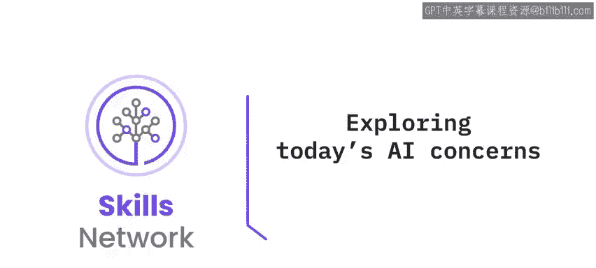
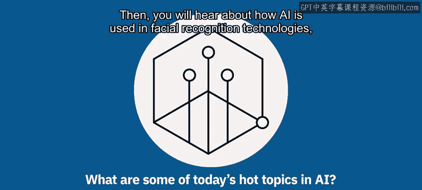
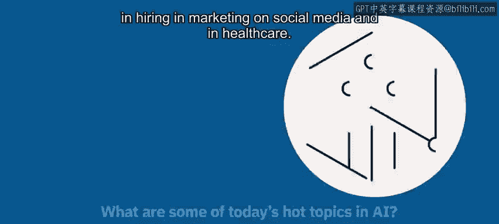
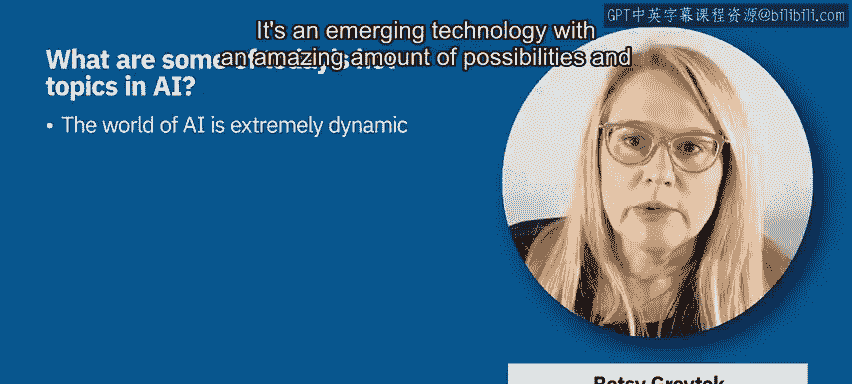
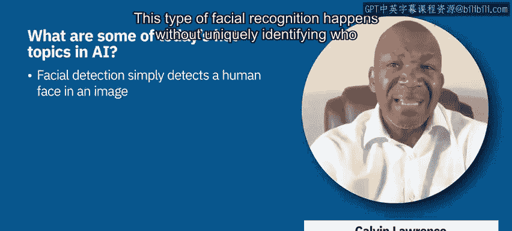
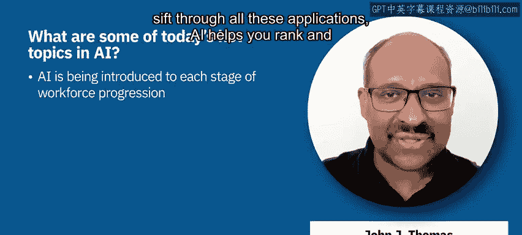
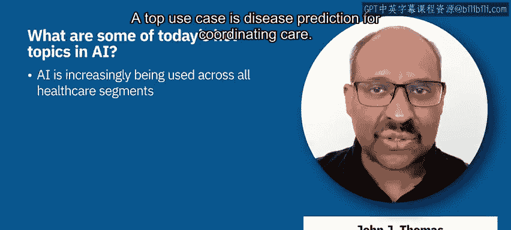

# IBM应用人工智能（从0开始搭建AI机器人）｜IBM Applied AI （中英字幕） - P20：19_探索当今的AI关注点.zh_en - GPT中英字幕课程资源 - BV1p64y1H7LM

Welcome to exploring today's AI Cons In this video。

 you will learn about some of today's hot topics in AI。First。

 you will hear about why trustworthy AI is the hot topic in AI。

 then you will hear about how AI is used in facial recognition technologies， in hiring。

 in marketing on social media， and in healthcare。

People frequently ask me what are current hot topics in AI and I will tell you that whatever I answer today is likely to be different next week or even by tomorrow。

 the world of AI is extremely dynamic， which is a good thing。

 it's an emerging technology with an amazing amount of possibilities and the potential to solve so many problems so much faster than what we thought was before possible。

Now， as we've seen， in some cases， it can have harmful consequences。

And so I would say that the hot topic in AI is how do we do this responsibly？

And IBM has come up with five pillars to address this issue。

 kind of summarizing the idea of responsible AI that is explainability， transparency， robustness。

 privacy and fairness， and we can go into those topics in more depth。

But I want to emphasize two things here， and one is that this is not a one and done sport。

If you're going to use AI， if we're going to put it into use in society。

This is not something you just address at the beginning or at the end。

 this is something you have to address throughout the entire life cycle of AI。

 these are questions you have to ask whether you're at the drawing board。

 whether you're designing the AI， you're training the AI or you have put it into use。

 or you are the end user who's interacting with the AI。

 and so those five pillars or things you want to constantly think about throughout the entire lifecycl of AI。

And then second， and I think even more importantly is this is a team sport。

 we all need to be aware of both the potential good and the potential harm that comes from AI and encourage everybody to ask questions。

 make room for people to be curious about how AI works and what it's doing and with that I think we can really use it to address。

Good problems and have some great results。And mitigate any of the potential harm。So。Stay curious。

In designing solutions around artificial intelligence， some we call it AI。

 facial recognition has become a permanent use case。

There are really three typical examples or categories of models and algorithms that are being designed。

 facial detection that's simply detecting whether an object is a human face versus just say a dog or a cat。

 this type of facial recognition happens without uniquely identifying who that face might belong to。

In facial authentication you might use this type of facial recognition to open up your iPhone or your Android device in this case we provide a one to one authentication by comparing the features of a face image with a previously still a single out image meaning that you are really only comparing the images with the distinct image of the owner of the iPhone or or Android device facial match and in this case we compare the image with a database of other images or photos just as different from the previous and that the model is trying to determine a facial match of an individual identity database for images belonging or or photos belonging to other humans。

 there are many different examples of facial recognition。

 many of them you have are no doubt experiencing your dayto-day activity some have proven to be helpful while others have shown to be not so helpful and then there are others that are proven to be that right criminal。

In nature where certain demographics of people have been harmed because of the use of these facial recognition systems。

We've seen facial recognitions and systems and solutions in AI systems provide significant value。

In scenarios like navigating through an airport or going through secure security line or or even using previous examples like the one we we talked about earlier where facial recognition to unlock your iPhone or possibly to unlock your home or to unlock a door in in your automobile。

 these are all helpful uses of facial facial recognition take that technologies。

 but they are also some clear examples and use cases that must be off limitss。

 these might include identifying a person and a crowd without the sole permission of that person or doing mass surveillanceil on a single or group of people。

 these types of uses of technology races， important privacy civil rights and human right concerns when used the wrong way by the wrong people and facial recognition technologies no doubt can be used to。

suppresspress， dissent or infringe upon the rights of minorities or to simply just erase your basic expectations of having privacy。

AI is being increasingly introduced into each stage of workforce progression。Hiring， onboarding。

 career progression， including promotions and awards。Handling attrition， et cetera。 Stboard hiring。

Consider an organization that receives thousands of job applications。

 people applying for all kinds of jobs， front office， back office， seasonal， permanent。

Instead of having large teams of people sit and sift through all these applications。

AI helps you rank and prioritize applicants against targeted job openings。

Presenting a list of the top candidates to the hiring managers。

AI solutions can process text in resumes and combine that。

With other structured data to help in decision making。

Now we need to be careful to have guardrails in place。

We need to ensure the use of AI in hiring is not biased across sensitive attributes。

Like a gender ethnicity and the like。Even when those attributes are not directly used by the AI。

 but maybe creeping in。Coming in from proxy attributes like zip code are。Type of job previously held。

One of the hot topics in AI today is its application and marketing on social media。

It has completely transformed how brands interact with their audiences on social media platforms like TikTok。

 LinkedIn， Twitter， Instagram， Facebook。AI today can create ads for you。

It can create social media posts for you， it can help you target those ads。Appropriately。

 it can use sentiment analysis to identify new audiences for you。

All of this drives incredible results for marketeer。

It improves the effectiveness of the marketing campaignsally reducing the cost of running those campaigns。

Now。The scene。Techniques and capabilities that AI produces for doing marketing on social media platforms also raises some ethical questions。

The marketing is successful because of all of the data and social media platforms collect from their users ostensibly。

 this data is collected to deliver more personalized personalized experiences for end users。

It's not always explicit what data has been collected and if you are providing your。

Consent for them to use as data。Now， the same techniques that are so effective for marketing campaigns or brands can also be applied for generating misinformation。

 conspiracy theories， whether it's political or scientific misinformation。

And this has horrendous implications for our communities at large。

This is why it is absolutely critical that all enterprises adhere to some clear principles around transparency。

 explainability， trust， privacy in terms of how they use AI or build AI into their solutions into their platforms。

The use of AI is increasing across all healthcare segments。Healthcare providers， pays， life sciences。

 etca。Payer organizations are using AI and machine learning solutions that tap into claims data。

Often combining it with other data sets like social determinants of health。

A top use case is disease prediction for coordinating care。

For example。Predicting who in the member population is likely to have an adverse condition。

Maybe like an ER visit in the next three months and then providing the right forms of intervention and prevention。

Equitable care becomes very important in this context。

 we need to make sure the AI is not biased across sensitive attributes like age， gender， ethnicity。

 etc across all of these， of course， conversational AI。Where virtual agents。

 as well as systems that help humans better service the member population。

That has become table stakes。Across all of these use cases of AI in healthcare we see a few common things。

Being able to unlock insights from the rich sets of data the organization owns。

Improving the member or patient experience。And having guardrails in place。

To ensure AI is trustworthy。