# IBM应用人工智能（从0开始搭建AI机器人）｜IBM Applied AI （中英字幕） - P22：21_定义AI伦理.zh_en - GPT中英字幕课程资源 - BV1p64y1H7LM

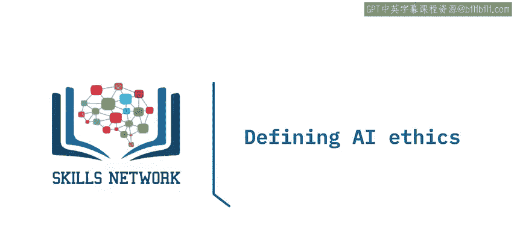

Welcome to defininging AI Eics。

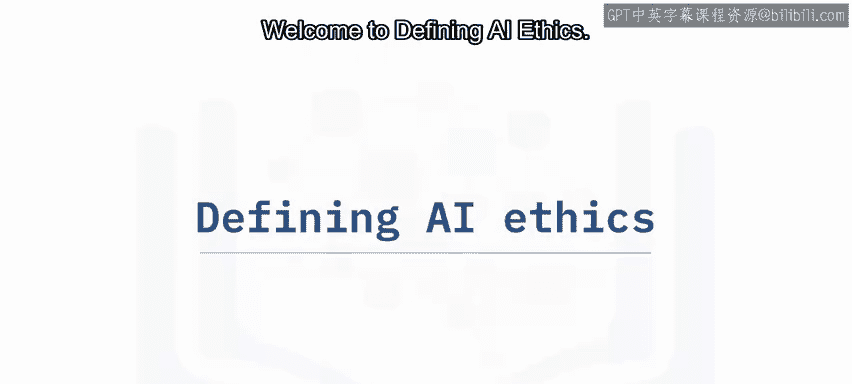

Humans rely on culturally agreed upon morals and standards of action or ethics to guide their decision making。

 especially for decisions that impact others。

As AI is increasingly used to automate and augment decision making。

 it is critical that AI is built with ethics at the core。

 so its outcomes align with human ethics and expectations。

AI ethics is a multidisciplinary field that investigates how to maximize AI's beneficial impacts while reducing risks and adverse impacts。

It explores issues like data responsibility and privacy， inclusion， moral agency， value alignment。

 accountability and technology misuse to understand how to build and use AI in ways that align with human ethics and expectations。

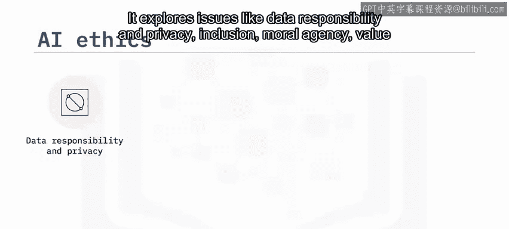

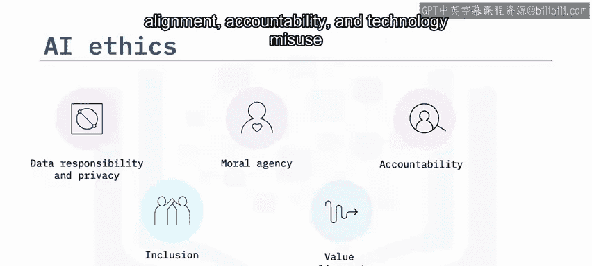

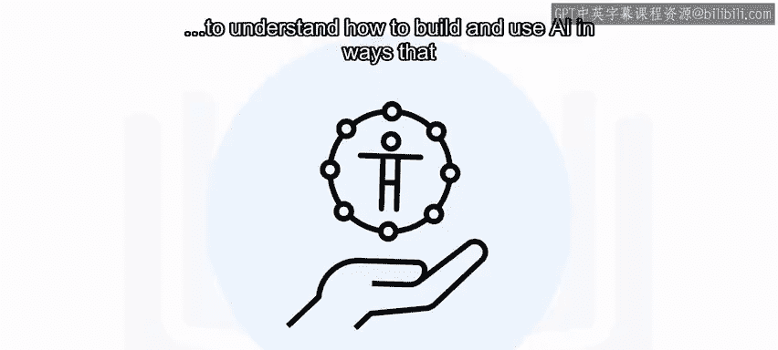

There are five pillars for AI ethics， explainability， fairness， robustness， transparency。

 and privacy。

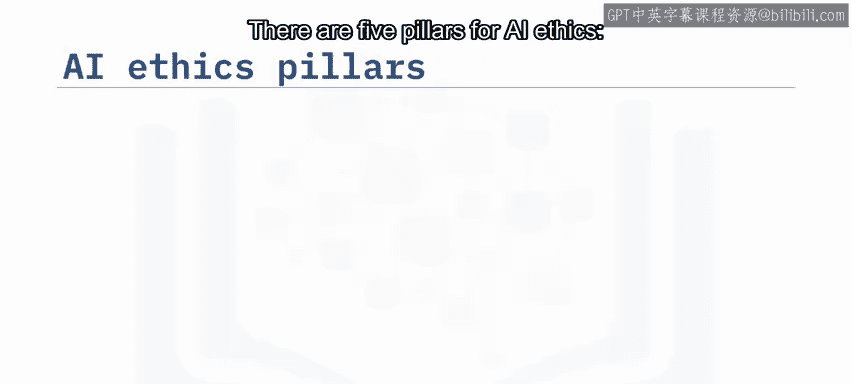

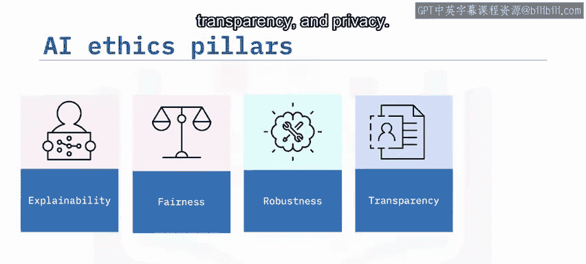

These pillars are focus areas that help us embed ethical principles in AI systems。

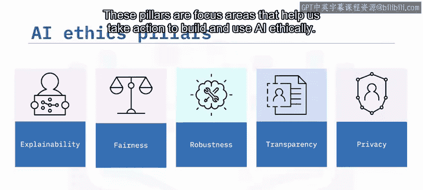

Explainability AI is explainable when it can show how and why it arrived at a particular outcome or recommendation。

 you can think of explainability as an AI system showing its work。

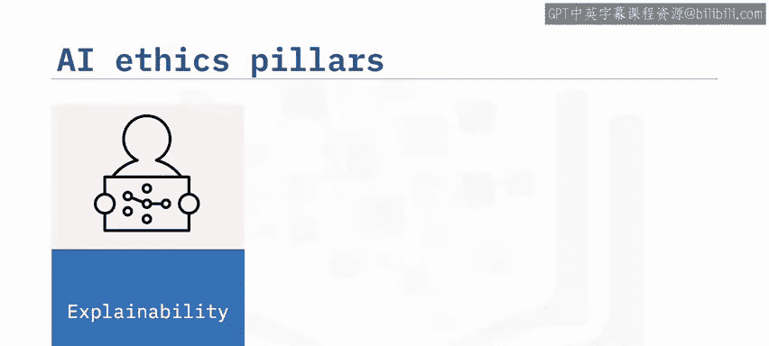

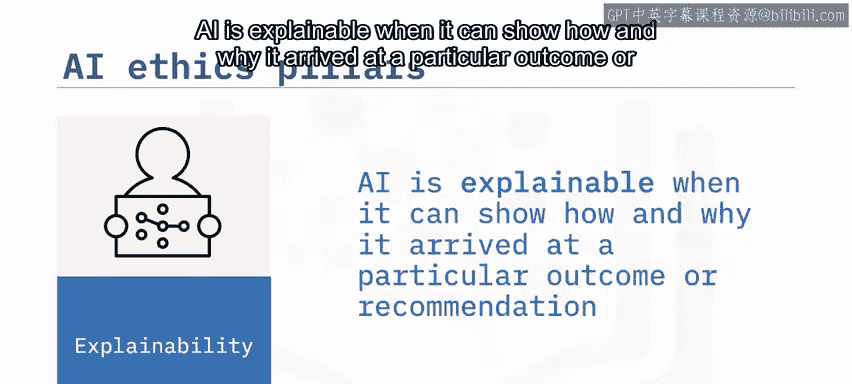

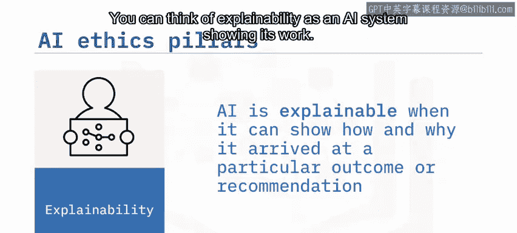

Fairness AI is fair when it treats individuals or groups equitably AI can help humans make fairer choices by counterbalancing human biases。

 but beware biases can be present in AI too， so steps must be taken to mitigate it。

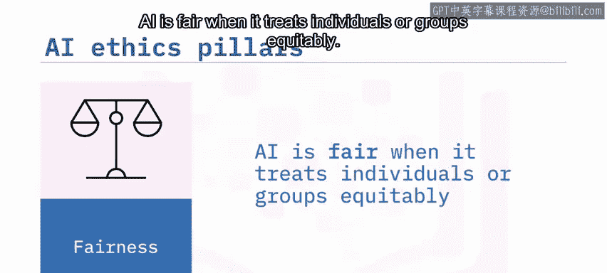

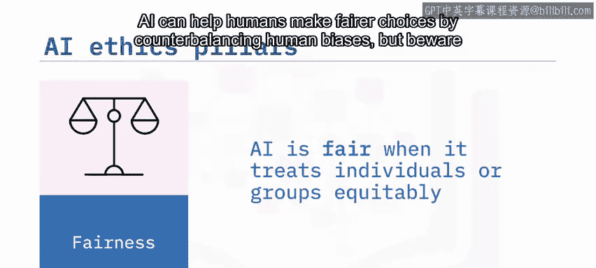

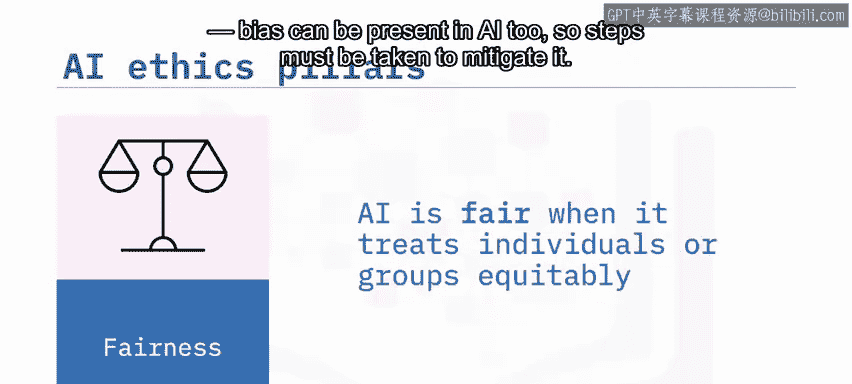

Robustness AI is robust when it can effectively handle exceptional conditions like abnormal input or adversarial attacks。

 Rob AI is built to withstand intentional and unintentional interference。

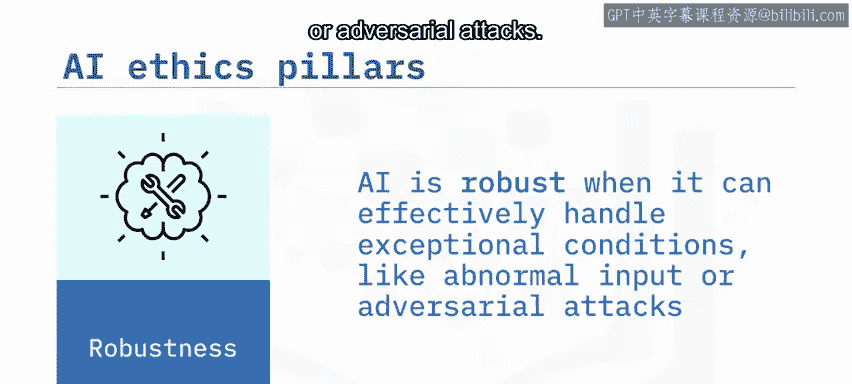

Transparency。AI is transparent when appropriate information is shared with humans about how the AI system was designed and developed。

Transparency means that humans have access to information。

 like what data was used to train the AI system， how the system collects and stores data。

 and who has access to the data the system collects。Privacy。Because AI ingests so much data。

 it must be designed to prioritize and safeguard humans privacy and data rights AI that is built to respect privacy collects and stores only the minimum amount of data it needs to function。

 and collected data should never be repurposed without users' consent among other considerations。

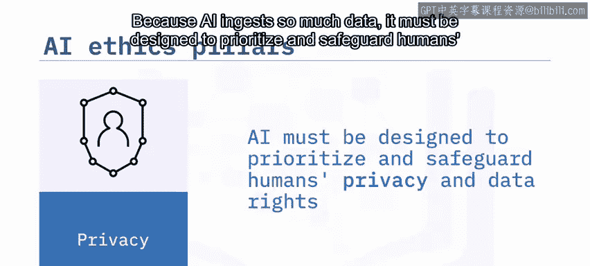

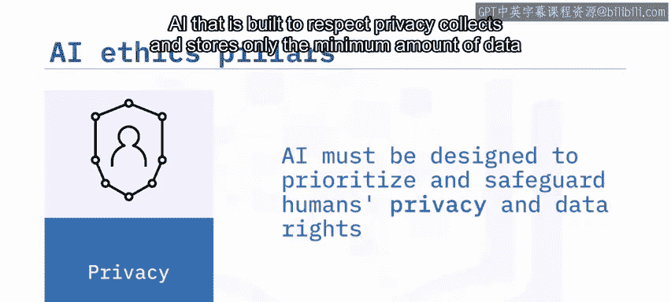

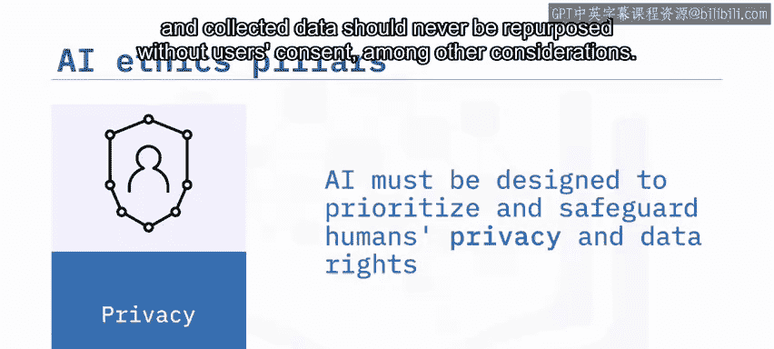

In summary， together these five pillars， explainability， fairness， robustness， transparency。

 and privacy， help us to design， develop， deploy， and use AI more ethically。

 and to understand how to build and use AI in ways that align with human ethics and expectations。

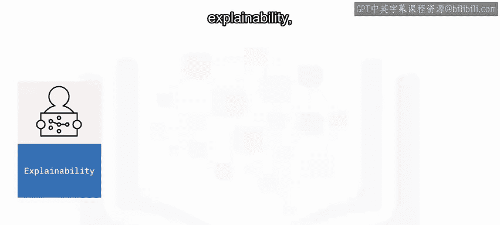

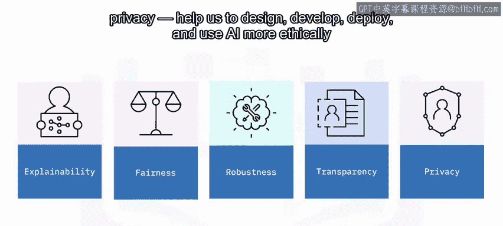

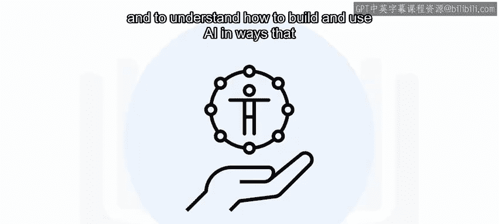

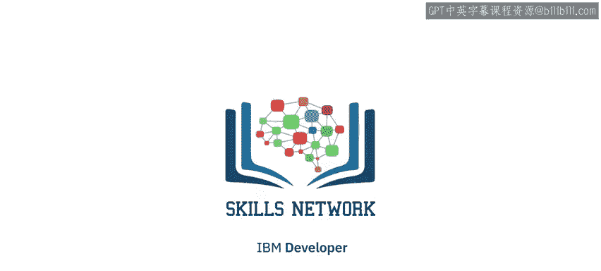