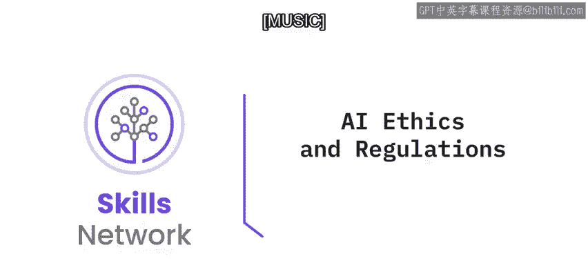
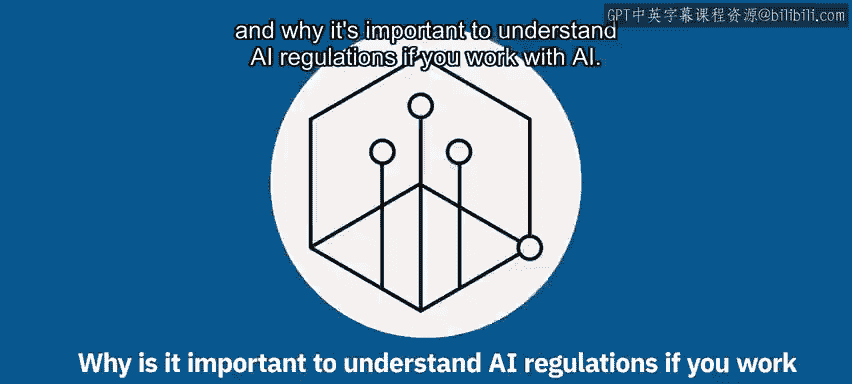
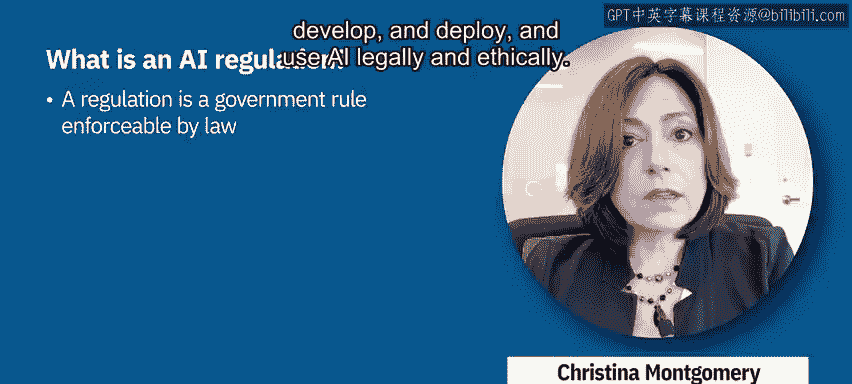
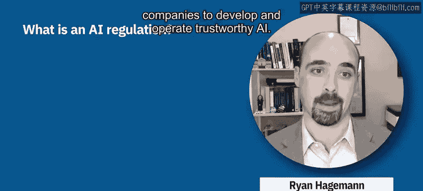
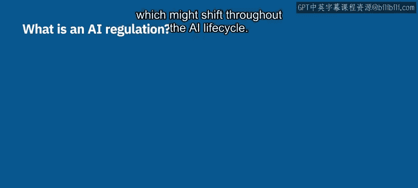
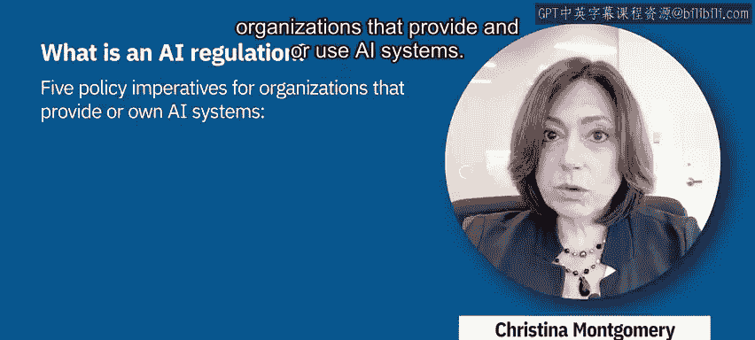

# IBM应用人工智能（从0开始搭建AI机器人）｜IBM Applied AI （中英字幕） - P24：23_AI伦理和法规.zh_en - GPT中英字幕课程资源 - BV1p64y1H7LM

Welcome to AI Ethics and Regs In this video， you will learn about what an AI regulation is。

 how AI regulations connect with AI ethics， and why it's important to understand AI regulations if you work with AI。

A regulation is a government rule enforceable by law。

 the landscape of regulations around AI is evolving rapidly。

it's important to understand key pieces of regulation in order to design， develop。

 and deploy and use AI legally and ethically。

IBM's position is that we call for precision regulation of artificial intelligence。

 and we support targeted policies that would increase the responsibilities for companies to develop and operate trustworthy AI。

 precision regulation of AI refers to a regulation that aims to be risk based context specific and which allocates responsibility to the party that is closest to the risk。

 which might shift throughout the AI life cycle。

Specifically， IBM has proposed a precision regulation framework that incorporates five policy imperatives for organizations that provide and or use AI systems。

First， designate an AI ethics official， a lead official responsible for compliance with trustworthy AI。

Develop different rules for different risks， in other words， regulate AI in context。

 not the technology itself。Don't hide your AI， make it transparent。Explain your AI。

 so in other words， make it explainable， not a black box decision。And test your AI for bias。

