# IBM应用人工智能（从0开始搭建AI机器人）｜IBM Applied AI （中英字幕） - P33：0_专业化简介.zh_en - GPT中英字幕课程资源 - BV1p64y1H7LM

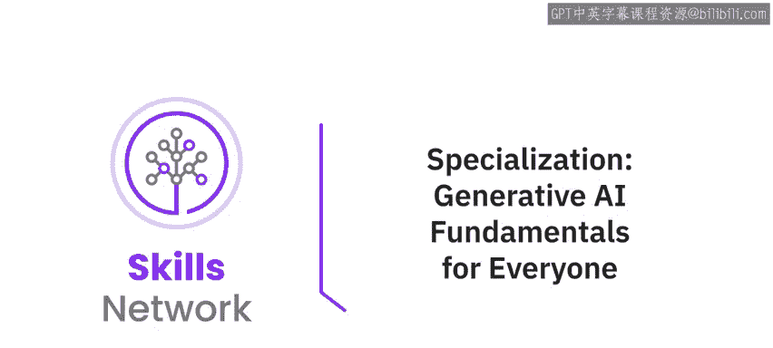

Did you know that marketers across the world are already using generative AI to create content。

 write copy， inspire， creative thinking， analyze market data， and generate images？

According to Bloomberg， the generative AI market is estimated to reach $1。3 trillion by 2032。

 In that case， you definitely want to get better acquainted with generative AI。

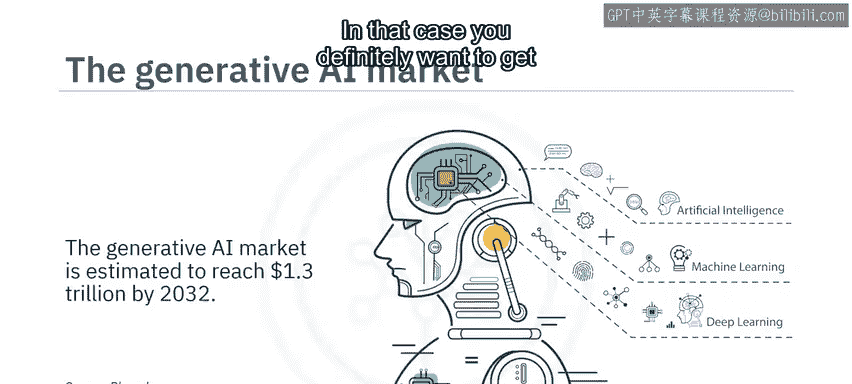

However， is generative AI for everyone。 Yeah， it is。

 And you can leverage its potential to create a better career and life for yourself。

 This specialization is for anyone who's passionate about discovering the power of generative AI prior technical knowledge or background in AI is not required。

 Even beginners can benefit from this specialization as it provides a comprehensive understanding of the fundamental concepts。

 models， tools and applications of generative AI by the end of this specialization。

 you'll be able to explain the fundamental concepts， capabilities， models， tools。

 applications and platforms of generative AI foundation models Discscribe prompt engineering and apply powerful prompt engineering techniques to write effective prompts and generate desired outcomes from AI models Disc the limitations of generative AI and explain the ethical concerns and considerations for the responsible use of generative AI and recognize the ability of generative AI to enhance your career and help implement improvements at your workplace。

 Sp across five focus self paced courses， each required。😊。

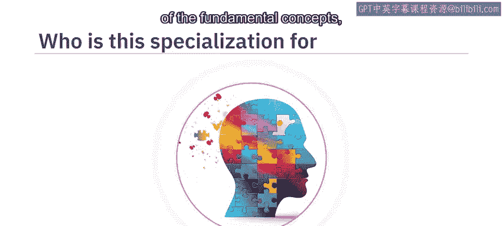

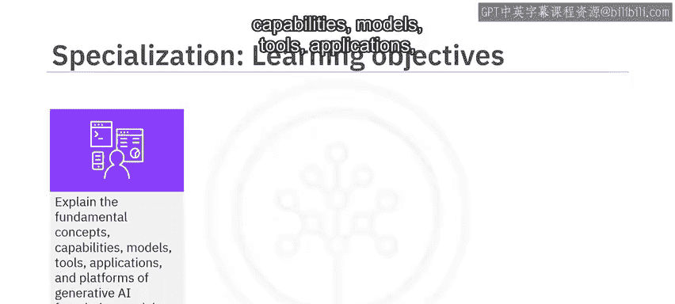

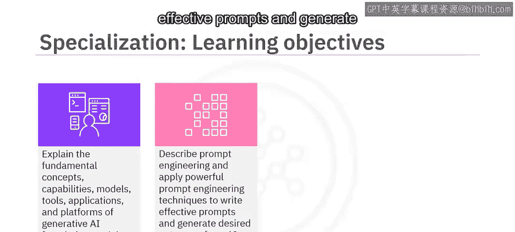

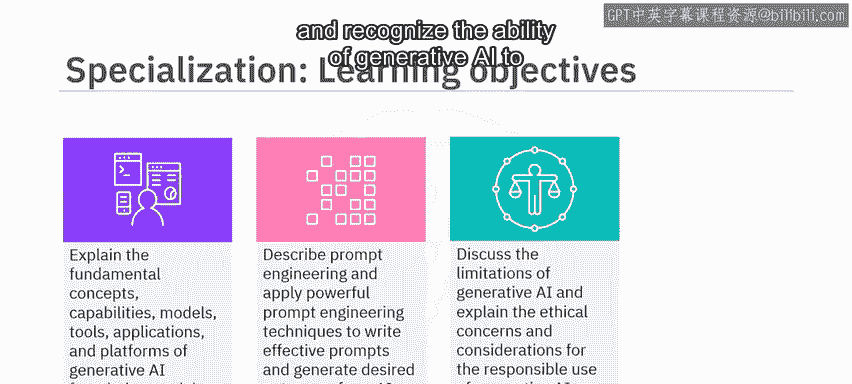

3 to5 hours to complete Cose1 is your first step toward understanding the capabilities of generative AI。

 which span different domains such as text， image， audio， video， virtual world， code and data。

 You'll understand how different sectors and industries apply common generative AI models and tools such as GT。

 Dolly， stable diffusion， IBM， granite and synthesia。

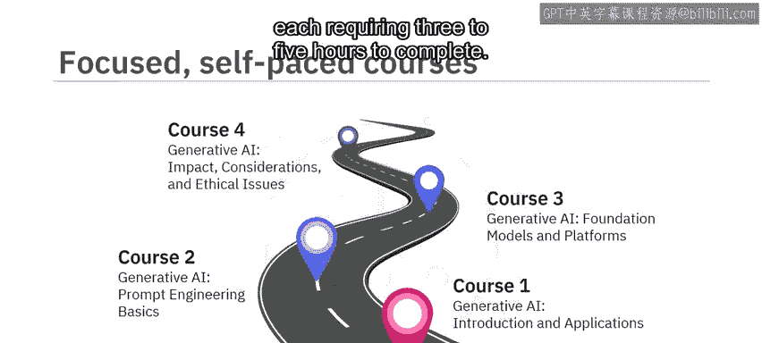

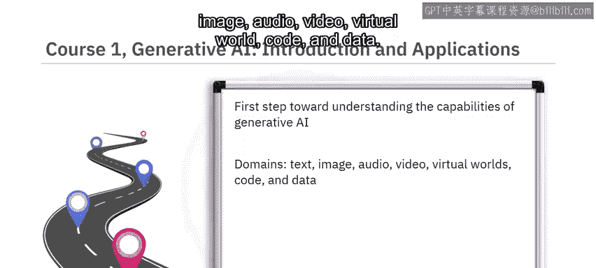

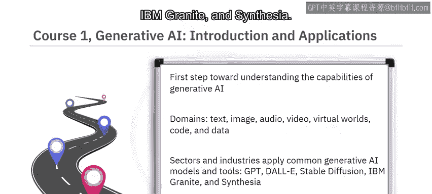

Course 2 introduces the concept of prompt engineering and how it can help you unlock the full potential of generative AI tools like chat GPT。

 You'll explore the techniques， approaches and best practices for developing effective prompts and work with commonly used tools such as IBM Watson X。

 Pro La， spellll book and dust Coourse 3 focuses on the core concepts and building blocks of generative AI。

 such as deep learning， Transformer based large language models。

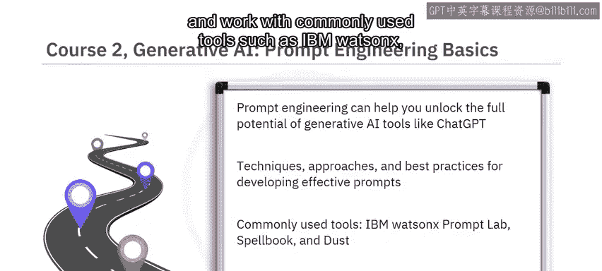

Diffusion models and foundation models you'll also learn about the different generative AI platforms like IBM Watson X。

 AI and HugingFace。

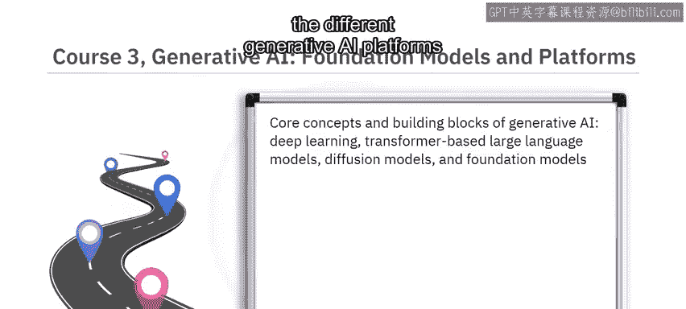

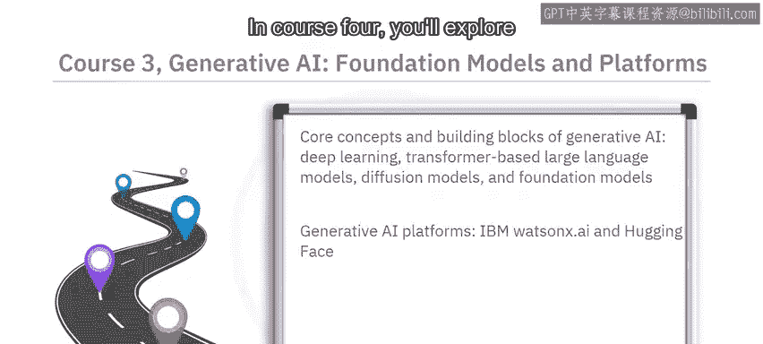

In Cose 4， you'll explore ethical considerations related to generative AI。

 how does it impact data privacy and security， copyright infringement。

 the workforce and the environment。You'll also describe limitations such as data bias。

 lack of explainability， transparency， and interpretability。

 and identify common misuses of generative AI such as deep fakes and hallucinations。

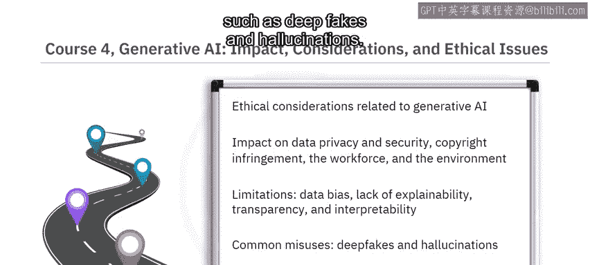

Lastly， Cose5 discusses the future of generative AI Don't you want to know what your career opportunities are in that future？

You'll learn how generative AI can impact and enhance existing functions。

 skills and job roles in different sectors and industries。

 and how you can use generative AI to build your own applications to create new business opportunities。

 the content in this specialization is designed to engage and empower you by viewing curated concept videos。

 hearing AI experts share their insights and tips and practicing techniques and handson labs and projects。

 you'll feel more confident in using generative AI tools and applications in your daily life。

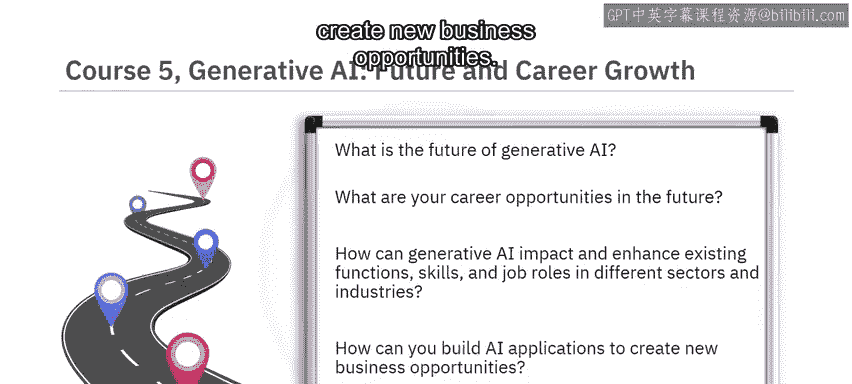

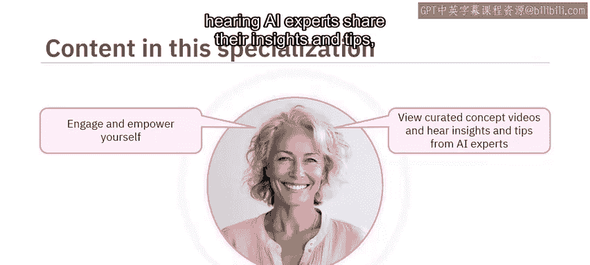

Currently， 65% of generative AI users are millennials are Gen Z and 72% are employed with this specialization。

 you'll be ready to join the generative AI change makers。 generative AI is for everyone。

