# IBM应用人工智能（从0开始搭建AI机器人）｜IBM Applied AI （中英字幕） - P36：3_生成式AI的功能.zh_en - GPT中英字幕课程资源 - BV1p64y1H7LM

Welcome to the capabilities of generative AI After watching this video。

 you'll be able to describe some of the capabilities of generative AI and explore their use in the real world。

 Let's start with a high level overview of some of the capabilities of generative AI that will discuss。

 First is the text generation capability of generative AI。

 That is its ability to generate clear lucid and contextually relevant textual responses。

 The second capabilities， image generation that is synthesizing artistic and realistic images that are very similar to real ones。

 The third capabilities， audio generation， generative AI enables music composition and synthetic audio generation。

 The fourth capability we' discuss is video generation。

 generative AI enables the generation of dynamic films and small videos based on textual descriptions and even images。

 The fifth capability is the codegen capability of generative AI。

 generative models can generate code functions and programs。

 will also discuss the data generation and augmentation capability of generative AI。

 This helps generate synthetic data to create and augment data sets。 Finally。

 we'll explore generative AI。😊。

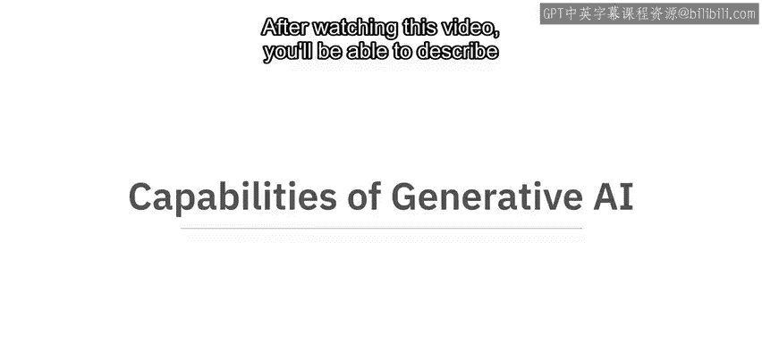

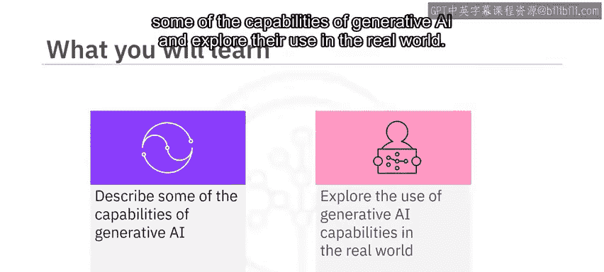

Caability to create real and immersive virtual worlds。

 These are just some of the capabilities of generative AI。

 essentially whatever the human mind is capable of conceiving is a potential use case for the application of generative AI。

 Now， let's delve deeper into some of these capabilities。

 Let's begin with the text generation capabilities of generative AI at the core of generative AI's text generation capabilities are advanced AI powered large language models or LLms LLms are trained on large data sets and can generate humanlike text in various contexts。

 These models learn patterns and structures within the data to generate coherent and contextually relevant responses。

 These models generate text converse and provide explanations， summaries and more。

 Some popular LLms are open AI's generative pretrained transformer or G and Google's pathways language model or P。

 These models can perform various language related tasks such as text completion。

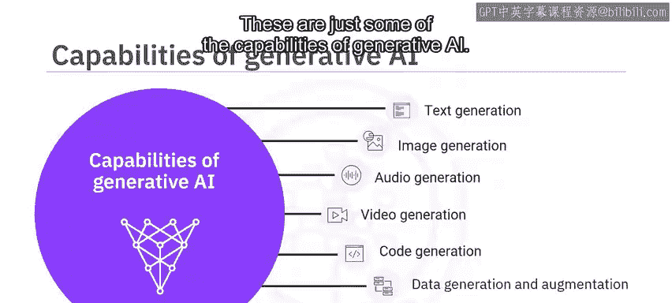

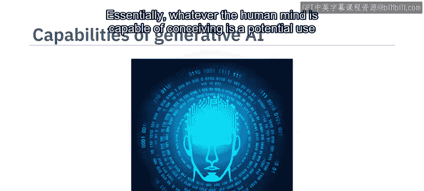

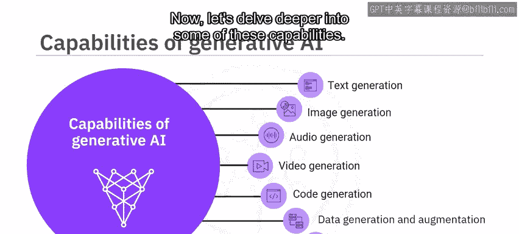

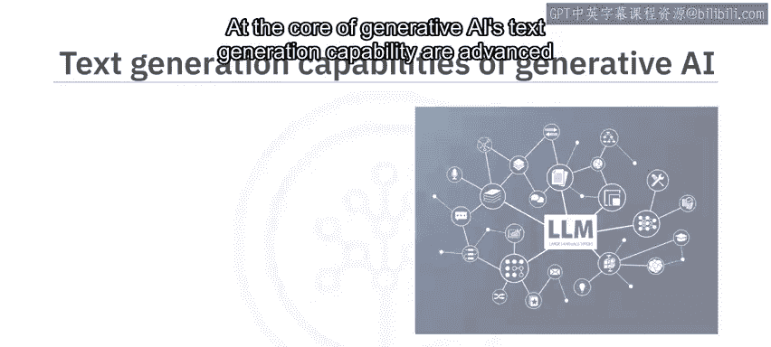

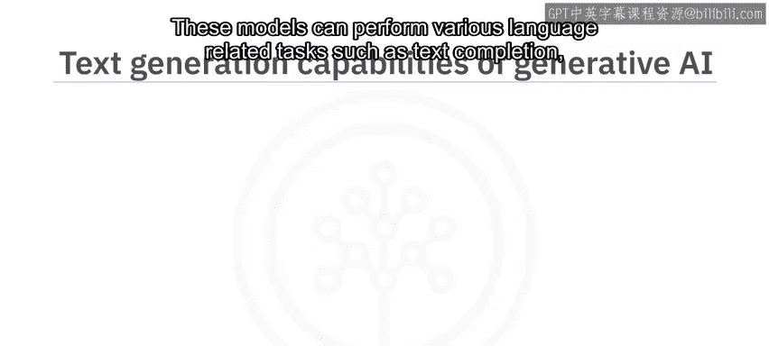

Summarization， question answering， translation， cogeneration and image and text pairing。

 conversational interactions with chatbots and virtual assistants are powered by LLms。

 Let's look at the image generation capabilities of generative AI generative models can generate high quality convincing images based on deep learning techniques such as generative adversarial networks organs and variational autoenrs or VAs。

 These generated images exhibit realistic textures， natural colors and fine grainin details。

 giving the impression of a real camera capture。 Stgan， for example。

 can generate high quality high resolution， new images of imaginary faces animals or nature。

 While deep art can create comprehensive artwork from a simple sketch。

 Dll E can generate entirely new images as described by the users Apart from applications in art。

 design， entertainment， gaming and research domains。

 generated images can augment training data and aid medical imaging and scientific visualization。

 In the context of audio generation， generative models can generate new musical compositions。😊。

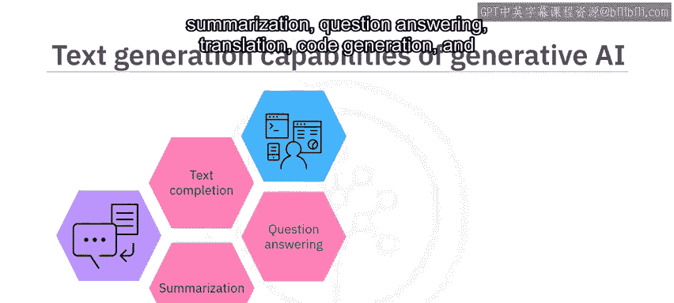

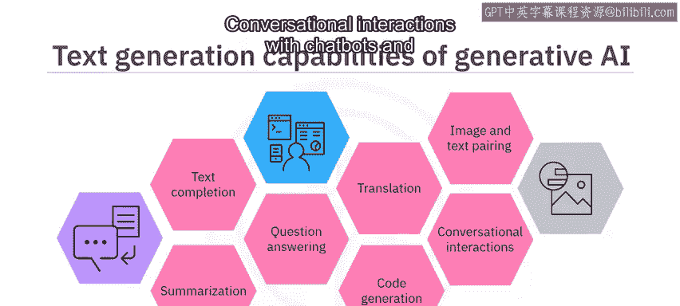

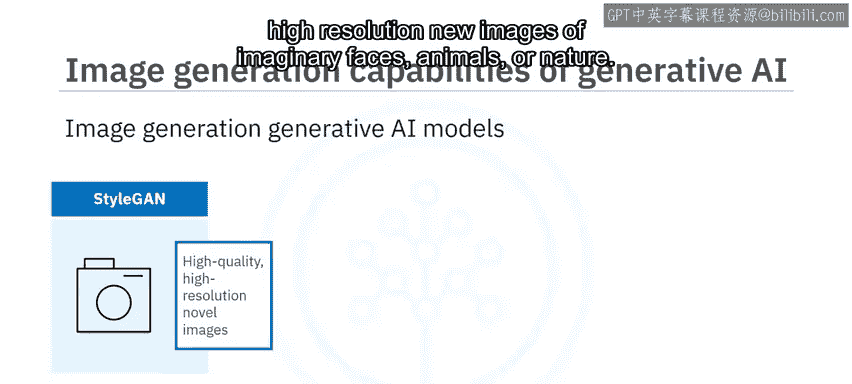

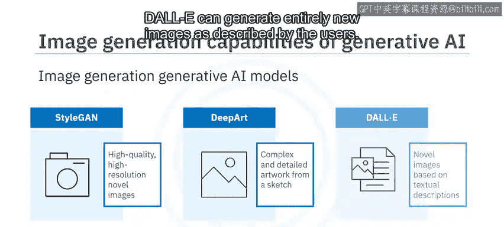

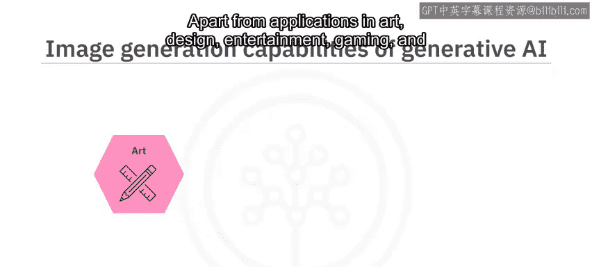

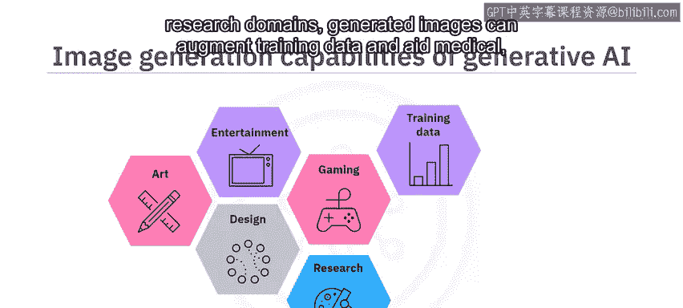

Convert text into audio using text to speech or TtS and create synthetic voices and natural sounding speech generative models can convert。

 modify and transform and clean up voices， also reduce noise and enhance audio quality These models also have the capability to mimic human voice to a fair amount of likeness waveg for example。

 can create new and realistic raw audio waveform including speech。

 music and natural sounds MusNe from open AI can combine various instruments styles and genres to generate novel musical compositions Google's takaron2 and Mozilla Tt use advanced T systems to create synthetic speech resembling human tone pitch。

ulation，nunciation， rhythm and expressions A generated by geneative models as applications in media creativity。

 entertainment， training， gaming virtual reality and several other domains Now let's look at the video generation capabilities of geneative AI geneative AI models can create dynamic and lucid videos ranging from basic animations to complex scenes These models。

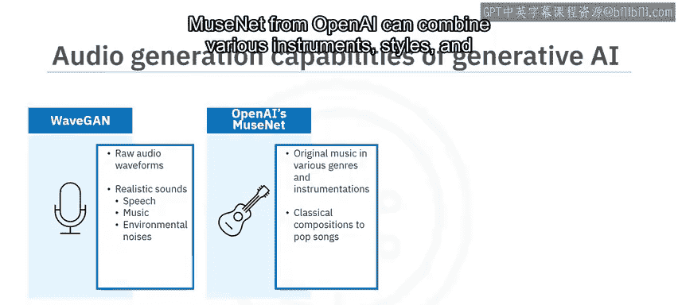

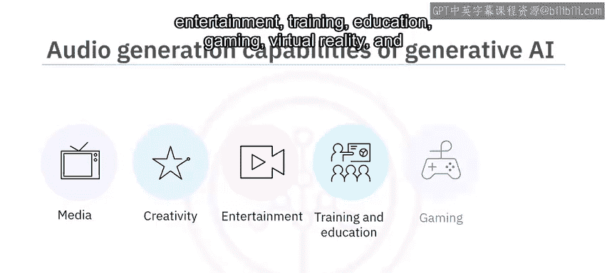

Form images into dynamic videos by incorporating temporal coherence in natural language processing。

 temporal coherence refers to the consistency and continuity of meaning or context over time。

 This enables these models to exhibit smooth motion and plausible transitions in videos。

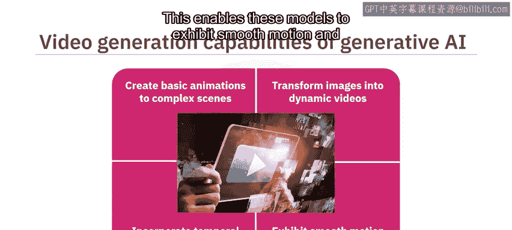

For instance， a popular AI model videoGT follows textual prompts users provide to generate new videos Use can specify the desired content and guide the video generation process。

 including completion， editing synthesis prediction and style transfer these generated videos can be used in domains such as art。

 entertainment， education， gaming medicine and research Now let's talk about geneative AIs code capabilities geneative models can generate new code snippets。

 functions or complete programs based on desired functionality Tra on existing code repositories。

 these models can complete or create code synthesize or refractor code identify and fixed bugs and code test software and create documentation including comments。

 function descriptions and usage examples For instance。

 GiHub copit and IBM Watson code assistant are AI based programming assistance that help autocomple code Ac hard tasks and generate code for provided input AI generated code can be used in software and web development。

 machine learning and natural language processing data science and analytics。

 robotics and automation。

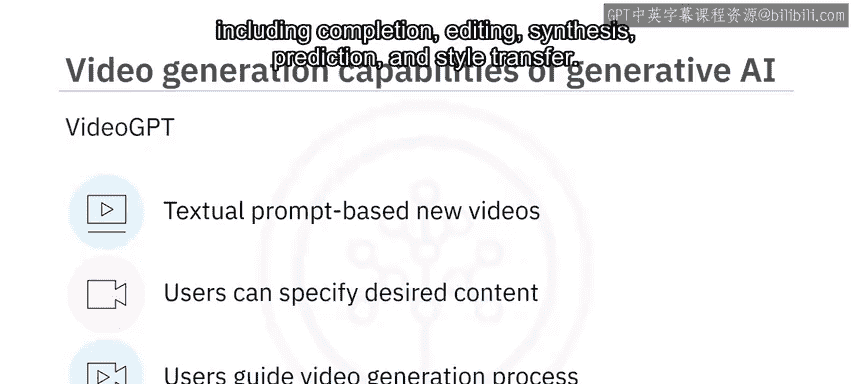

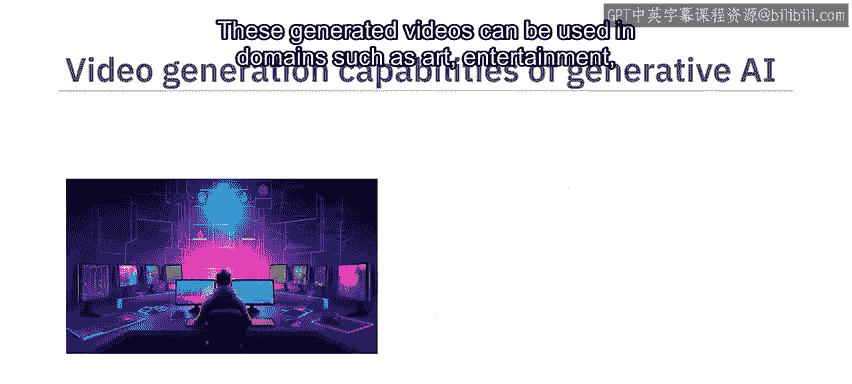

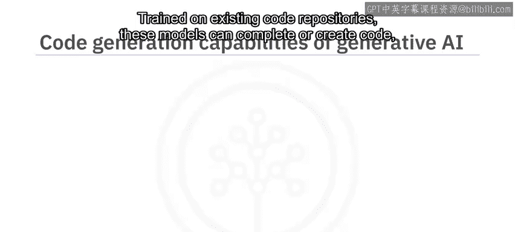

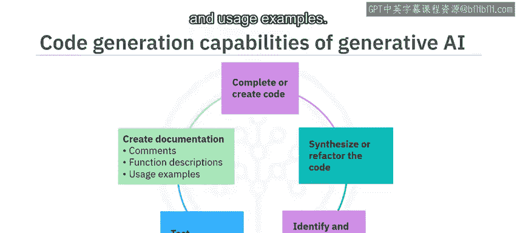

Virtual game and AR VR andviment development， and audio。

 video and speech processing software developers can benefit from leveraging code generation capabilities to write。

 debug and test their code Now let's explore the data generation and augmentation capabilities of generative AI generative models can generate new data and augment existing data sets Gene synthetic data sets helps increase the diversity and variability of the data leading to more robust and effective performance。

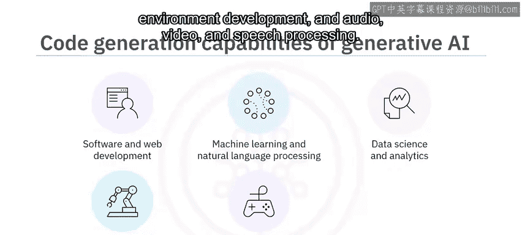

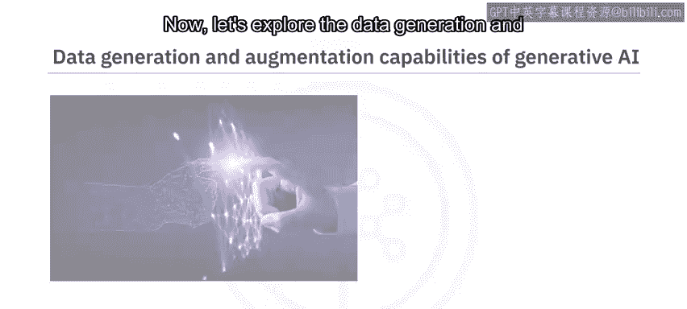

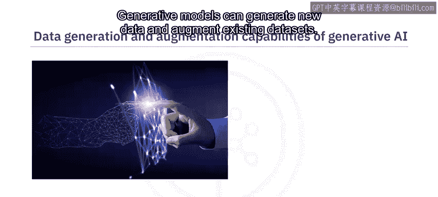

These models can generate new samples and augment data sets for images， text， speech。

 tabular data and statistical distribution， time series， data， finance。

 and more The data generation and augmentation capabilities of generative AI have applications in medicine。

 health， gaming， education and training， art and creativity。

 self-driving automobiles and many more Another powerful capability of generative AI models is their ability to create highly realistic and complex virtual worlds。

 you can create avatars that simulate realistic behavior， expressions， Con and even decisions。

 you can also create complex virtual environments with realistic textures。

 sounds and objects that follow the principles of the physical world。

 Meverse platforms use generative models to create unique and personalized experiences for individual users。

 generative AI also makes it possible to create virtual identities with unique personalities。

 avatars that can be fitted with specific personality traits that reflect in their behaviors and conversations。

 The virtual world capabilities of generative AI as applications and gaming， entertainment。

 education， augmented and virtual。metaverse platforms and also virtual influencers and digital personalities In this video。

 you learned about some of the capabilities of generative AI models and their use in the real world generative AI can create coherent and contextually relevant content and generate realistic high quality images。

 synthetic voices， new audio and dynamic videos and generative AI models can generate and complete code and synthesize new data to augment the existing data sets generative AI models are also capable of creating highly realistic and complex virtual worlds。

 including virtual avatars and digital personalities。

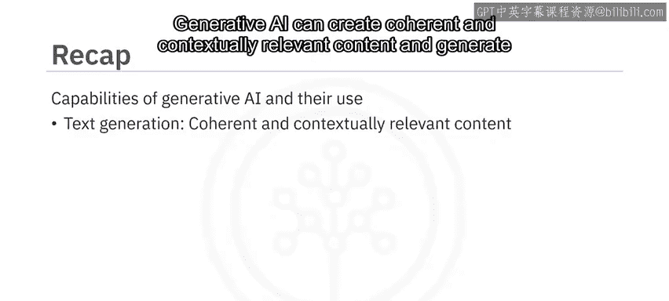