# IBM应用人工智能（从0开始搭建AI机器人）｜IBM Applied AI （中英字幕） - P41：8_代码生成工具.zh_en - GPT中英字幕课程资源 - BV1p64y1H7LM

Welcome to Tool for Co generationeration After watching this video。

 you'll be able to describe the basic capabilities of generative AI for Codegeneration。

 discuss the strengths and limitations of text generating tools for cogeneration。

 and explain the key capabilities of common models and tools for codegeneration。

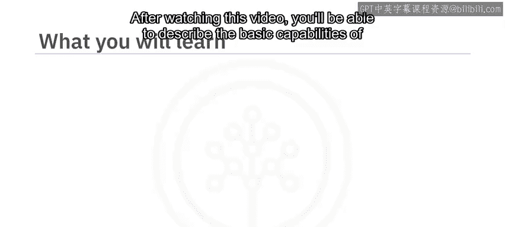

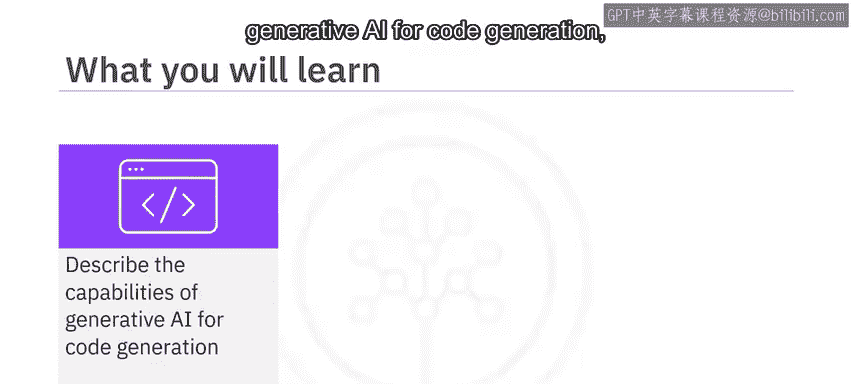

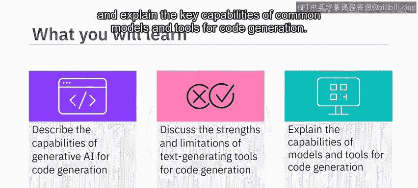

Generative AI models and tools for code generation can generate code based on natural language input。

 based on deep learning and natural language processing or NLP。

 these models comprehend the context and produce contextually appropriate code。

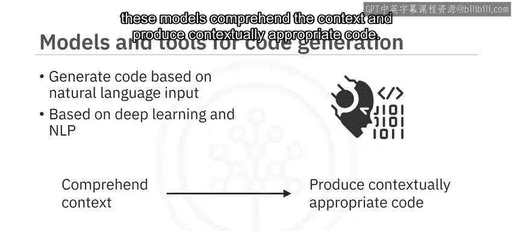

Coode generators can generate a new code snippet or a program from a text prompt。

 They can predict lines of code to complete a partial code snippet。

 They can also produce optimized versions of existing code。 Further。

 these code generators can convert code from one programming language to another。

 They can also generate summaries and comments for code to improve documentation。

 Code generators can also recommend a complete programming solution。

 Describe a problem you're trying to solve and code generators will suggest algorithms。

 data structures and the right programming approaches。

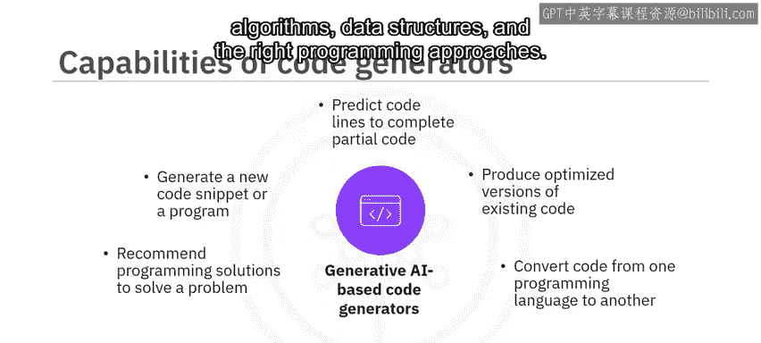

Let's explore the capabilities of GPT for code generation。

 Open AI's GPT excels in human like text generation and demonstrates impressive capabilities in code creation。

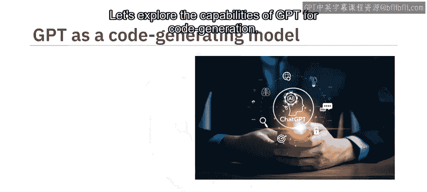

Here's an example of generating simple Python code through chat GT a tool based on GT。

 When you enter a text prompt， write a Python code to generate a message to greet a person。

 chat GT generates the Python code for it。Interestingly。

 it also provides guidelines about how to run this code for generating code。

 it's important that you provide a clear prompt specify the programming language and provide other relevant requirements and constraints to demonstrate how G helps debug code enter incorrect code as a text prompt in chat GT An incorrect code and text are prompted to chat GT。

 chatt GT provides the correct code and explanations of the corrections made。

 GT also enables translating code from one programming language to another。

 It can also generate code documentation and comments to improve readability。

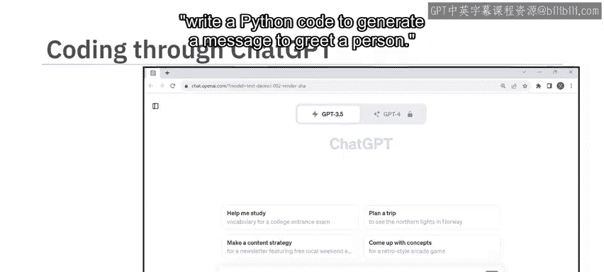

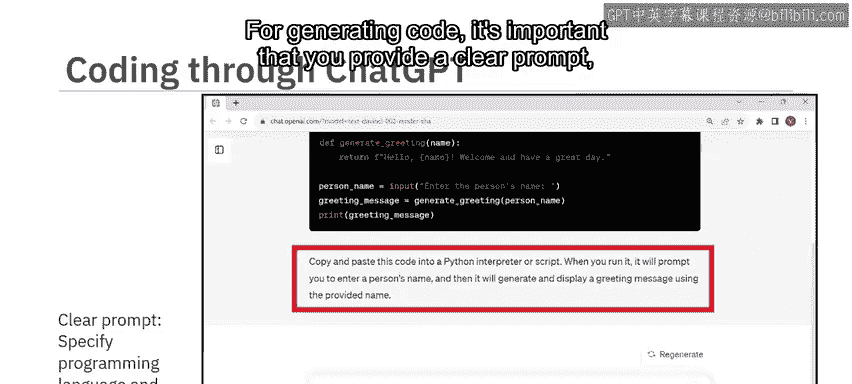

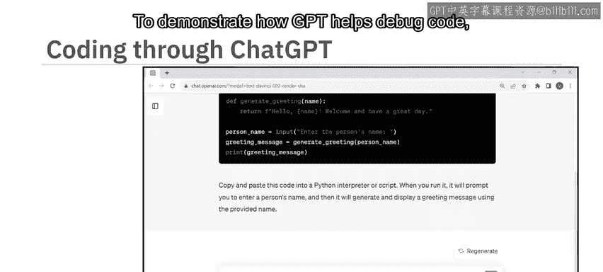

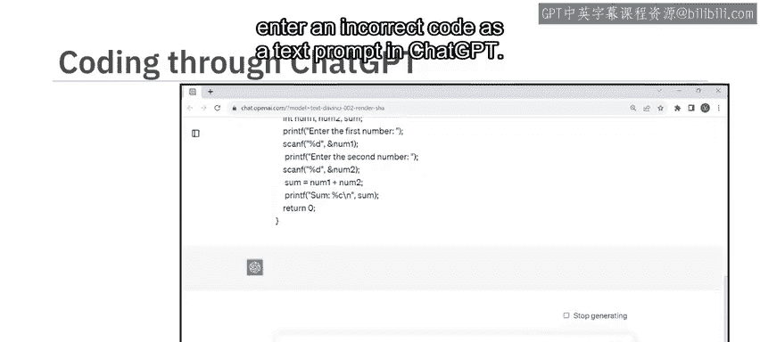

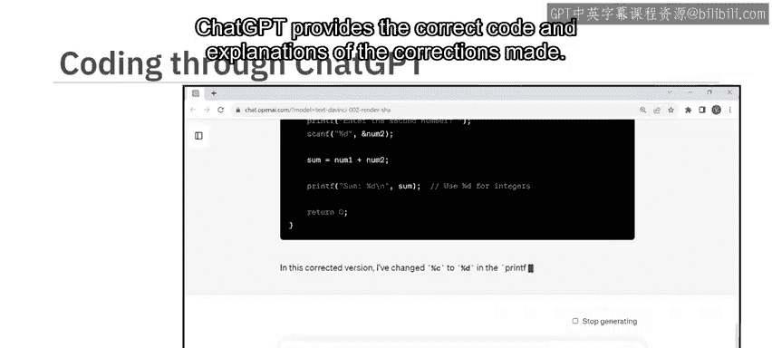

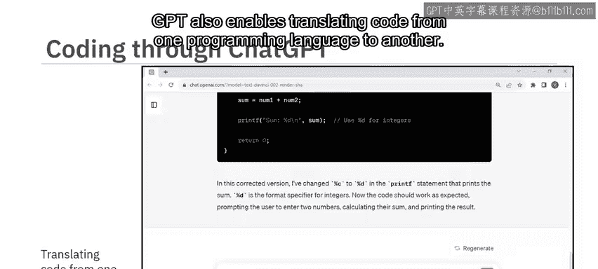

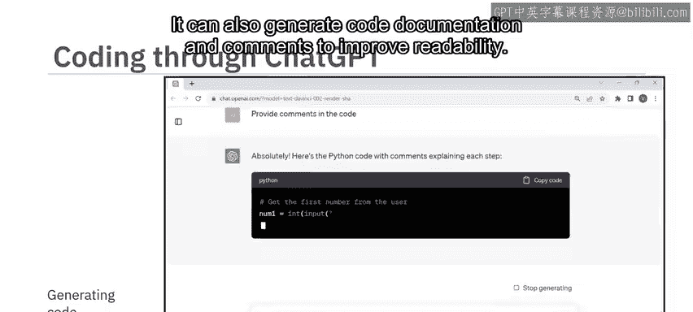

GPT based models and tools have evolved to generate longer and more accurate codes。

 This enables using these models and tools for coding to develop apps， websites and plugins。

 Furthermore， the evolution of GPT makes it possible to generate code from images。 For example。

 you can input the image of a course outline to generate code for a fully functional app。

Google Bard also offers cogen and debugging capabilities in more than 20 programming languages。

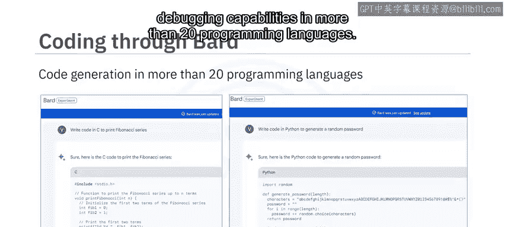

Chat， GPT and Bard are valuable tools for coding or a new programming language because they provide a step by step and detailed explanation for better understanding。

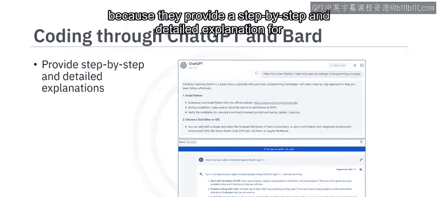

Chat GPT and Bard Excelel at generating code with basic logic and programming concepts。 They may not。

 however， be able to generate large or complex code from scratch。

 And while these tools understand programming concepts and syntax。

 they may not completely understand semantics。 So while the generated code is technically accurate。

 it may still not function as required。 It's important to note that the knowledge of these models is limited to the data they're trained on。

 A specific version of G may not be aware of programming frameworks and libraries released after its training。

 For example， the knowledge of G 3。5 is limited to September 2021。

So if you want a more dated code generator， consider using models and tools designed specifically for code generation。

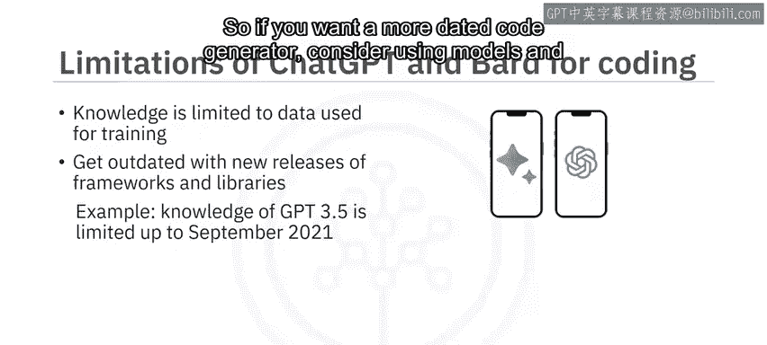

GitHub copiot an AI code generator can generate code based on various programming languages and frameworks。

 Gitthub Copit is powered by open AI codex， which is a generative pre traineded language model。

 It helps developers generate solution based code。 Copilot is trained on natural language text and source code from publicly available sources。

 including Gitthub repositories。 Coilot can be integrated as an extension with popular code editors。

 such as visual studio。 It can produce code snippets that adhere to best practices and industry standards。

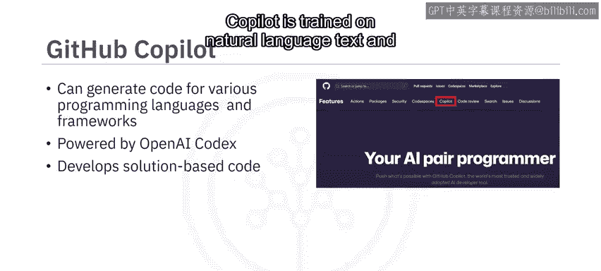

Polycoder is an open source AI code generator， it's based on GPT when trained on data from various GitHub repositories written in 12 programming languages。

 it's particularly accurate for writing C codes Polycoder offers an extensive library of predefined templates that can be used as blueprints for code generation for various use cases Polycoder can help create review and refined code snippets precisely customized to requirements。

Different code generators offer specific functionality and features， however。

 when the requirement is to enable hybrid cloud developers to write code for diverse needs。

 IBM Watson Code assistant is an option。

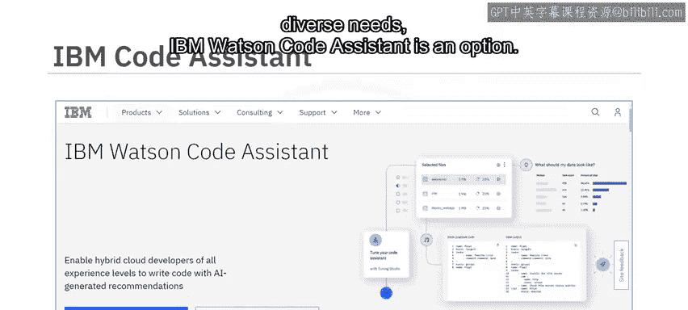

It's built on IBM Watson X。AI foundation models for developers of any skill level。

You can integrate Watson code assistantant with a code editor。

 it enables developers to write code accurately and efficiently with real time recommendations。

 autocomplete features， and code restructuring assistance。Moreover。

 you can input code or project files into Watson code assistant for analysis。 It identifies patterns。

 suggests improvements and generates code， snippets or templates。

 Developers can customize this generated code for specific project needs。

Many other AI driven code generators and code assistant tools are available to help developers write accurate code faster Amazon code Wsperer can be integrated with code editors and offers real time code recommendations。

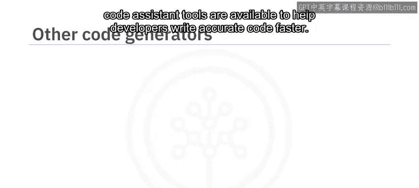

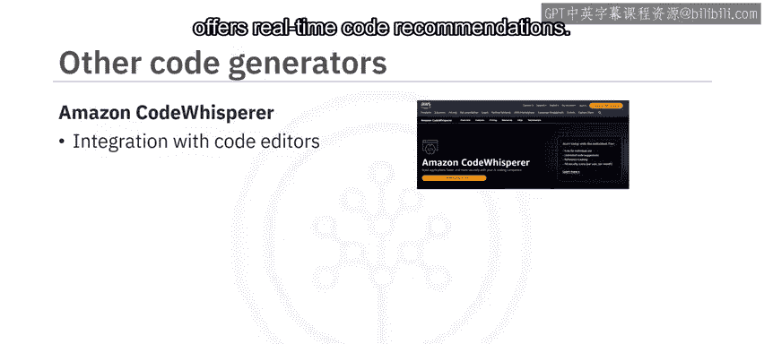

Tab 9 can be helpful for accurate code completions。

Reeplet is a platform that provides an interactive space for users to code， learn， and collaborate。

With automatic code writing and optimization capabilities。

 AI based code generators help developers increase their productivity and quality of code。

 They enable rapid prototyping to iterate on design ideas。

 These tools also help with cross platformat compatibility and migration by enabling multi language code translation。

 AI based code generators follow consistent patterns and coding standards。

 They can suggest refactoring patterns to adhere to best practices。

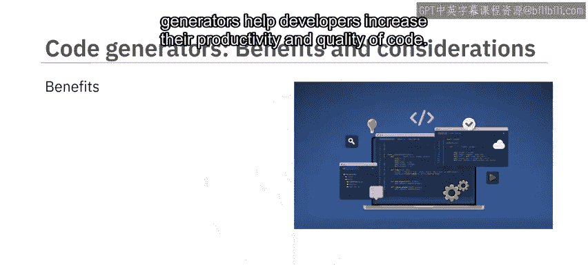

However， these tools should be used with caution to ensure that the AI generated code does not lead to ethical issues；

 for example， security vulnerabilities as these tools may be used for generating malicious data or data biases based on training。

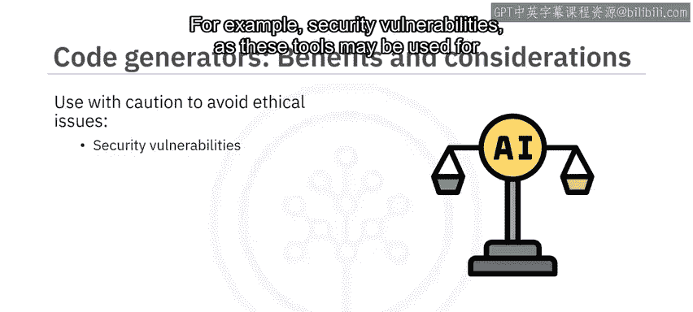

In this video you learned that generative AI based models and tools can generate new code from text and image prompts。

 optimize existing code and produce solution based code。

 chat GPT and borrow are useful for simple code generation， debugging and learning programming。

Prominent code generators like GitHub Copilot， Polycoder and IBM Watson Code Assistant offer varied features such as realtime recommendations。

 code restructuring and solution templates in general， code generators improve productivity。

 accelerate development cycles， promote coding best practices and foster consistent coding standards。

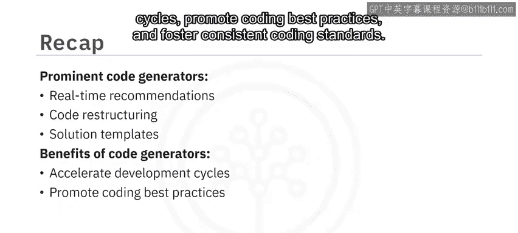

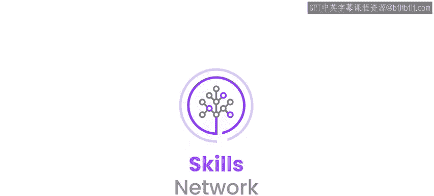