# IBM应用人工智能（从0开始搭建AI机器人）｜IBM Applied AI （中英字幕） - P42：0_课程简介.zh_en - GPT中英字幕课程资源 - BV1p64y1H7LM

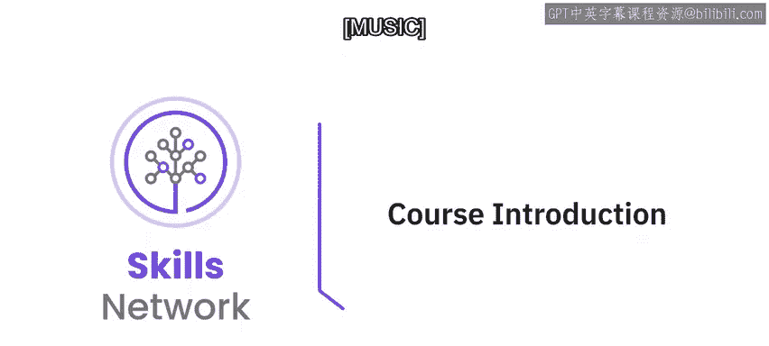

Let's get started with the basics of prompt engineering。

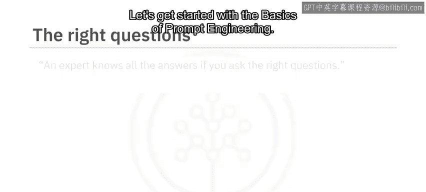

An expert knows all the answers if you ask the right questions。Interestingly。

 this is the same principle on which we design prompts for generative AI models。

 prompts that we use to query and question AI applications such as chatbots， image。

 audio or video generation tools and even virtual worlds prompts optimize the response of generative AI models The power lies in the questions that you ask knowing how to write a prompt that is effective and direct will allow you to generate more precise and relevant content。

 A good question to ask right now is what will I be able to do after completing this course。

 This course invites all beginners whether professionals， enthusiasts。

 practitioners or students who have a genuine interest in learning how to write effective prompts a course for everyone regardless of your background or experience By the end of this course。

 you'll be able to explain the concept and relevance of prompt engineering in generative AI models apply the best practices for creating prompts assess commonly used tools for prompt。

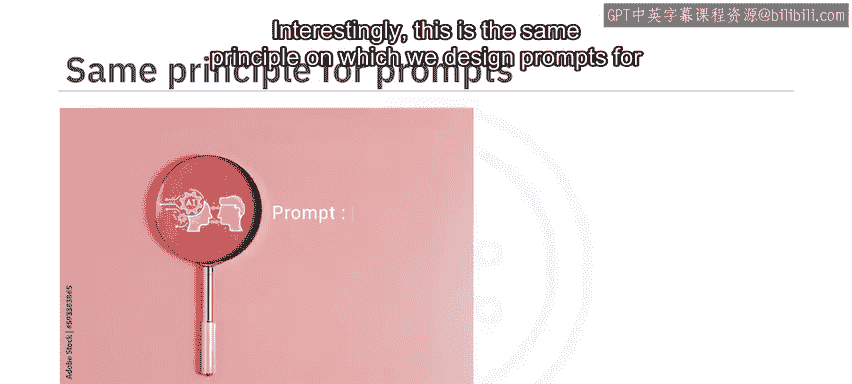

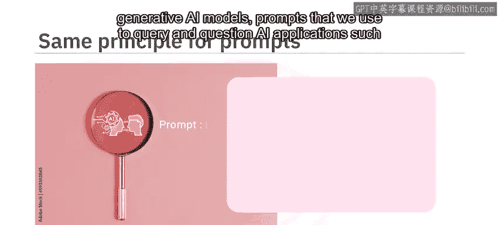

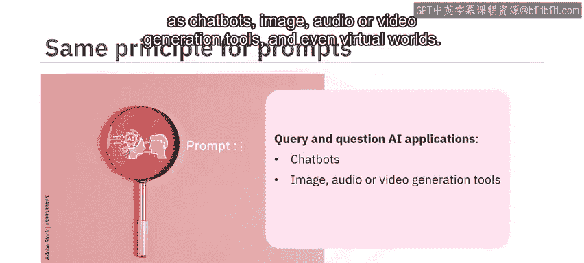

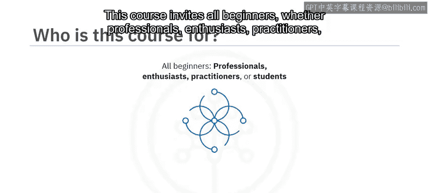

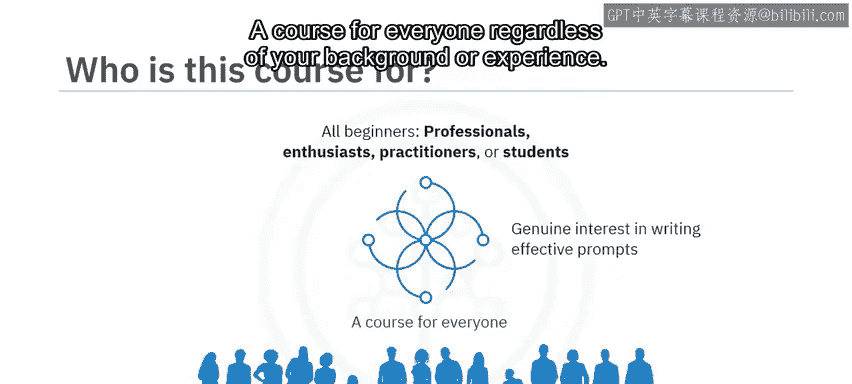

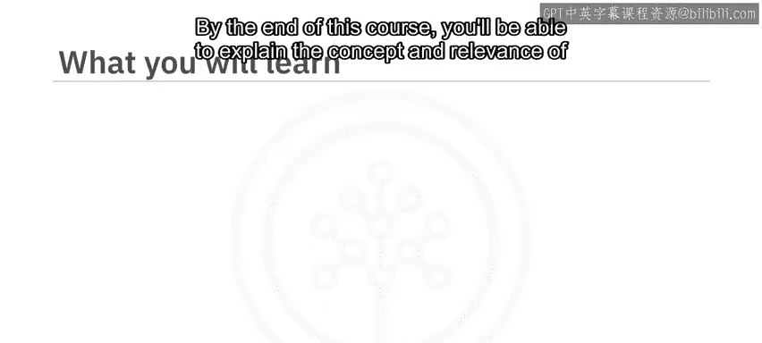

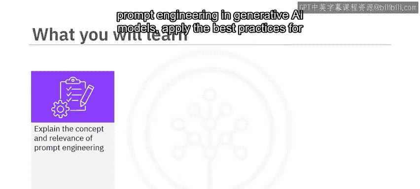

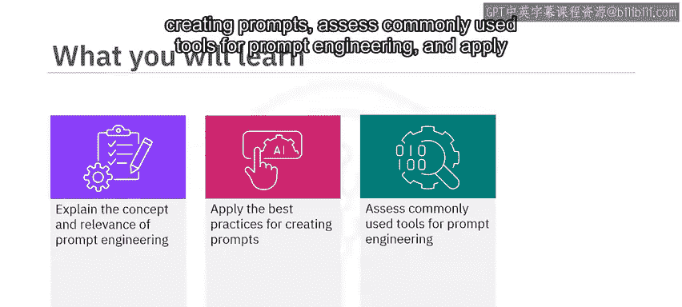

apply common prompt engineering techniques and approaches for writing effective prompts This is a focused course comprising three modules。

 each of which requires one to two hours to complete。

In module 1 of the course， you'll learn about the concept of prompt engineering。

 starting with how to define a prompt and its elements。

 you'll learn to apply the best practices for writing effective prompts and assess common prompt engineering tools。

 such as IBM Watson X prompt lab， spell book and dust in module 2。

 you'll study various prompt engineering approaches like interview pattern。

 chain of thought and tree of thought。 You'll discover techniques for skillfully crafting prompts such as0 shot and few shot。

 to produce precise and relevant responses。 Moule 3 requests your participation in a final project and presents a graded quiz to test your understanding of course concepts。

 You can also visit the course glossary and receive guidance on the next steps in your learning journey。

 The course is curated with a mix of concept videos and supported readings。😊。

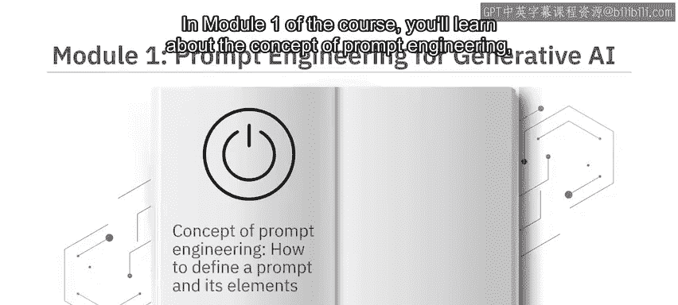

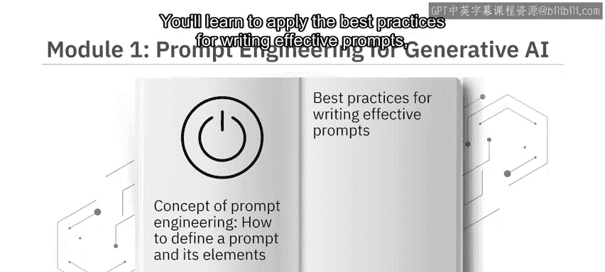

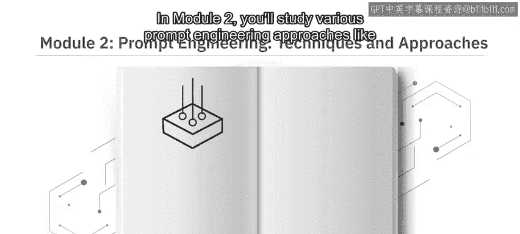

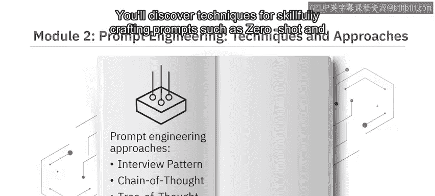

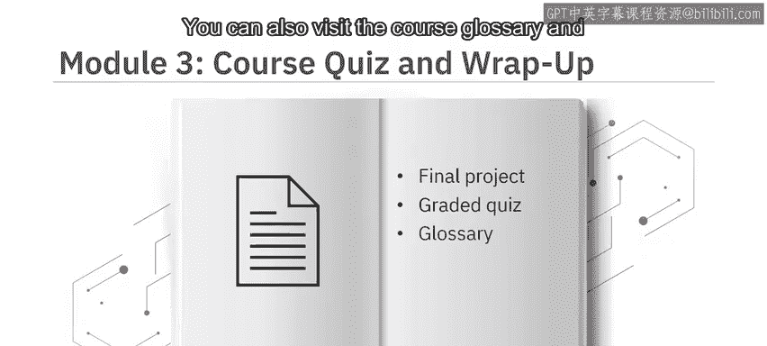

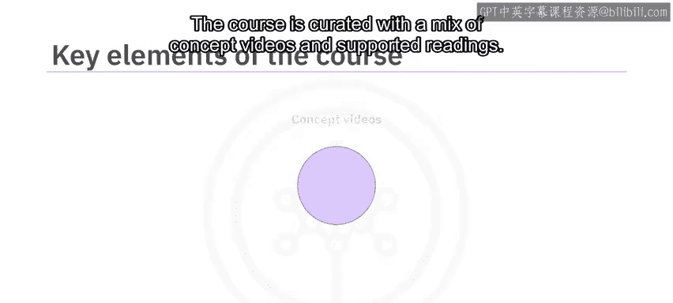

Watch all the videos to capture the full potential of the learning material。

 You'll enjoy handson labs in a final project that demonstrates how to optimize results by creating effective prompts in the IBM generative AI classroom。

 The course includes practice quizzes to help you reinforce your learning At the end of the course。

 you'll also attempt a graded quiz。 The course also offers a discussion forums to connect with the course staff and interact with your peers。

 Most interestingly， through the expert viewpoint videos。

 You'll hear from experienced practitioners who will share their perspectives on the tools and approaches used in prompt engineering and the art of writing effective prompts。

 Are you ready to learn everything you can about writing prompts to unlock the full potential of generative AI。

 Let's get started。😊。

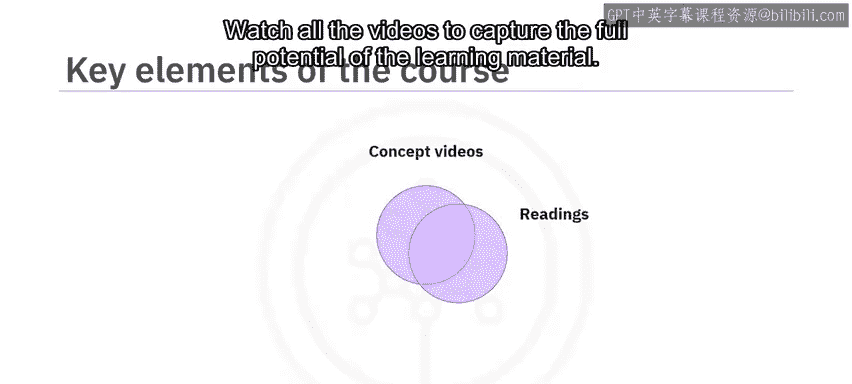

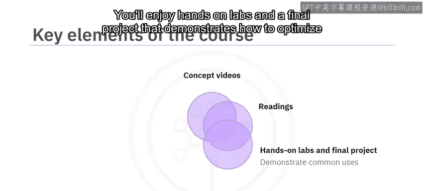

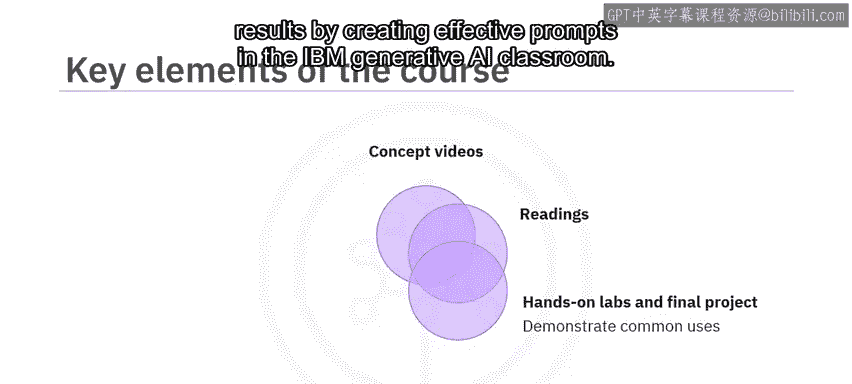

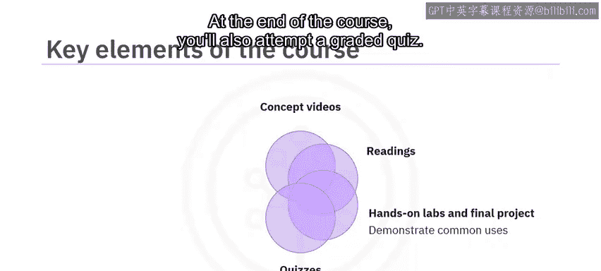

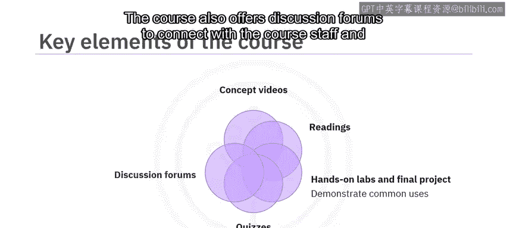

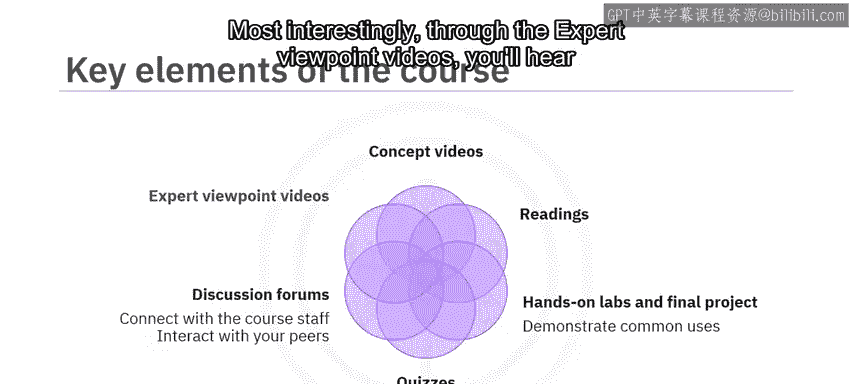

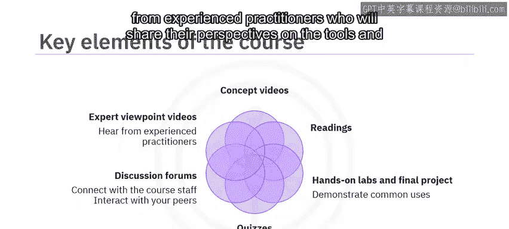

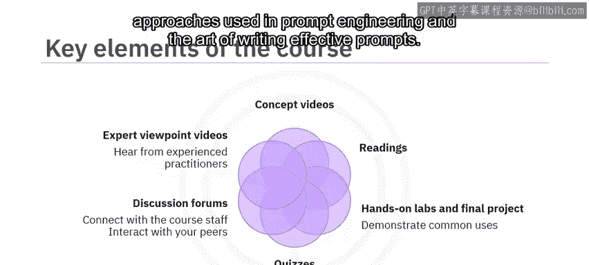