# IBM应用人工智能（从0开始搭建AI机器人）｜IBM Applied AI （中英字幕） - P43：1_什么是提示.zh_en - GPT中英字幕课程资源 - BV1p64y1H7LM

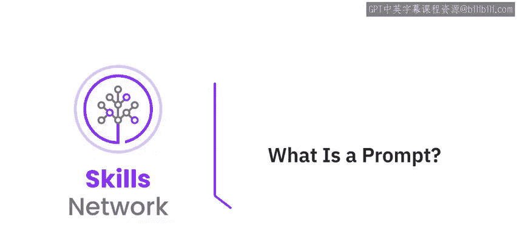

Welcome to what is a prompt After watching this video。

 you will be able to define a prompt and its elements。

 you will also be able to explain the relevance of writing effective prompts to guide generative AI models to produce the desired results。

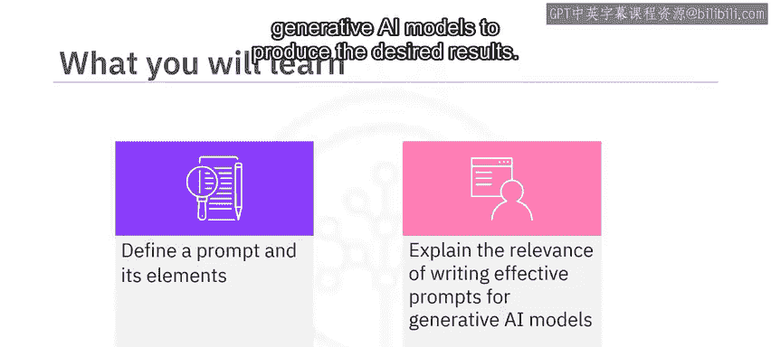

One of the significant capabilities of generative AI models is that their output closely resembles what a human can produce。

 relevant， contextual， imaginative， nuanced and linguistically accurate。

 and one of the critical factors in generating this output is prompt。So what is a prompt。

 a prompt is any input you provide to a generative model to produce a desired output。

 You can think of it as an instruction you provide to the model。 For example。

 write a small paragraph describing your favorite holiday destination。

 write H code to generate a drop down selection of cities within an online form。

 These are straightforward prompts used to produce a specific output。

 Pros can also be a series of instructions that refine the output step by step to achieve the desired result。

For example， write a short story about a scientist studying life on Mars what were some of the challenges he faced during his research with these examples it is clear that prompts contain questions。

 contextual text， guiding patterns or examples and partial input for the model based on these natural language requests submitted as prompts。

 generative AI models collect information， derive inferences。

 and provide creative solutions these instructions help the model produce relevant and logical responses or output based on provided inputs。

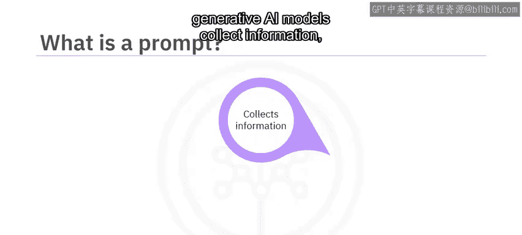

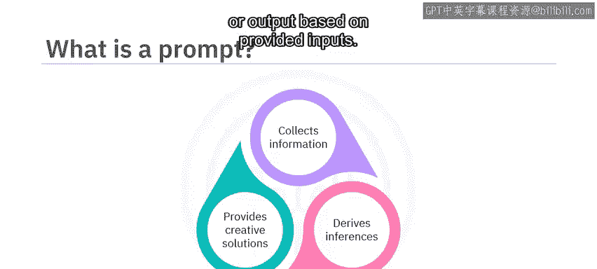

Let's look at some more examples to help us understand this better。

 Suppose you want the model to write a short story about the struggles and achievements of a farmer who became a successful businessman in 10 years。

 If your prompt is rich man's story from a small town， his struggles and achievements。

 it'll produce a generic output， as this is what we call naive prompting。

 It means asking queries from the model in the simplest possible manner。

To convey your intentions to the model， you can make simple adjustments that can radically improve the result。

 like your prompt must have context to proper structure and can be comprehensible。

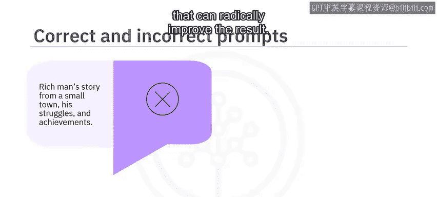

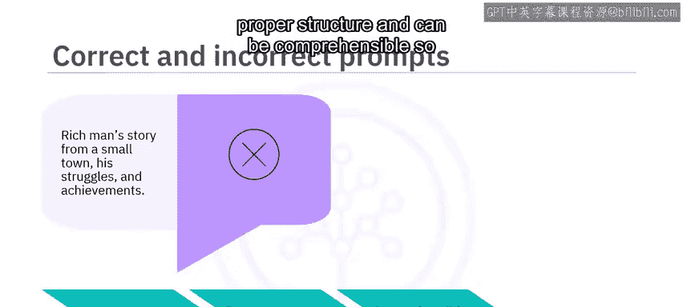

So you can rewrite the prompt as write a short story about the struggles and achievements of a farmer who became a rich and influential businessman in 10 years。

 Let's look at another example where you want the model to generate an image of a sunset scenery you have in mind。

 W the prompt as sunset image between mountains may not give you the desired output。

 The prompt is too brief and lacks a detailed outline of the image you have in mind。

 You can rewrite the prompt as generate an image depicting a calm sunset about a river valley that rests amidst the mountains。

 to master the art of writing effective prompts。 Let's understand the building blocks of a well constructed prompt  one by one instructions。

 give the model distinct guidelines regarding the task you wish to execute。

 Steing the actions of the generative AI model to influence the formation of its response。

 Like write an essay and 600 words， analyzing the effects of global warming on marine life is one example。

 context helps establish。😊。

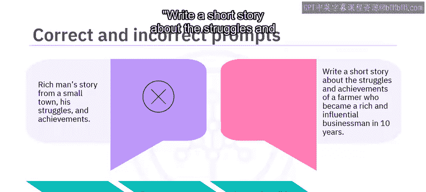

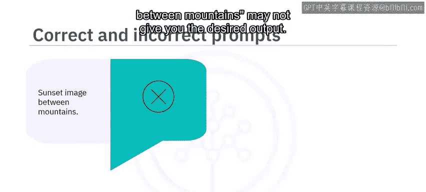

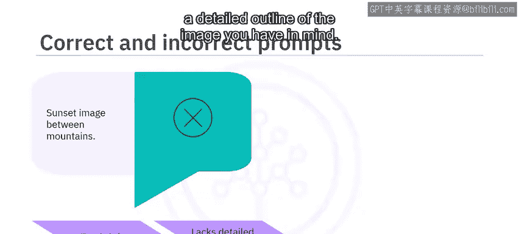

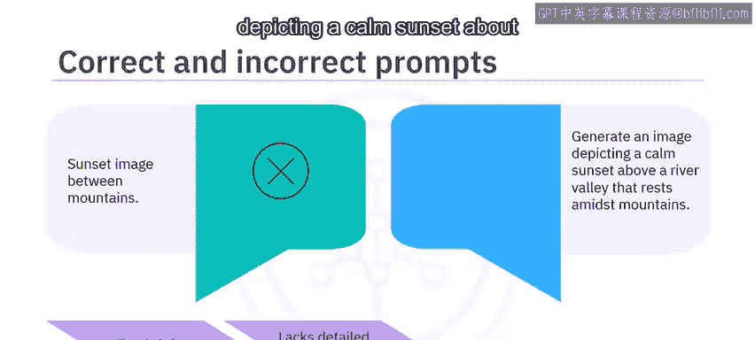

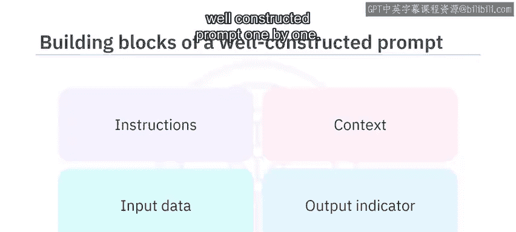

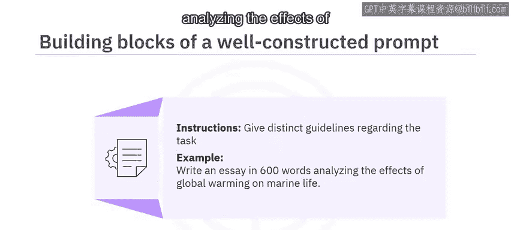

The circumstances that form the setting of the instruction and provides a framework for generating relevant content to understand this。

 let's add some context to the prompt discussed in the previous example。 In recent decades。

 global warming has undergone significant shifts， leading to rising sea levels。

 increased storm intensity and changing weather patterns。

 These changes have had a severe impact on marine life Write an essay in 600 words analyzing the effects of global warming on marine life。

 This prompt will help the model generate output aligned with the context。

 input data is any piece of information provided by you as part of the prompt。

 This can be used as a reference for the generative model to attain responses with a specific set of details or ideas to provide input data。

 the same prompt can be reconstructed in the following manner。

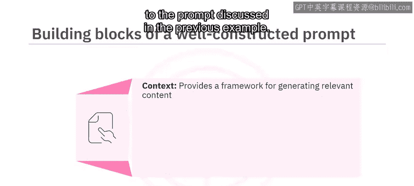

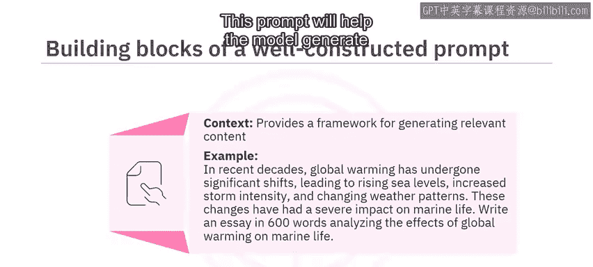

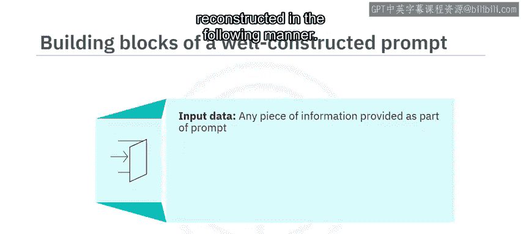

You have been provided with a data set containing temperature records and measurements of sea levels in the Pacific Ocean。

 write an essay in 600 words analyzing the effects of global warming on marine life in the Pacific Ocean。

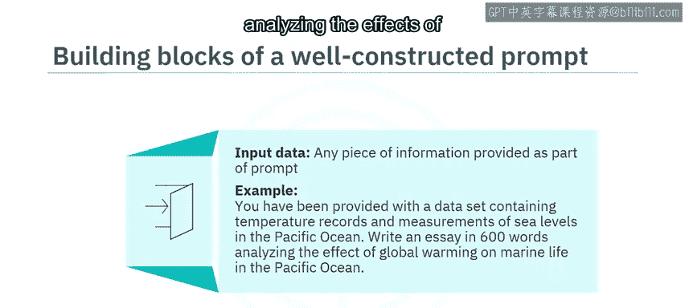

Output indicator offerss benchmarks for assessing the attributes of the output generated by the model。

 It can outline the tone， style， length and other qualities you desire from the output In the prompt write an essay and 600 words。

 analyzing the effects of global warming on marine life。

 The output indicators specifies that the output generated should be an essay of 600 words。

 It will be evaluated based on the clarity of the analysis and the incorporation of relevant data or case studies。

 Each of these elements plays a role in helping the generative AI model comprehend your requirements and give you the desired output。

 In this video， you learned that a prompt is any input or series of instructions you provide to a generative model to produce a desired output。

 These instructions help in directing the creativity of the model and assisted in producing relevant and logical responses。

 The building blocks of a well structured prompt include instruction， context。

 input data and output indicators。 these elements。😊。

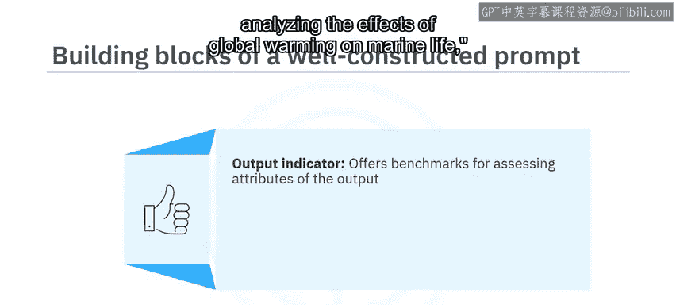

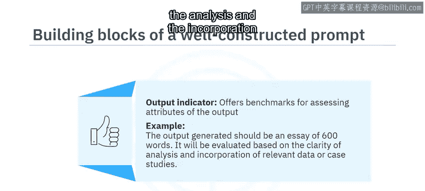

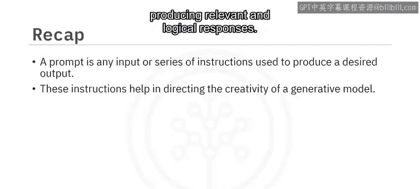

Help the model comprehend our necessities and generate relevant responses。

