# IBM应用人工智能（从0开始搭建AI机器人）｜IBM Applied AI （中英字幕） - P44：2_什么是提示工程.zh_en - GPT中英字幕课程资源 - BV1p64y1H7LM

Welcome to what is prompt engineering After watching this video。

 you'll be able to define what prompt engineering is and explain the relevance and importance of prompt engineering with respect to generative AI models。

 you'll also be able to explain the process involved in formulating effective prompts through prompt engineering to guide these models to produce relevant responses。

 The process of designing effective prompts to generate better and desired responses is called prompt engineering。

 Although generative AI models have the potential to supplement human creativity。

 if you fail to provide precise prompts， these models may produce inadequate results and even false and misleading information。

 Pro engineering is a blend of critical analysis， creativity and technical acumen。

 it is not limited to asking the right question， it includes framing the question in the right context with the right information and your expectation of desired outcomes to elicit the most appropriate response。

 Let's understand this through an example a ship is sailing through the Atlantic Ocean to plan is voyage。

 the ship's captain wants to know the。😊。

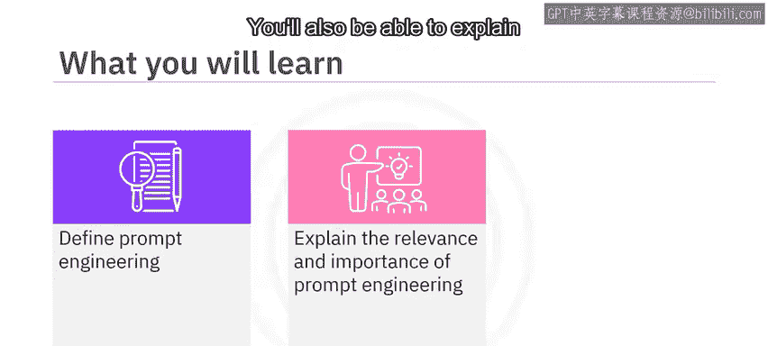

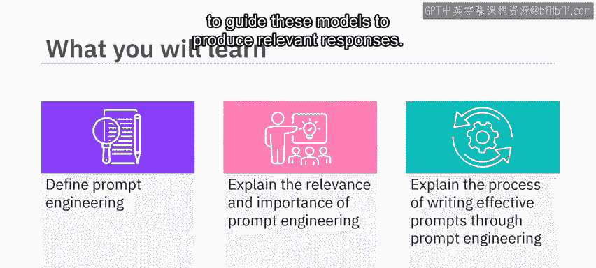

Weather forecast for a specific location at a specific time In this case。

 providing the model with a simple prompt such as weather forecast of the Atlantic Ocean may not get the desired results to get the most accurate results。

 the captain will have to engineer the prompts when designing the prompt the captain needs to define the context to include details such as the intended location for the weather forecast in latitude and longitude and the time range for prediction For example。

 the captain of a ship is planning a strategic voyage in the Atlantic Ocean to help the captain navigate effectively provide weather forecasts for the upcoming week from 28 August 2023 to1 September 2023 the coordinates of the target location are between 20 degrees north and 30 degrees north latitude and 40 degrees and 20 degrees longitude The captain must also indicate whether he require specific output like should the model return information on other weather elements that could affect the voyage For example。

 to help plan an effective navigation in the Atlantic Ocean provide detailed information about。

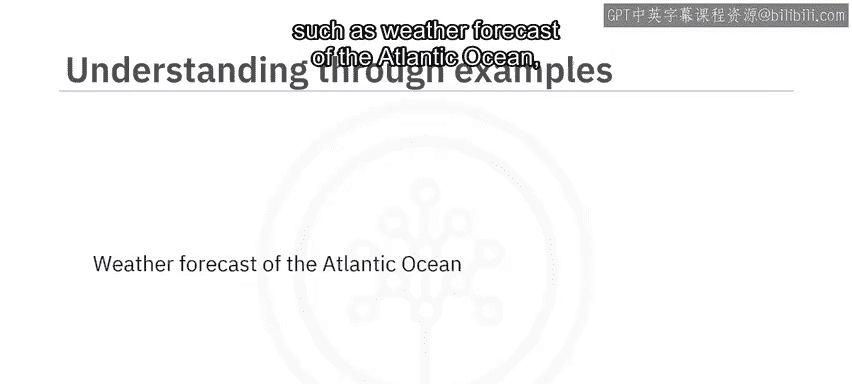

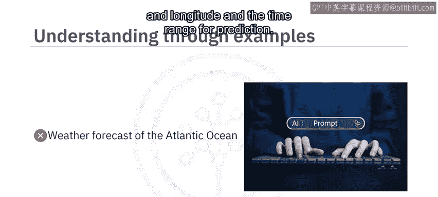

pected wind patterns， wave heights， precipitation probabilities， cloud cover。

 and any potential storms that might affect the voyage during a specified time frame and location。

It's important to recognize that prompt engineering is a well structured iterative process that involves refining the prompts and experimenting with various factors that could influence the output from the model。

 Let's understand the step by step process involved in creating effective prompts through prompt engineering Def the goal。

 The initial step in the process involves establishing a distinct goal。

 you must know what exactly you want the model to generate。 For example。

 form a brief overview of the benefits and risks associated with artificial intelligence and automobiles。

 Cr initial prompt， Having to the goal， It's now time to create an initial prompt。

 This might manifest as a question a directive or even a situation depending on the goal。

 For example， write an article that presents a well rounded analysis of the benefits and drawbacks associated with the incorporation of artificial intelligence in the field of automobile industry。

 Test the prompt。 The prompt you created should now be tested and analyzed for its response。

 While the response might be relevant， It could lack the distinct perspective you are aiming for。

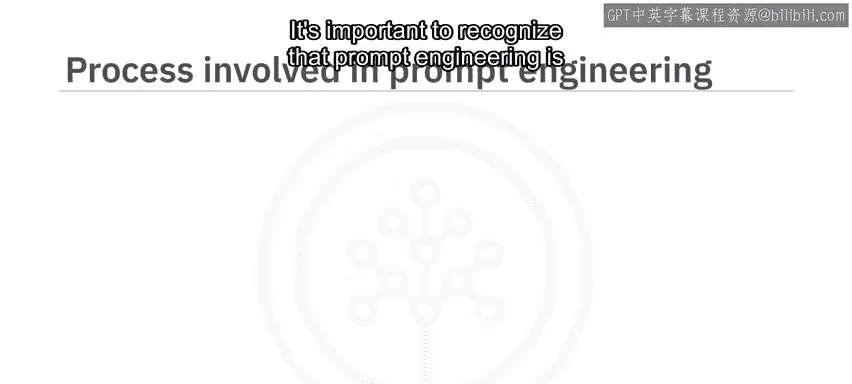

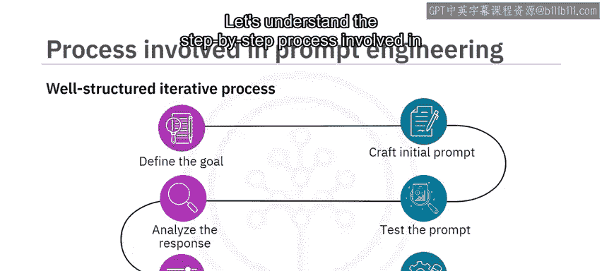

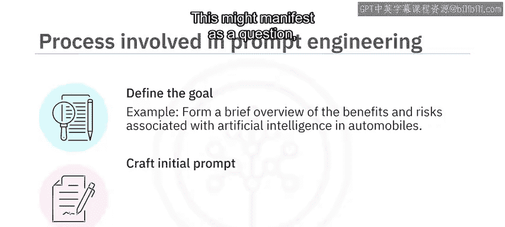

For example， the response to the initial prompt directly lays out the benefits and drawbacks of integrating artificial intelligence in the automobile industry。

 It does not highlight any ethical concerns that might arise。 Further。

 there is no discussion on the positive and negative implications of the same。 analyze the response。

 You must carefully review the response and examine whether it aligns with your goals。

 if not make a note of the areas where it fell short。 For example。

 the initial prompt used fails to cover a comprehensive range of benefits and risks associated with artificial intelligence in the automobile industry。

 Ref the prompt， using the knowledge acquired through testing and analysis。

 It's now appropriate to modify the prompt。 This might include enhancing its specificity。

 incorporating additional context or rephrasing。 The initial prompt can be refined as follows。

 Write an informative article discussing the role of artificial intelligence in revolutionizing the automobile industry。

 cover specific areas such as autonomous driving and realtime traffic analysis。

 as well as potential issues like technical complexity。Cybersecurity concerns。Iterate the process。

 The last three steps are repeated until you're satisfied with the response。 Consequently。

 following several cycles of refinement， the final prompt shall take this form。

 write in articles showcasing the transformation in the automobile industry brought about by artificial intelligence。

 discuss its positive impacts on autonomous driving and real-time traffic analysis while extensively digging into apprehensions regarding intricate technical aspects and cybersecurity breaches that may gain potential control over critical vehicle systems。

 thus compromising safety。 Now， let's summarize the importance and relevance of prompt engineering and generative AI models。

 Opimizing model efficiency， promptmp engineering helps design intelligent prompts that allow the users to harness the full capabilities of these models without requiring extensive retraining。

 Boting performance for specific tasks， promptmp engineering empowers generative AI models to deliver responses that are nuanced and have a context。

 rendering them more effective for specific tasks。

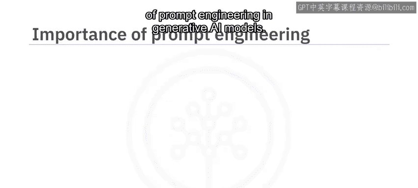

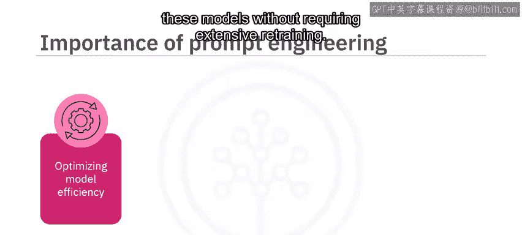

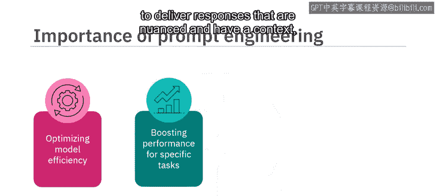

Understanding model constraints， refining prompts through each iteration and studying the corresponding responses of the model can help us understand its strengths and weaknesses。

 This knowledge can further guide feature enhancement or complete development of the model in the future。

 enhancing model security， S prompt engineering can prevent issues of harmful content generation due to poorly designed prompts。

 thereby enhancing safe utilization of the model。

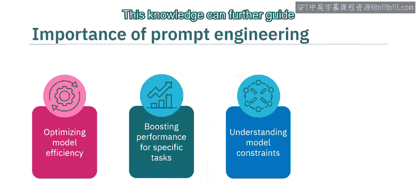

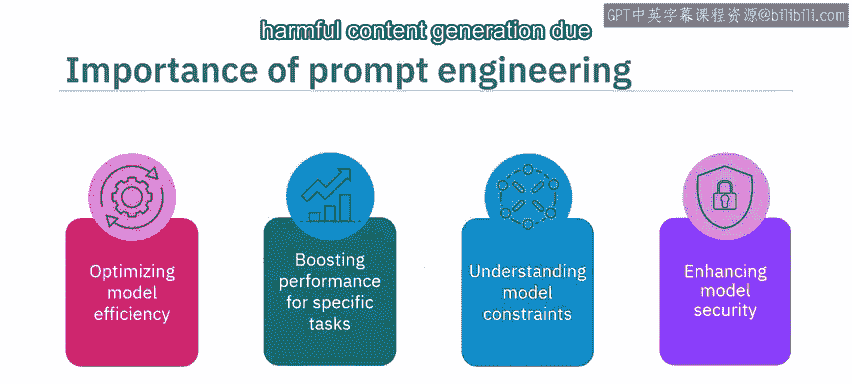

In this video， you learned that prompt engineering is the process of designing effective prompts to leverage the full capabilities of generative AI models in producing optimal responses。

 You also learn the process of refining a prompt via prompt engineering。 At last。

 you learned the importance of prompt engineering and optimizing model efficiency。

 Boting performance， Under model constraints and enhancing its security。

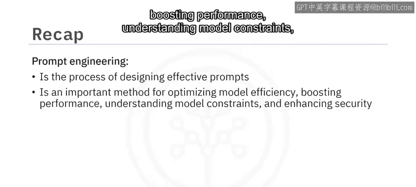

