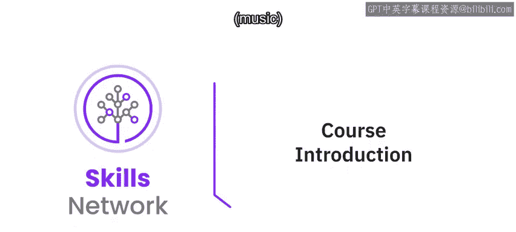
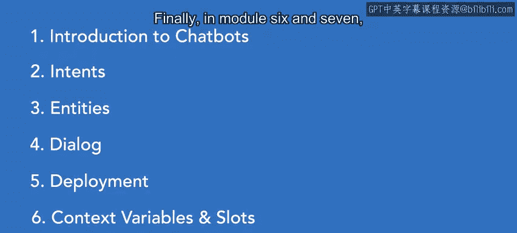

# IBM应用人工智能（从0开始搭建AI机器人）｜IBM Applied AI （中英字幕） - P52：0_欢迎.zh_en - GPT中英字幕课程资源 - BV1p64y1H7LM

🎼Welcome toBuilding AI Power chatbots Without programming My name is Anton and Jano and Im a software developer and AI evangelist at IBna。

When we talk about AI， people start thinking about science fiction scenarios。

Then might excite you or maybe scare you， but one thing is certain。

We're many years away from so called strong AI in which a machine becomes as intelligent as a human being。

 well， some humans。What we're not far away is artificial intelligence that serves practical purposes and can fundamentally change the way we experience everyday life。

In this course we're going to focus on one of the most popular applications of AI available today。

 namely chatbots， which are one example of conversational AI。Chaapbots are exploding in popularity。

 so much so the gardener predicts that by next year。

 a quarter of all customer service operations will use chatbots to assist their customers。

This presents a great opportunity for individuals and companies who have the skills to build the safe chatbots。

That's my goal for this course to teach you how to build customer service chatbots。

🎼AI is getting smarter and more readily available as such I will be able to teach you how to create chatbots without need to write any single line of code。

🎼We'll start off by introducing chatbots and discuss what they are。

 as well as why they are becoming so popular。🎼Next in moduleule 2 and 3 we introduce intents and entities。

 which are two key components of any childbot。In moduledule4 we'll tackle the dialogue itself。

 including chabo design considerations and best practices。

🎼ImmodO file will deploy the chatbot to an actual website that will be generated for you。

This means that anyone with a link to your site can try out your chat。Finally。

 in modules 6 and7 we'll consider more advanced topics that can really help you polish the user experience and create more advanced chatbots。

🎼Notow that this is a hands on course， so when I say that we'll tackle such topics。

 I do really mean it。I'll give you the theoretical background required to understand what's going on。

 while you spend most of your time working on labs designed to help you experience the actual process of creating chatbots Each module as a series of great quizzes that count towards your final score。

🎼Likewise， there is an exam at the end to ensure that you fully grasp the concept presented within the course。

🎼I believe you will find the process of creating chats with Watson to be intuitive and fun once you get the end of it。

 I hope you enjoy this course and it will help you break into a career in AI。

