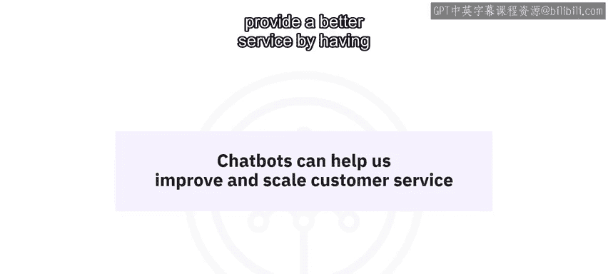
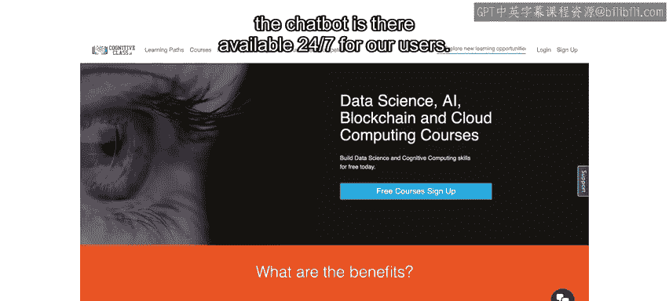
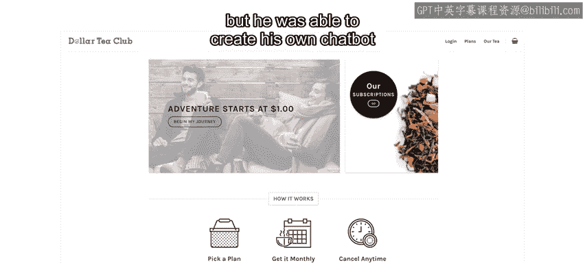
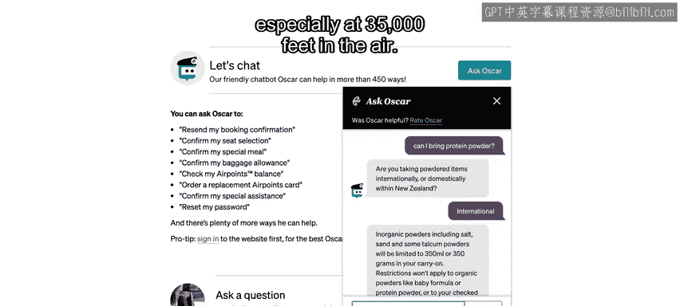
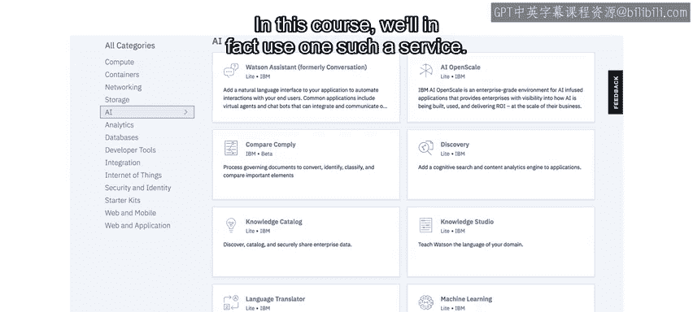
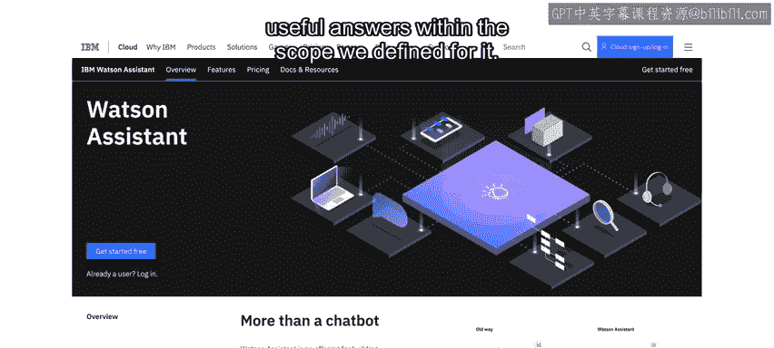

# IBM应用人工智能（从0开始搭建AI机器人）｜IBM Applied AI （中英字幕） - P53：1_聊天机器人简介.zh_en - GPT中英字幕课程资源 - BV1p64y1H7LM

Welcome to How toBuild Chatbots My name is Antonio Kengiiano。

 and I'm a software developer and artificial intelligence evangelist at IBM。Over 50。

000 people took the first edition of this course on chatbot building。

 and the reviews have been amazing so far， this motivated me to create an even better version of the course that uses the latest user interface and incorporates some exciting new features that weren't available when the first edition of the course came out in 2017。

In this course， I'll teach you all that you realistically need to know about chatbots。

 the business opportunity they provide， and how to start building useful chatbots for yourself。

 your company， or your clients。No coding skills are required。

 so anyone can take this course and learn how to create and deploy chatbots Together。

 we'll build a chatbot for a fictitious flored chain of stores。

 a chatbot that provides information and assistance to prospective customers We'll then deploy it on a Wordpress site。

 Don't worry if you don't have your own Wordpress site as one will be provided for you in the course。

 All right， let's find out what chatbots are and how they can help us by discussing a common scenario。

Your call is important to us， due to unusually high call volume you may experience a greater hold time than usual。

 many of us are going to be familiar with this greeting on the phone when trying to reach the customer support line of a company。

The prompt fairies， but the gist of it is always the same。

It would seem that the call volume is always unusually high， no matter when we call。

Another common prompt you might be familiar with is your call may be recorded for quality and training purposes。

I must confess that at times I question how much these conversations are actually being used for training purposes as opposed to liability purposes。

As we'll see in this course with chatbots， we can actually use the conversations with customers to train and make our chatbot smarter and more useful。

At any rate， we are on the line waiting for what seems to be an eternity。

 And we finally get to talk to a person。 And they tell us。

 have you tried turning it off and on again。 Now， this is frustrating。

 regardless of whether it fixes our problem。 If it doesn't。

 we feel insulted by such a simple suggestion after 20 minutes of patiently waiting on the line。

 And if it fixes our problem as it often actually does。 Well be happier。

 but still frustrated from having wasted so much time on something we should have thought of ourselves。

 or found as a suggestion on the company website。 I'm not picking on companies providing customer care here。

 The truth is that customer support is hard。 It's not hard because the questions are very hard。

 In most cases， it's a matter of providing simple answers to simple questions。

 It's hard because customer care powered by humans。 is not very scalable。

If your business is doing well， you'll have an increasingly large amount of customers who need your help。

 so you'll need to hire more and more people， and that takes money。

You'll also need to spend the time and energy to train them properly， managing them。

 and so on chatbots are not meant to replace humans entirely。

 but they can help us address a large number of simple inquiries from our customers。

They can scale indefinitely， unlike human teams， and are available 24/7 every day of the year。

In other words， they can act as a first line of defense for your customer care team。

 allowing you to inexpensively scale your customer support operations and provide a better service by having immediate answers around the clock for common inquiries For example。

 a hotel might drastically cut down on the number of calls its reception desk receives simply by having a chat box that replies to the most common inquiries such as restaurant hours or checkout times setting an alarm call or figuring out how to connect to the Wi-F this leaves the hotel staff with a greater degree of time and energy to tackle more elaborate requests such as changing rooms because one of their customers found crickets in their room that actually happened to me but that's a story for another day we have this customer care scaling problem ourselves when cognitive class started to become more popular。

We were ecstatic to have 1 million enrolled learners。

 but that posed a serious problem for our small team。

 so we created a student advisor chatbot that could advise students on which course to take and other common questions。

As simple as it is， it reduced the number of support tickets from our students to about half of the number we were getting prior to the introduction of our chatbot。

 and unlike our team who has the habit of going to sleep most nights。

 the chatbot is there available 247 for our users。 That's our story。 Here is another one。

 Alllan from Dollar Tea Club。 a subscription service for tea lovers is a oneman shop。

He has to do everything by himself。Prior to introducing a chatbot。

 he was spending a lot of his time answering the same questions over and over。Do you ship to Canada。

 how much is shipping， How does it work， What kind of teas do you have and so on Again。

 simple questions that still take time to answer if a human is on the receiving end。

 so he took the first version of this chatbot course and built a chatbot that is saving him many hours a week。

According to Alan， the moment the chatbot went live。

 it was like turning off a switch in terms of support tickets received。

The chatbot he created is allowing him to regain some of his time which he can use to actually grow his business。

It's worth noting that Alan is a businessman， not a programmer。

 but he was able to create his own chatbot by the end of this course， so will you。

Another example I wanted to give you is Oscar， the chatbot from the airline company， Air New Zealand。

I recently visited their wonderful country and on my way there。

 I had a question about protein powder。 You know how import regulations can be quite straight。

 so I got a little paranoid that I might be breaking some rules。

Not wanting to be the Pablo escobar of wh protein isolate。

 I asked the staff on board and they had no idea。Thankfully。

 I had WiF on the plane and was able to use their chatbot。

 which had an answer to my protein powder question and all other questions I had。

I was really impressed by how useful it was， especially at 35，000 feet in the air。

As you can see， chatbots are universally useful， regardless of whether you're a one person operation or a Fortune 500 company。

Throughout this course， we'll learn how to create chatbots that serve practical business purposes。

 rather than just being amusing gimmicks。But first， what is a chat bot。

 It's a software agent capable of conversing with users through some kind of chat interface。

Typically， the chatbot will greet the user and invite them to take some action。

 like asking it a question when the user replies， the chatbot will parse the input and figure out the intention of the user's question。

Finally， it will respond in a consequential manner。

 either providing information or asking for further details before ultimately answering the question。

Great chatbots can keep up this back and forth in a natural way。

 within the scope of what the chatbot is designed to do。

They make the user feel understood and helped。They create a rapport with a user without pretending to be human。

The most common chat box are textual chatbots， the kind you'd interact with in a chat popup window on a website or through a messaging app like Facebook Messenger。

 Whatsapp or Slack， however， you can interact with some chatbots through your voice。

 Apple Siri and Amazon Alexa are two examples of audiobased virtual assistance。

Before we proceed further， it's worth noting that sometimes you might hear the word bot instead of chatbot in this course or elsewhere online。

Depending on the context it's acceptable to use bot in lieu of chattbot to mean the same thing Nevertheless。

 the term bot is more generic and there are software programs that independently perform a certain operation on our behalf without being chatbots。

For example， a trader bot might monitor the market for certain conditions and then perform automated stock trading transactions based on that information。

 That's not a chatbot as no chatting is taking place。

 The conversational element is what makes a bot a chatbot。

 There are many other terms that refer to chatbot such as chatterbot， chatterbox， talkbot。

 virtual assistant， conversational agent embodied agent and even artificial conversational entity。

 or its acronym ace。And believe it or not， this list is not even exhaustive。

 I like to keep things simple though， so I will generally stick with chatbot and occasionally bot in this course。

Chat bots are trending in this video we'll discuss why and give you your first assignment。

Chatbots are really trending Everybody seems to be talking about them and every day there is a new headline about how they are going to be big。

 If you cut through the hype， you'll notice that there is a genuine interest and businesses small and big are paying very close attention to them This creates a great business opportunities for those with the right skills。

Chatbots have been around since the late 60s。 The first chatbot Eliza was rudimentary。

 but it proved the potential of chatbots even back then。

 so wire chatbots suddenly so in demand now over half a century later。

 two key developments have allowed chatbots to become a viable business tool。

 and such an in demandman skill， the first one is the emergence of messsenger applications Whatsapp。

 WeChat， Facebook Messenger and even Slack have become incredibly popular。Collectively。

 they are used by billions of people around the world that's B not M。 In fact。

 messsenger platforms are even more popular than social media sites。

Messenger apps might have been the catalyst for the emergence of chatbots。

 but they are certainly not the only platform。Chatbots are now appearing on sites and as mobile apps as well。

It's not so much the platform on which they are delivered on。

 but rather the conversational nature of the interface。

People simply love textual chat and prefer it over virtually every other form of digital conversation。

The second key component that allowed chatbots to really take off is the emergence of artificial intelligence。

Chatbots wouldn't be very useful if they weren't able to understand what the user wants and respond accordingly。

Over the past few years， machine learning， deep learning。

 natural language processing and artificial intelligence in general have all progressed quite rapidly。

 You might be familiar with IBM Watson， who several years ago。

 defeated the best jeopardy players in the world。More recently， IBM showcased Project Debr。

 an AI capable of debating humans on complex topics。

The math behind many of these innovations and achievements is quite complex。

And by the end of this course， you will fully understand these formulas。Well。

 not really you see AI is becoming smarter， but it's also becoming more readily available to everyone AI is no longer accessible solely to researchers with PhDs in computer science。

Such cognitive capabilities are now easily available via libraries and through services provided by companies like IBM Today the many AI capabilities of Watson are readily provided as services and APIs that are available to anyone with an IBM cloud account。

In this course， we'll in fact use one such a service。

Specifically， I'm talking about Watson Assant This will enable us to develop a chat box with MLLP or natural language processing capabilities。

In other words， a chat box that understands our users and can provide useful answers within the scope we define for it。

It's now your turn in the next section of this module。

 you'll find a lab that will instruct you to register for a free IBM cloud account and to create a Watson As service。

Follow the step by step instructions I provided， and the process should not take much time or effort。

