# IBM应用人工智能（从0开始搭建AI机器人）｜IBM Applied AI （中英字幕） - P54：2_使用意图.zh_en - GPT中英字幕课程资源 - BV1p64y1H7LM

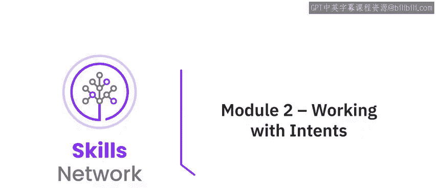

Welcome to the second module of how to build chatbots in this module we'll discuss one of the three components of a chatbot。

 namely Inense conceptually this is how a chat box works the user enters some text the chatbot thinks really hard and then a response is issued to the user now that's very very high level and doesn't tell us much of course so let's see more in detail how this works。

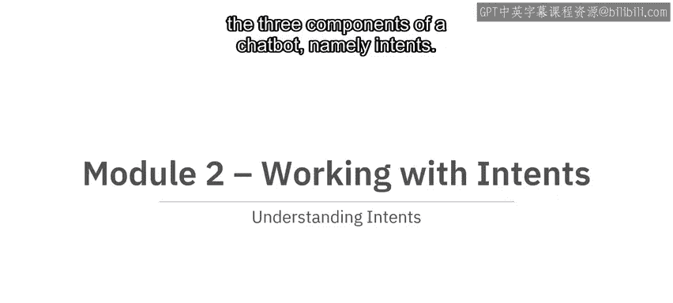

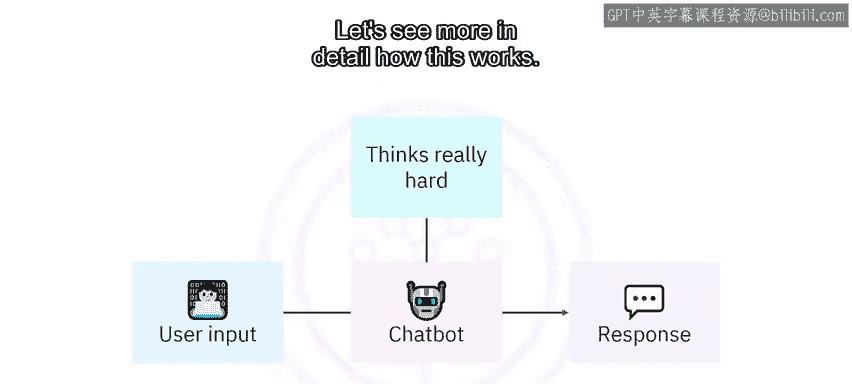

The chatbot will use three main components to determine how to interpret the user input and how to respond to it Ins。

 the subject of this module entities， which we'll cover in the next module。

 and finally the dialogue which will cover in module 4 when you create a chatbot in Watson assistant the first thing you do is create a dialogue skill which will contain these three components。

 Ins are the most important component because they try to determine what the user wants。

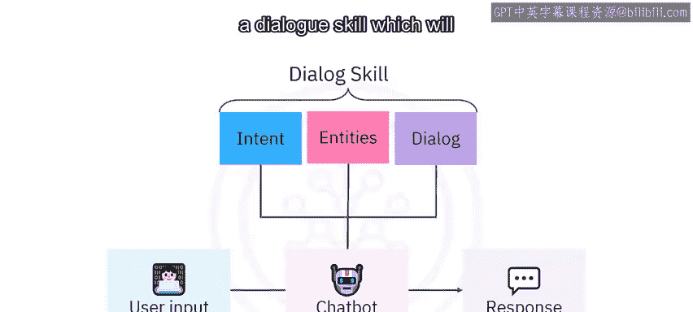

What are they asking for， In other words， they capture the intent or goal of the user。For example。

 we could define a greeting's intent and train Watson with some examples of what a greeting looks like。

 we might provide hello hey， hi， good morning， and for our friends from New Zealand， Kiora。

 it's a good practice to provide at least five examples per intent in order to fully train Watson on the intent。

 but the more the merrier applies here， once Watson is trained on the intents we define。

 it will look at the user input and try to determine if any of the intents match the user request。

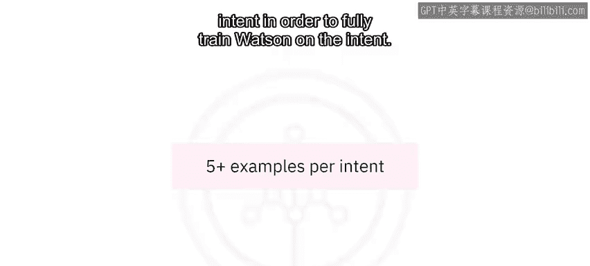

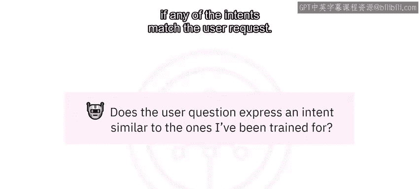

For example， if the user were to say Aloha， Watson would recognize that it's a greeting akin to the ones we've trained it on。

 note that Aloha was not one of the examples we gave it。

This is where Watson's artificial intelligence capabilities really kick in。

 We train it with some examples and Watson will be able to recognize an intent in the user utterance。

 even when the user phrases it very differently from the examples we provided as mentioned in the previous module in this course we'll create a simple chatbot for a fictitious chain of flower shops。

 so let's consider for a moment a domainspecific intent， as opposed to simple chit chat intents。

Users may want to find out about our hours of operation， so we could define an hours's info intent。

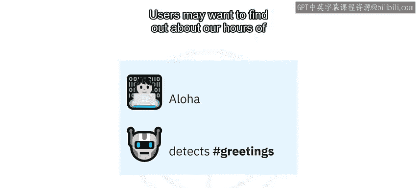

Note， however， that intents cannot have spaces， so we'll simply use an underscore instead of a space。

 and here are some examples that we might provide to train Watson on the hours info intent。

 What time are you open until。 what are your hours of operation Are you open on Saturdays and so on。

 These are all realistic ways in which users might express the same request for hours of operation information It's important to train Watson with realistic examples to the point that you'll even want to leave in typos you might accidentally make as you type out the examples After all。

 if you made that typo， your users might as well Now。

 when the user asks when is your Toronto store open Watson will recognize our hours info intent。

 even though again， this particular phrasing was not part of our examples Watson was smart enough to figure out what the user wanted now that it understands what hours info represents。

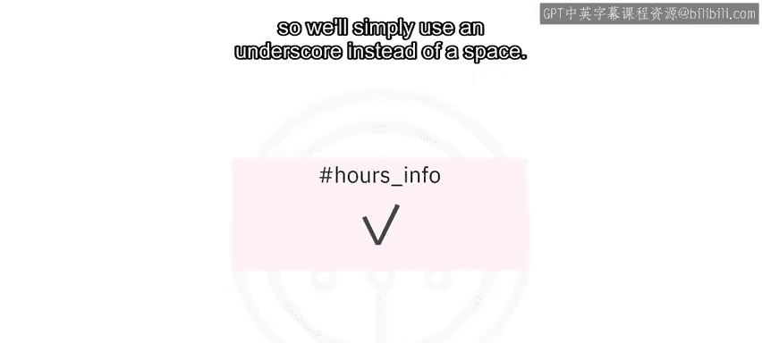

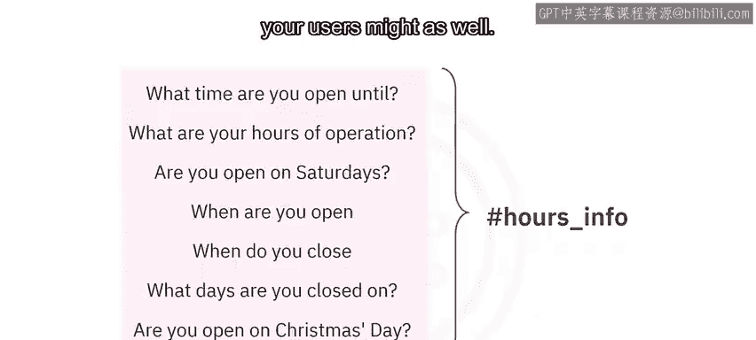

Intent examples can be entered manually in Watson Assant。

 but they can also be imported from CSV files This simplifies collaboration For instance you could receive the examples from a colleague in your customer care team who doesn't know anything about building chatbots to help you out Watson assistant also comes with a content catalog which provides collections of intent relevant to various industries such as banking。

 insurance and e-commerce， it's not a premade chatbot by any means。

 but you can use it as a starting point to build upon it's worth noting that in this course we'll build our chatbot in English。

 but several other languages are available as well。

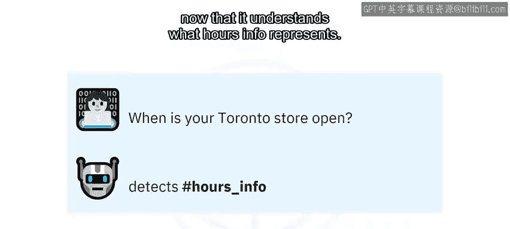

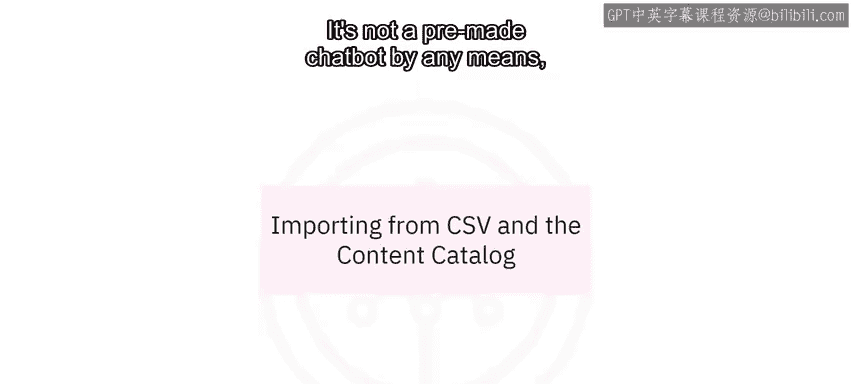

So if you wish to create a chatbot in Italian or Japanese。

 youll simply create a dialogue skill in that language and then train Watson with relevant examples in the same language that's it for the theory around intense。

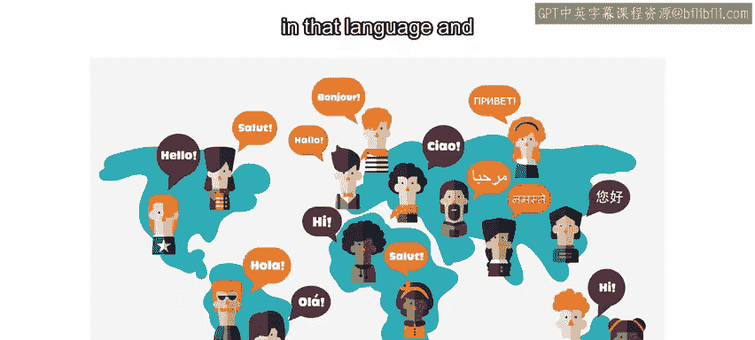

In the rest of the module， you'll go through the labs that will guide you through the process of creating。

 importing， and testing Ins。

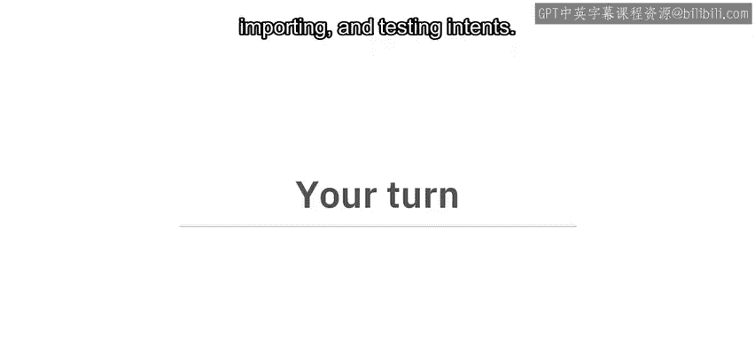