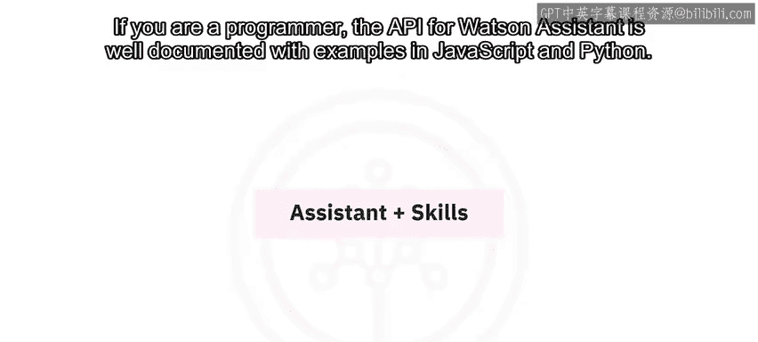
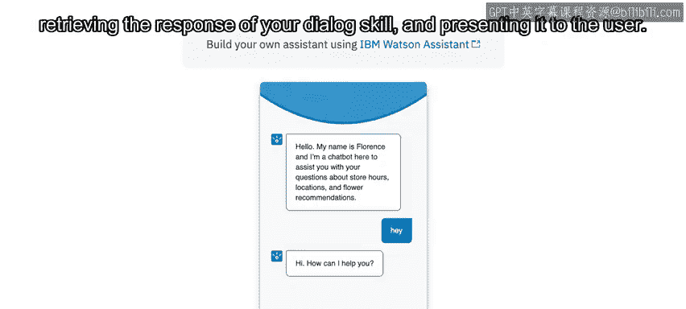
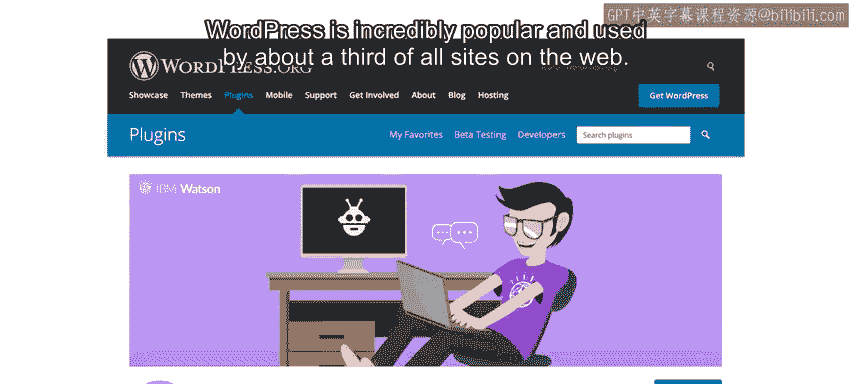
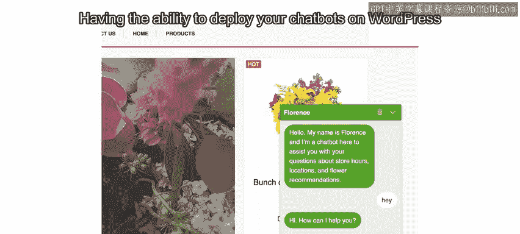

# IBM应用人工智能（从0开始搭建AI机器人）｜IBM Applied AI （中英字幕） - P58：6_部署WordPress站点.zh_en - GPT中英字幕课程资源 - BV1p64y1H7LM

Welcome to the fifth module of How toBuild chatbots。So far。

 we've created a basic but functioning chatbot。The problem is that it's currently available only from the try it out panel after you log in if you wish to share it with some friends or actual end users。

 you are not able to， unless you give them your login information。

 something you should never do what we need to do is deploy our chat bot somewhere publicly accessible。

As you worked on the dialogue skill in the previous module。

 you might have noticed that alongside skills， there was a tab for assistance。

An assistant is a chat bot and it can have one or more skills within it。

We developed a dialogueg skill that allows the chatbot to understand and reply to the user now we'll need to create the actual assistant and link our dialogue skill to it。

Doing so will allow our chatbot to be deployed through various channels， including WordPress sites。

 Facebook Messenger， intercom， Slack， your own application， etc。

Some coding skills are required for the more advanced deployments。

 such as your own web or mobile application。But thankfully， in this course。

 we'll deploy the chatbot without having to write any code。If you are a programmer。

 the API for Watson Assistant is well documented with examples in JavaScript and Python。

When you create an assistant， you are given the option to enable a preview link。

Doing so is a good idea as it gives you a page where anyone with your link can try out your chatbot。

 so it's a great way to let colleagues， friends or even customer try out your chatbot on the web This widget works by sending the user input to the Watson As service you created。

 retrieving the response of your dialogue skill and presenting it to the user。

If your site is powered by the open source version of WordPress。

 you can greatly simplify the deployment of your chatbot thanks to a plugin that we developed you install the plugin with one click。

 copy over the credentials from your assistant， and your chatbot will magically appear on your site Word is incredibly popular and used by about a third of all sites on the web Having the ability to deploy your chatbots on WordPress really simplifies the process of making your chatbot available to the public at large The plugin is extremely convenient and flexible。

 allowing you to customize the look and feel of your chatbot window it also includes many powerful features such as the ability to rate。

 limit the number of conversations that your chatbot can have so that it doesn't exceed your free monthly allowance。

You can also prevent abusive users from using up your quota by spamming your chat bot。

Other cool features include the ability to escalate your request to a human。

Log your conversation and more。It pays off to spend some time investigating the features once you install the plugin。

In the labs for this module， you'll generate a test WordPress site。

 so you don't need to have a WordPress site of your own。Please note also that Wordpress。

com is a commercial offering of the open source WordPress software located at Word。org。As a result。

 they actually charge quite a bit to allow people to install plugins。

 so I don't recommend that you create a Word。com account and try to install our Watson Assant plugin there。

Instead， at least while you're learning， you should use the site that is provided to you in the labs。

Once you generated the WordPresspress site， you'll be tasked with activating and configuring the plugin so that it can communicate with the assistant that you'll create。

This assistant will in turn be linked to the dialogue skill you've been working on so far。

Once the chatbot is deployed on your WordPress test site。

 you'll be able to make changes to the chatbot directly within Watson Assistant。

 and these changes and improvements will be automatically reflected in the chatbot that's deployed on your site。

