# IBM应用人工智能（从0开始搭建AI机器人）｜IBM Applied AI （中英字幕） - P59：7_使用上下文变量和插槽.zh_en - GPT中英字幕课程资源 - BV1p64y1H7LM

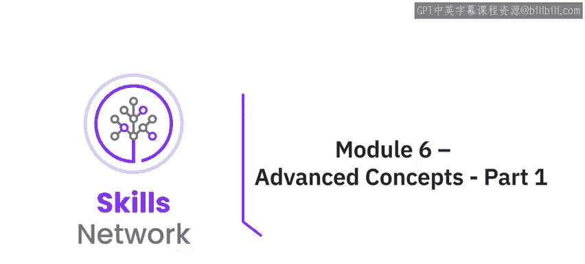

Welcome to the sixth module of how to build chatbots。

Now that you know the fundamentals of chatbot building and how to deploy your chatbot to a WordPress site。

 it is time to look at more advanced features。We'll do so in this and the next module of the course。

In this module we'll focus on two important concepts。

 they can really take your chatbot to the next level。Namely， context variables and slots。

Consider the following interaction。

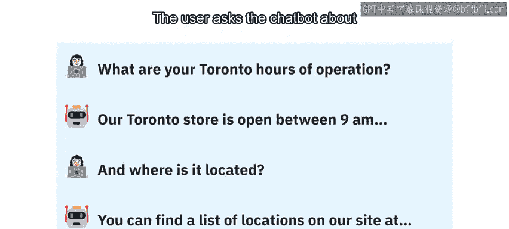

The user asks the chatbot about hours of operation for a specific location。

The chatbot replies correctly。Then the user asks for the address of the store and the chatbot replies with a generic list of all stores instead of the specific information。

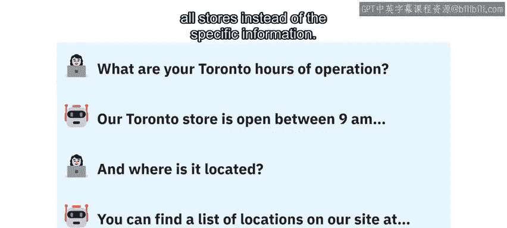

A human answering the same question would understand from the context that the user is asking about the location they already mentioned。

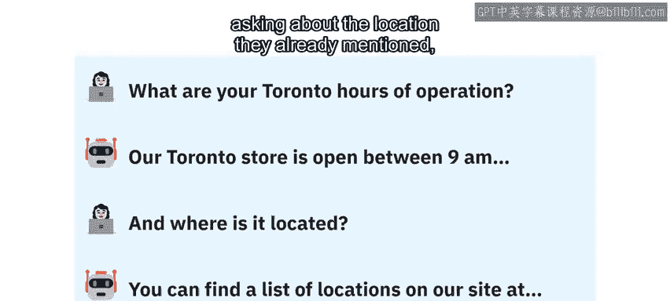

But our current chatbot does not。

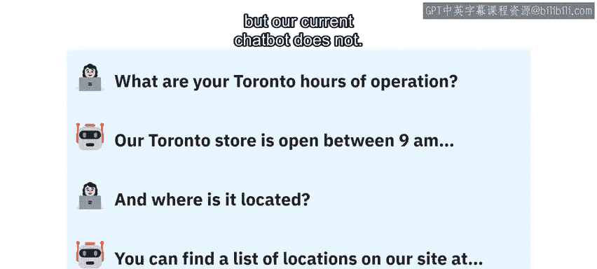

The reason why this happens is that entities are captured and exist only during the current user input。

There is no memory of them once the user enters new questions。

 so even though the Toronto store was mentioned before。

We have no recollection when the user asks us for its address。

The only way this would work as expected would be if the user were to repeat Toronto again in their request for an address。

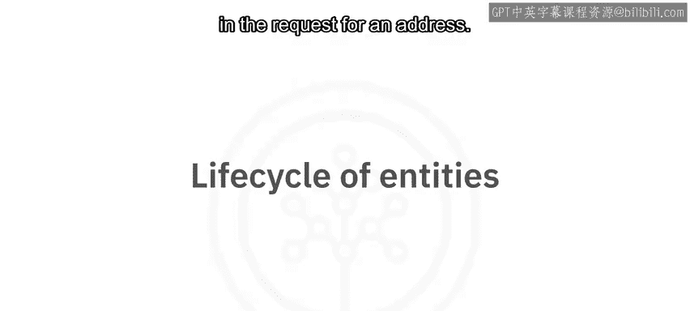

Unfortunately， we can't control how people choose to phrase their questions。

 and it would be uncommon for the average user to repeat Toronto again when it's obvious from the context of the conversation。

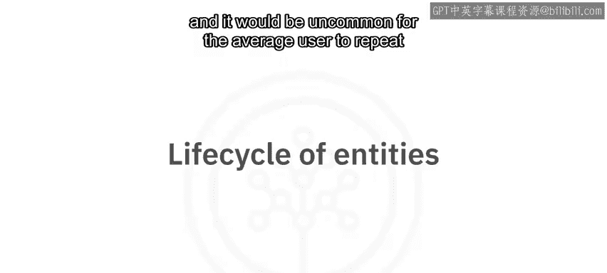

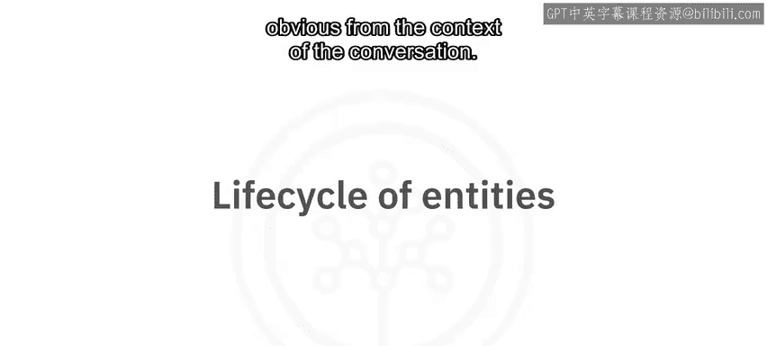

This is the problem that context variables allow us to solve。At any time in any node of our dialogue。

 we can store values we collected from the user for later use。Unlike entities。

 context variables remain available for the entire duration of the conversation with the user。

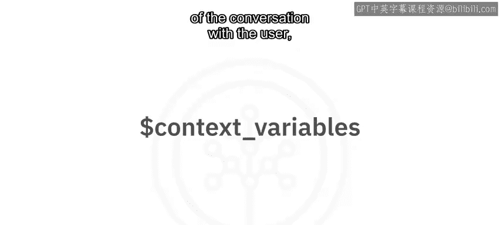

So we can refer back to them at any time。We could， for example。

 store the location entity value in a city context variable in the node that handles hours of operation。

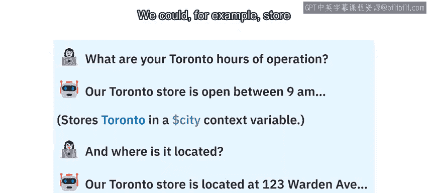

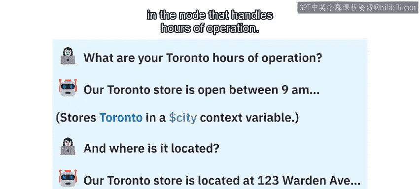

Then when we hit the location info node， we can look into the city context variable to see if a value has been set。

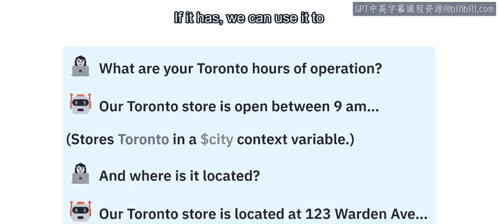

If it has， we can use it to provide a specific address to the user。

There are a few ways to set context variables， but one of the most convenient ways is using slots。

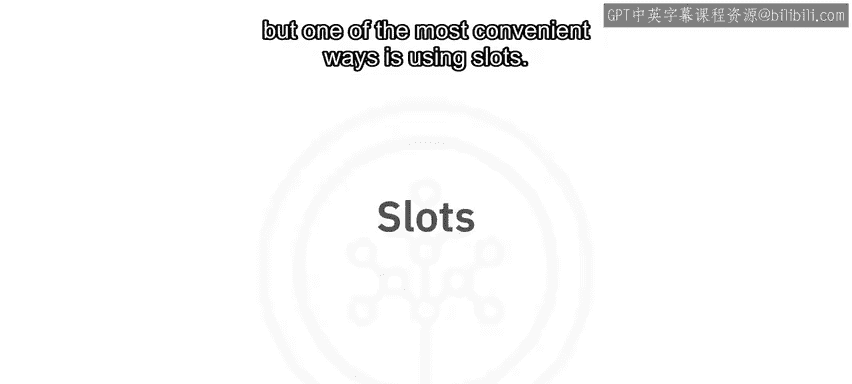

We could for example， add an optional slot to our node and check for a location entity。

If one is found in the user input， the value will then be stored in the city context variable。

 it is optional because we don't force the user to give us a city。

 we simply assign it if one is provided。

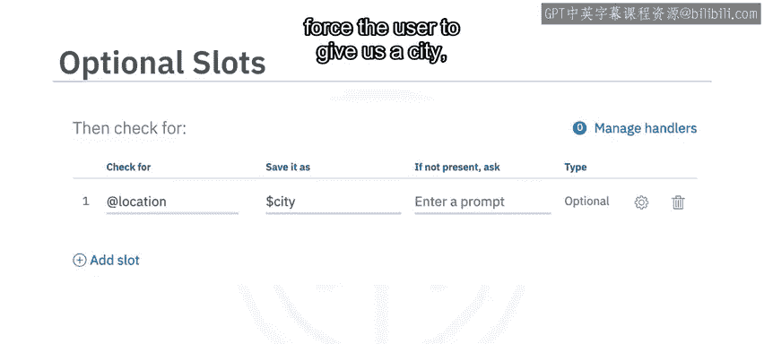

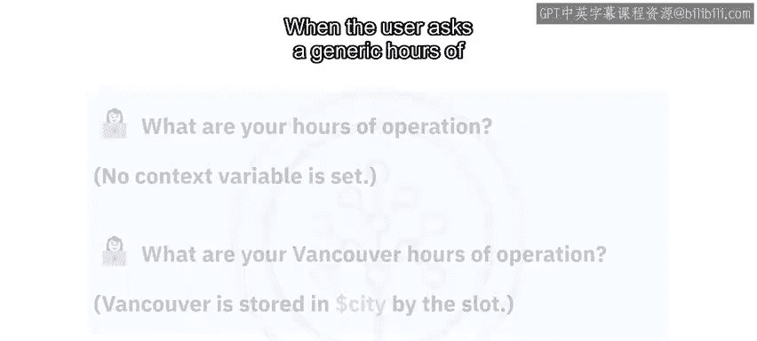

So when the user asks a generic hours of operation question without specifying a location。

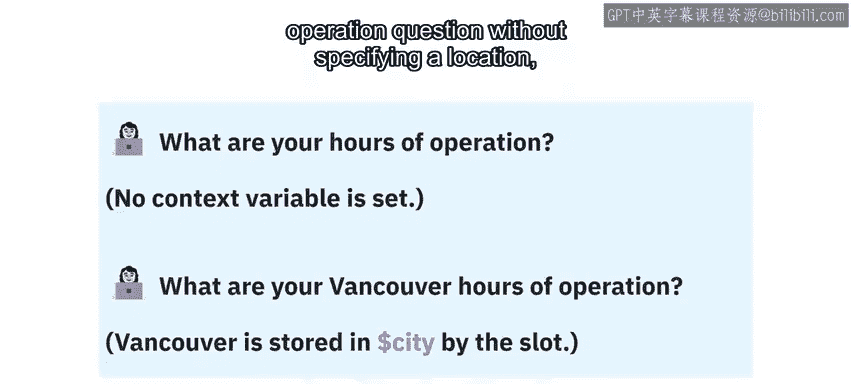

No context variable is set， and we can reply with a link to a page that includes all our locations and hours of operations。

But if a location is specified， we store it in the city context variable through the slot and then use it in our multiple responses within the same node to provide the specific hours of operation for the given location in this case。

 Vancouver， we can make the slot required by adding a question that the chatbot will ask whenever no location is provided by the user。

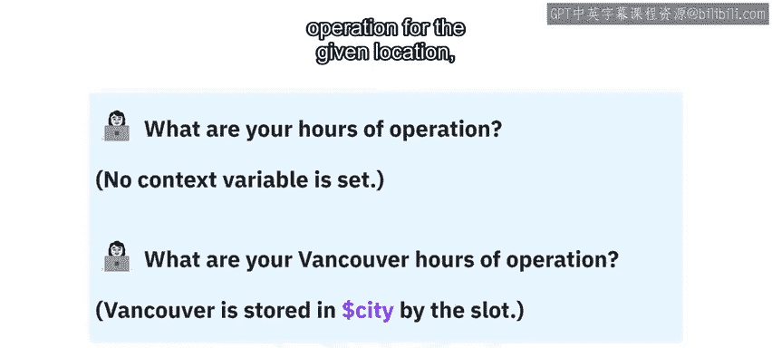

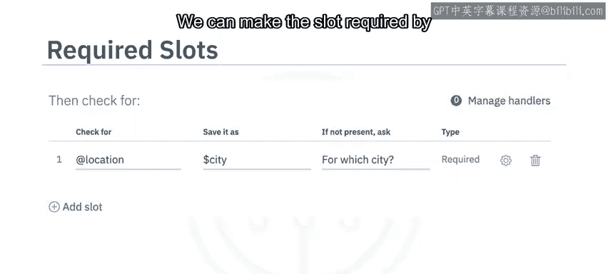

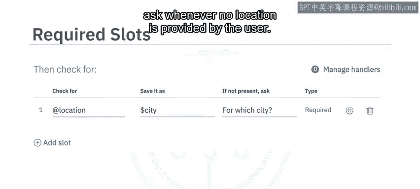

When the user asks， what are your hours of operation without mentioning a city。

 our chatbot will then reply with for which city？The slot will not give up asking the question until a valid answer is provided once the user provides the specific city。

 it will get stored in the context variable as usual。

 and the multiple responses in the node will handle the specific response for the city at hand。

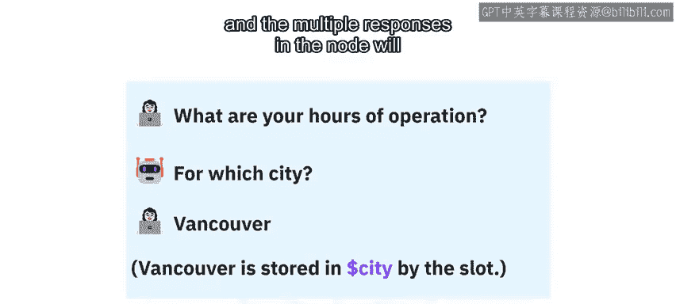

It's also worth noting that you can have multiple slots within the same node， in fact。

 this is the most valuable aspects of using slots。

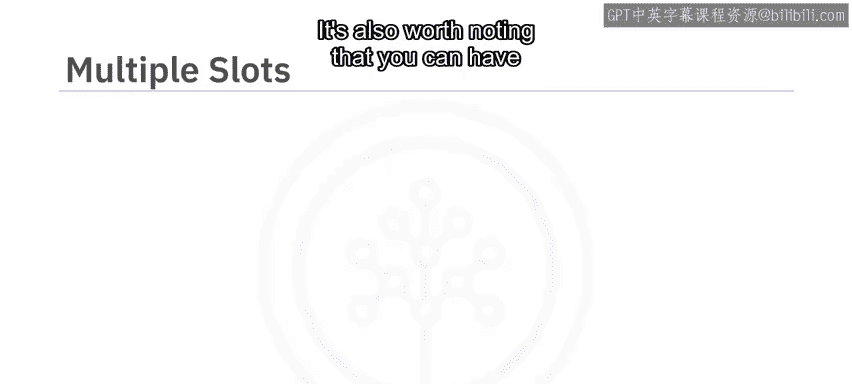

They are great at collecting information from the user。

 especially when multiple follow up questions need to be asked。

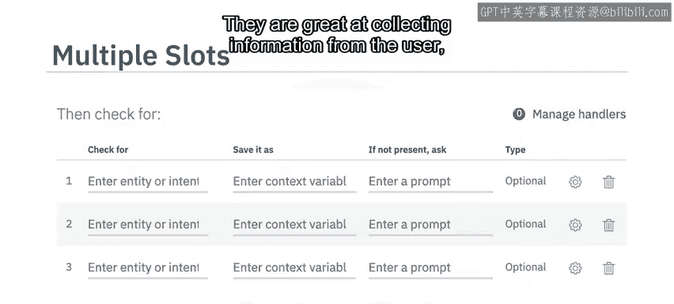

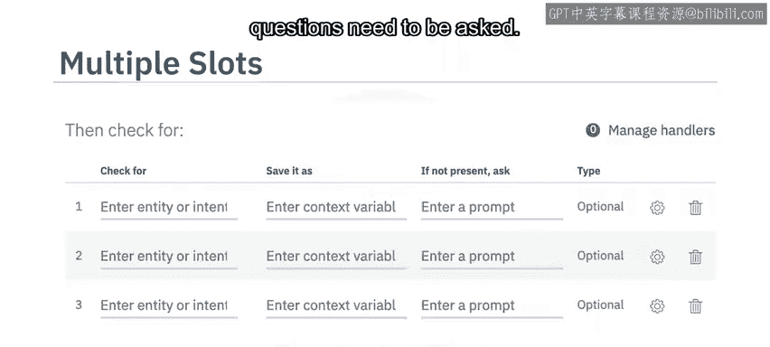

For example， consider the case of a restaurant chatbots booking a reservation for a customer。

 The chatbot will ask how many guests and then store the number in an appropriate context variable。

 then it might ask the date， then the time， and finally which name the reservation should be made under each of these question is one slot within this hypothetical reservation node。

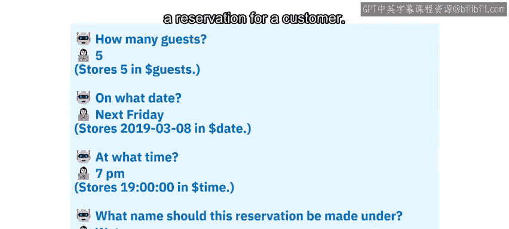

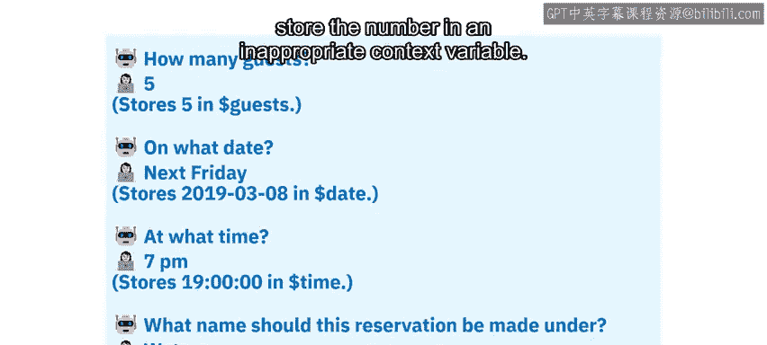

Once the information has been collected and stored in the context。

 the restaurant will have access to the data needed to book the reservation in。

This could be done manually by checking logs， or through a bit of programming。

 by making the node make a call to an API server to schedule the reservation in whatever table system the restaurant adopts。

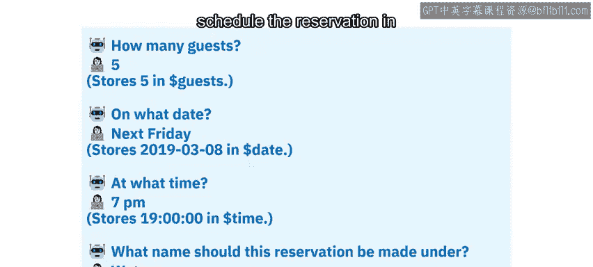

I wanted to give you a decent theoretical understanding of what problems， context variables。

 and slots solve。However， as it's often the case， the only way to truly master these concepts is for you to practice them。

The labs in this module will get you to improve your chatbot by employing some of the techniques discussed here。

