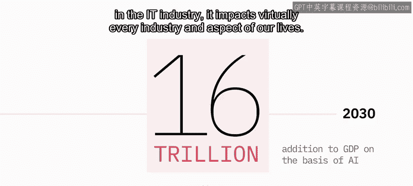
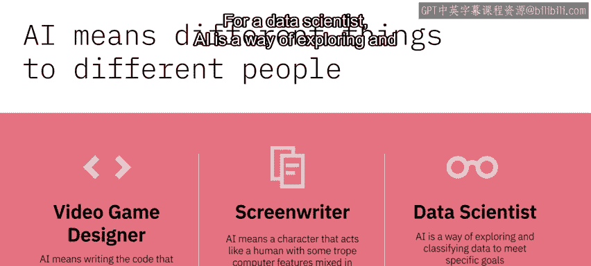
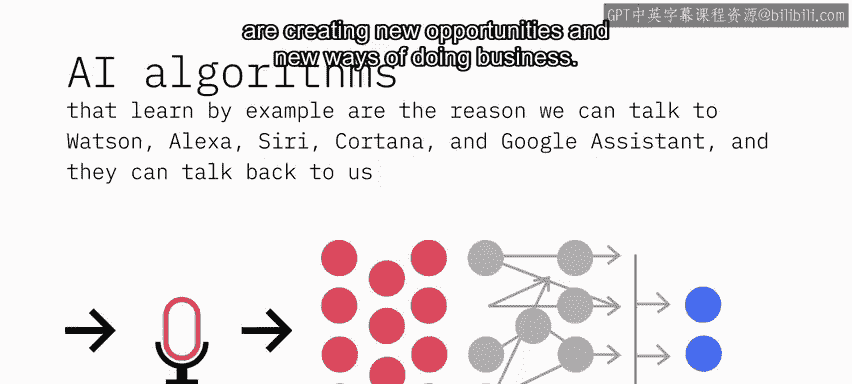
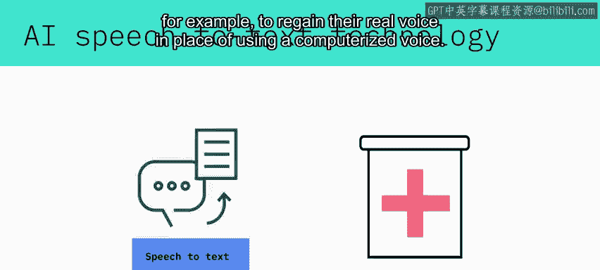
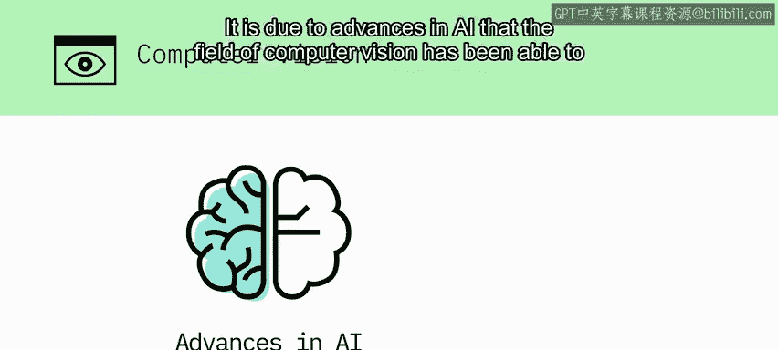
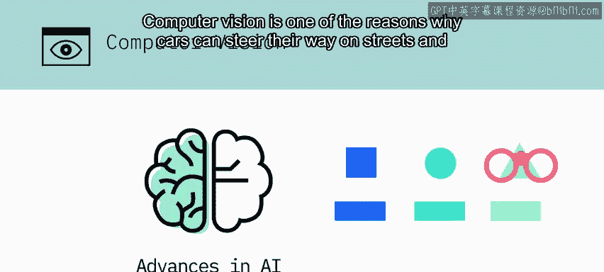
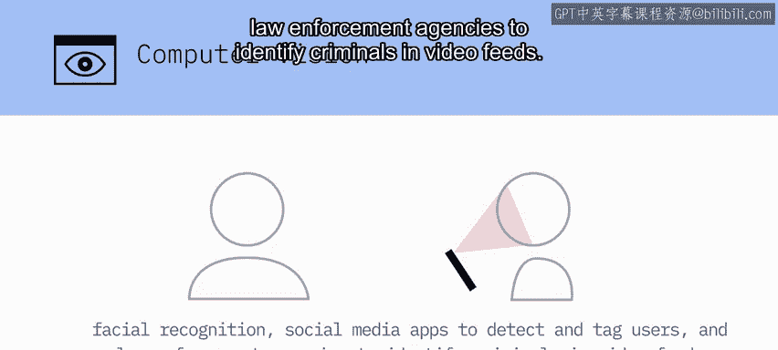
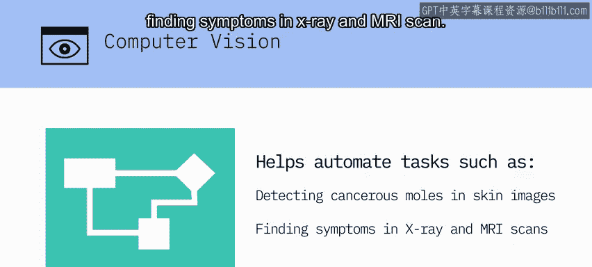
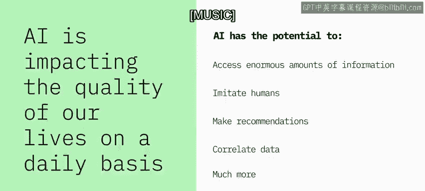

# IBM应用人工智能（从0开始搭建AI机器人）｜IBM Applied AI （中英字幕） - P5：4_AI的影响和示例.zh_en - GPT中英字幕课程资源 - BV1p64y1H7LM

。AI is here to stay with the promise of transforming the way the world works According to a study by PWC。

 $16 trillion of GDP will be added between now and 2030 on the basis of AI this is a never before seen scale of economic impact and it is not just in the IT industry it impacts virtually every industry and aspect of our lives。

AI means different things to different people for a video game designer。

 AI means writing the code that affects how bots play and how the environment reacts to the player。

For a screenwriter， AI means a character that acts like a human with some trope of computer features mixed in。

For a data scientist， AI is a way of exploring and classifying data to meet specific goals。

🎼AI algorithms that learn by example are the reason we can talk to Watson， Alexa， Siri。

 Corana and Google assistantistant， and they can talk back to us the natural language processing and natural language generation capabilities of AI are not only enabling machines and humans to understand and interact with each other but are creating new opportunities and new ways of doing business chatbots powered by natural language processing capabilities are being used in healthcare to question patients and run basic diagnoses like real doctors in education。

 they are providing students with easy to learn conversational interfaces and ondemand online tutors。

 Custom service chatbots are improving customer experience by resolving queries on the spot and freeing up agents time for conversations that add value。

🎼AI powered advances in speech to text technology have made real time transcription a reality Advs in speech synthesis are the reason companies are using AI powered voice to enhance customer experience and give their brand its unique voice。

In the field of medicine， it's helping patients with Lou Geig's disease， for example。

 to regain their real voice in place of using a computerized voice。

It is due to advances in AI that the field of computer vision has been able to surpass humans and tasks related to detecting and labeling objects Computer vision is one of the reasons why cars can steer their way on streets and highways and avoid hitting obstacles。

Computer vision algorithms detect facial features and images and compare them with databases of F profiles。

 this is what allows consumer devices to authenticate the identities of their owners through facial recognition。

 social media apps to detect and tag users and law enforcement agencies to identify criminals in video feeds。

🎼Computer vision algorithms are helping automate tasks such as detecting cancerous moles and skin images or finding symptoms in X-ray and MRI scan。

 AI is impacting the quality of our lives on a daily basis。

 There is AI in our Netflix Q our navigation apps， keeping spam out of our inboxes and reminding us of important events。

 AI is working behind the scenes monitoring our investments， detecting fraudulent transactions。

 identifying credit card fraud and preventing financial crimes。

 AI is impacting healthcare in significant ways by helping doctors arrive at more accurate preliminary diagnoses。

 reading medical imaging， finding appropriate clinical trials for patients。

 It is not just influencing patient outcomes， but also making operational processes less expensive。

 AI has the potential to access enormous amounts of information。

 imitate humans even specific humans make life-changing recommendations about health and finances correlate data that may invade privacy and。

Much more。

