# IBM应用人工智能（从0开始搭建AI机器人）｜IBM Applied AI （中英字幕） - P60：8_了解digressions.zh_en - GPT中英字幕课程资源 - BV1p64y1H7LM

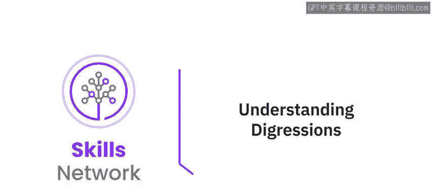

Welcome to the seventh module of How toBuild chatbots。At this point。

 you should have a solid understanding of what context variables and slots bring to the table。

There is still one problem we're facing that we don't have a solution for yet。

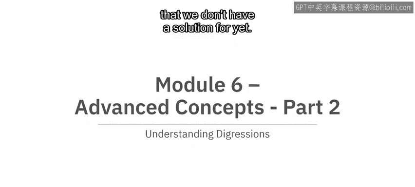

Consider the following interaction。The user asks the chatbot for some flower recommendations。

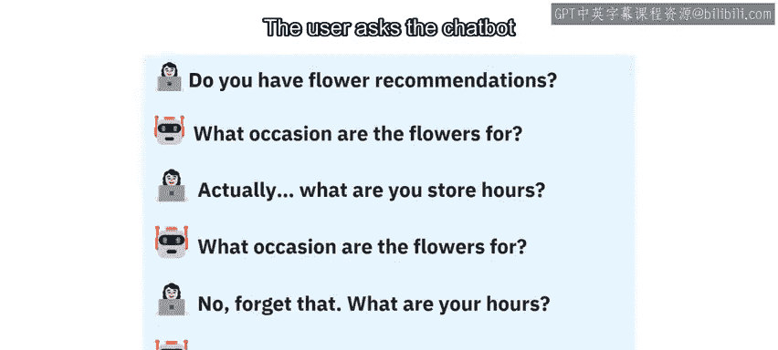

The slot will ask for what occasion。

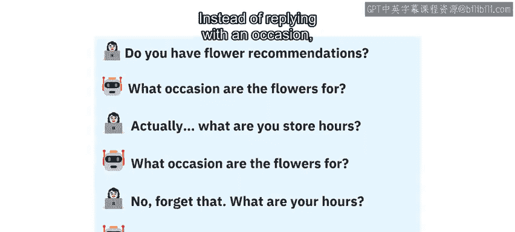

Instead of replying with an occasion， the user decides to ask about hours of operation。

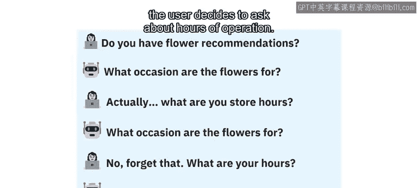

The slot will continue to pester the user， asking for the occasion。

 and ignoring other questions from the user， even though technically the chat bot knows how to answer such questions。

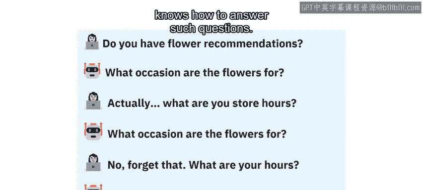

The problem is that required slots won't quit asking their question until an acceptable answer has been provided and stored in a context variable。

One option we have to make the interaction less obnoxious is to configure the not found section of a slot。

Found and not found sections allow us to specify what the slot will say to the end user when they reply with an acceptable answer and when they don't。

 respectively。

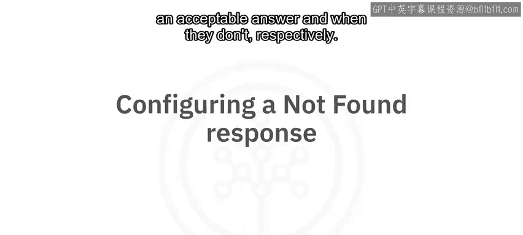

Typically you'll use the Found section to thank the user for answering your question or just leave it blank as it is by default。

More interestingly， however， we can use the not found section to make asking the same question again less awkward。

In other words， we can soften the blow of ignoring their second question by apologizing for having to ask the question again。

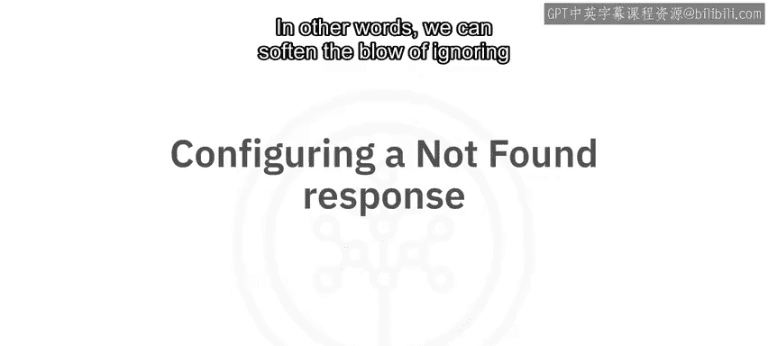

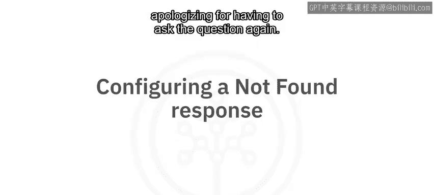

Here is a practical example of how configuring the not found section of a slot。

Can make the interaction a little smoother。 You'll notice that when the user asks us an unrelated question while the slot is asking for the specific occasion。

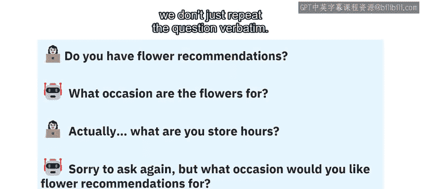

We don't just repeat the question verbatim。In this case， we say something like， sorry to ask again。

 but what occasion would you like flower recommendations for？

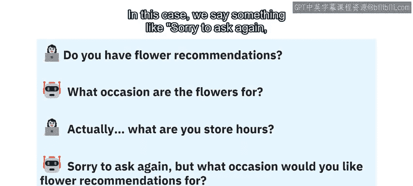

It comes across as significantly more empathetic and less robotic。

 even though technically we are still asking the same question。

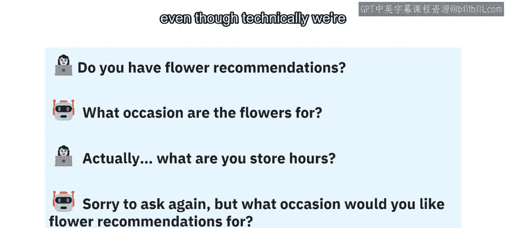

This is an improvement， but wouldn't it be great to be able to answer the aside question we received from the user？

And then come back to the original question。

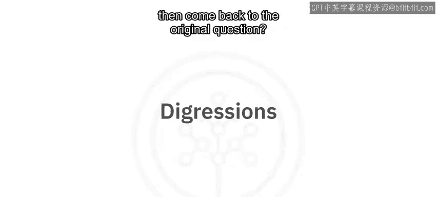

That's what a human agent would do in most circumstances。

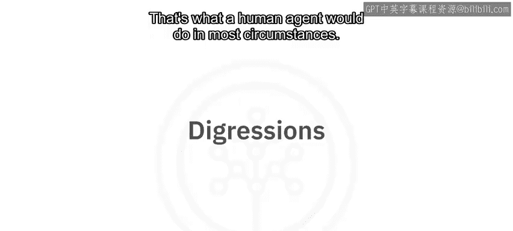

It turns out this is possible， thanks to digressions。

We can allow a slot to jump to a different node after having asked the mandatory question。

 and we can specify that other nodes can return back to an originating slot。

After answering the users a side question。Let's see a practical example of how this would work。

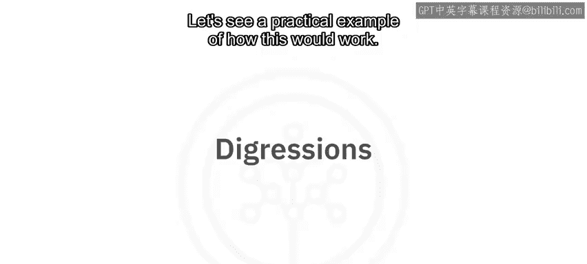

When the user ignores our request for a specific occasion。

 asking our chatbo to provide store hours instead， digressions allow us to jump to the node that handles hours of operations。

 since that node has a slot too， that slot will ask its own question about which city are the store hours for。

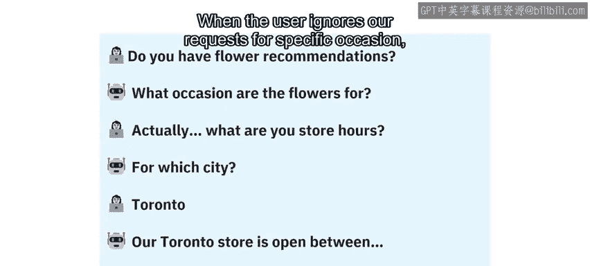

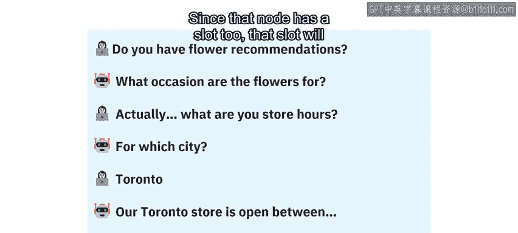

Once the user replies with Toronto， the node will provide the information to the user and return to the original node where the slot will ask about the occasion once again。

This is a workflow that works quite well and makes our chat bot come across as smarter and friendlier。

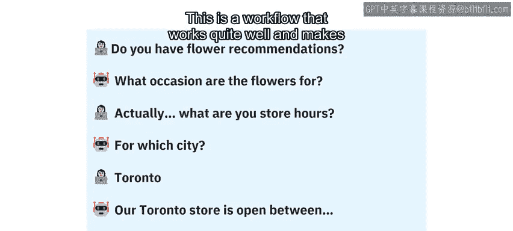

In some instances， you might not want to return， but instead continue the conversation from the node you jump to。

With digressions， you'll have a chance to specify the desired behavior。

 including which slots can digress to other nodes， which nodes can accept digressions。

 and whether a return is required， it's a powerful and genuinely useful feature。

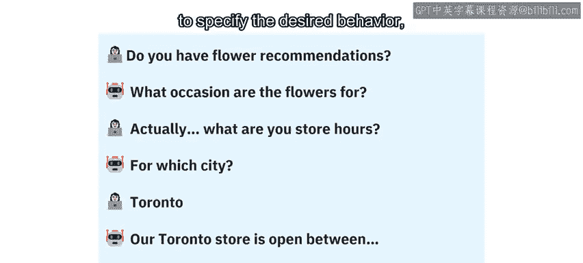

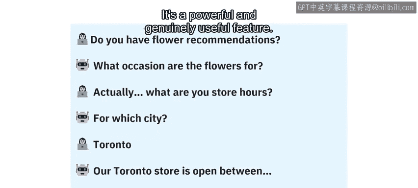

So where exactly do we specify the found and not found text for slot？

And where do we configure digressions？The nitty gritty details are， as you probably guessed。

 in the labs for this module。You'll get to play with these new features that will make our simple chatbot more useful and user friendly。

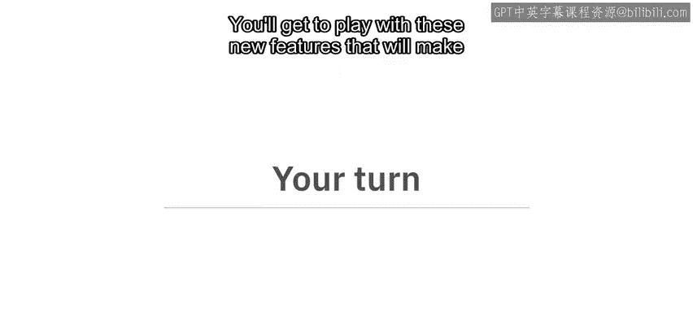

Keep in mind that these features are somewhat advanced。

I know plenty of people who built great chatbots without understanding or relying on them。

Still having a precursory understanding of the advanced concepts presented in this and the previous module will really pay off once you start building your own chatbots。

 whether for yourself， your company or paying clients。

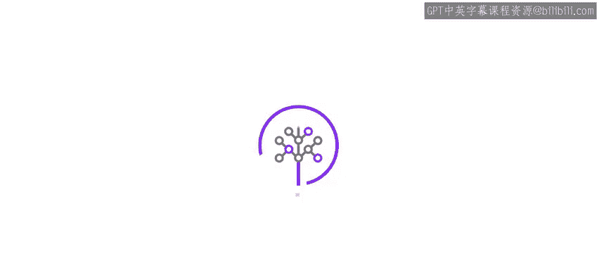