# IBM应用人工智能（从0开始搭建AI机器人）｜IBM Applied AI （中英字幕） - P61：9_总结.zh_en - GPT中英字幕课程资源 - BV1p64y1H7LM

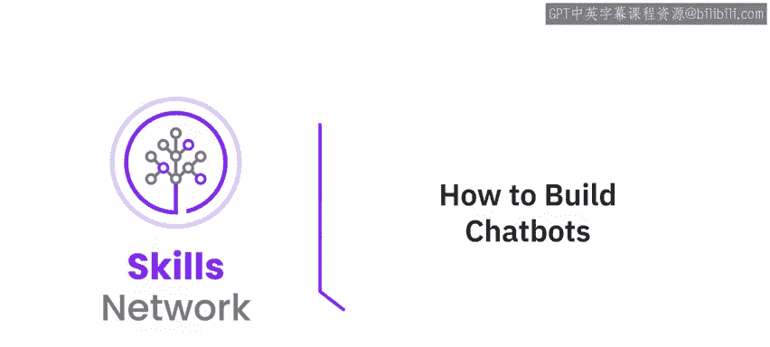

Congratulations on reaching the end of this course。 I hope you enjoyed it。 Above all。

 I hope that you feel more confident in your ability to create chatbots。😊。

By now you should be much more familiar with chatbots and how to leverage Watson assistantsant to create。

 test， deploy， and improve your chatbot without having to write any code。

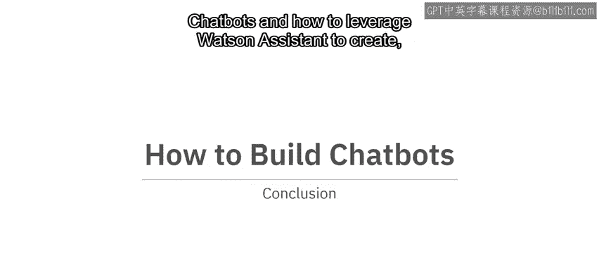

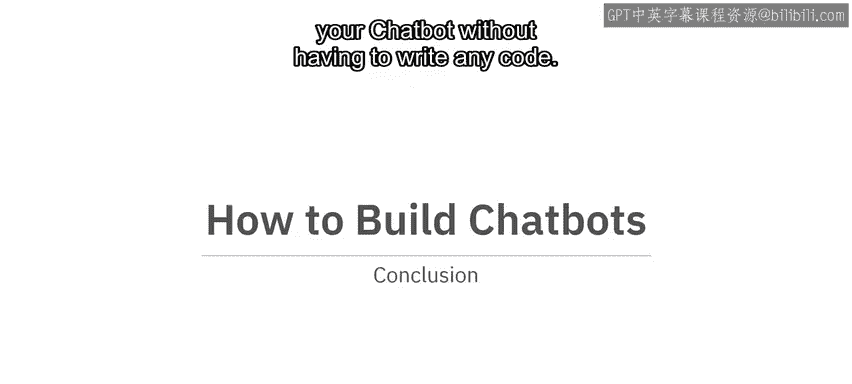

You might be wondering what's next， so let's review some possible next steps for you。

First and foremost， if you haven't completed the course quizzes and exam， make sure you do so Next。

 if you are taking this course as part of a learning path or specialization。

 you might consider other Watson based courses that expand upon the fundamentals you mastered within this course。

I also recommend that you check out and read the official Watson Assist documentation。

 it has a wealth of knowledge and will allow you to learn about some finer points we couldn't cover in this course。

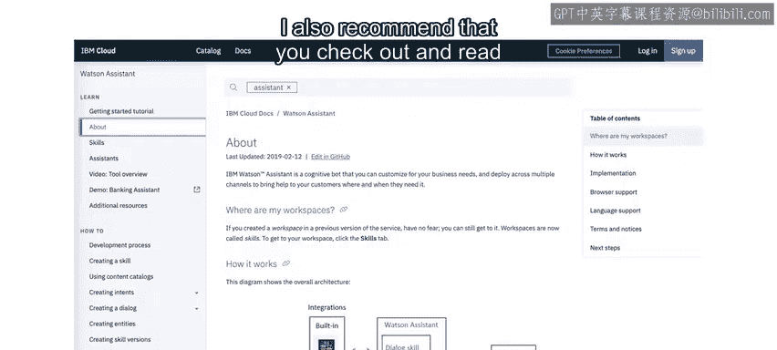

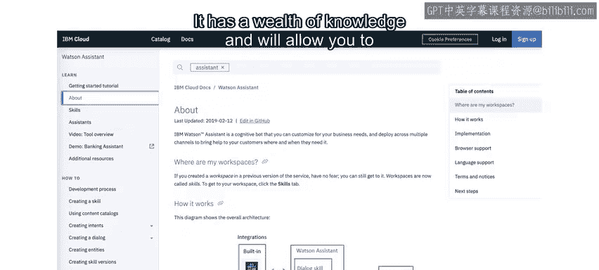

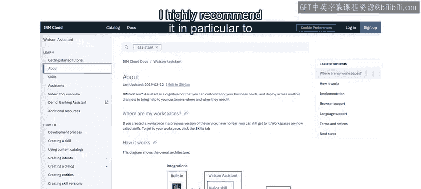

I highly recommend it in particular to programmers who took this course。

The documentation covers some advanced features that will be available to those who have programming experience or are not afraid of giving it a shot。

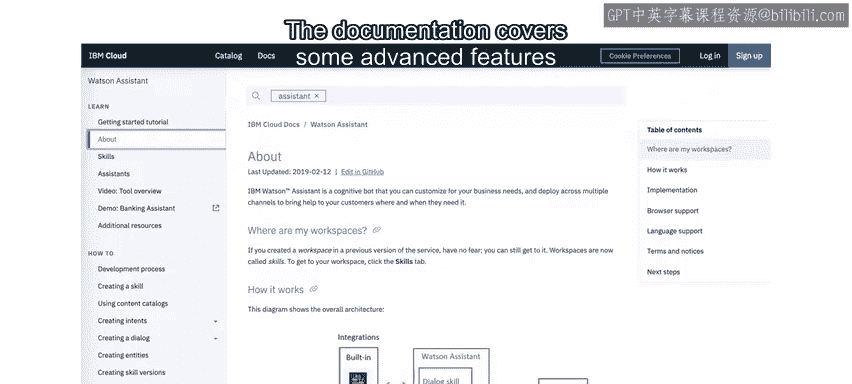

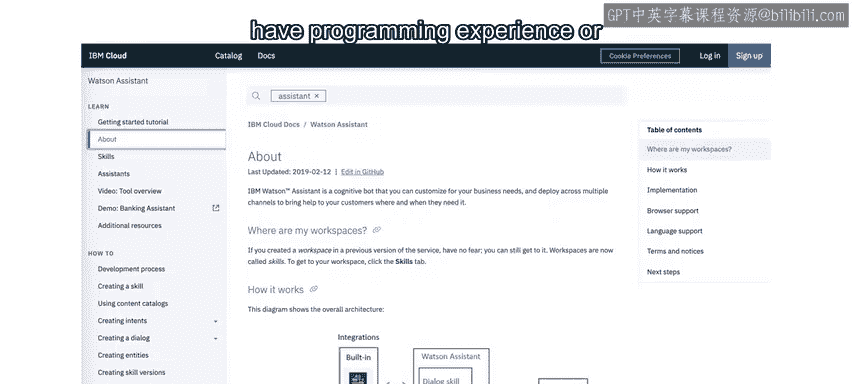

On that note， if you are a programmer， you may want to check out the IBM code Pat site。

 where you'll find sample code related to among others， chatbots and artificial intelligence。

Many of these patterns leverage Watson assistantsant， along with other Watson services。

 to create smart and useful chatbots。One such service is actually available to everyone。

 even if you don't have programming skills。

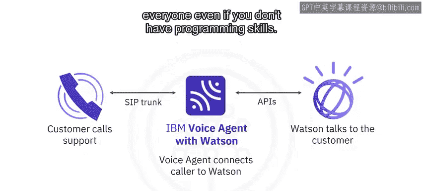

I'm talking about IBM Voice agent with Watson， a plug and play service that connects to your Watson Assant chatbot to make it available over the phone。

 same chatbot just over audio rather than text。

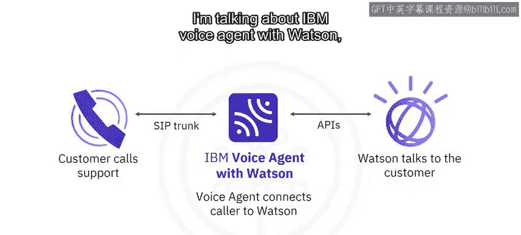

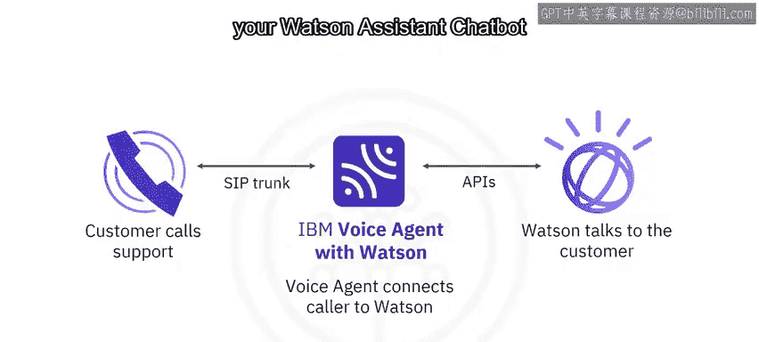

This is something your business or your clients might find highly appealing。

 so it's worth checking out in the IBM Cloud catalog。

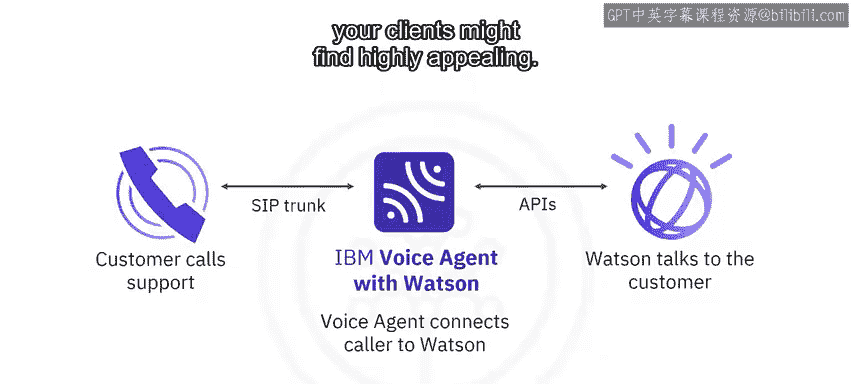

In my experience as someone who also loves to learn online。

 courses like this are great at providing an overview of what's possible and how you might go about accomplishing a given task。

I have given you the lay of the land， if you will。But you won't truly master these concepts unless you take the time to create something on your own。

We humans tend to learn by doing。So use these videos as much as needed。

 reference the Watson Assant documentation as you see fit。Take a look at the code Pat examples。

But try to come up with your own chatbot to polish and fine tune your skills as a chatbot builder。

If you have questions in the process of creating your own chatbot。

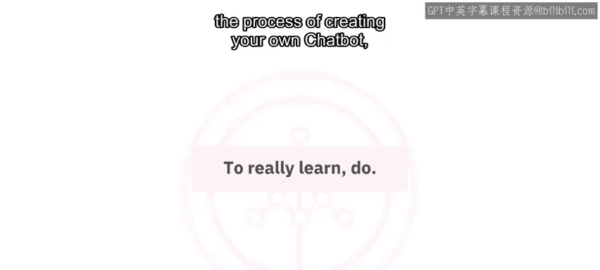

Feel free to pose them in the discussion forum for this course。

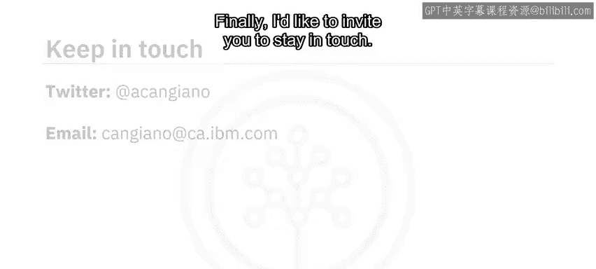

Finally， I'd like to invite you to stay in touch。You can follow and interact with me on Twitter。

 my username is AC AnGiano Also if you build something cool after taking the course。

 feel free to share it with me there。If you don't use Twitter or would like a more private setting。

 you can also email me at canggiiano。ca。ibm。com to show me what you built。

We are more than happy to feature people who make good use of our AI technology。

 so this could be your opportunity to have your project or company featured somewhere on the IBM site。

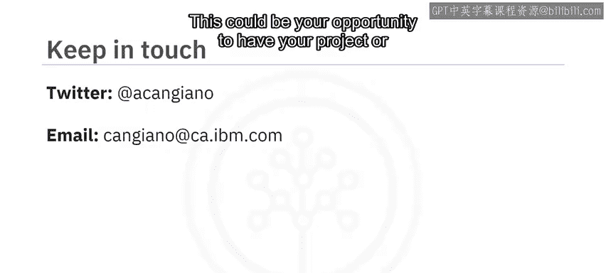

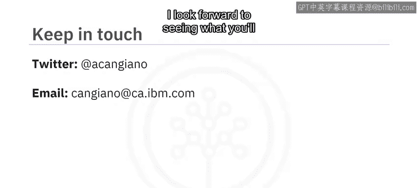

I look forward to seeing what you'll build， all the best to you， and good luck。

