# IBM应用人工智能（从0开始搭建AI机器人）｜IBM Applied AI （中英字幕） - P63：11_创建Watson操作.zh_en - GPT中英字幕课程资源 - BV1p64y1H7LM

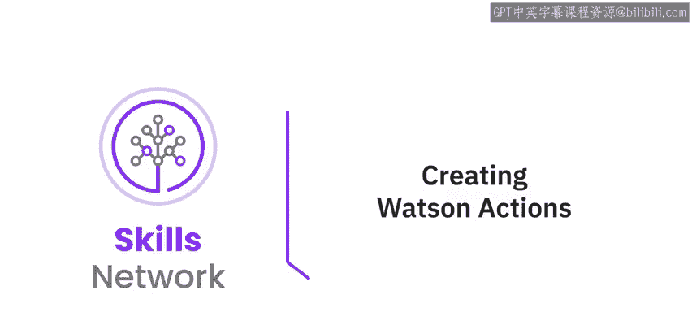

Welcome to Creating Watson A。

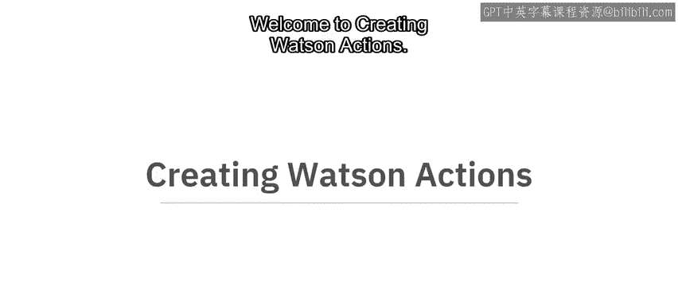

After watching this video， you will be able to explain actions and their structure in the product UI。

 explore the actions build process and feature set。

 test your first action and preview your first action with a realistic simulation。

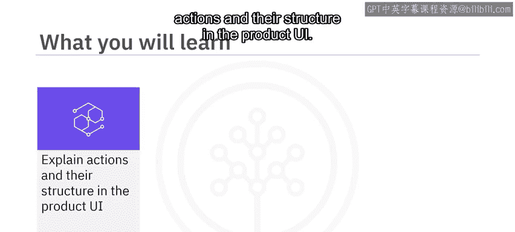

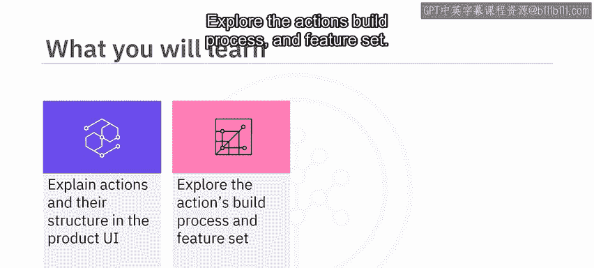

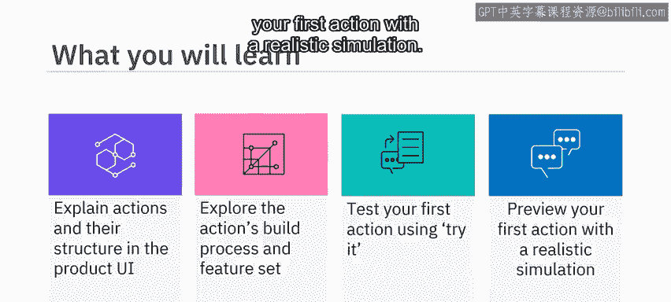

An action is a problem or a task that your customer wants to resolve Anything from paying a bill。

 getting an invoice or asking about the weather could be an action in your assistant a step is just a backand forth interaction between your assistant and your customer Simply put steps represent the clarification questions。

 final answers or human agent handoff points in the action。

 Other information required by the step to function such as the flow logic response options or storage of the user's response is contained within the structure of the action itself。

 There is no need to create separate entities and intent as part of a dialogue skill。

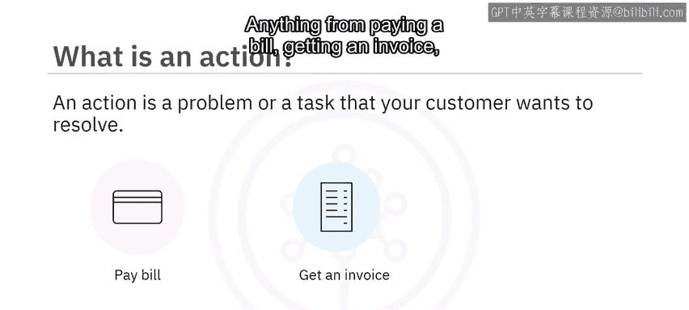

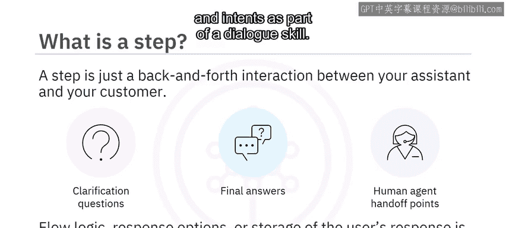

You will be prompted to create your first assistant when you first launch the new experience。

 enter the name of the assistant that represents the domain of topics you want it to handle。

 for example， if you are building an assistant to handle support questions in your billing department。

 you can name it the billing assistant。

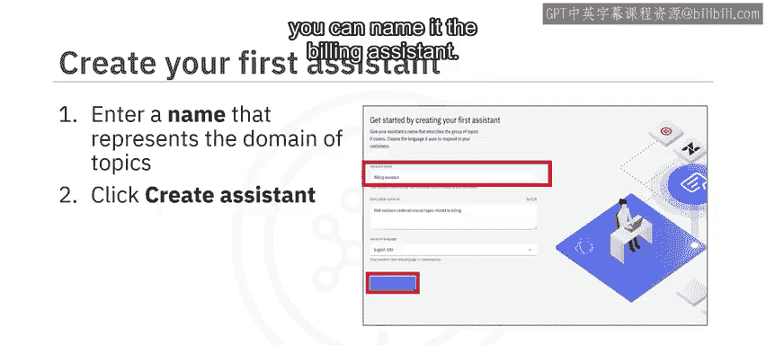

So let's build a conversation flow using a billing example。For an internet or phone bill。

 the customer will be sent to the online billing portal for cable bills。

 our fictional company's policy dictates that a human agent will receive the payment In this case。

 the assistant needs to acquire the customer's account number to speed the transaction with the human agent。

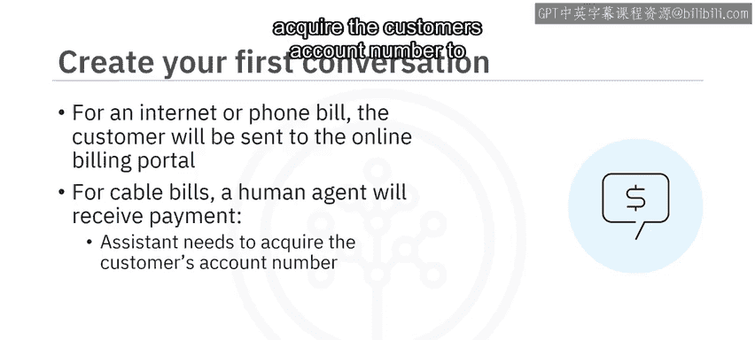

So let's build it。Start by creating your first action remember that actions represent the topics your assistant can handle。

 such as Pay bill you need to train your assistance， topic recognition。

 artificial intelligence or AI by giving it some example sentences start with the first one here。

 something like I want to pay my Cap bill please。

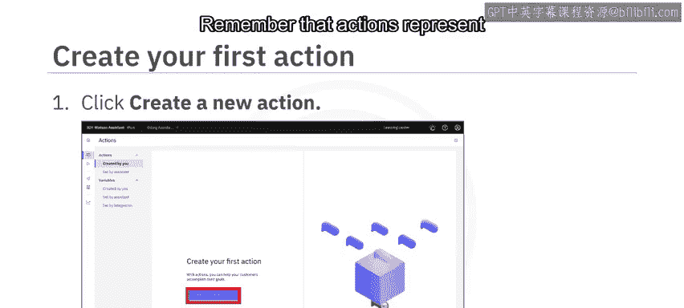

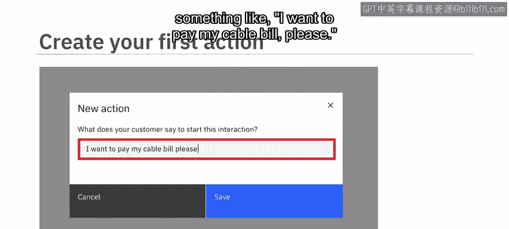

Now it's time to create the first step in the bill pay interaction。

 we'll start with the clarification question around the customer's account type。

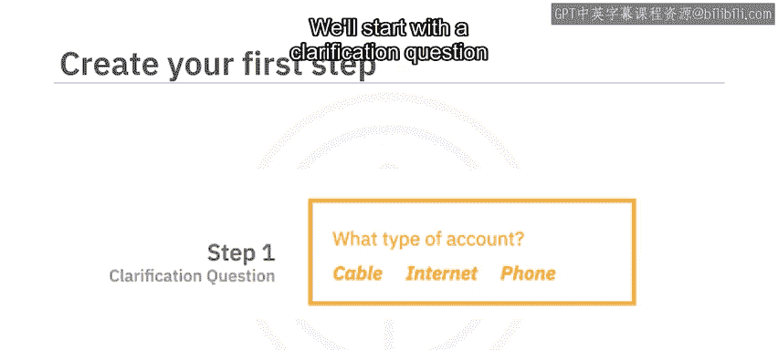

Step one was already created for you， so move to it and add the clarification question in the assistant says text box。

 something along the lines of what type of account are we talking here？

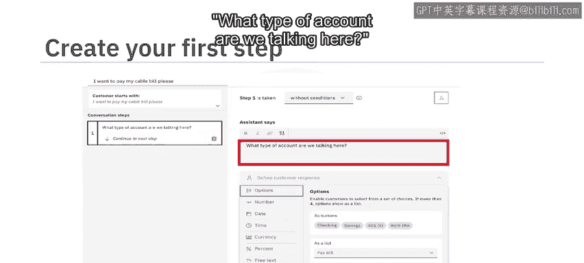

Then select the type of customer response the assistant should wait for in this case。

 options are the best choice， and the three options for cable。

 internet and phone and apply your changes。

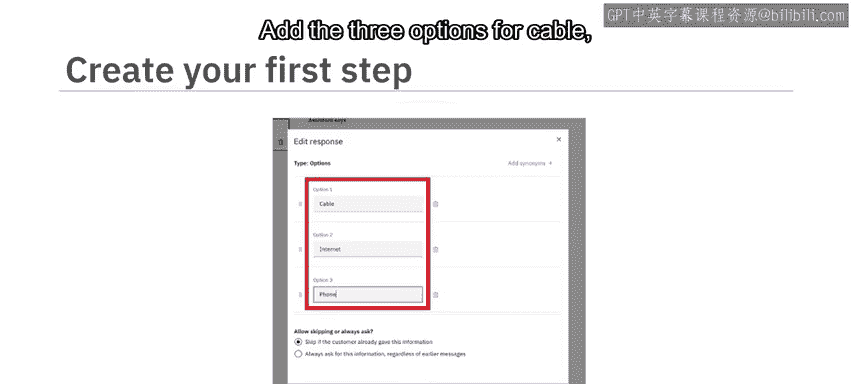

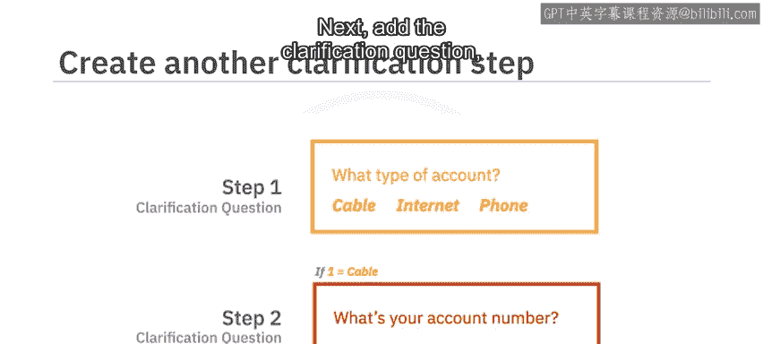

Next add the clarification question asking for the account number， for example。

 enter what's your account number， then you need to define the customer response from the response drop down list。

 select number。

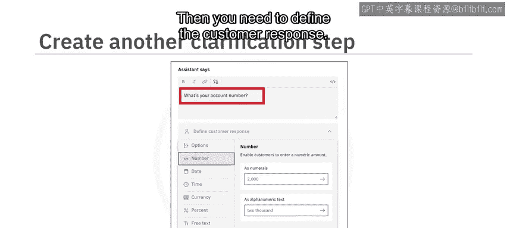

And next， you need to add some flow logic remember， given the logic flow。

 an account number should only be collected in the case of a cable bill to handle this scenario。

 you need to add a condition to your step to do that。

 change the step to be taken with conditions instead of without。

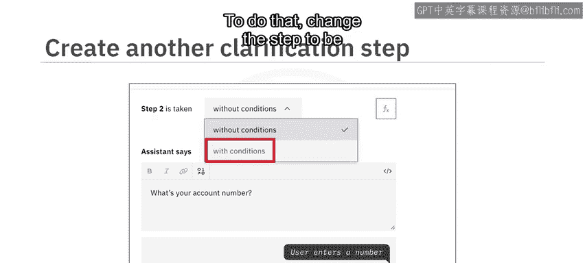

Now conditions are requirements which must be met for the step to be triggered in this case。

 you want to set a condition on the response to step1 as cable and not internet or phone ensure you have the condition set to step1 is equal to cable。

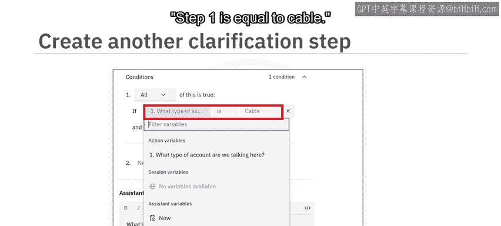

Great job you have almost finished building this action you just need to add steps three and4。

 each of which provides the outcome for the user Let's start with step3。

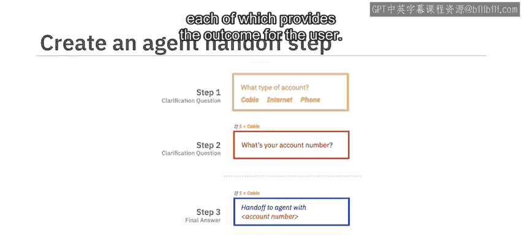

In step3， add some text below step two related to getting the user to an agent to pay their bill you can addLet me get you to an agent who can help you pay your cable bill。

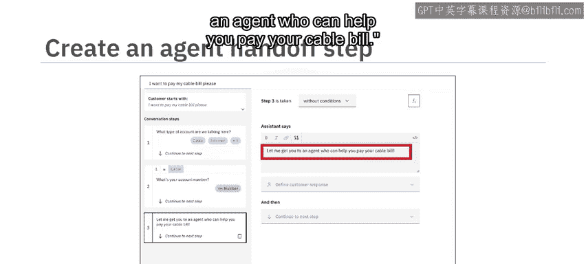

And finally， in the agent handoff step， you don't need to gather any information from the user so you can leave the Def customer response section empty。

 you should， however， set up the assistant to route this conversation to a human agent to add that under the and then setting select Connect to agent which will also end the action when it hands off。

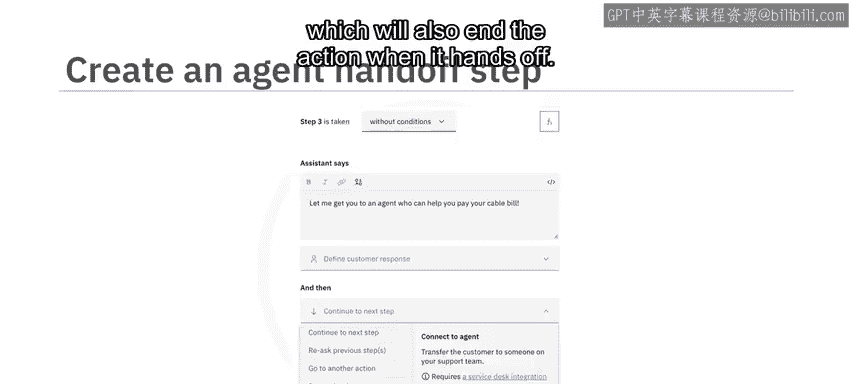

Lastly， add step4， you need to send the bill to an online portal。

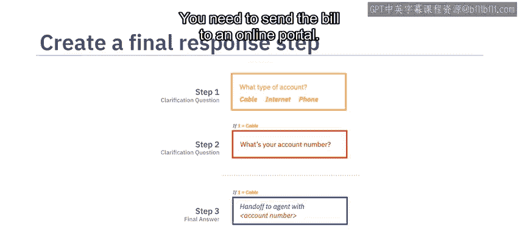

Under assistance says add something like to pay your include the type of bill bill。

 you can head to our online portal and give the link to the portal to insert a variable like the type of bill being paid。

 click the variable insertst button at the top of the text box。

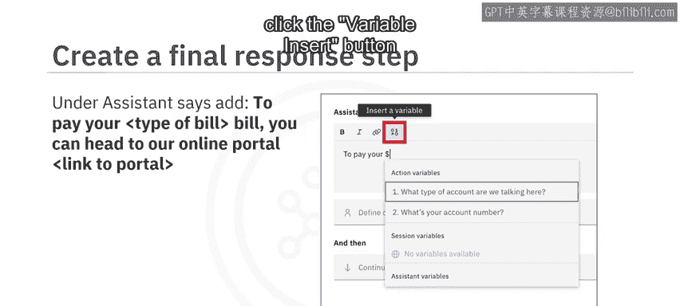

Now make sure this step only fires for an internet or phone bill to do that。

 create a condition for step1 is equal to internet。

 then add another condition for step1 is equal to phone。

 and after adding the conditions in the dropdown select any this way。

 any one of the conditions should be true and not all of them。

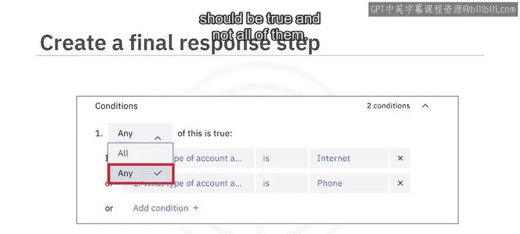

To end the action， change the and then setting by clicking on and the action。

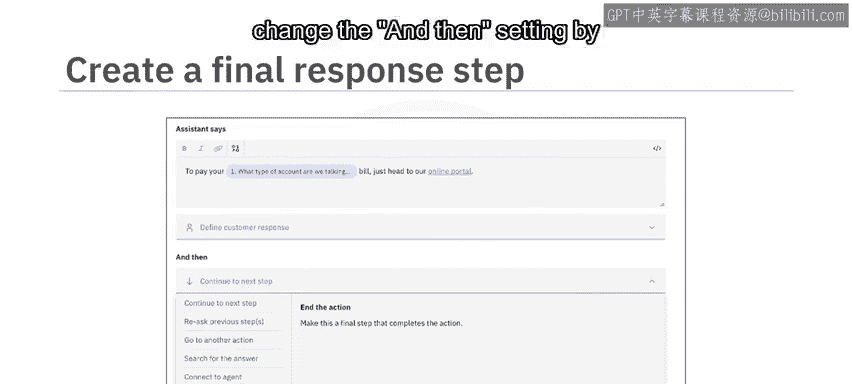

At the end， you should test the action to ensure that it is working as required。

 your steps should now be complete as shown on the screen。

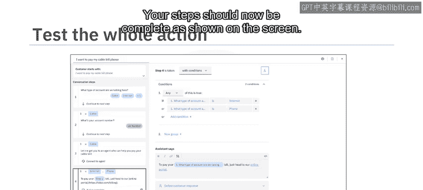

Just try a few scenarios where you state the type of bill up front。

 notice how the assistant skips that question and moves immediately to the next step。

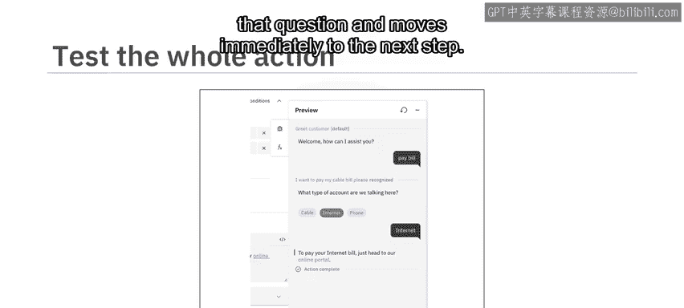

To see how your assistant would work on one of your channels， open the preview page。

 this page is a representation of your draft work in progress。

 it has an inline preview for you to test。And you can also share your work with others on your team quickly with a shareable URL。

 simply click the button to copy the URL to your clipboard。

 then paste it into any messaging service to share your draft with members of your team the embedable web chatt integration is included for you by default。

 and you can go to the integration catalog to add any other channels to your assistant such as phone integration。

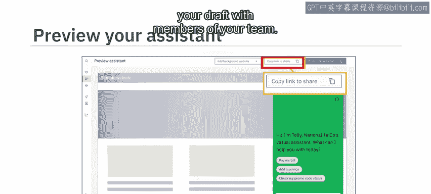

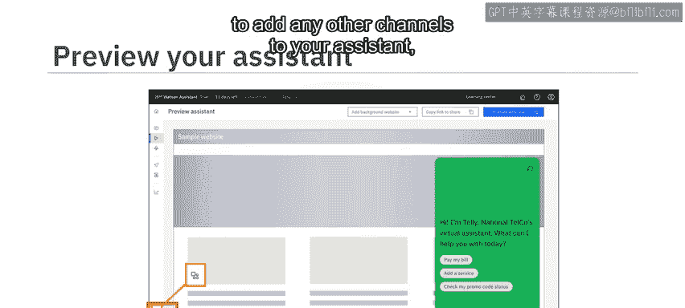

In this video you learned that an action is a problem or a task that your customer wants to resolve a step is just a back and forth interaction between your assistant and your customer other information required by the step to function such as the flow logic。

 response options or storage of the user's response is contained within the structure of the action itself。

 and you need to train your assistance topic recognition。

 artificial intelligence or AI by giving it some example sentences。

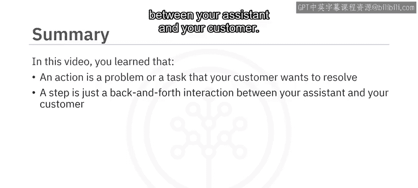

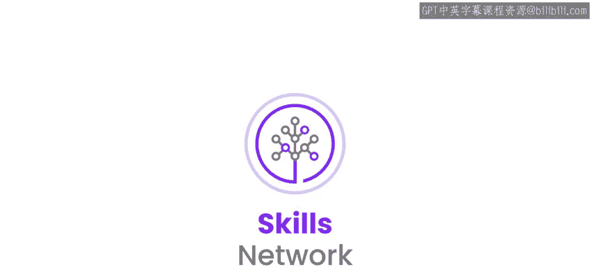