# IBM应用人工智能（从0开始搭建AI机器人）｜IBM Applied AI （中英字幕） - P64：12_将对话技能迁移到Watson操作.zh_en - GPT中英字幕课程资源 - BV1p64y1H7LM

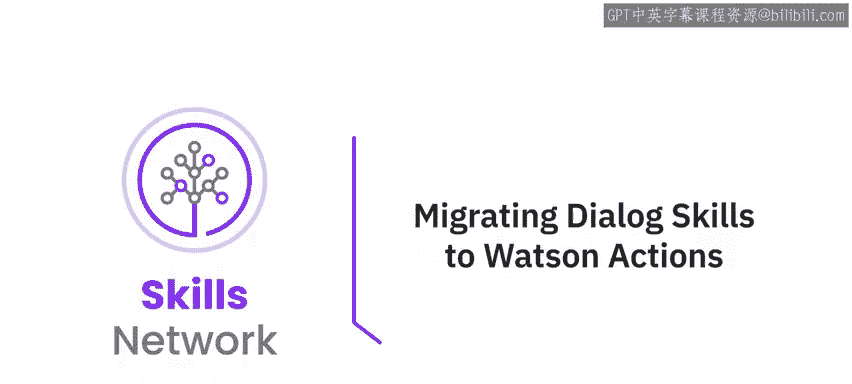

Welcome to Migrating Dio Skills to Watson Aions。

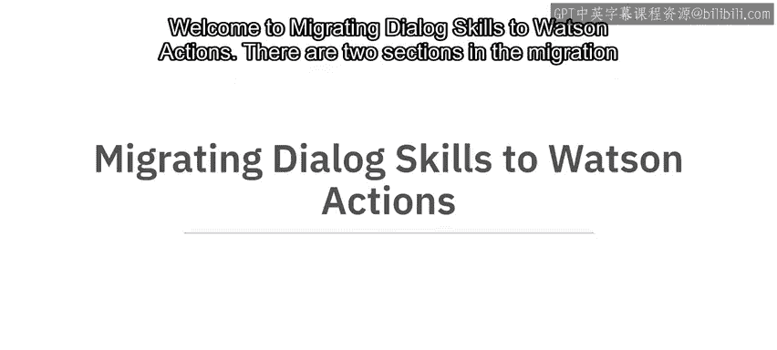

There are two sections in the migration course。 The first section is about how to switch from classic Watson Assant to new Watson assistantsant。

 and the second section covers migration of a dialogue skill to an action skill。

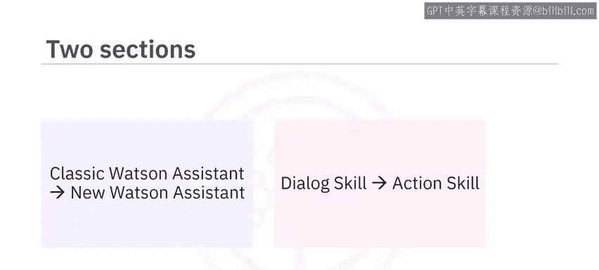

After watching this video， you will be able to switch between classicic and New Watson Assistant。

 activate dialogue in New Watson Assistant， call in action from dialogueo。

 migrate intents and entities separately， and add downloaded entities from a dialogue skill to an action skill。

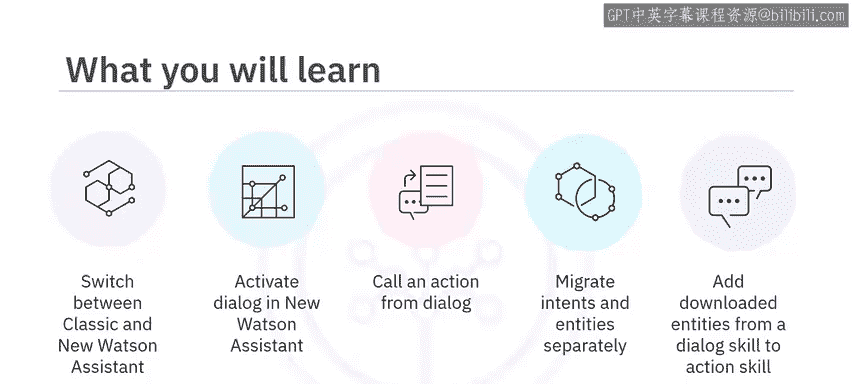

First， let us learn about the migration from classic to New Watson Assant。

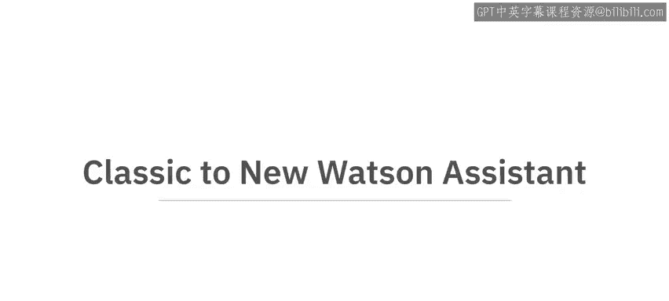

To migrate classic Watson assistantant to new Watson assistant。

 click the user icon at the top right corner。 You can switch between classic experience and new experience。

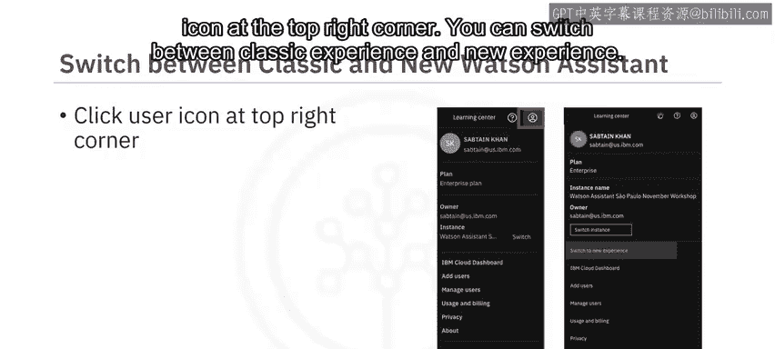

To use an existing dialogue skill， you need to activate the dialogueog feature in your assistant。

 then you can upload your existing skill。To activate the dialogueo feature in the new experience。

 create or open an assistant where you want to use a dialogue as the primary conversation with users。

 then click Assist settings。

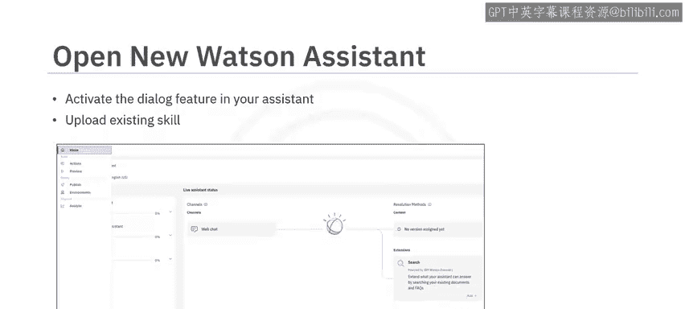

Next， click Activate dialog， the confirmation dialog box is displayed， click Activate dialog again。

 and once you activate the dialogueog feature， it takes precedence over actions。

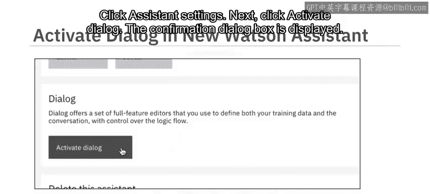

You can use actions to supplement a dialogue based conversation， however。

 the dialogue drives the conversation with users to meet their requests。

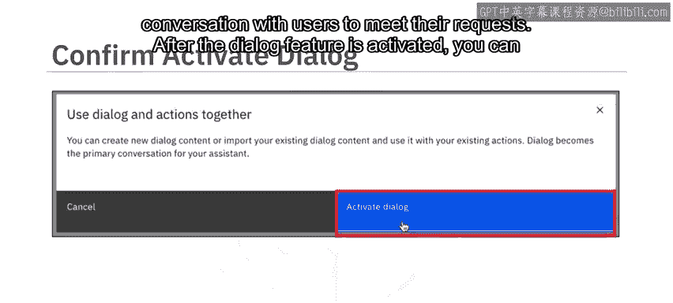

After the dialogueo feature is activated， you can start a new dialogue conversation or migrate an existing dialogue into the new Watson Assant。

To migrate an existing dialogue skill， use the classic experience to download your dialogue skill in J format in the new Watson assistantsant。

 open the dialogueog page in options， select upload slash download on the upload tab。

 upload the J file for your dialogue skill。

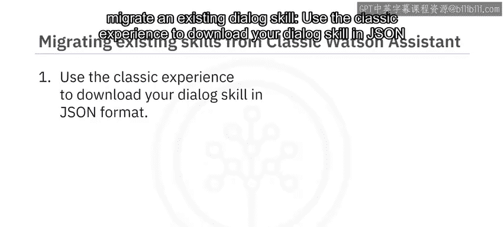

Now in Nuanceson Assant， you can use actions with your primary dialogue conversation。

 a dialogue feature takes precedence over actions。A dialogue note calls an action to perform a task and then return to the dialogue。

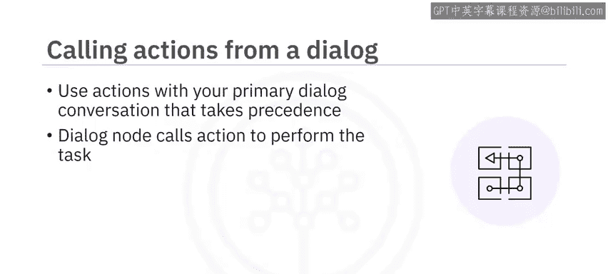

From a single dial node， you can either call an action if you want to perform a discrete and self contained task and then return to the dialogue to be ready to address any new user requests。

 data collected from the user during action processing must be stored as a session variable for it to be passed to the dial。

Call a web hook if you want to send a request to a web service to complete a task and return a response that can be used later by this dialogue。

Now you might want to call in action from a dialogue in the following scenarios。

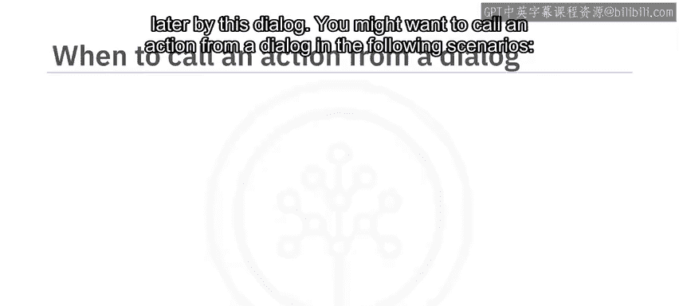

You want to perform an action from multiple dialogue threads。 For example。

 you want to ask customers how satisfied they are with your service。

 You can define a single action to check customer satisfaction and call it from multiple branch ending dialogue nodes。

 In this scenario， you don't need to define an intent， such as check satisfaction。

 The action is called automatically replacing a jump to another dialogue nodes response。

Another could be。 you want to see how actions work in this scenario。

 you can pick an intent for the action to handle。 If you plan for the action to be called from the dialogue only。

 you can spend your time defining the user examples for the intent that triggers the dialogue note。

 And when you define the action， you can add one customer example only reducing the time you need to spend building the action。

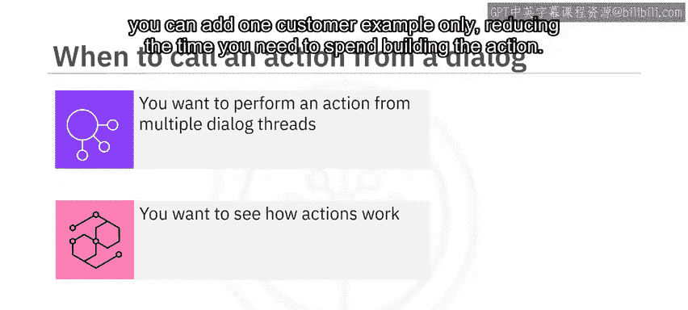

To call an action from a dialog node from the dialog node， click customize。

 set call out to web hookooks slash actions to on。 Now， select call in action。

 When you add a call to in action。 Multiple conditional responses are enabled for the dial node automatically。

 click apply and in the dialog node， choose the action you want to call。

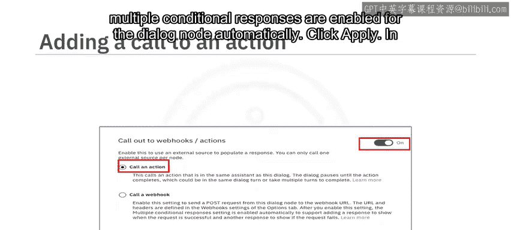

Under then call out to my action section， select one of the action titles。 Note。

 you need to have an action first to select a call out to an action。

Click add parameters to add key parameters to be sent with the call out。Next。

 let's go through how to build or migrate a dialogue skill as an action。

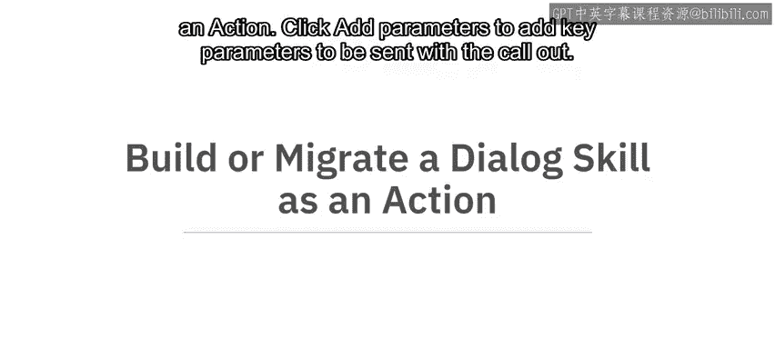

You can migrate your intents and entities from the classic Watson Assist experience to the new Watson Assistant experience。

You can download Ins to a CSV file， which you can then upload and reuse as actions or example phrases in the new Watson Assistant experience。

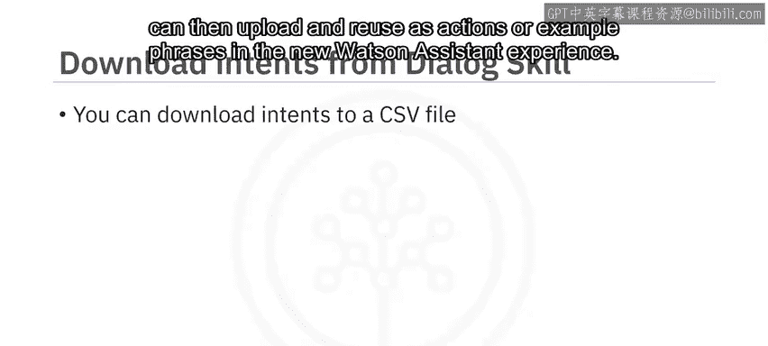

Now， go to the intense page。 select the intents you want to download and then click the download icon Downed examples will be in a CSV file。

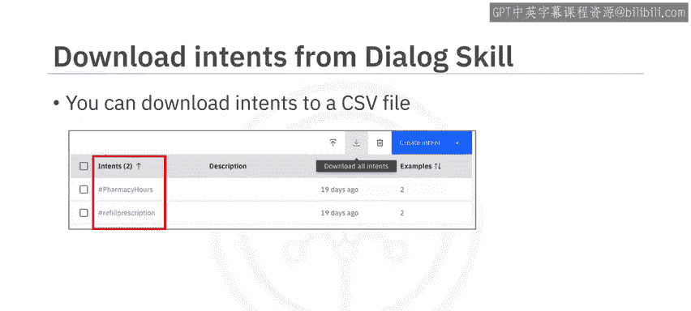

Go to the entities page， select the entities and then click the download icon。

 specify the name and location of the CSV file and click Sa。

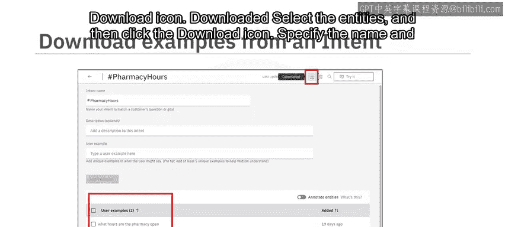

Now， go to the actions table in the new Watson assistantant。 Click the upload icon。

 Select the CSV with intents from dialogueo。 A new action will be created per intent with examples added per intent。

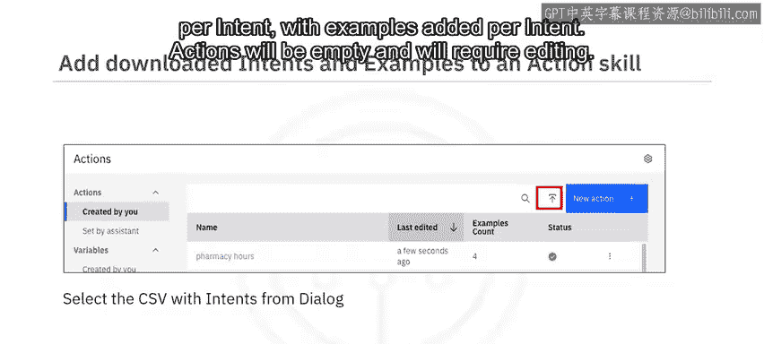

Actions will be empty and will require editing。And now go to the Aions table in the new Watson Assistant。

 select an action， click the upload icon， select the CSV with example phrases。

 and action will populate with examples。

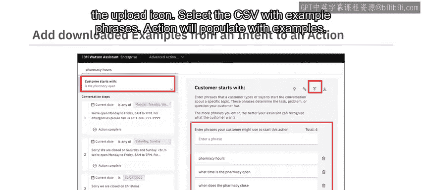

Now go to the Sa Reponse table in the new Watson Assistant， click the upload icon。

 select the CSV with required En。Table will populate with entities as saved responses。

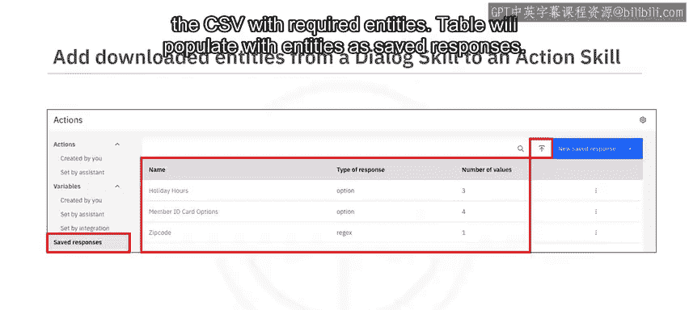

If you plan to use a downloaded intent file to upload example phrases for a specific action。

 Down only a single intent In the new experience， only one intent can be uploaded per action。

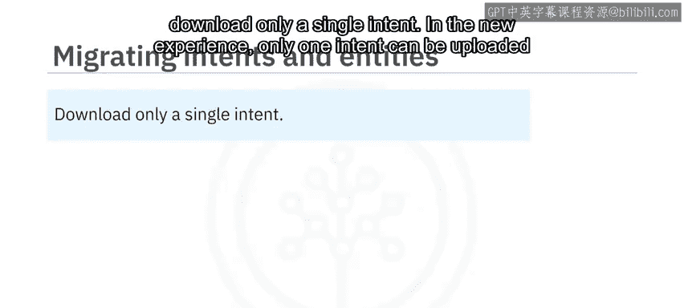

Specify the name and location in which to store the CSV file that is generated and click Save。

You can now perform the following tasks to migrate information to the new Watson Assant。

Upload intents as actions and upload the examples from a single intent as example phrases for a specific action。

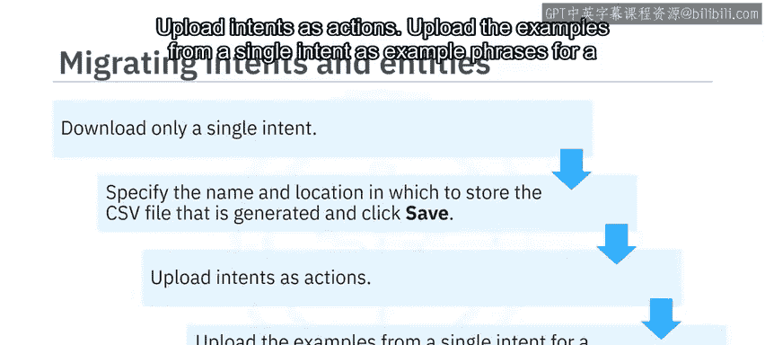

In this video， you learned that to use an existing dialogue skill。

 you need to activate the dialogue feature in your assistant。Once you activate the dialogue feature。

 it takes precedence over actions。 You can migrate your intents and entities from the classic Watson Ass experience to the new Watson Ass experience。

😊。

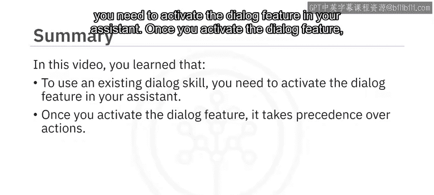

And a dialogue note calls an action to perform a task and then return to the dialogue。

