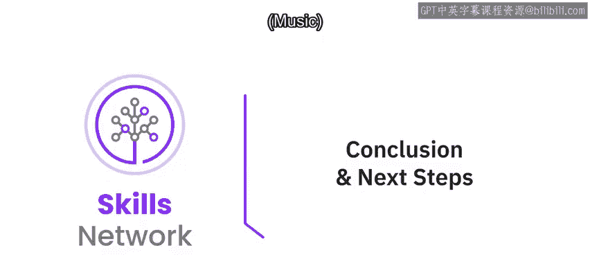
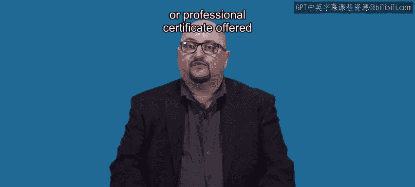

# IBM应用人工智能（从0开始搭建AI机器人）｜IBM Applied AI （中英字幕） - P65：13_最终建议.zh_en - GPT中英字幕课程资源 - BV1p64y1H7LM

Congratulations on completing my course on building chatbots without programming I hope you enjoy the course by now you should have a much clearer picture of why chatbots matter the business opportunity they provide and how to go about creating them This course laid the foundation for you showing you how to leverage Wasson assistant for the creation of simple but useful chatbots。

Now that you know the basics， you might wonder what's next。

My recommendation is that you start building your own chatbot。

 whether it's a personal chatbot for your own home page or a chatbot that serves a business need。

There is no substitute for real practiceBeyond that I would suggest that you pursue your chatbot education if you will further by taking another course of mine calledBuild AI applications with Watson APIs its the logical followup course as it teaches you how to create more advanced AI applications in chatbots by integrating Watson assistant with other AI services such as Discover and speech APIs This allows you to leverage your newly acquired chatbot buildinging skills and take them further by ending in some coding。

In fact， if you enjoyed this course and see the potential in AI。

 I would recommend that you set yourself apart from the competition by enrolling in the AI specialization or professional certificate offered by IBM here on Coursera。

I look forward to seeing you succeed。

