# IBM应用人工智能（从0开始搭建AI机器人）｜IBM Applied AI （中英字幕） - P68：2_字符串操作.zh_en - GPT中英字幕课程资源 - BV1p64y1H7LM

In Python， a string is a sequence of characters。A string is contained within two quotes。

 You could also use single quotes。A string can be spaces or digits。

 A string can also be special characters。😊，We can bind or assign a string to another variable。

 It is helpful to think of a string as an ordered sequence。

 Each element in the sequence can be accessed using an index represented by the array of numbers。

 The first index can be accessed as follows。 We can access index 6， Moreover。

 we can access the 13th index。 We can also use negative indexing with strings。

 The last element is given by the index negative  one。

 The first element can be obtained by index negative 15 and so on。

 We can a string to another variable。 It is helpful to think of string as a list or tuple。

 We can treat the string as a sequence and perform sequence operations。

 We can also input a stride value as follows。 The two indicates we select every second variable。

 We can also incorporate slicing。 In this case， we return every second value up to index 4。

 We can use the Le command to obtain the length of the string。 as there are 5。😊。

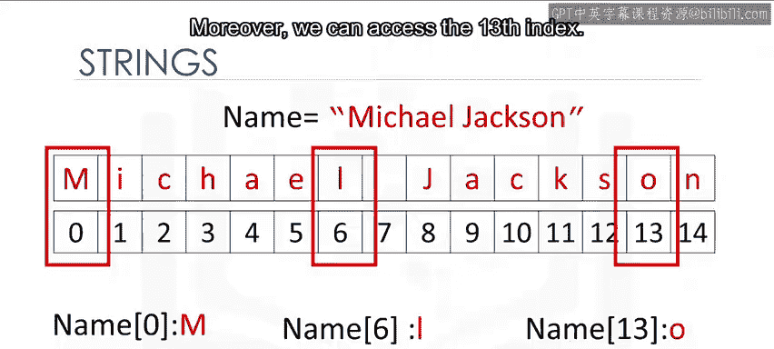

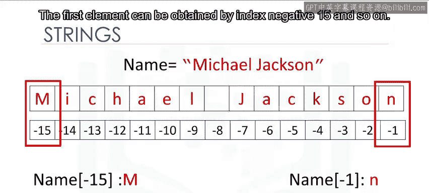

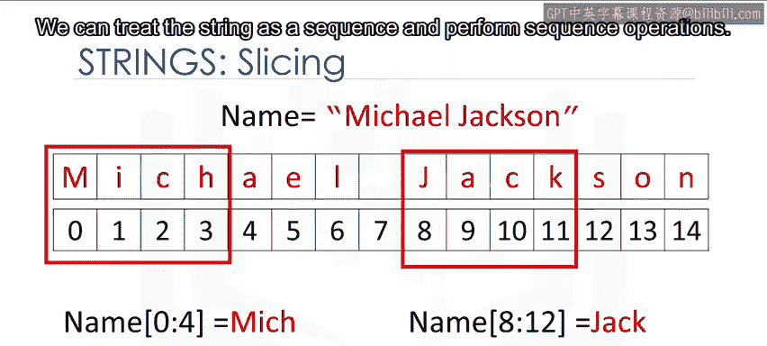

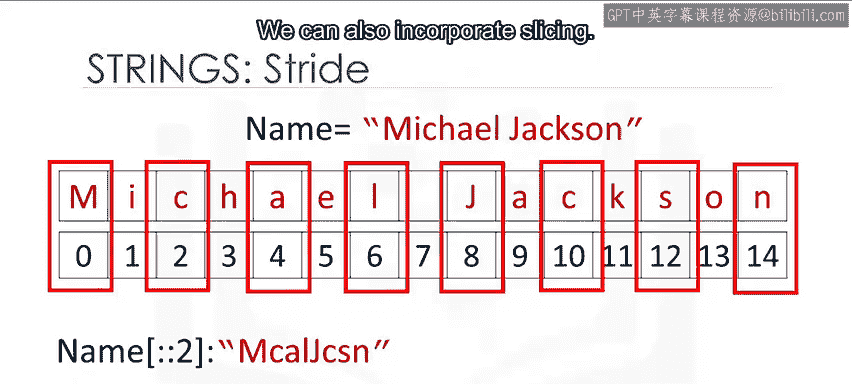

Ements， the result is 15。 We can concatenate or combine strings。 We use the addition symbols。

 The result is a new string that is a combination of both。 We can replicate values of a string。

 We simply multiply the string by the number of times we would like to replicate it。 In this case，3。

 The result is a new string。 The new string consists of three copies of the original string。

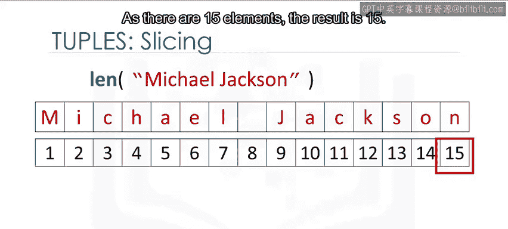

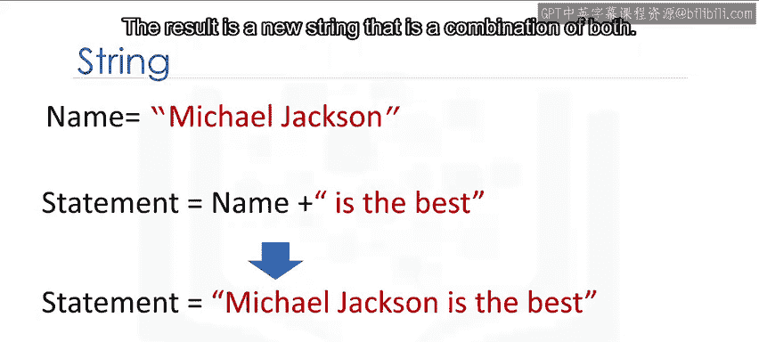

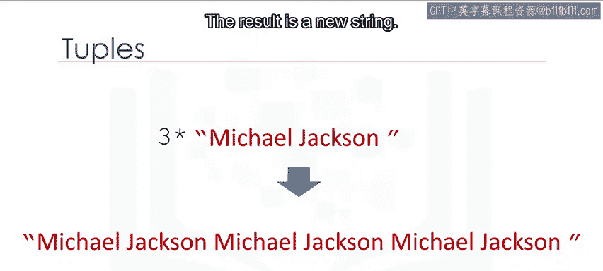

This means you cannot change the value of the string， but you can create a new string。For example。

 you can create a new string by setting it to the original variable and concatenated with a new string。

 The result is a new string that changes from Michael Jackson to Michael Jackson is the best。

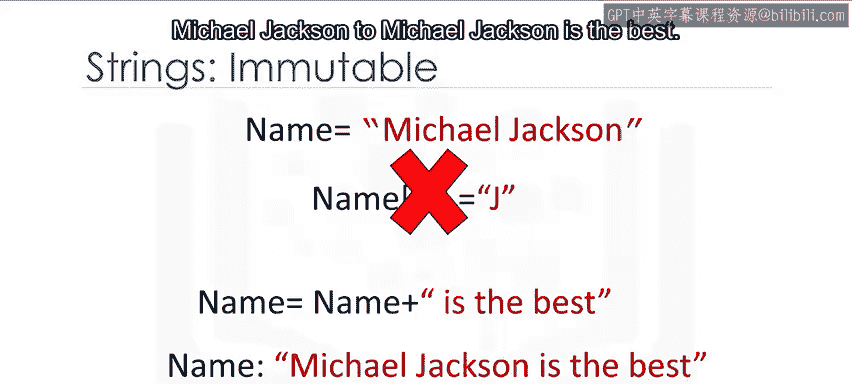

Strings are immutable。 Back slashes represent the beginning of escape sequences。

 Escape sequences represent strings that may be difficult to input。 For example。

 back slashes N represent a new line。 The output is given by a new line after the back slashes N is encountered。

 Similarlyly， back slash T represents a tab。 The output is given by a tab where the back slash T is。

 If you want to place a back slash in your string。 Use a double back slash。

 The result is a back slash after the escape sequence。

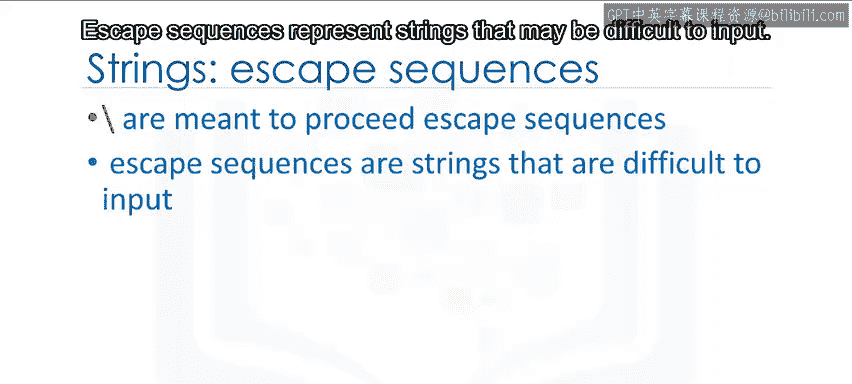

We could also place an R in front of the string。

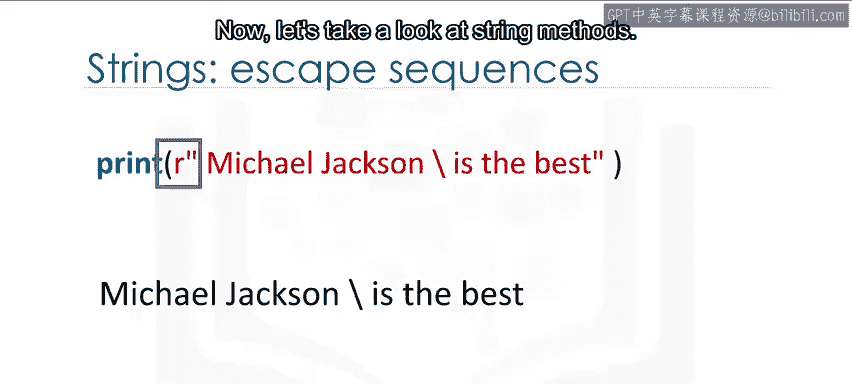

Now let's take a look at string methods。Strings or sequences and as such。

 have applied methods that work on lists and tuples。

 Strings also have a second set of methods that just work on strings。

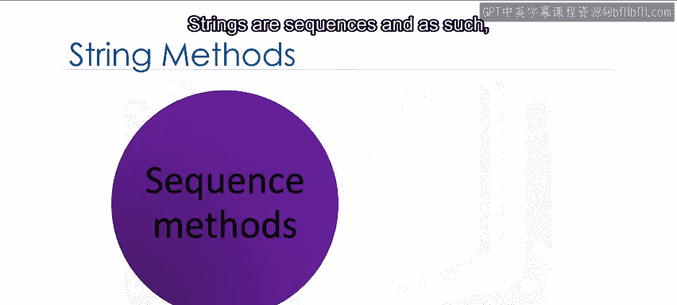

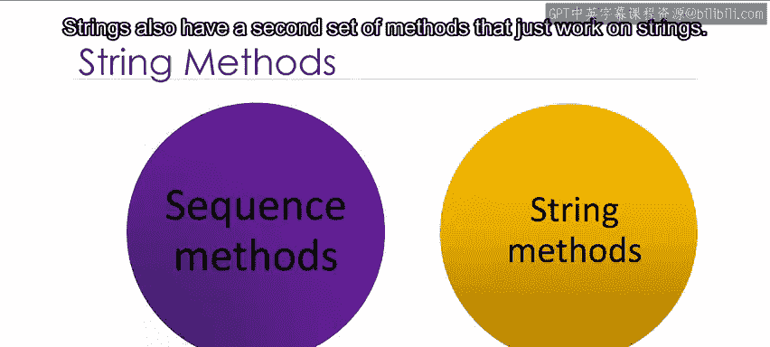

When we apply a method to the string A， we get a new string B， that is different from A。

 Let's do some examples。 Let's try with a method upper。

 This method converts lowercase characters to uppercase characters。 In this example。

 we set the variable A to the following value。 We apply the method upper and set it equal to B。

 The value for B is similar to a， but all the characters are uppercase。

 The method replaces a segment of the string， I。e。 a substr with a new string。

 We input the part of the string we would like to change。

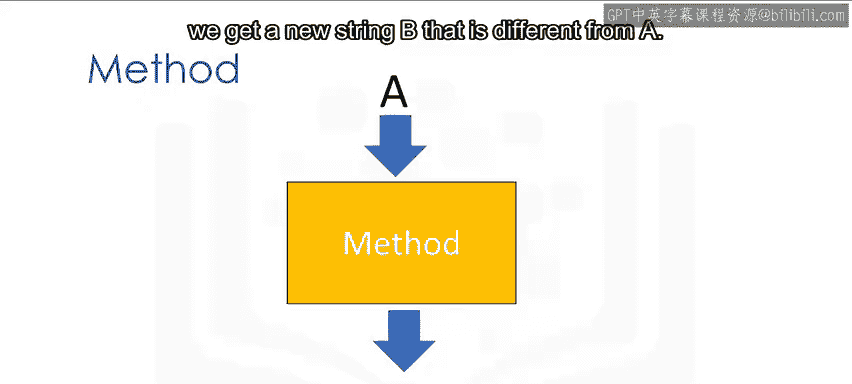

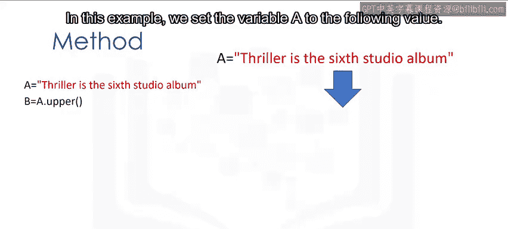

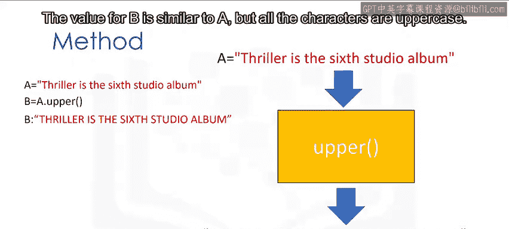

The second argument is what we would like to exchange the segment with。

The result is a new string with the segment changed。

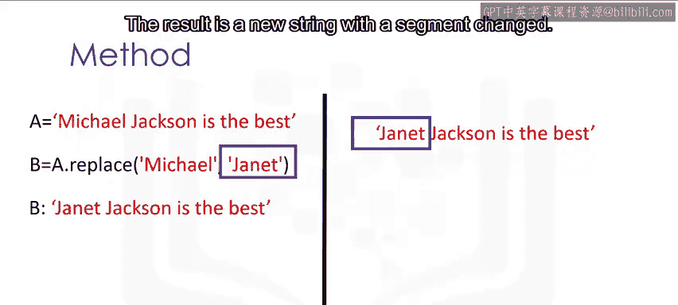

The method find fine substrs。The argument is the substr you would like to find。

The output is the first index of the sequence。We can find the substr jack。

If the substr is not in the string， the output is negative1。 check the labs for more examples。

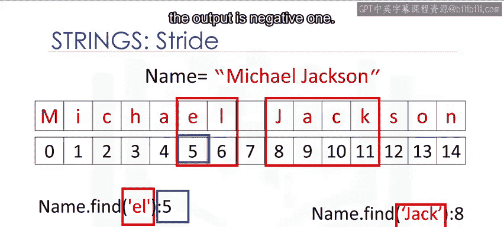