# IBM应用人工智能（从0开始搭建AI机器人）｜IBM Applied AI （中英字幕） - P72：6_条件和分支.zh_en - GPT中英字幕课程资源 - BV1p64y1H7LM

In this video， you will learn about conditions and branching。

 comparisonison operations compareare some value or operaand。 Then based on some condition。

 they produce a boolean。 Let's say we assign a value of a to 6。

 We can use the equality operator denoted with two equal signs to determine if two values are equal。

 In this case， if 7 is equal to 6。 In this case， as 6 is not equal to 7， the result is false。

 If we performed an equality test for the value 6。 the two values would be equal。 As a result。

 we would get a true。 Consider the following equality comparison operator。

 If the value of the left operaand in this case， the variable。

 I is greater than the value of the right operaand in this case，5。

 the condition becomes true or else we get a false。 Let's display some values for I on the left。

 Let's see the values greater than 5 in green and the rest in。

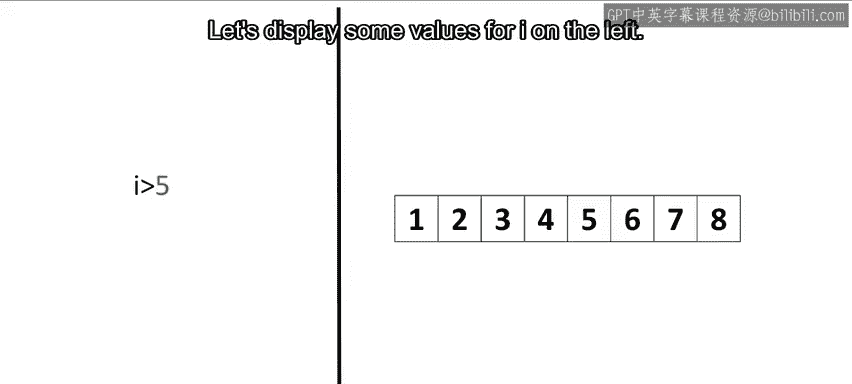

If we set I equal to 6， we see that 6 is larger than 5。 and as a result， we get a true。

 We can also apply the same operations to floats。 If we modify the operator as follows。

 If the left operaand I is greater than or equal to the value of the right operaand， In this case，5。

 then the condition becomes true。 In this case， we include the value of 5 in the number line。

 and the color changes to green accordingly， If we set the value of I equal to 5。

 the operaand will produce a true。 If we set the value of I to 2， we would get a false。

 because two is less than 5。 we can change the inequality。

 If the value of the left operaand in this case， I is less than the value of the right operaand。

 In this case，6。 then condition becomes true。 again。

 we can represent this with a colored number line。 The areas where the inequality is true are marked in green and red where the inequality。

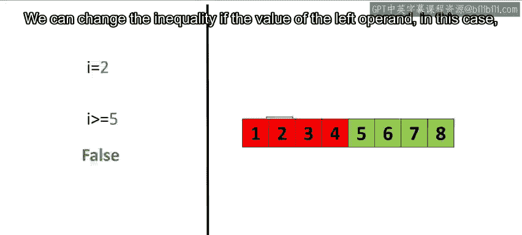

Is false。 If the value for I is set to2， the result is a true， as two is less than 6。

 The inequality test uses an explanation mark preceding the equal sign。

 If two operarans are not equal than the condition becomes true。 We can use a number line。

 when the condition is true， the corresponding numbers are marked in green and red for where the condition is false。

 If we set I equal to2， the operator is true as two is not equal to 6。 we compare strings as well。

 comparinging A C， D C and Michael Jackson using the equality test， we get a false。

 as the strings are not the same。 using the inequality test。

 we get a true as the strings are different。 See the labs for more examples。

 branching allows us to run different statement for a different input。

 It's helpful to think of an if statement as a locked room。 If the statement。

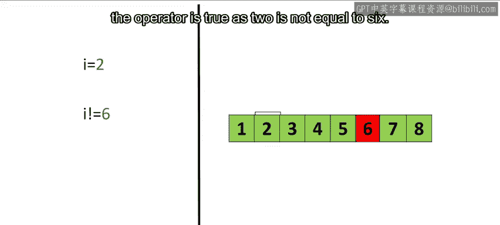

Is true。 You can enter the room， and your program can run some predefined task。

 If the statement is false， your program will skip the task。 For example。

 consider the blue rectangle representing an A DC concert。 If the individual is 18 or older。

 they can enter the A DC concert。 If they are under the age of 18， they cannot enter the concert。

 Individual proceeds to the concert。 Their age is 17。 Therefore。

 they are not granted access to the concert。 and they must move on。If the individual is 19。

 the condition is true， they can enter the concert。 then they can move on。

 This is the syntax of the if statement from our previous example。 We have the if statement。

 We have the expression that can be true or false。 The brackets are not necessary。 We have a colon。

 within an indent， we have the expression that is run。 If the condition is true。

 The statement after the if statement will run regardless of the condition is true or false for the case where the age is 17。

 we set the value of the variable age to 17。 We check the if statement， The statement is false。

 Therefore， the program will not execute the statement to print。 you will enter In this case。

 it will just print， move on for the case where the age is 19。

 we set the value of the variable age to 19。 We check the if statement。 The statement is true。

 Therefore， the program will execute the statement to print。 you will enter。 then。It will just print。

 move on。 The E statement will run a different block of code。 If the same condition is false。

 Let's use the AcDC concert analogy again。 If the user is 17， they cannot go to the ADC concert。

 but they can go to the meatloaf concert represented by the purple square。 If the individual is 19。

 The condition is true。 They can enter the AcDC concert。 Then they can move on as before。

 The syntax of the L statement is similar。 We simply append the statement else。

 We then add the expression we would like to execute with an indent。

 for the case where the age is 17， we set the value of the variable age to 17。

 We check the if statement。 The statement is false。 Therefore， we progress to the E statement。

 We run the statement in the indent。 This corresponds to the individual attending the meatloaf concert。

 The program will then continue running。

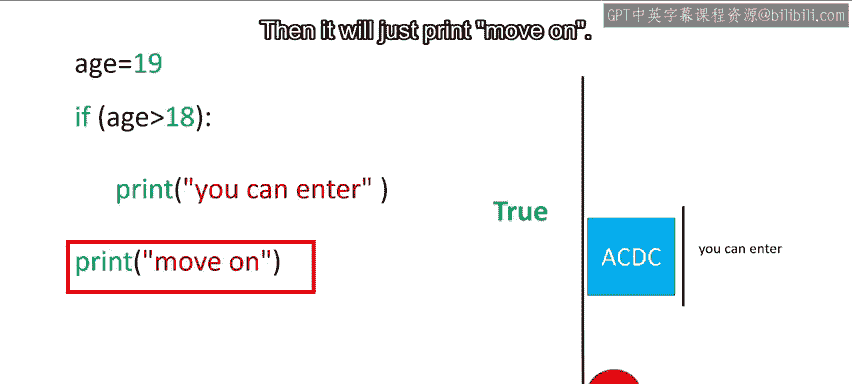

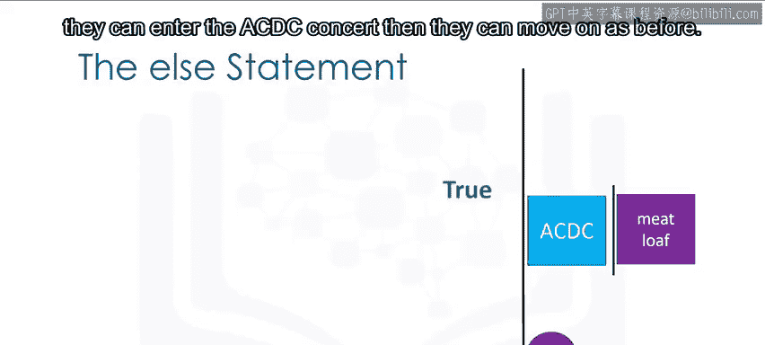

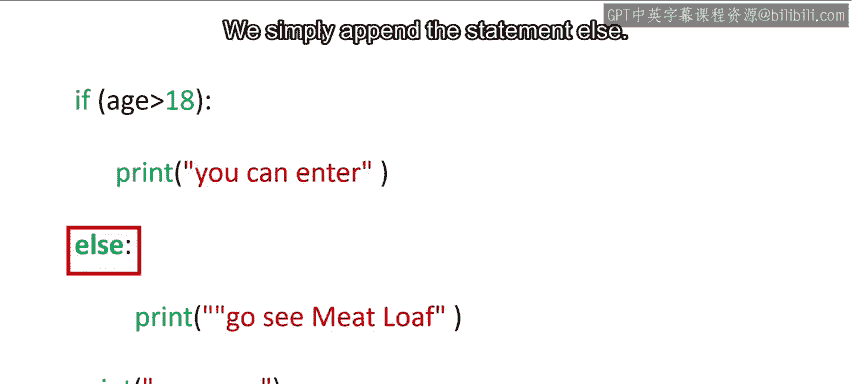

For the case where the age is 19， we set the value of the variable age to 19。

 We check the if statement。 The statement is true。 Therefore。

 the program will execute the statement to print。 you will enter。

 The program skips the expressions in the Elf statement and continues to run the rest of the expressions。

 The if statement short for else。 if allows us to check additional conditions。

 If the proceedceding condition is false。 If the condition is true。

 the alternate expressions will be run。 Consider the concert example， If the individual is 18。

 they will go to the pinknk Floyd concert instead of attending the A DC or Meloaf concerts。

 The person of 18 years of age， enters the area as they are not over 19 years of age。

 They cannot see A DC。 but as they are 18 years， they attend Pink Floyd。 After seeing Pink Floyd。

 they move on。

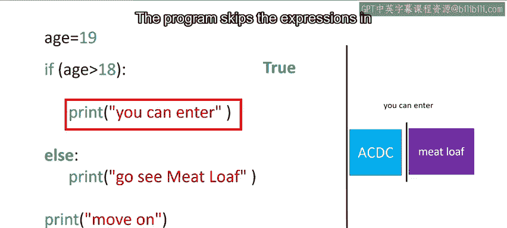

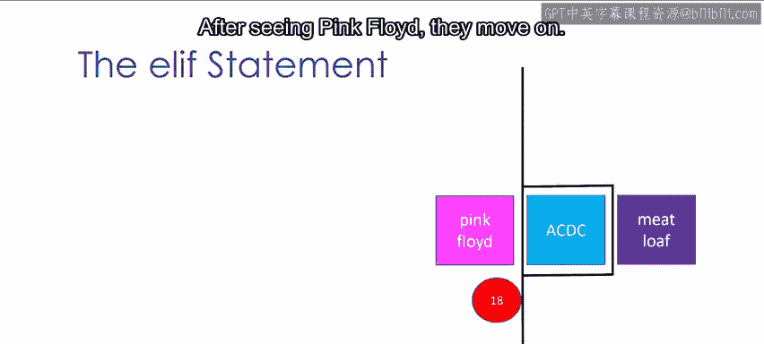

The syntax of the L F statement is similar。 We simply add the statement F with the condition。

 We then add the expression we would like to execute if the statement is true with an indent。

 Let's illustrate the code on the left。 and 18 year old enters。

 they are not older than 18 years of age。 Therefore， the condition is false。

 So the condition of the N F statement is checked。 The condition is true。 So then we would print。

 go see pink Floyd。 then we would move on as before， If the variable age was 17。

 the statement go see meatloaf would print Similarly， if the age was greater than 18。

 the statement you can enter with print。 check the lapse for more examples。 Now。

 let's take a look at logic operators。 Lo operations。

 take boolean values and produce different boolean values。 The first operation is the not operator。

 If the input is true， the result is a false。 Similarlyly， if the。

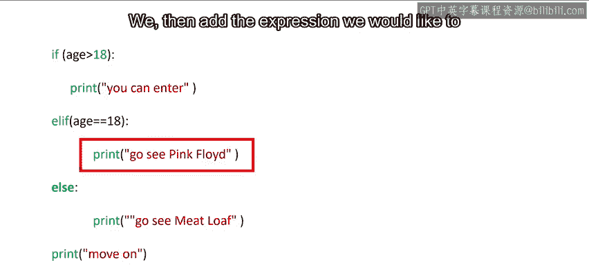

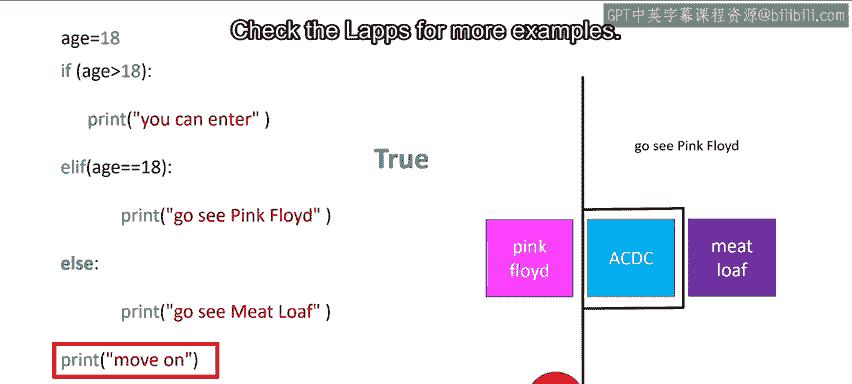

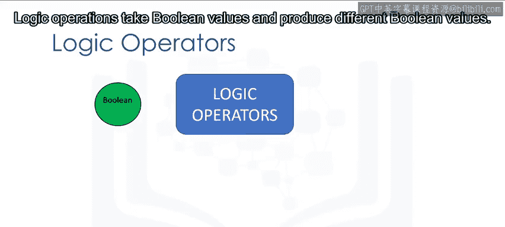

is false。 The result is a true。 Let A and B represent boolean variables。

 The or operator takes in the two values and produces a new Boolean value。

 We can use this table to represent the different values。

 The first column represents the possible values of a。

 The second column represents the possible values of B。

 The final column represents the result of applying the or operation。

 We see the or operator only produces a false。 if all the boolean values are false。

 The following lines of code will print out This album was made in the 70s or 90s。

 If the variable albummeer does not fall in the 80s。

 Let's see what happens when we set the albummeer to 1990。

 The colored number line is green when the condition is true。 and red when the condition is false。

 In this case， the condition is false。 examining the second condition we see that 1990 is greater than。

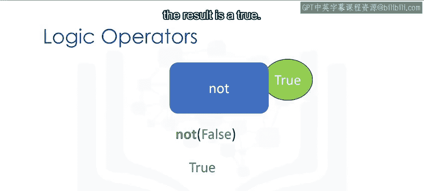

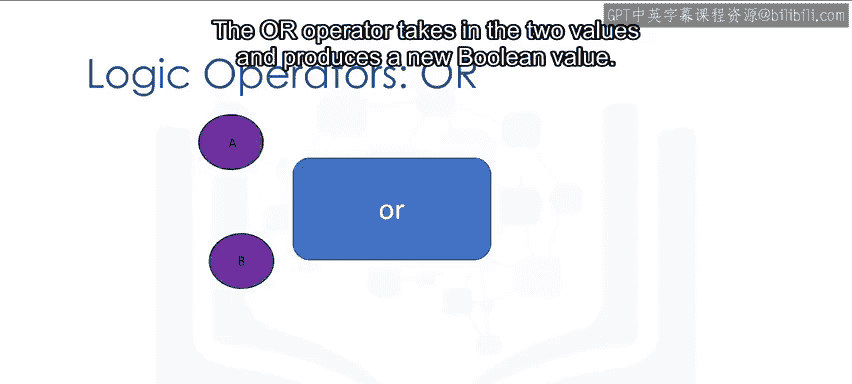

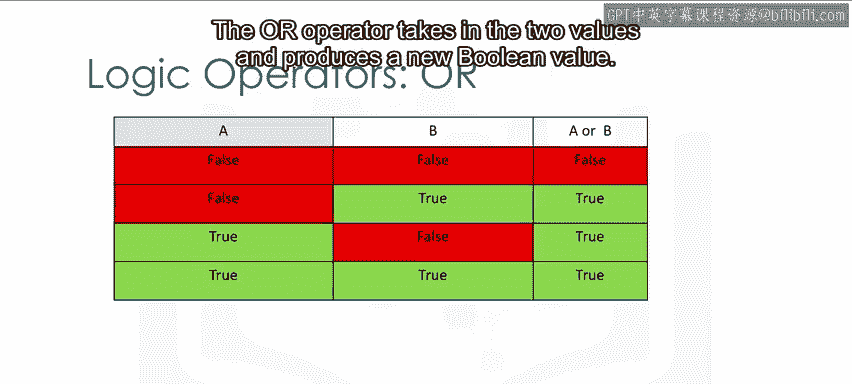

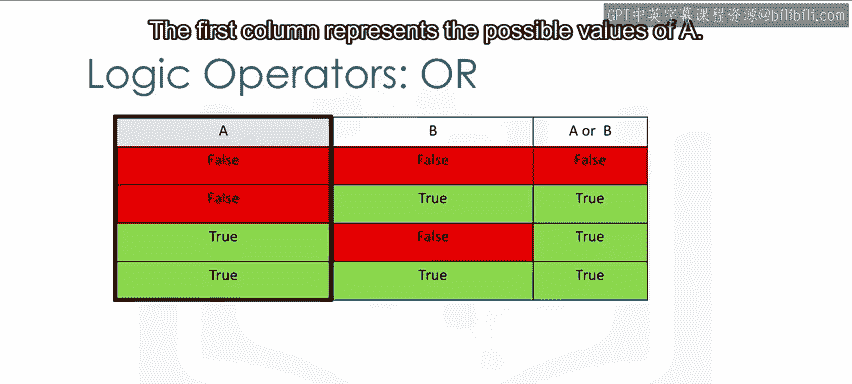

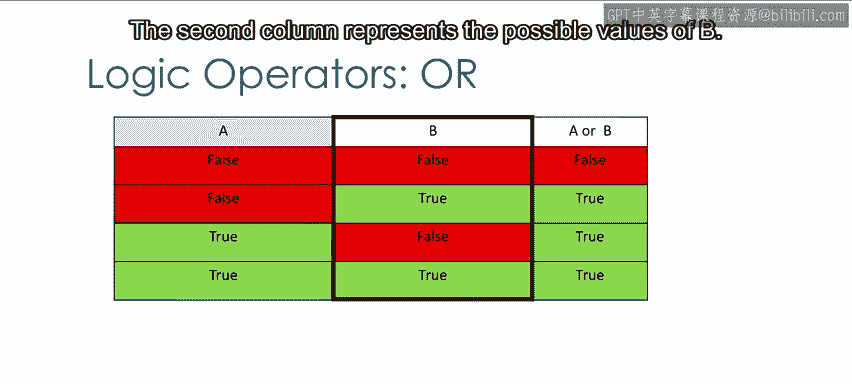

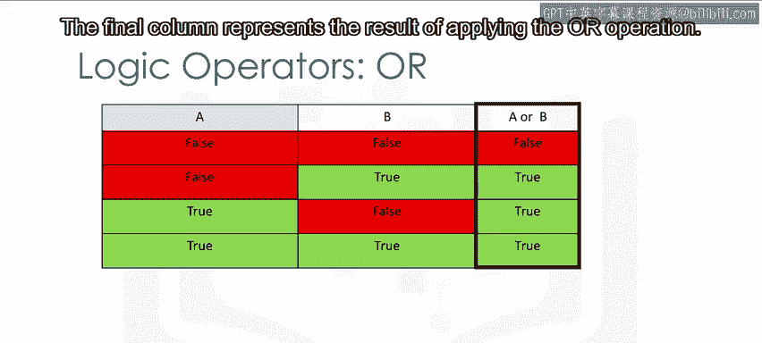

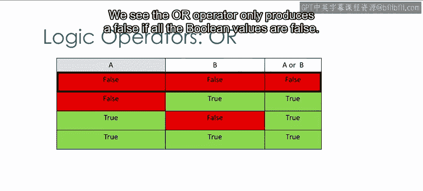

1989， so the condition is true。We can verify by examining the corresponding second number line in the final number line。

 the green region indicates where the area is true。

 This region corresponds to where at least one statement is true。 We see that 1990 falls in the area。

 Therefore， we execute the statement。 Let A And B represents Boolean variables。

 The and operator takes in the two values and produces a new Boolean value。

 We can use this table to represents the different values。

 The first column represents the possible values of a。

 The second column represents the possible values of B。

 The final column represents the result of applying the and operation。

 We see the and operator only produces a true。 If all the boolean values are true。

 The following lines of code will print out。 This album was made in the 80s。

 If the variable album year is between 1980 and 1989。

 Let's see what happens when we set the album here to 1983。

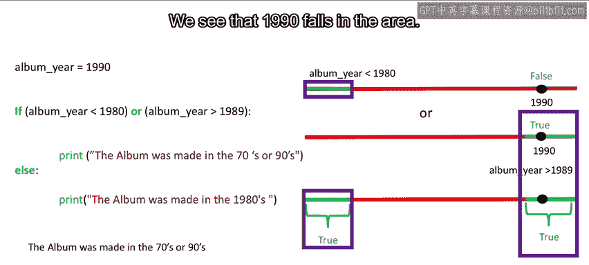

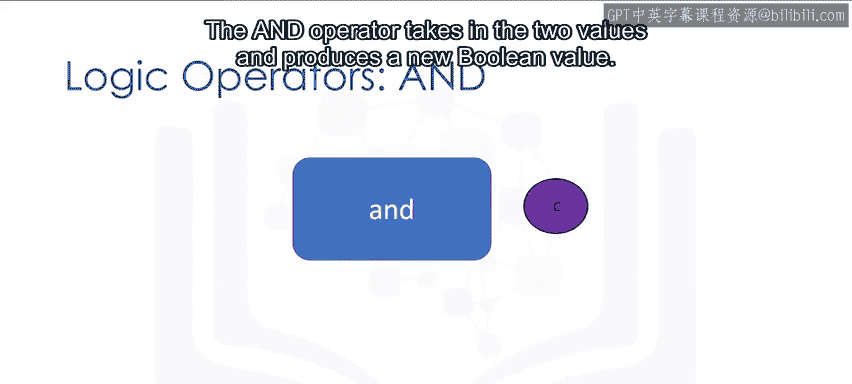

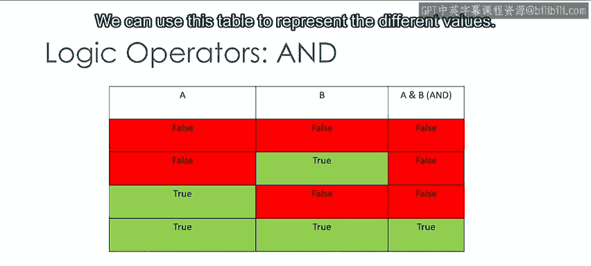

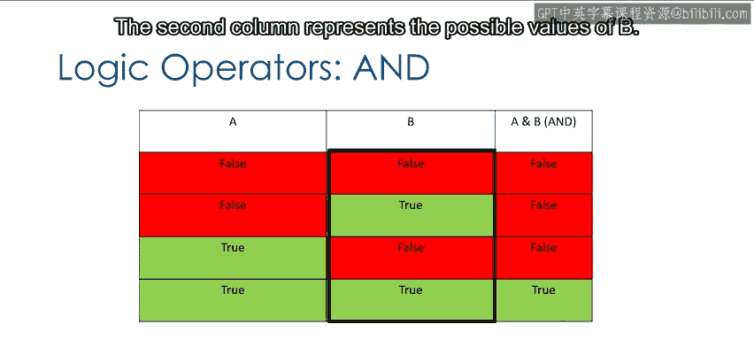

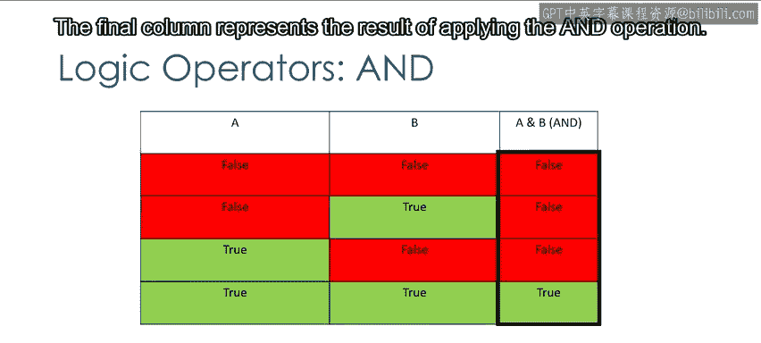

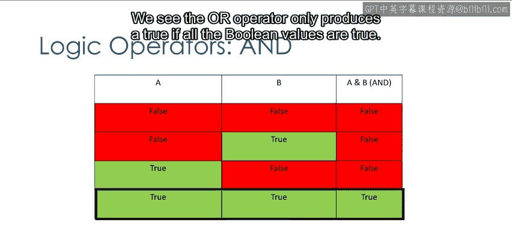

As before， we can use the colored number line to examine where the condition is true。 In this case。

1983 is larger than 1980， so the condition is true。 examiningami the second condition。

 we see that 1990 is greater than 1983。 So this condition is also true。

 We can verify by examining the corresponding second number line。 In the final number line。

 the green region indicates where the area is true。 Similarlyly。

 this region corresponds to where both statements are true。 We see that 1983 falls in the area。

 Therefore， we execute the statement。 Braning allows us to run different statements for different inputs。

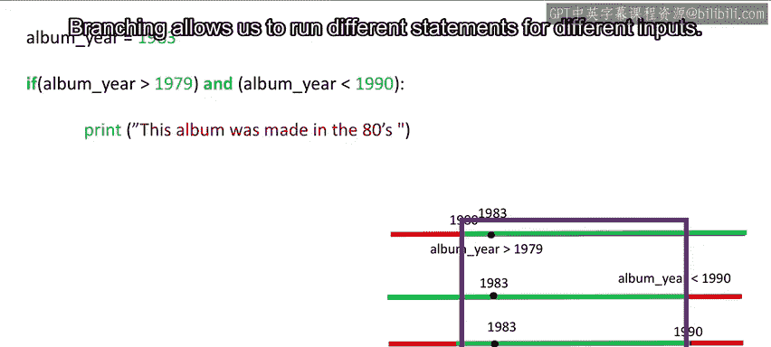