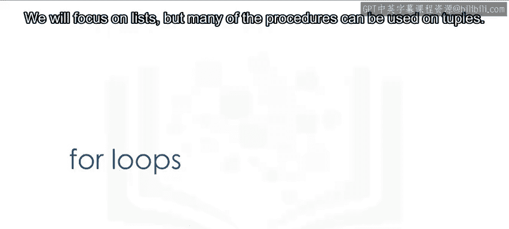
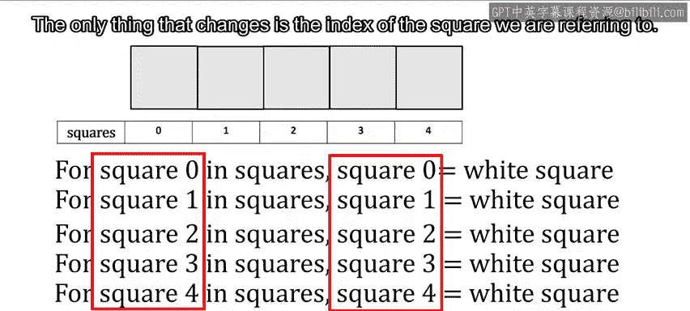
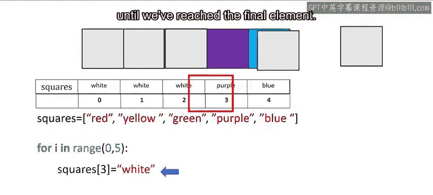
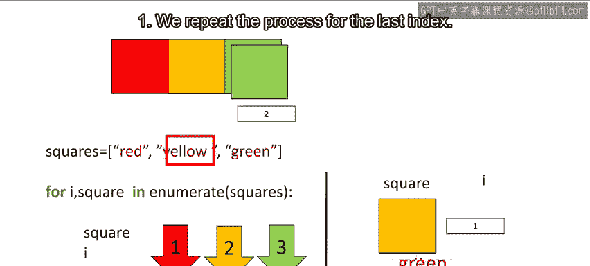
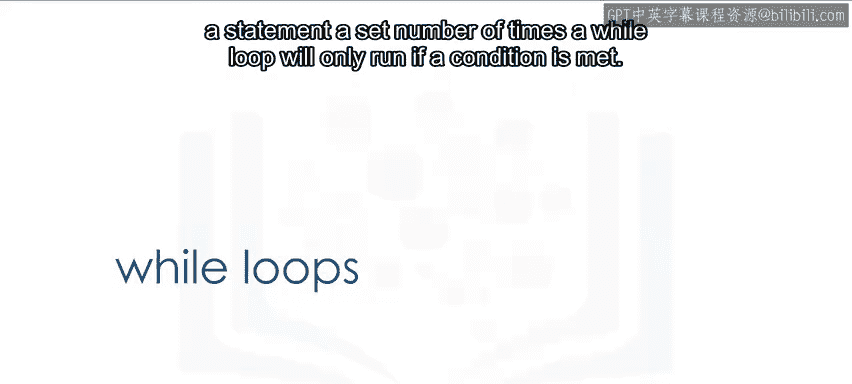
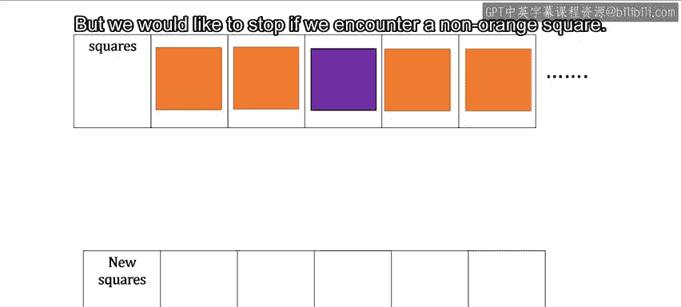
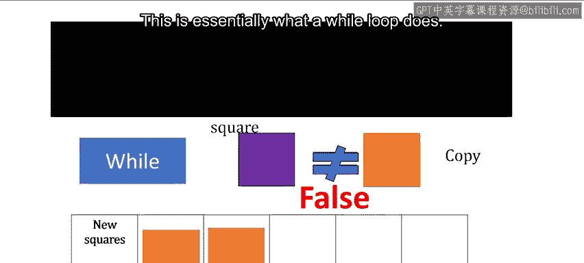
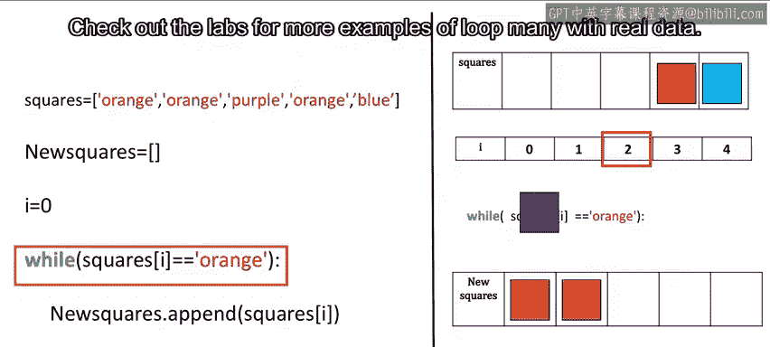

# IBM应用人工智能（从0开始搭建AI机器人）｜IBM Applied AI （中英字幕） - P73：7_循环.zh_en - GPT中英字幕课程资源 - BV1p64y1H7LM

In this video， we will cover loops。 in particular， four loops and while loops。

 We will use many visual examples in this video。 See the labs。

 for examples with data Before we talk about loops， let's go over the range function。

 the range function outputs and ordered sequence as a list I， if the input is a positive integer。

 the output is a sequence。 the sequence contains the same number of elements as the input。

 but starts at 0。 for example， If the input is 3， the output is the sequence 0，1，2。

 If the range function has two inputs。 or the first input is smaller than the second input。

 The output is a sequence that starts at the first input。 then the sequence iterates up  to。

 but not including the second number。 for the input 10 and 15。 we get the following sequence。

 See the labs for more capabilities of the range function。 please note， if you use Python 3。

 the range function will not generate。😊，List explicitly like in Python 2 in this section。

 we will cover four loops。 We will focus on lists， but many of the procedures can be used on tuples。

 Los perform a task over and over。 Consider the group of colored squares。

 Let's say we would like to replace each colored square with a white square。😊。

Let's give each square a number to make things a little easier and refer to all the group of squares as squares。

 If we wanted to tell someone to replace square 0 with a white square， we would say。

Equals replace square 0 with a white square， or we can say4 square 0 in squares。

 square 0 equals white square。 Similarlyly， for the next square， we can say four square 1 in squares。

 square 1 equals white square。😊，For the next square， we can say4 square2 in squares。

 square2 equals white square。We repeat the process for each square。

The only thing that changes is the index of the square we are referring to。

If we are going to perform a similar task in Python， we cannot use actual squares。

 So let's use a list to represent the boxes。 Each element in the list is a string representing the color。

 We want to change the name of the color in each element to white。

 Each element in the list has the following index。 This is a syntax to perform a loop in Python。

 Not the indent。 The range function generates a list。

 The code will simply repeat everything in the indent five times。

 If you were to change the value to 6。 It would do it six times。 However。

 the value of I is incremented by one each time。 In this segment。

 we change the Ih element of the list to the string white。 The value of I is set to 0。

 Each iteration of the loop starts at the beginning of the indent。

 We then run everything in the indent。 The first element in the list is set to white。

 We then go to the start of the indent。 We progress down each line。 When we reach the line to。

Change the value of the list。 We set the value of index 1 to white。 The value of I increases by one。

 We repeat the process for index 2。The process continues for the next index until we have reached the final element。

We can also iterate through a list or tuple directly in Python。 We do not even need to use indices。

 Here is the list squares。 Each iteration of the list we pass one element of the list squares to the variable square。

 Let's display the value of the variable square on this section for the first iteration。

 The value of square is red。 We then start the second iteration。 for the second iteration。

 The value of square is yellow。 We then start the third iteration for the final iteration。

 The value of square is green。 A useful function for itating data is enumerate It can be used to obtain the index and the element in the list。

 Let's use the box analogy with the numbers representing the index of each square。

 This is the syntax to iterate through a list and provide the index of each element。

 We use the list squares and use the names of the colors to represent the colored squares。

 The argument of the function enumerate is the list in this case。😊，Squas the variable I is the index。

 and the variable square is the corresponding element in the list。

 Let's use the left part of the screen to display the different values of the variable square and I for the various iterations of the loop for the first iteration。

 the value of the variable is red corresponding to the zeroth index and the value for I is 0 for the second iteration。

 The value of the variable square is yellow and the value of I corresponds to its index。 I。e 1。

 We repeat the process for the last index。😊。

Wild loops are similar to four loops， but instead of executing a statement， a set number of times。

 a while loop will only run if a condition is met。 Let's say we would like to copy all the orange squares from the list squares to the list new squares but we would like to stop if we encounter a non orangerange square。

 We don't know the value of the squares beforehand。

 We would simply continue the process while the square is orange or see if the square equals orange。

 If not， we would stop for the first example， we would check if the square was orange。

 It satisfies the conditions。 So we would copy the square。

 We repeat the process for the second square。 The condition is met。 So we copy the square。😊。

In the next iteration， we encounter a purple square。 The condition is not met。 So we stop the prosa。

 This is essentially what a wild loop does。 Let's use the figure on the left to represent the code。

 We will use a list with the names of the color to represent the different squares。

 We create an empty list of new squares。 In reality， the list is of indeterminate size。

 We start the index at 0。 The while statement will repeatedly execute the statements within the indent until the condition inside the bracket is false。

 We append the value of the first element of the list squares to the list new squares。

 We increase the value of I by one。😊。

We append the value of the second element of the list squares to the list new squares。

 We increment the value of I。 Now， the value in the array squares is purple。 Therefore。

 the condition for the wild statement is false， and we exit the loop。

 Check out the labs for more examples of loop。 many with real data。

