# IBM应用人工智能（从0开始搭建AI机器人）｜IBM Applied AI （中英字幕） - P78：12_使用open写入文件.zh_en - GPT中英字幕课程资源 - BV1p64y1H7LM

We can also write to files using the open function。

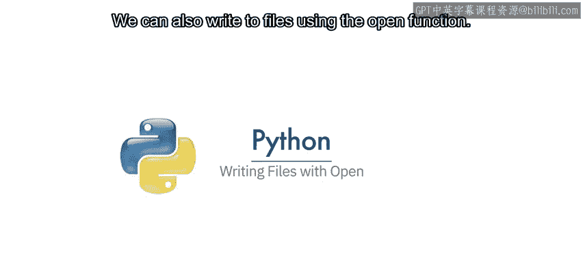

We will use Python's open function to get a file object to create a text file。

 we can apply method right to write data to that file As a result， text will be written to the file。

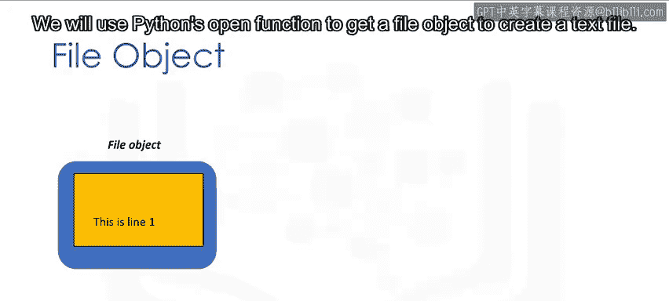

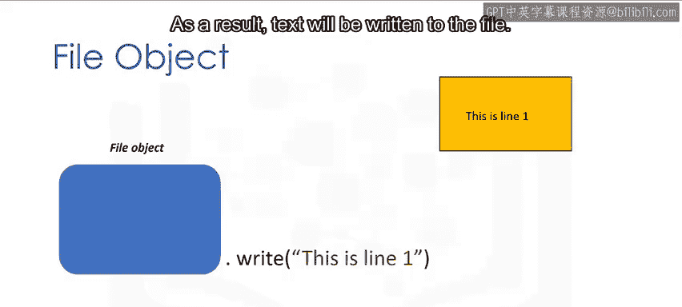

We can create the file example2 dot T X T as follows。 We use the open function。

 The first argument is the file path。 This is made up of the file name。

 If you have that file in your directory， it will be overwritten and the file directory。

 We set the mode parameter to W for writing。 Finally， we have the file object。

 As before we use the with statement。 The code will run everything in the indent block。

 then close the file。 We create the file object file 1。

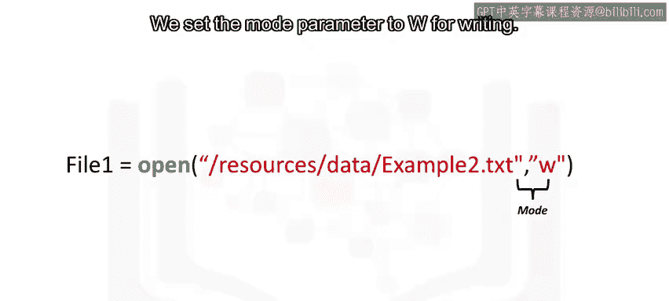

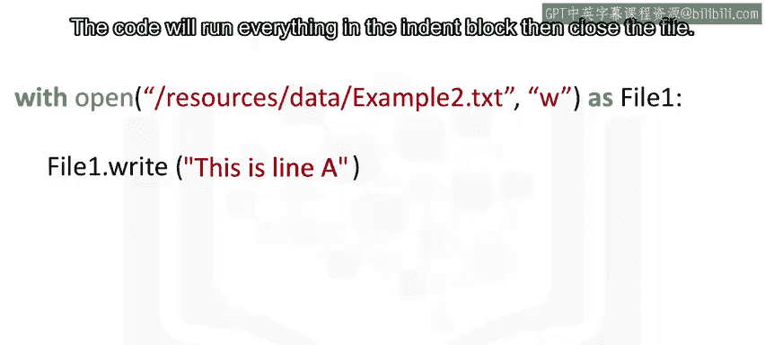

We use the open function。 This creates a file example2 dot T X T in your directory。

 We use the method right to write data into the file。

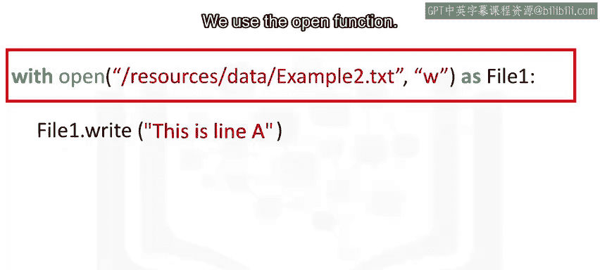

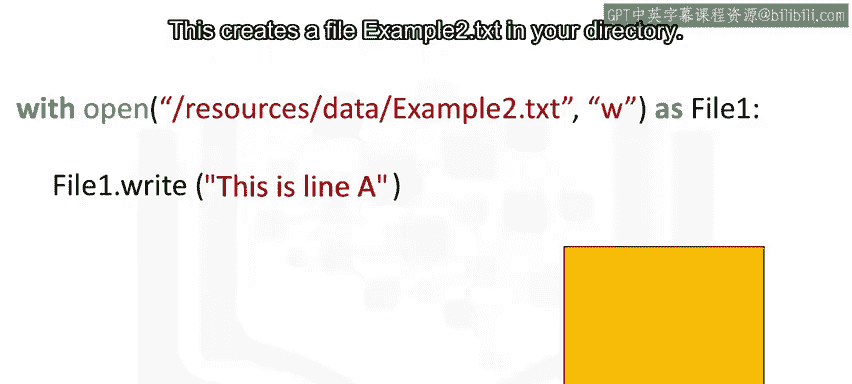

The argument is the text we would like input into the file。

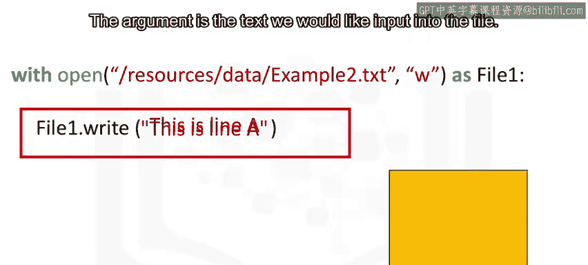

If we use the right method successively， each time it's called， it will write to the file。

 The first time it is called， we will write。 this is line A with a slash N to represent a new line。

 The second time we call the method， it will write this is line B。 Then it will close the file。

 We can write each element in a list to a file。

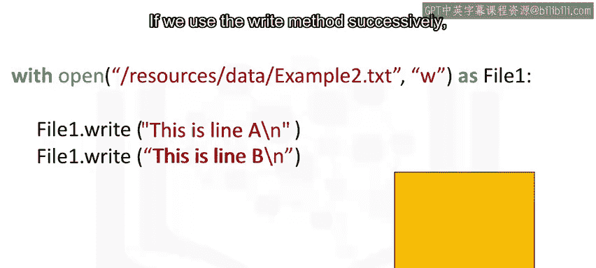

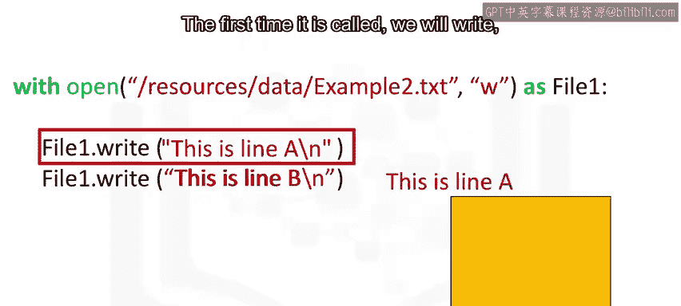

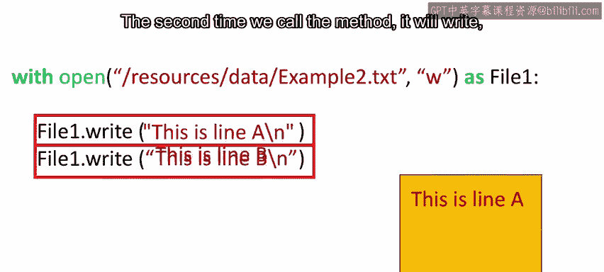

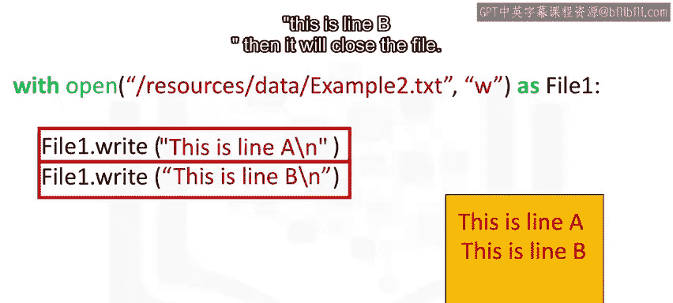

As before we use a with command and the open function to create a file。

 the list lines has three elements consisting of text。

 We use a four loop to read each element of the first lines and pass it to the variable line。

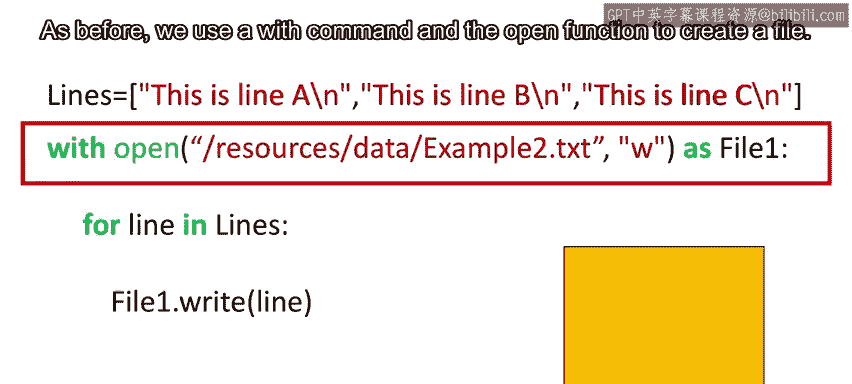

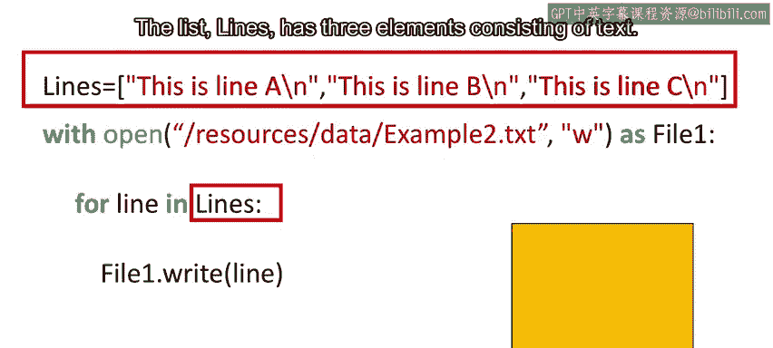

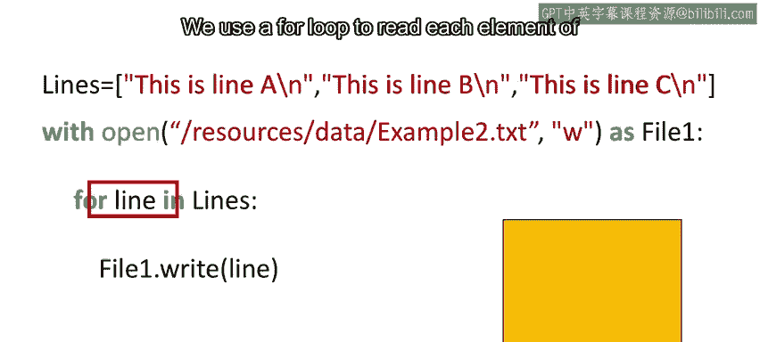

The first iteration of the loop writes the first element of the list to the file example2。

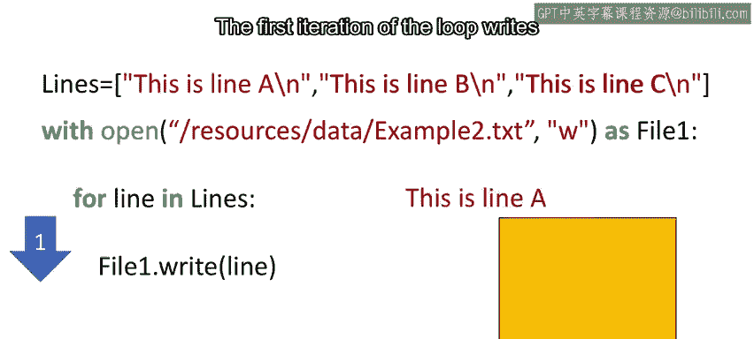

The second iteration writes the second element of the list， and so on。

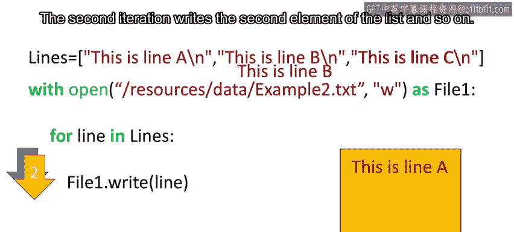

At the end of the loop， the file will be closed。

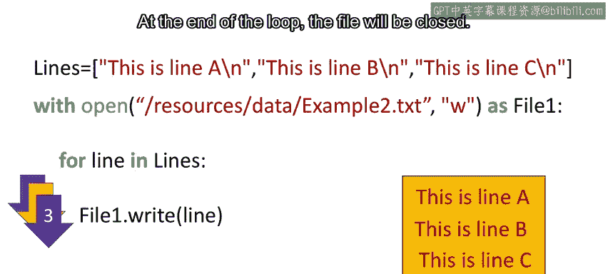

We can set the mode to append it using a lower case A。 This will not create a new file。

 but just use the existing file。 If we call the method right。

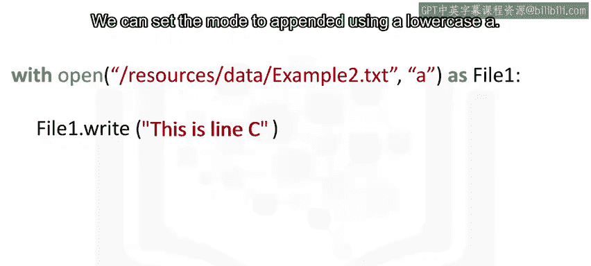

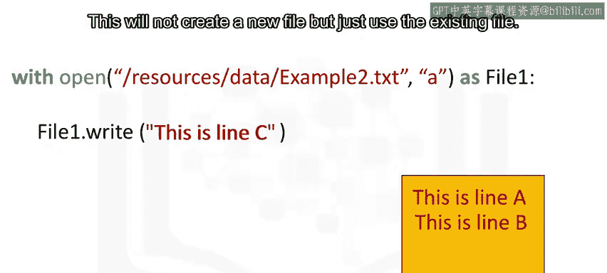

It will just write to the existing file， then add this is line C， then close the file。

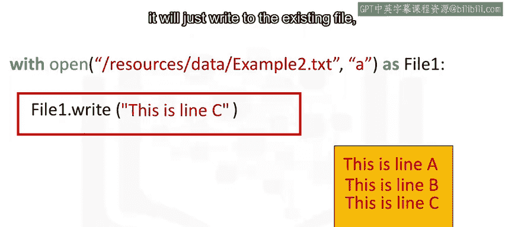

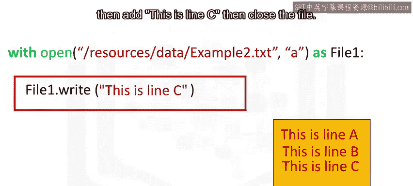

We can copy one file to a new file as follows。 First。

 we read the file example 1 and interact with it via the file object， read file。

 Then we create a new file example 3 and use the file object right file to interact with it。

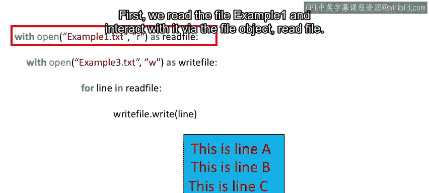

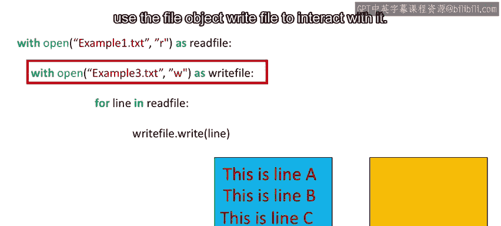

The for loop takes a line from the file object read fileile and stores it in the file example3。

 using the file object right file。

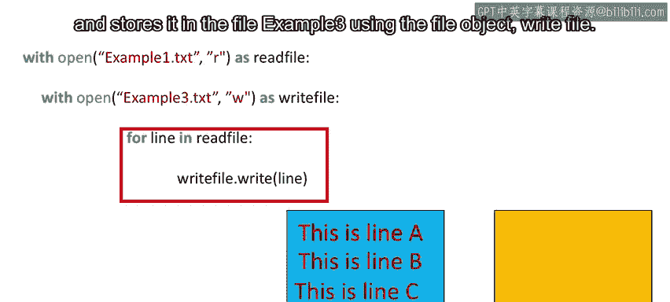

The first iteration copies the first line。 The second iteration copies the second line till the end of the file is reached。

 Then both files are closed。

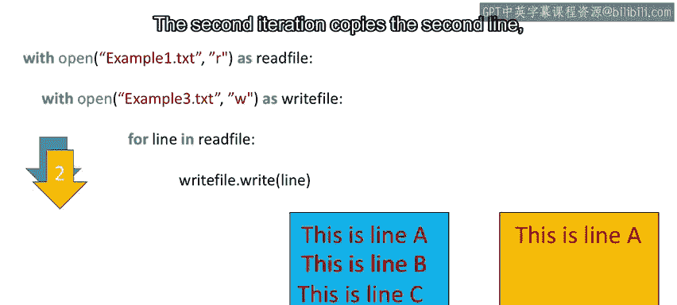

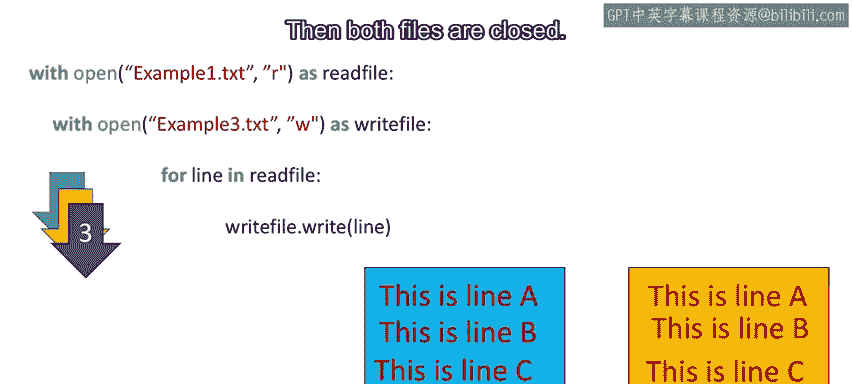

Check out the labs for more examples。