# IBM应用人工智能（从0开始搭建AI机器人）｜IBM Applied AI （中英字幕） - P83：17_简单API 第1部分.zh_en - GPT中英字幕课程资源 - BV1p64y1H7LM

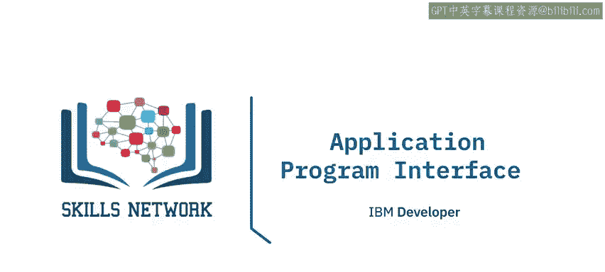

In this video we will discuss application program interfaces or APIs for short。

 specifically we will discuss what an API is API libraries and rest APIs including request and response and an example with Pycoin Gego an API lets two pieces of software talk to each other for example。

 you have your program you have some data and you have other software components。

 You use the API to communicate with other software via inputs and outputs。

 just like a function you don't have to know how the API works just its inputs and outputs Padas is actually a set of software components。

 much of which are not even written in Python you have some data。

 you have a set of software components We use the pandas API to process the data by communicating with the other software components。

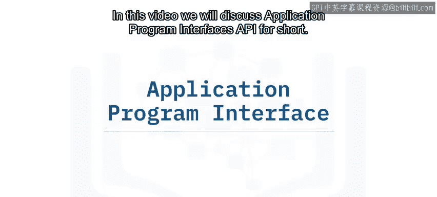

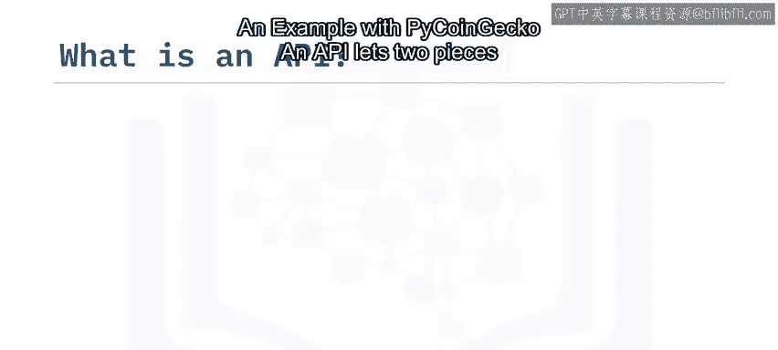

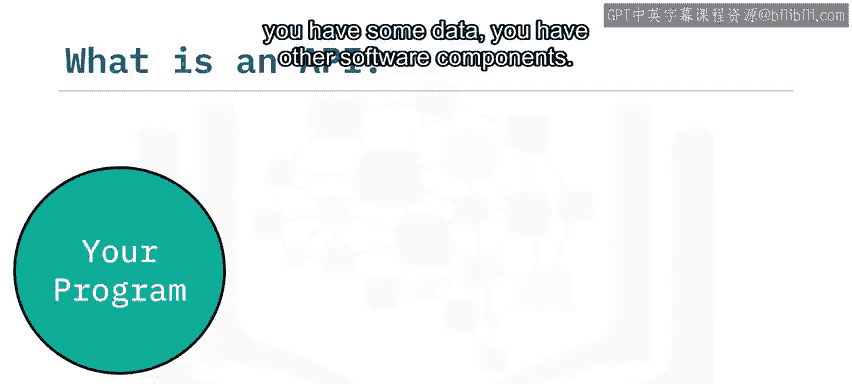

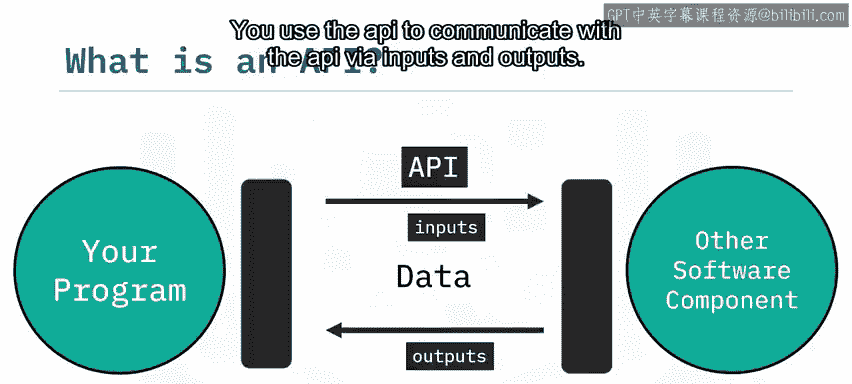

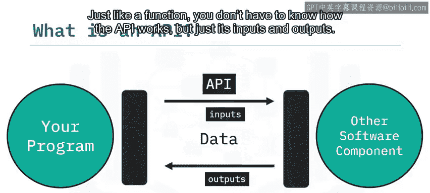

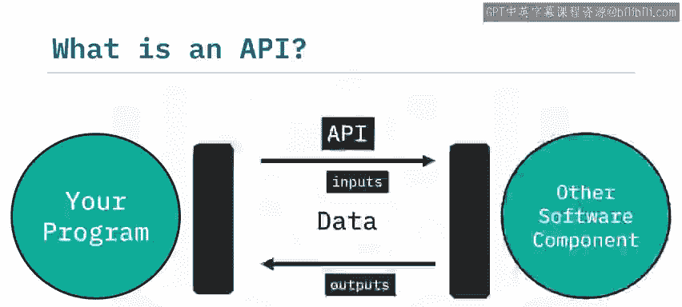

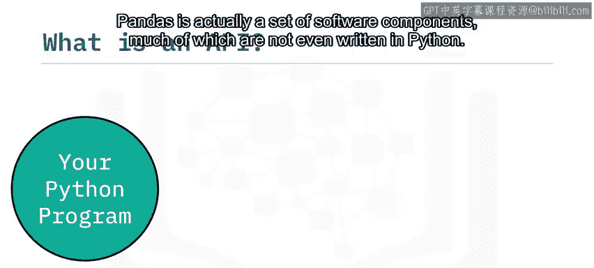

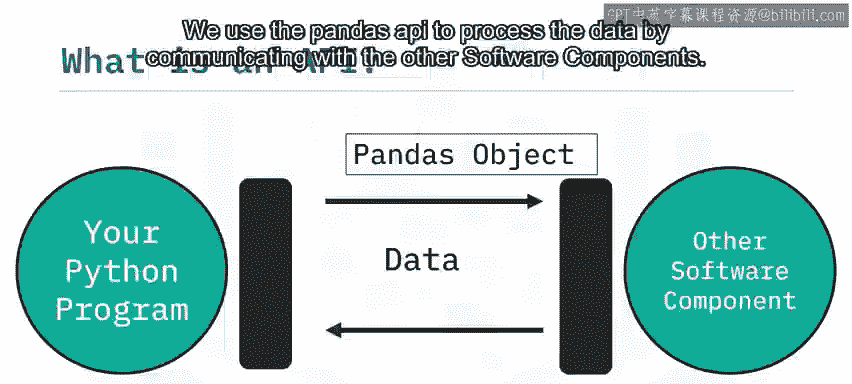

Let us clean up the diagram when you create a dictionary。

 then create a pandas object with the data frame constructor in API lingo this is an instance the data in the dictionary is passed along to the pandas API you then use the data frame to communicate with the API When you call the method head the data frame communicates with the API display the first few rows of the data frame When you call the method mean the API will calculate the mean and return the values。

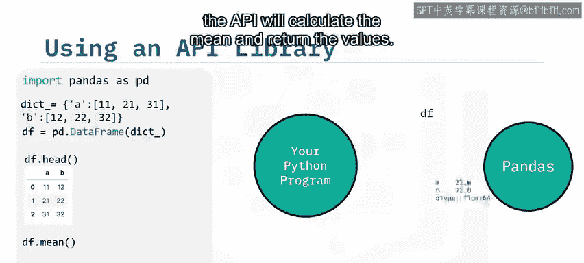

Rest APIs are another popular type of API。 They allow you to communicate through the Internet。

 letting you take advantage of resources like storage， access more data。

 artificial intelligence algorithms and much more。 The R stands for representational the S for state and T for transfer。

 in restest APIs。 your program is called the client。

 The API communicates with a web service you call through the Internet。

 There is a set of rules regarding communication。 input or request and output or response。

 Here are some common terms。 You or your code can be thought of as a client。

 The web service is referred to as a resource。 The client finds the service via an endpoint。

 We will review this more in the next section。 The client sends requests to the resource and the response to the client。

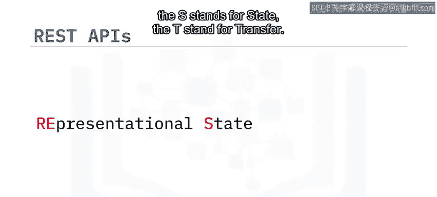

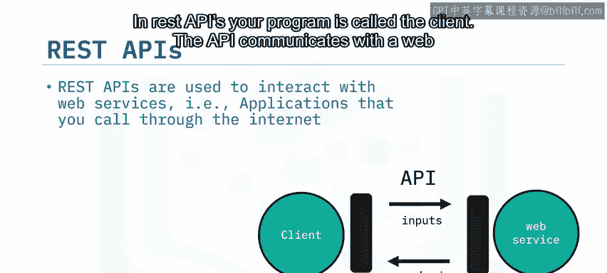

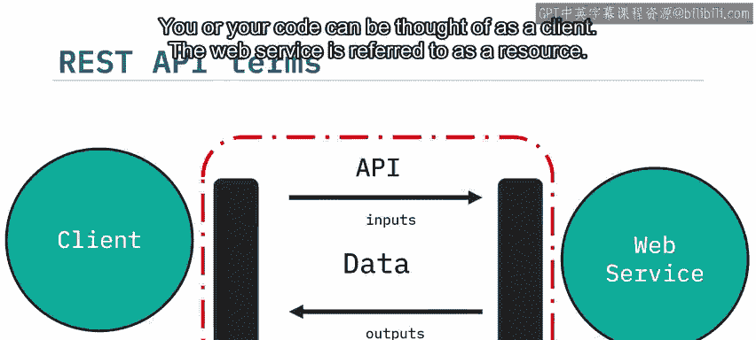

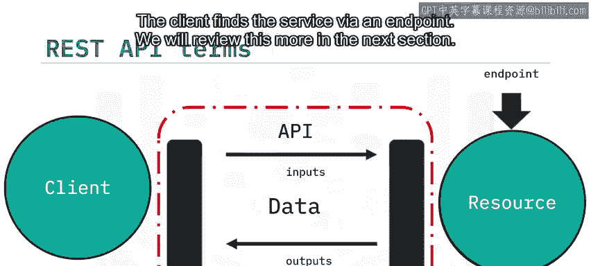

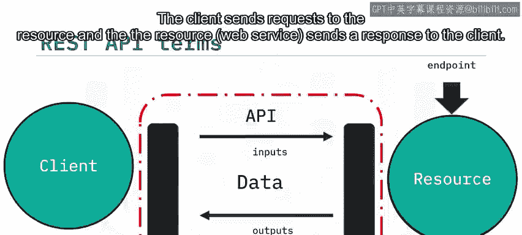

HTTP methods are a way of transmitting data over the Internet we tell the rest APIs what to do by sending a request。

 the request is usually communicated via an HTTP message the HTTP message usually contains adjacent file This contains instructions for what operation we would like the service to perform this operation is transmitted to the web service via the internet and the service performs the operation in a similar manner the web service returns a response via an HTTP message where the information is usually returned via adjacent file。

 and this information is transmitted back to the client。

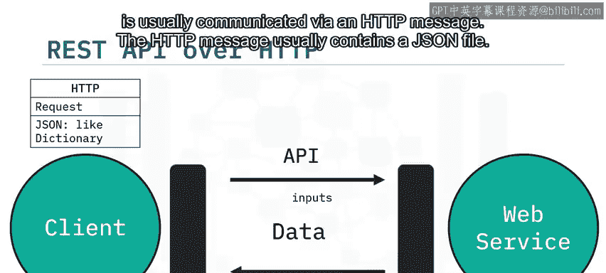

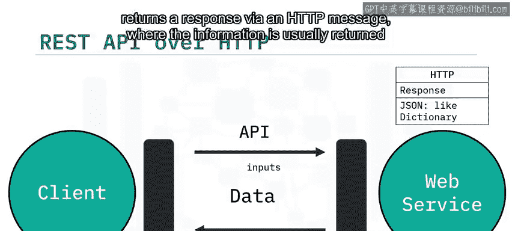

Cryptocurrency data is excellent to use in an API because it is constantly updated and is vital to cryptocurrency trading。

 We will use the Pcoin Geco Python client or wrapper for the coin Geckco API updated every minute by coin Geco。

 We use the raper or client because it is easy to use so you can focus on the task of collecting data。

 We will also introduce panda's time series functions for dealing with time series data。

 using Pycoin Geckco to collect data is simple。 All we need is to install and import the library。

 then create a client object and finally use a function to request our data。 In this function。

 we are getting data on Bitcoincoin in US dollars for the past 30 days。 In this case。

 a response is adjacent file expressed as a Python dictionary of nested lists。

 including price market cap and total volumes which contain the Unix timestamp and the price at。

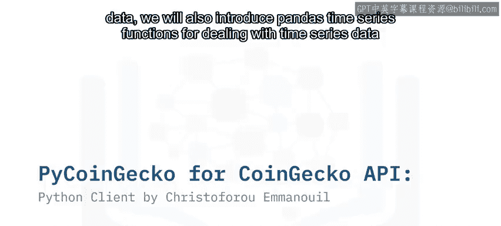

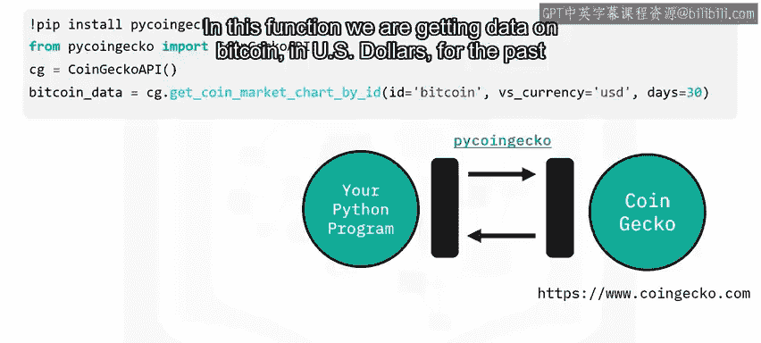

Time we are only interested in price。 so that is what we will select using the key price to make things simple。

 We can convert our nested list to a data frame with the columns timestamp and price。

 It is difficult to understand the column timest。 We will convert it to a more readable format using the pandas function to underscore date time using this to underscore date time function。

 We create readable time data。 The input is the timestamp column unit of time is set to milliseconds。

 We append the output to the new column date。 Now we want to create a candlestick plot。

 to get the data for the daily candlesticks。 We will group by the date to find the minimum maximum first and last price of each day。

 Finally， we will use plotly to create the candlestick chart and plot it。

 Now we can view the candlestick chart by opening the Hm file and clicking trust Htm in the top。

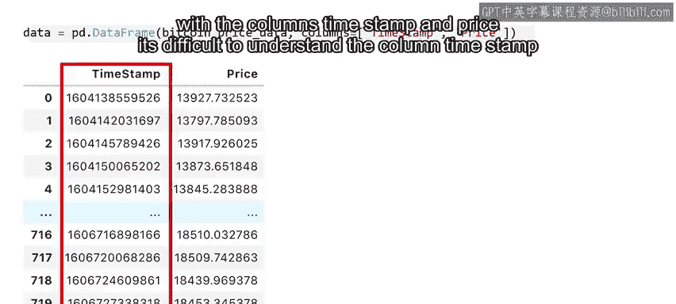

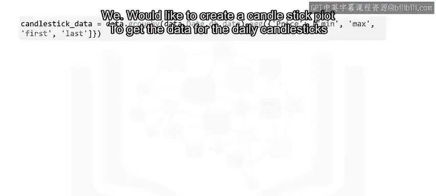

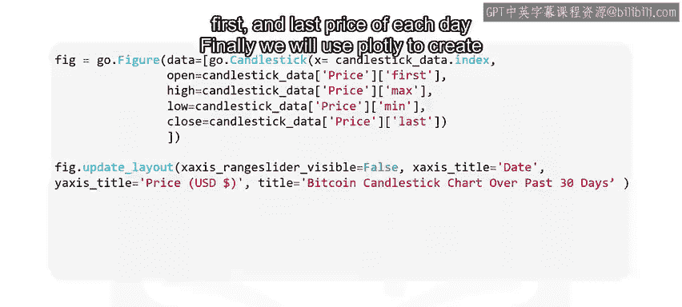

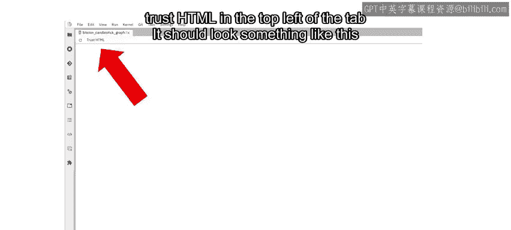

Left of the tab， it should look something like this。

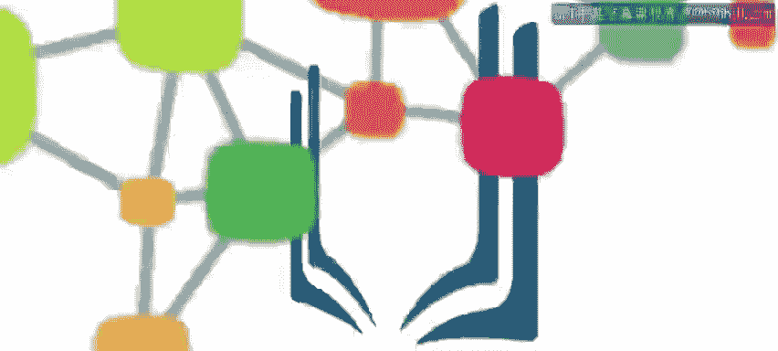