# IBM应用人工智能（从0开始搭建AI机器人）｜IBM Applied AI （中英字幕） - P84：18_简单API 第2部分.zh_en - GPT中英字幕课程资源 - BV1p64y1H7LM

In this video， we will discuss application program interfaces that use some kind of artificial intelligence。

 We will transcribe an audio file using the Watson text to speech API。

 We will then translate the text to a new language using the Watson language Translator API in the API call you will send a copy of the audio file to the API。

 This is sometimes called a post request。

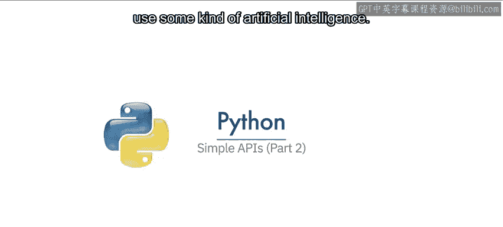

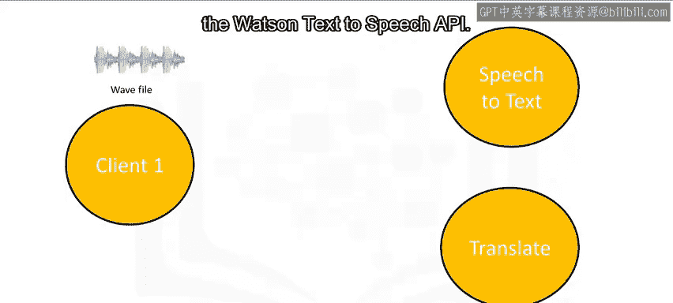

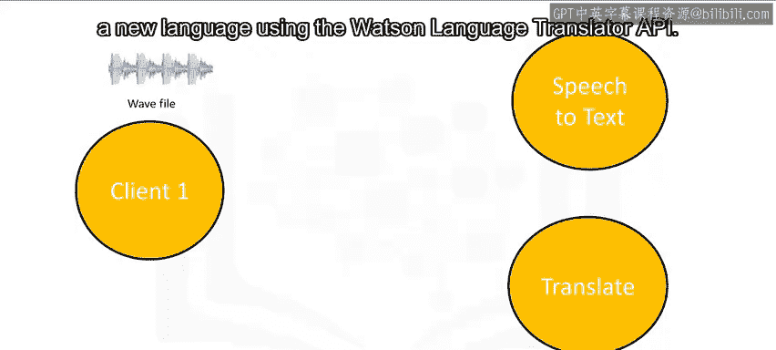

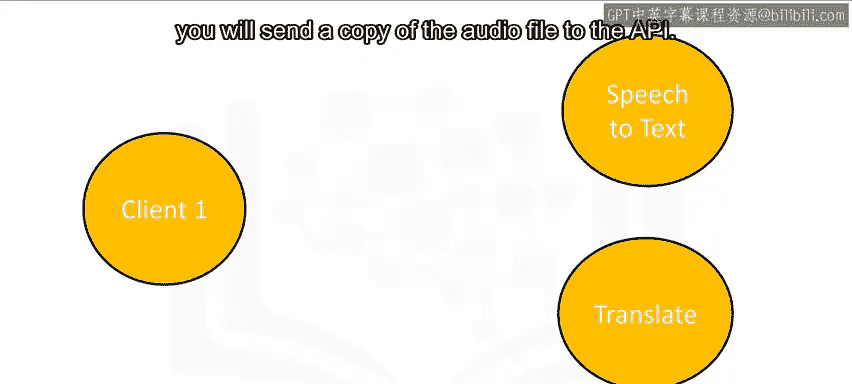

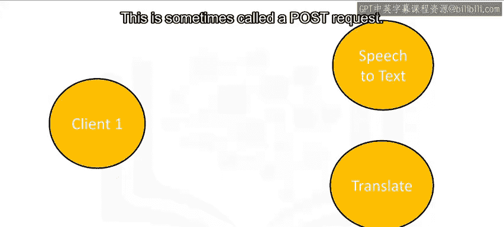

Then the API will send the text transcription of what the individual is saying under the hood。

 the API is making a get request。 We then send the text we would like to translate into a second language to a second API。

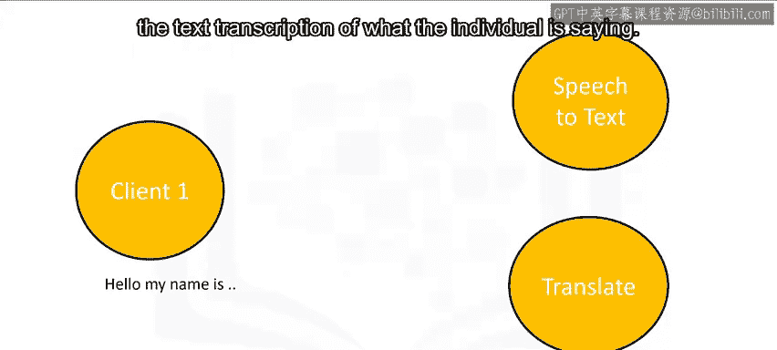

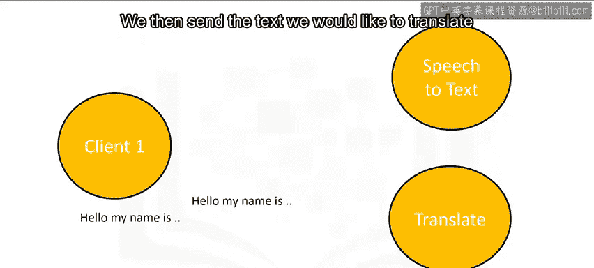

The API will translate the text and send the translation back to you。 In this case。

 we translate English to Spanish。 We then provide an overview of API keys and endpoints。

 Watson's speech to text and Watson translate First， we will review API keys and endpoints。

 They will give you access to the API。

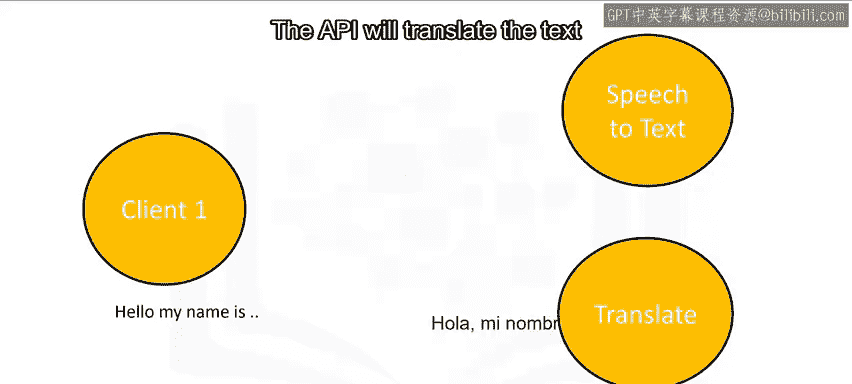

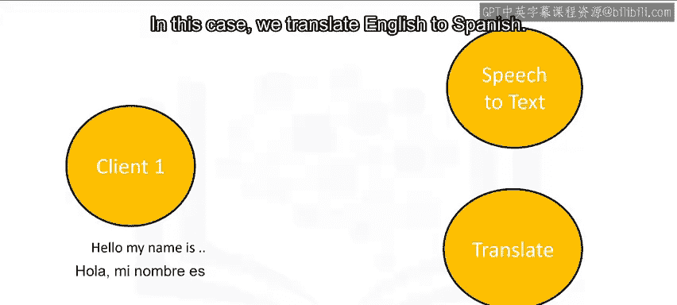

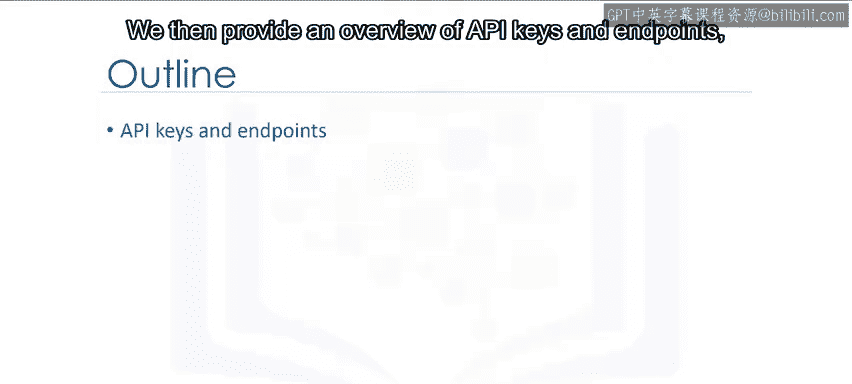

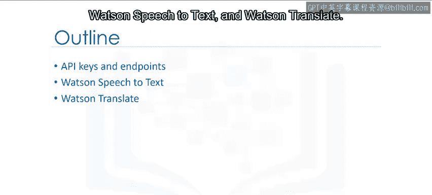

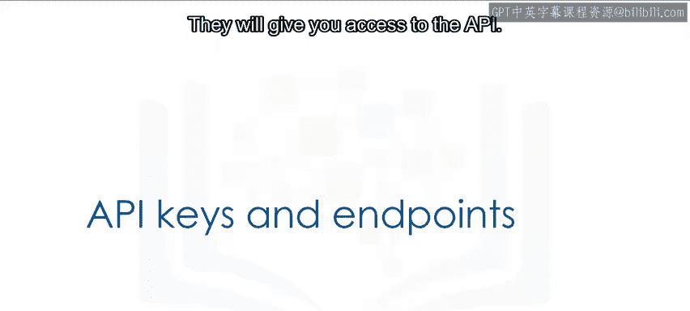

An API key is a way to access the API。 It's a unique set of characters that the API uses to identify you and authorize you。

 Usually your first call to the API includes the API key。 This will allow you access to the API。

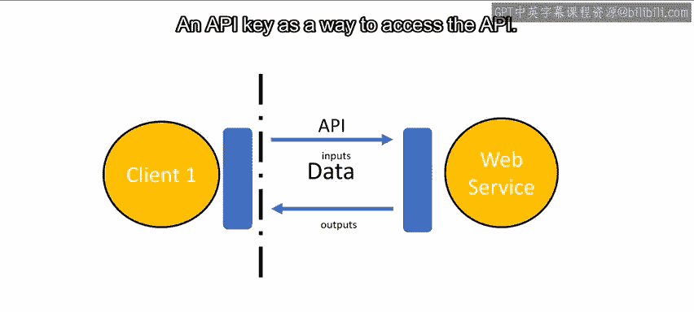

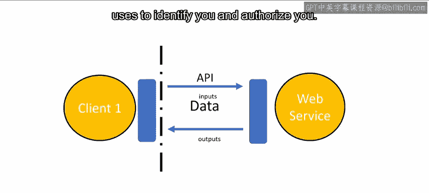

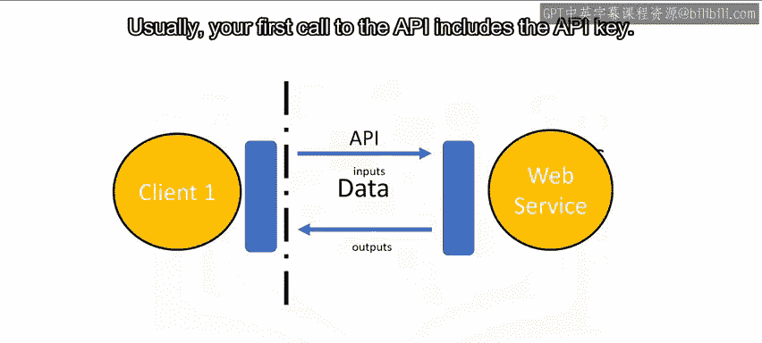

In many APIs， you may get charged for each call， so like your password。

 you should keep your API key a secret。

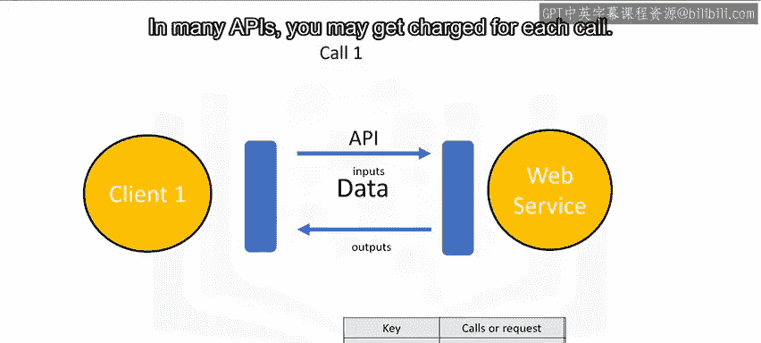

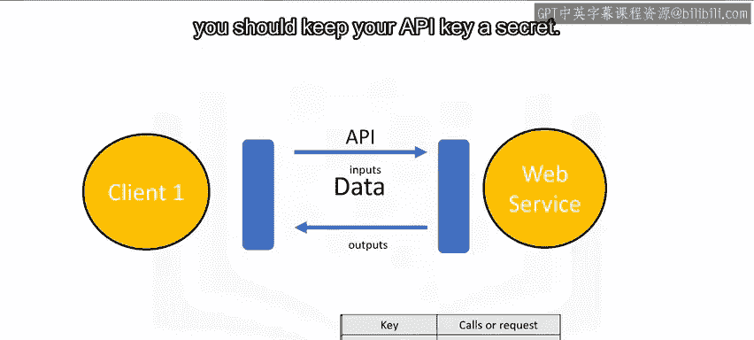

An end point is simply the location of the service。 It's used to find the API on the Internet。

 just like a web address。

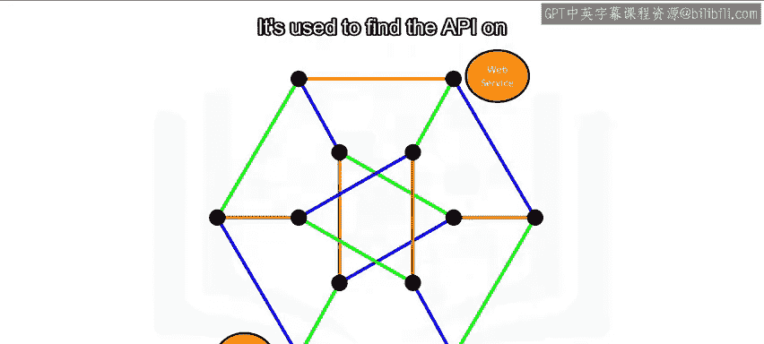

Now we will transcribe an audio file using the Watson Text to Speech API。

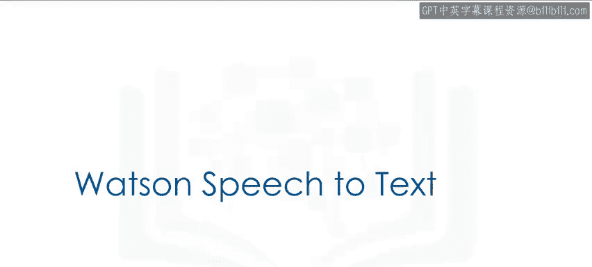

Before you start the lab， you should sign up for an API key。

 We will download an audio file into your directory。 First。

 we import speech to text V1 from IBM Watson。 The service endpoint is based on the location of the service instance。

 We store the information in the variable URL underscore S 2 T to find out which URL to use。

 view the service credentials You will do the same for your API key。

 You create a speech to text adapter object。😊，The parameters are the endpoint and API key。

 You will use this object to communicate with the Watson speech to text service。

 We had the path of the wave file we would like to convert to text。

 We create the file object wave with the wave file using open。 We set the mode to R B。

 which means to read the file in binary format。

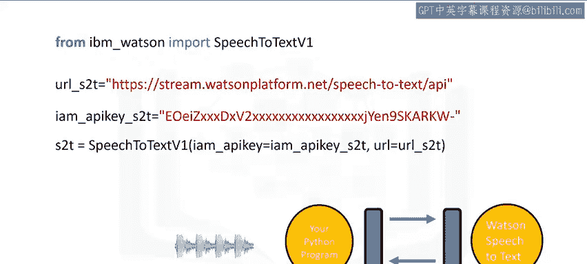

The file object allows us access to the wave file that contains the audio。

 We use the method recognized from the speech to text adapter object。

 This basically sends the audio file to Watson's speech to text service。

The parameter audio is the file object。The content type is the audio file format。

The service sends a response stored in the object response。

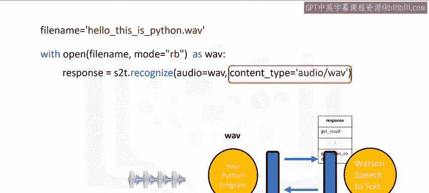

The attribute result contains a Python dictionary。 The key results value has a list that contains a dictionary。

 We are interested in the key transcript。 We can assign it to the variable recognized underscore text as follows。

 recognized underscore text now contains a string with the transnscribe text。 Now。

 let's see how to translate the text using the Watson language translator。😊。

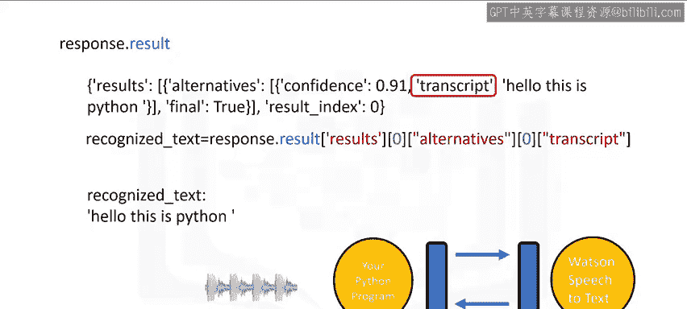

First， we import language translator V3 from IBM_ Watson。

We assign the service endpoint to the variable URL LT。

 you can obtain the service in the lab instructions。You require an API key。

 see the lab instructions on how to obtain the API key。

 This API request requires the date of the version， see the documentation。

We create a language translator object， language translator。

We can get a list of the languages that the service can identify as follows。

 the method returns the language code。For example， English has a symbol E， N to Spanish。

 which has the symbol E， S。In the last section， we assign the transcribed text to the variable to recognized underscore text。

 We can use the method translate。 This will translate the text。

 The result is a detailed response object。 The parameter text is the text。

Model underscore ID is the type of model we would like to use。In this case， we set it to E， N。

 hyphen E， S for English to Spanish。 We use the method get result to get the translated text and assign it to the variable translation。

The result is a dictionary that includes the translation word count and character count。

 We can obtain the translation and assign it to the variable Spanish underscore translation。

 as follows。

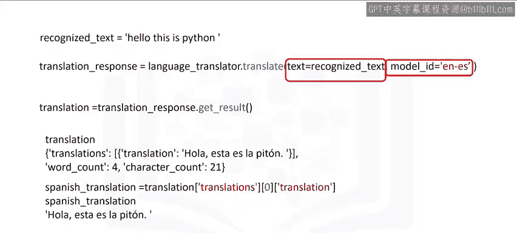

Using the variable Spanish underscore translation， we can translate the text back to English as follows。

 The result is a dictionary。 We can obtain the string with the text， as follows。

We can then translate the text to French as follows。 Thanks for watching this video。😊。

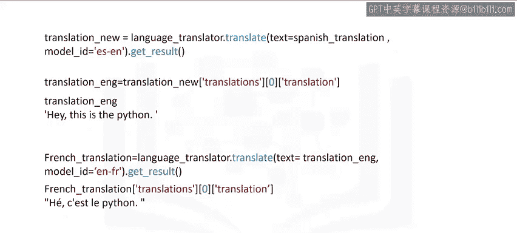