# IBM应用人工智能（从0开始搭建AI机器人）｜IBM Applied AI （中英字幕） - P85：19_REST API HTTP请求 第1部分.zh_en - GPT中英字幕课程资源 - BV1p64y1H7LM

In this video， we will discuss the HTTP protocol specifically。

 we will discuss Uni Re locator or URL request and response。

 We touched on rest APIpis in the last section。 The HtTP protocol can be thought of as a general protocol of transferring information through the web。

 This includes many types of rest APIs。 recall that rest APIs function by sending a request and the request is communicated via HtTP message The HtTP message usually contains a J file。

 When you the client use a web page。 your browser sends an HtTP request to the server where the page is hosted。

 The server tries to find the desired resource by default index HM。 If your request is successful。

 the server will send the object to the client in an HtTP response。

 This includes information like the type of the resource the length of the。

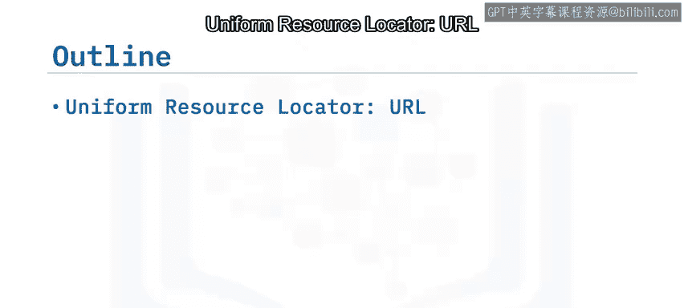

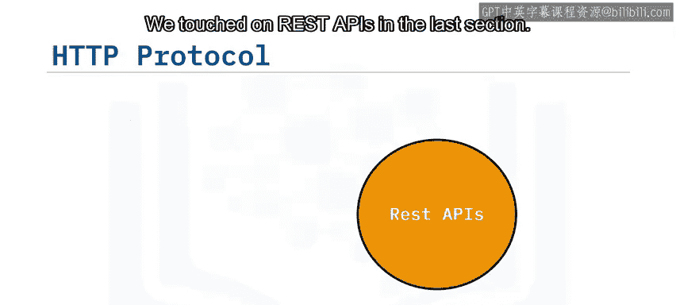

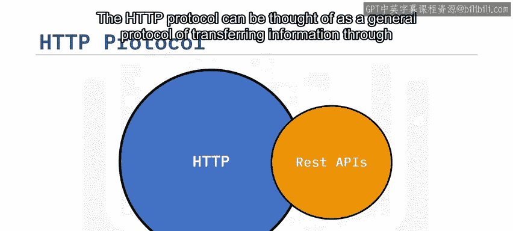

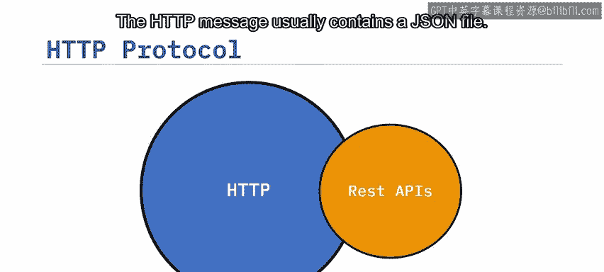

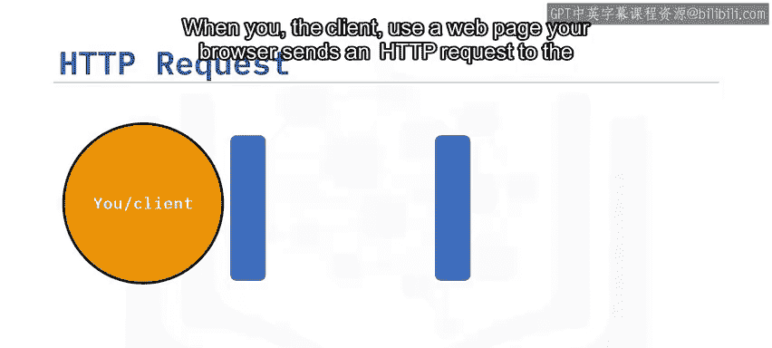

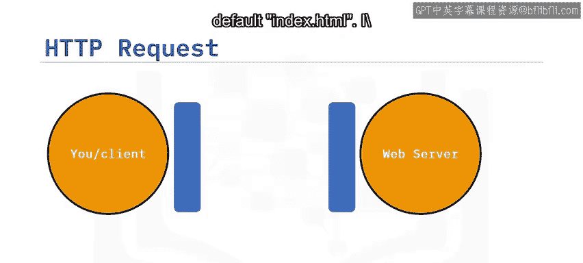

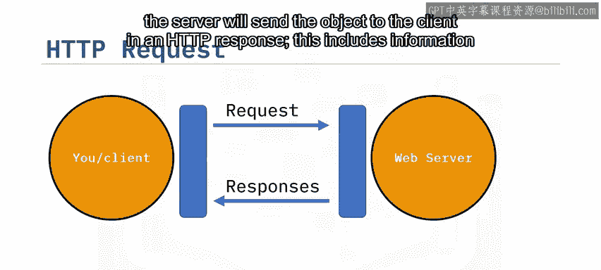

and other information The table under the web server represents a list of resources stored in the web server in this case。

 an HTML file， PNG image and a text file When the request is made for the information the web server sends the requested information that is one of the files。

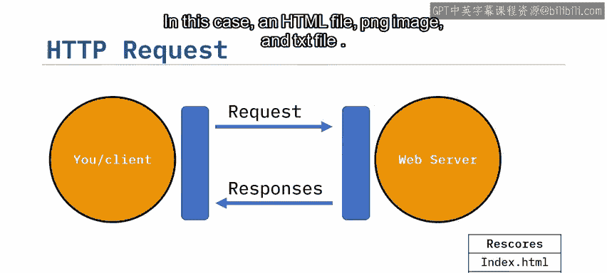

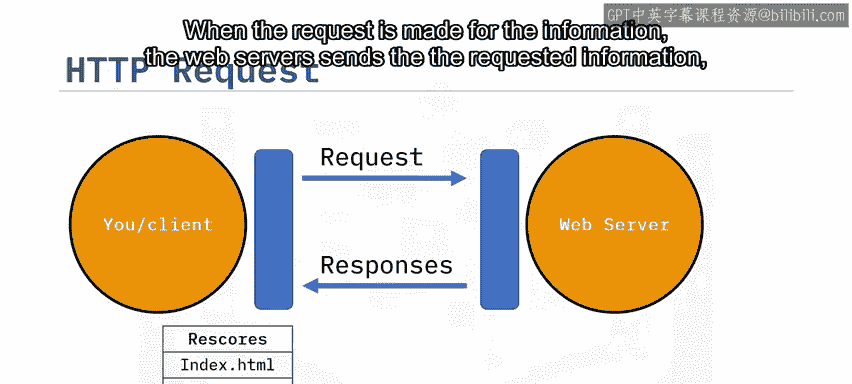

A uniform resource locator or URL is the most popular way to find resources on the web。

 We can break the URL into three parts。 First， we have the scheme。

 This is the protocol And for this lab。 it will always be HtTP colon forward slash forward slash The Internet address or base URL。

 This will be used to find the location。 Some examples include www。Bm dot co and www。getlab do com。

 And finally， the route， this is the location on the web server。 For example。

 slash images slash Isn logogo dopNg。 Let us review the request and response process。

 The following is an example of the request message for the get request method。

 There are other httP methods we can use In the start line。 we have the get method。

 This is an HttP method In this case， its requesting the file index。

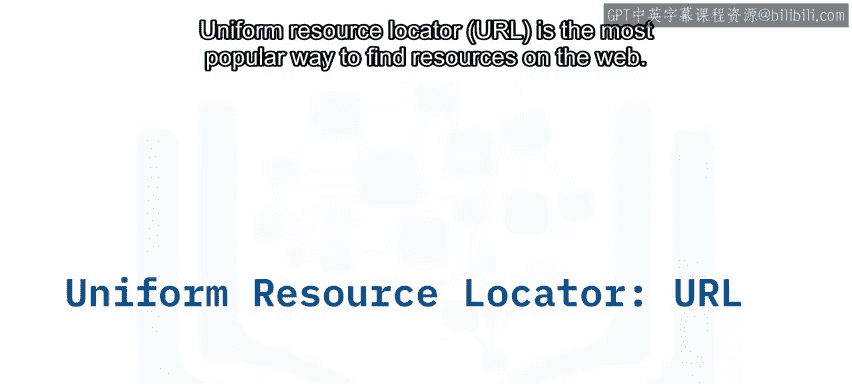

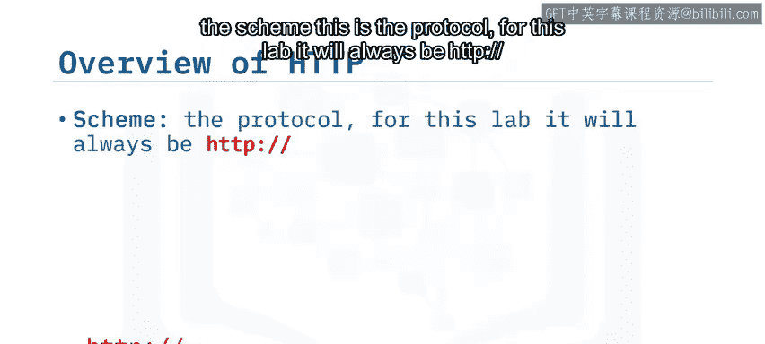

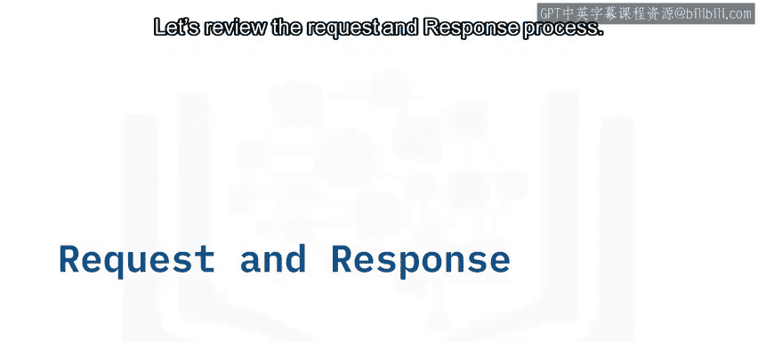

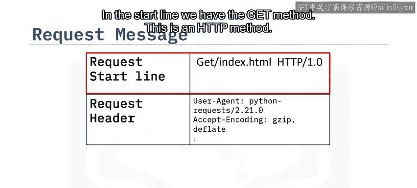

Hm the request header passes additional information with an HtTP request in the get method。

 the request header is empty。 Some requests have a body。

 We will have an example of a request body later the following table represents the response the response start line contains the version number followed by a descriptive phrase In this case。

 HtTP slash 1。0 a status code 200， meaning success and the descriptive phrase okay we have more on status codes later the response header contains information Finally。

 we have the response body containing the Re file In this case， an Hm document。

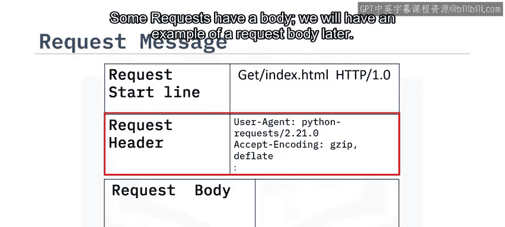

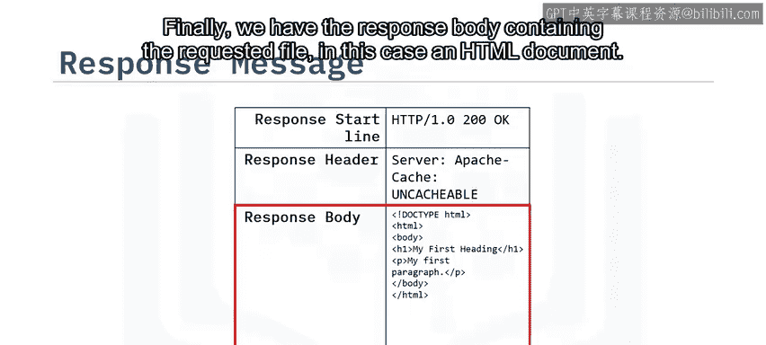

Let us look at other status codes。

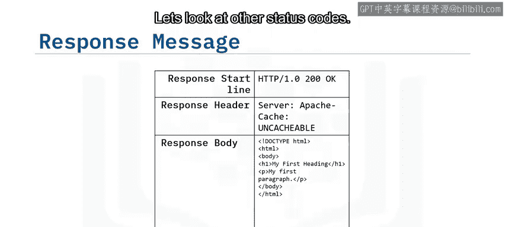

Some status code examples are shown in the table below the prefix indicates the class For example。

 the 100s are informational responses。 100 indicates that everything is okay so far。

 The 200s are successful responses For example， 200。

 the request has succeeded Anything in the 400s is bad news 401 means the request is unauthorized。

 500s stand for server errors like 501 for not implemented。

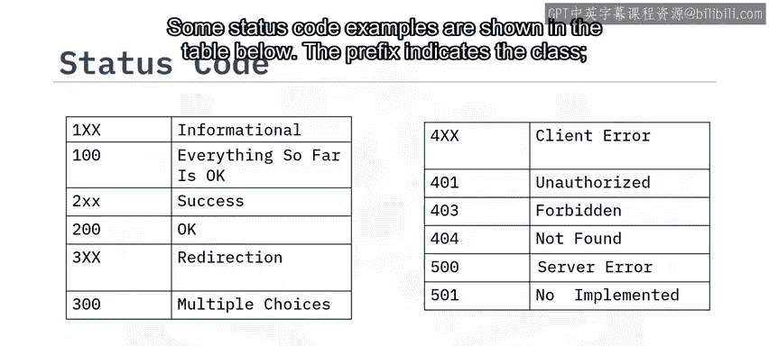

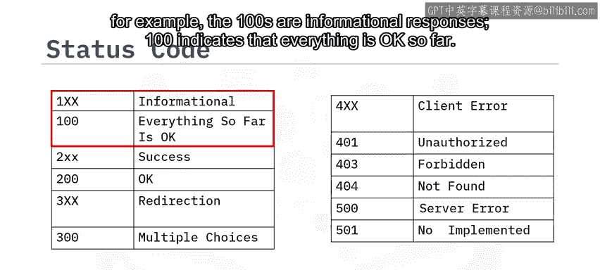

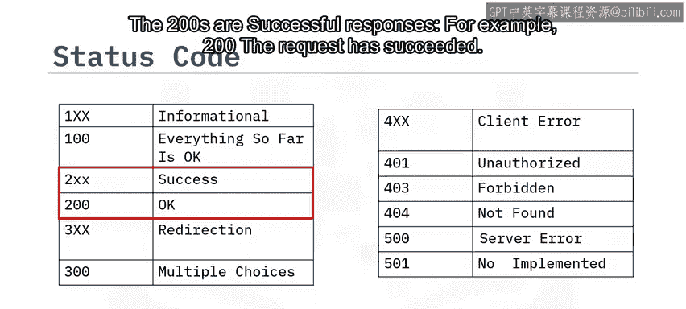

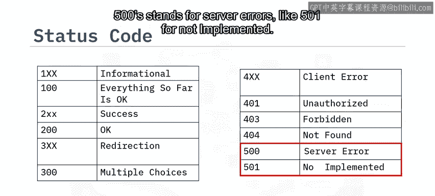

When an HTTP request is made an HTTP method is sent， this tells the server what action to perform。

 a list of several HTTP methods is shown here。In the next video。

 we will use Python to apply the get method that retrieves data from the server and the post method that sends data to the server。

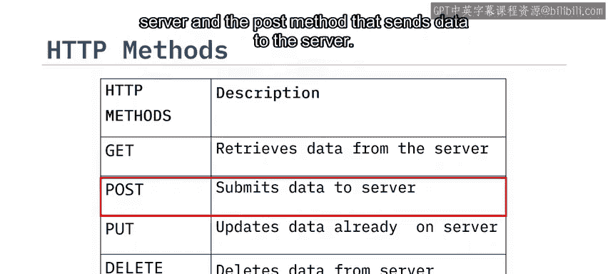

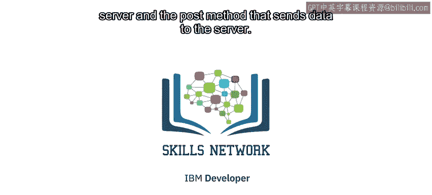