# IBM应用人工智能（从0开始搭建AI机器人）｜IBM Applied AI （中英字幕） - P98：8_打包.zh_en - GPT中英字幕课程资源 - BV1p64y1H7LM

In this video， we will focus on creating a Python package。

 We will provide an overview of Python modules and Python packages。

 A Python module is a dot py file containing Python definitions， statements， functions and classes。

 We can import the module to other scripts and notebooks， making things easier。

 consider module dot py that has two functions。 A function that squares the input and returns the result as an output。

 and a function that doubles the input and returns the result as an output。

 If the function is in the same directory， we can import it and use the functions in that module。

 We can then use them in our code。 A package is a collection of Python modules into a dictionary with an underscore。

 underscore in it underscore， underscore dot py file。

 which distinguishes it from just a dictionary of Python scripts。

 The example here shows the package my。😊。

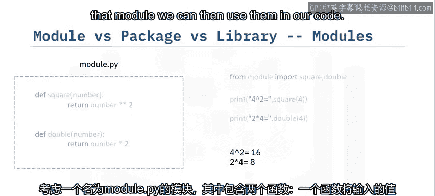

Project in the parent underscore directory with modules module 1 and module 2 It also contains the init file When you import a module or a package。

 the corresponding object created by Python is always of type module Note that the distinction between module and package is just at the file system level。

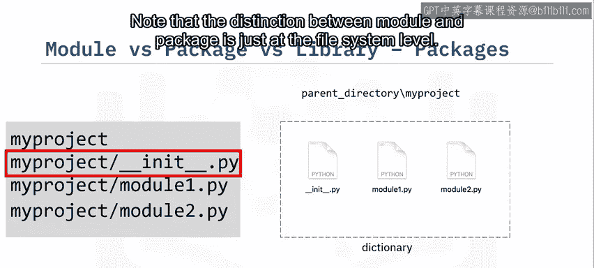

A library is a collection of packages， or it can be a single package。

 An example of this is nuy or pytorrch。 Note that the terms package and library are often used interchangeably。

 So pytorrch and numpy are also referred to as packages。 Here's how you create a package。 First。

 create a folder with the package name。 create an empty underscore， underscore in it。

 underscore dot Py file。 you will enter the code for this file later。 createate your modules。

 and in the underscore， underscore in it， underscore dot Py file。

 Add code to reference the modules in the package。Now verify your package。Open a bash terminal。

 Change the directory to the folder where your package is located。

 Open the Python interpreter by running the command Python in the shell。

 using the Python prompt type import， then type your project name。

 If this command runs without errors。 It is an indication that the package is successfully loaded。

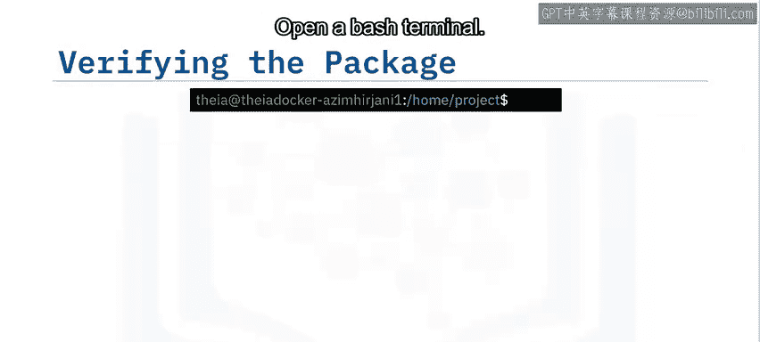

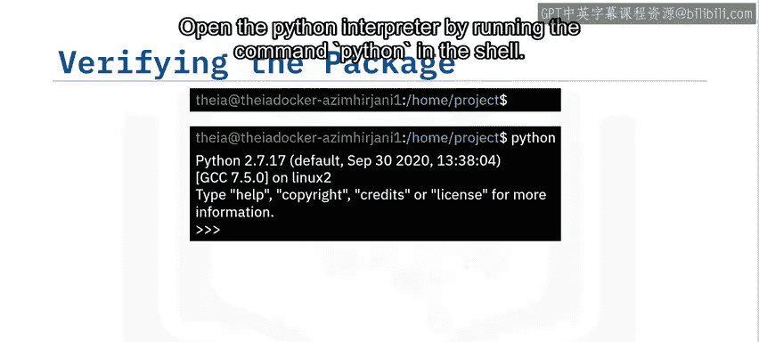

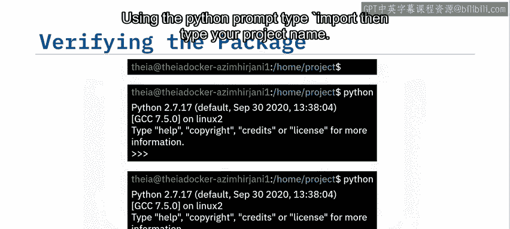

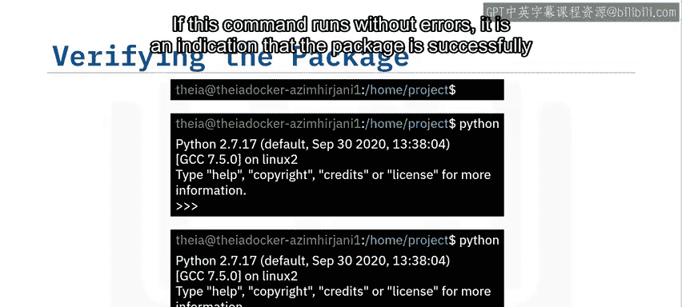

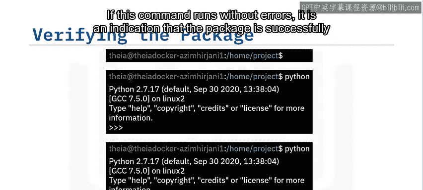

The general structure for testing your package is the package name， dot module， name。

 dot function name， followed by the parameters without the curly brackets。

 but keeping the round brackets。 Here is an example using our project。

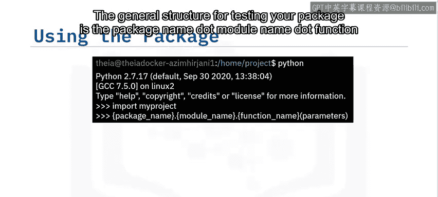

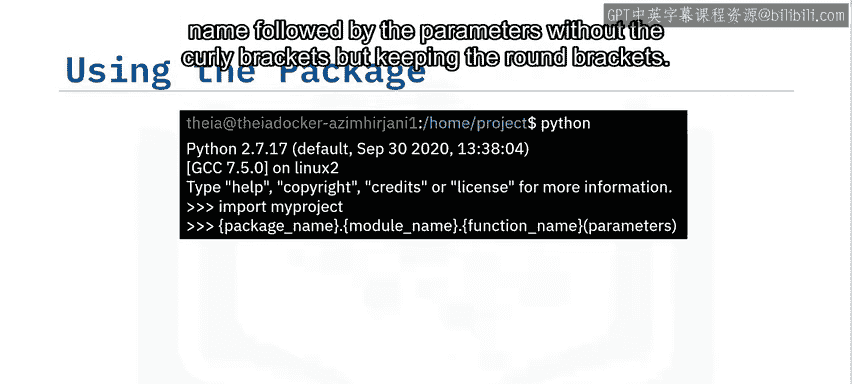

So once we have created the package， we can use it in other scripts if the package folder is in the same directory In this case。

 we have the file test。 Py in the parent directory， we can import the functions in the package。

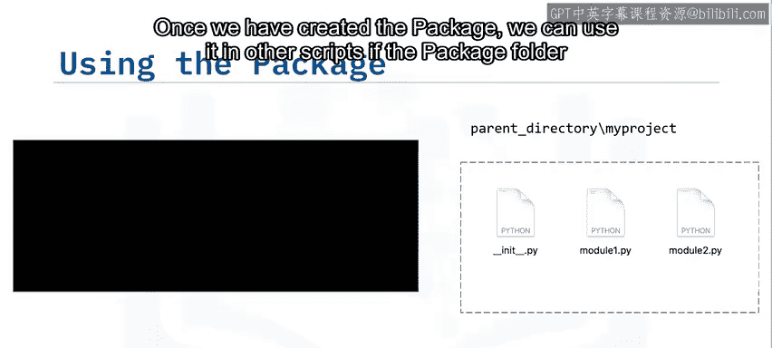

We can then run the functions and see if we get the correct results。

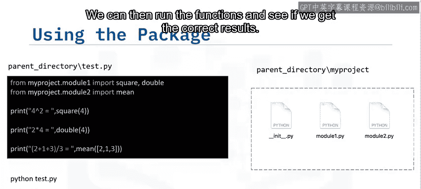