# IBM数据工程专业证书 课程11：《使用Spark和Hadoop进行大数据介绍》｜big-data-with-spark-hadoop｜ - P11：10_hadoop 生态系统.zh_en - GPT中英字幕课程资源 - BV12h4y1D7hF

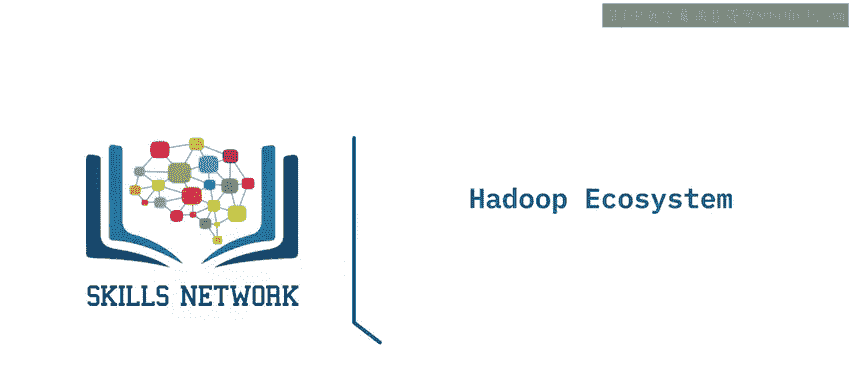

Welcome to Hadoop ecosystems。

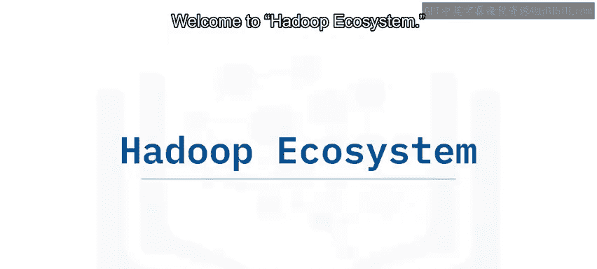

After watching this video， you'll be able to list the stages of the Hadoop ecosystem。

 differentiate between the core components and the extended components。

 list some examples of tools used in each stage。😊。

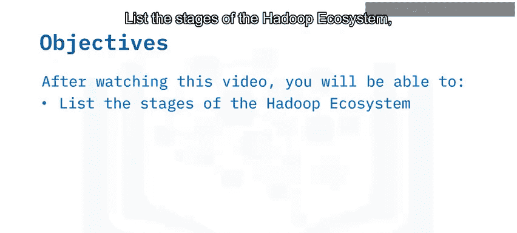

Apart from the core components of Hadoop， Hadoop Common refers to the common utilities and libraries that support the other Hadoop modules。

 Hadoop distributed file system。 HFS stores the data collected from the ingestion and distributes the data across multiple nodes。

 map reduceuce is used for making big data manageable by processing them in clusters。

 Yet another resource negotiator yarn is the resource manager across clusters。

 The extended Hadoop ecosystem consists of libraries or software packages that are commonly used with or installed on top of the Hadoop core。

 The Hadoop ecosystem is made of components that support one another for big data processing。

 We can examine the Hadoop ecosystem based on the various stages。

 When data is received from multiple sources。 Fme and scoop are responsible for ingesting the data and transferring them to the storage component。

 HFs and Hbase then。

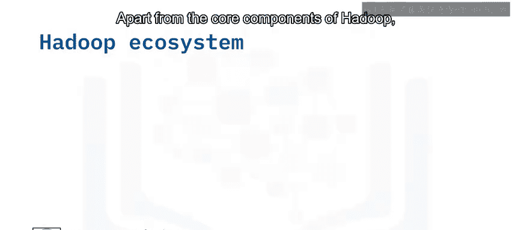

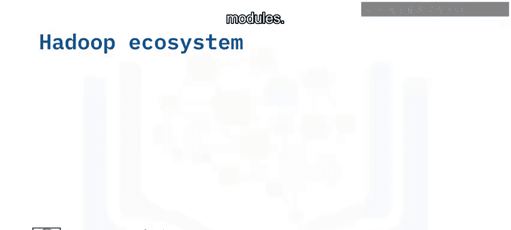

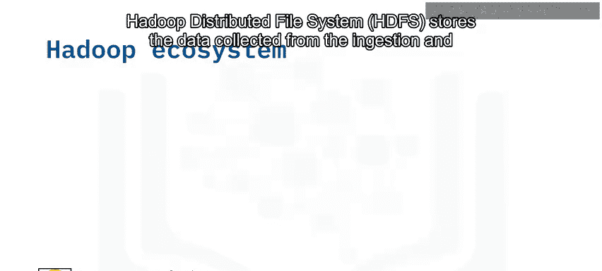

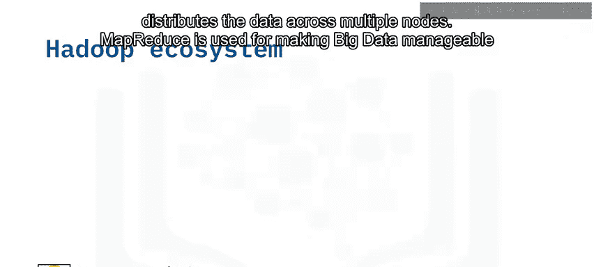

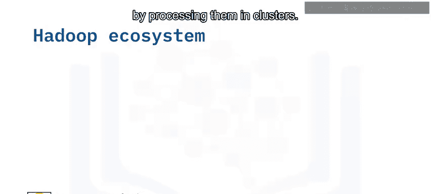

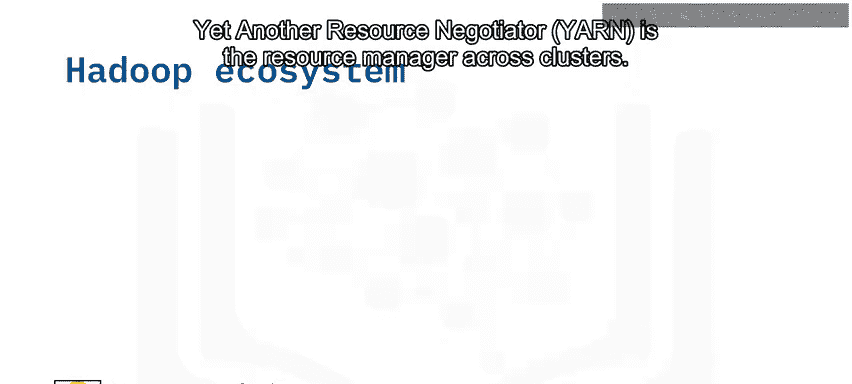

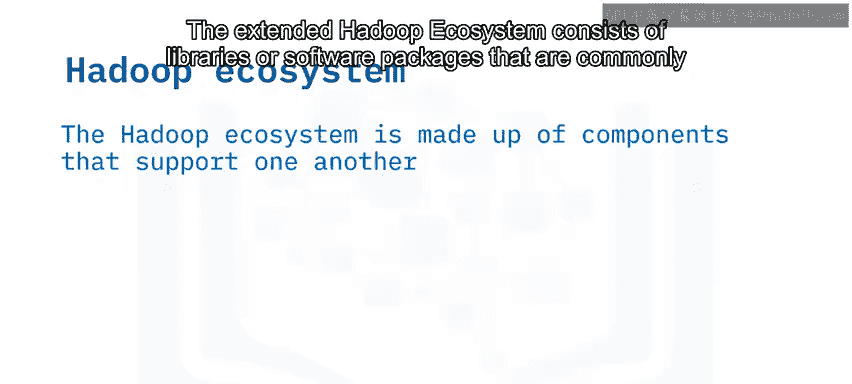

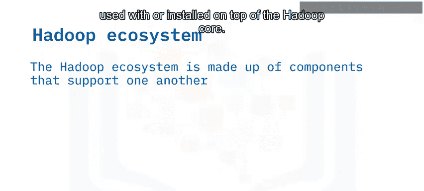

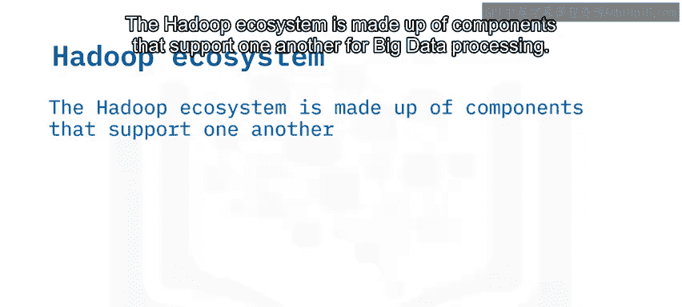

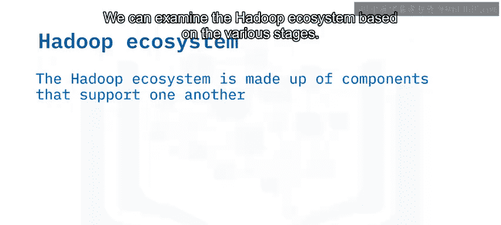

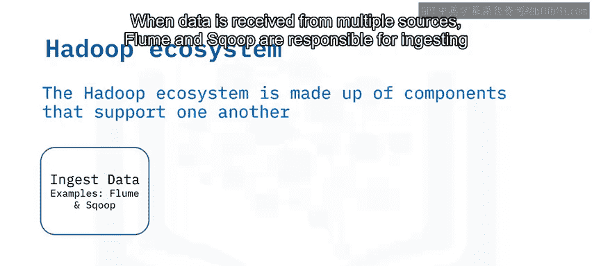

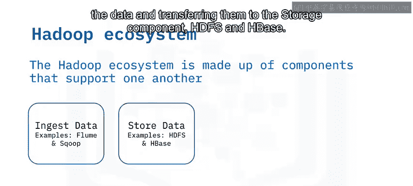

Data is distributed to a mapreduce framework like P and hive to process and analyze the data and the processing is done by parallel computing After all that is done。

 tools like H are used to access the refined data。Ingesting is the first stage of big data processing Whenever you deal with big data。

 you get data from different sources。 you then use tools like Fe and scoop。

 Floe is a distributed surface that collects aggregates and transfers big data to the storage system。

 Fe has a simple and flexible architecture based on streaming data flows and uses a simple。

 extensible data model that allows for online analytic application。

 Scope is an open source product designed to transfer bulk data between relational database systems and Hadoop。

 Scope looks in the relational database and summarizes the schema。

 It then generates mapreduce code to import and export data as needed。

 Scope allows you to quickly develop any other mapreduce applications that use the records that scoop stored into HDFS。

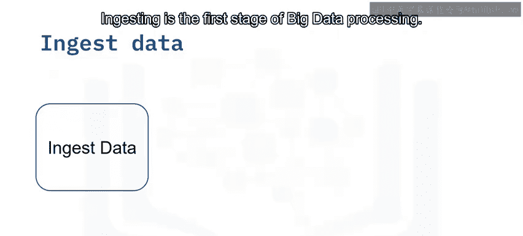

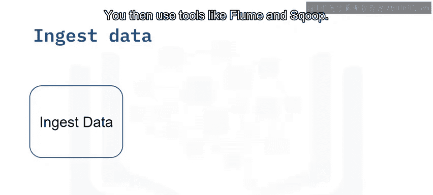

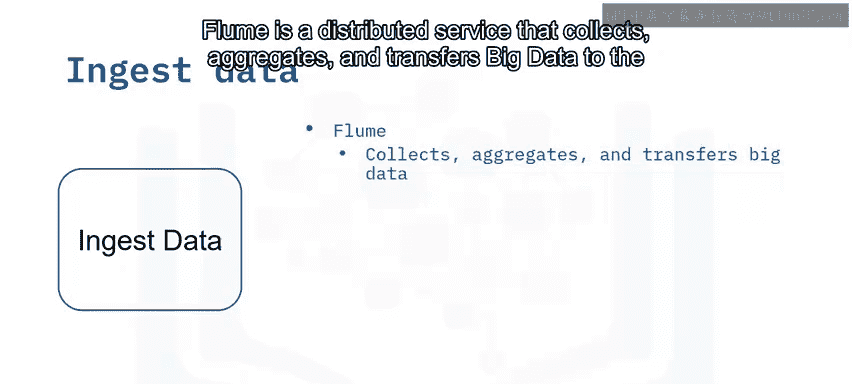

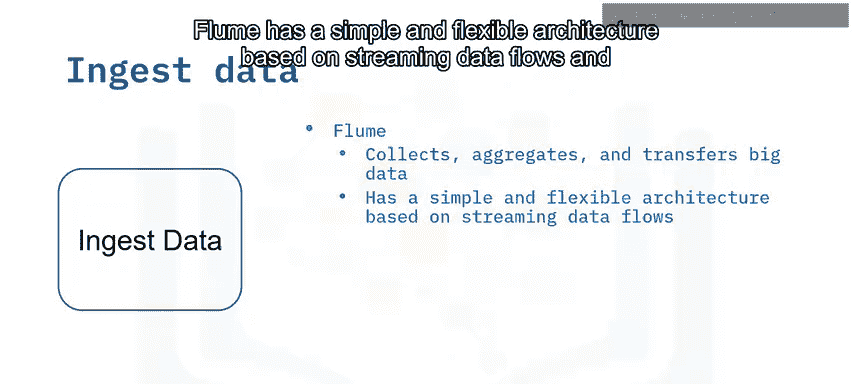

HBase is a columnoriented non-relational database system that runs on top of HDFS。

 It provides realtime wrangling access to the Hadoop file system HBase uses hash tables to store data in indexes and allow for random access of data。

 which makes lookups faster Cassandra is a scalable no SQL database designed to have no single point of failure。

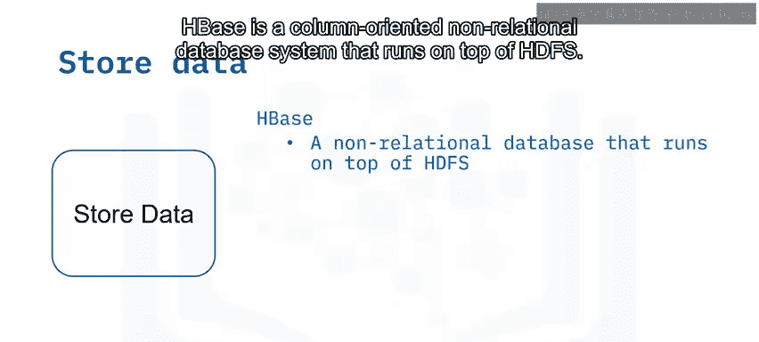

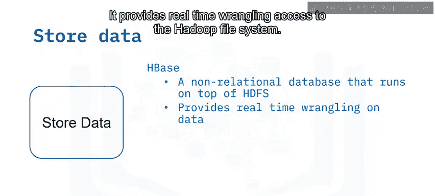

In the analyzed data stage， PIG is used for analyzing large amounts of data。

 PIG is a procedural dataflow language and a procedural programming language that follows an order and set of commands Hive is used mainly for creating reports and operates on the server side of a cluster Hive is a declarative programming language which means it allows users to express which data they wish to receive。

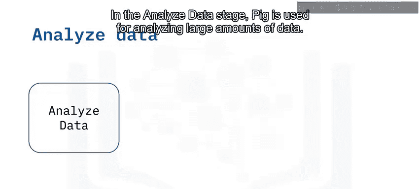

The final stage is access data， where users have access to the analyzed and refined data。

 At this stage， tools like impmpalla are often used。

 Impalla is a scalable system that allows nontechnical users to search and access the data in Hadoop。

 You do not need to be skilled in programming to use impmpalla。

 and Hugh is another tool of choice at this stage。 Hugh is an acronym for Hadoop user experience。

 Hugh allows you to upload， browse and query data。 You can run P jobs and workflow in He。

 Hugh also provides a SQL editor for several query languages like Hve and MysQL。😊。

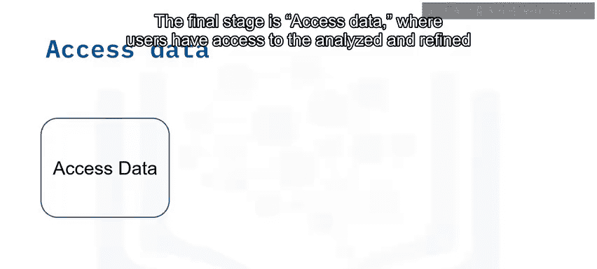

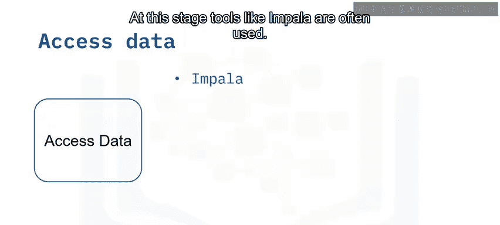

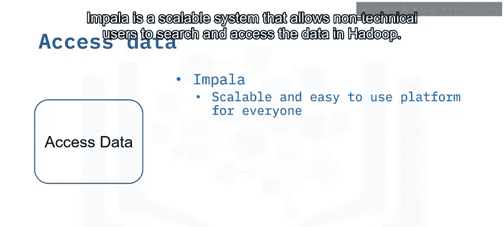

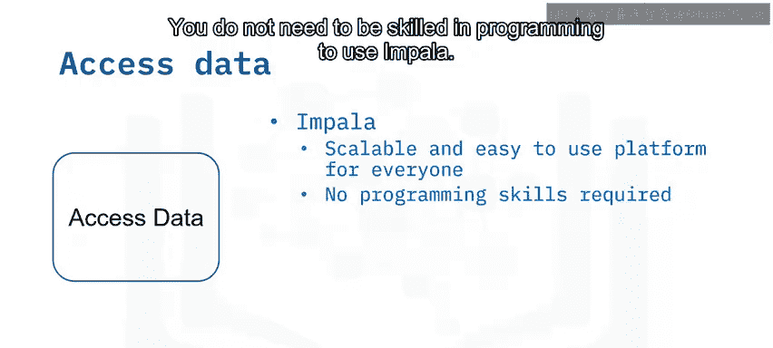

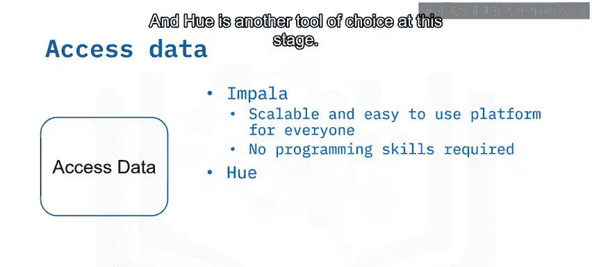

In this video， you learned that the four main stages of the Hadoop ecosystem are ingest， store。

 process and analyze and access， some examples of the tools associated with each stage and how each stage interacts with the others。

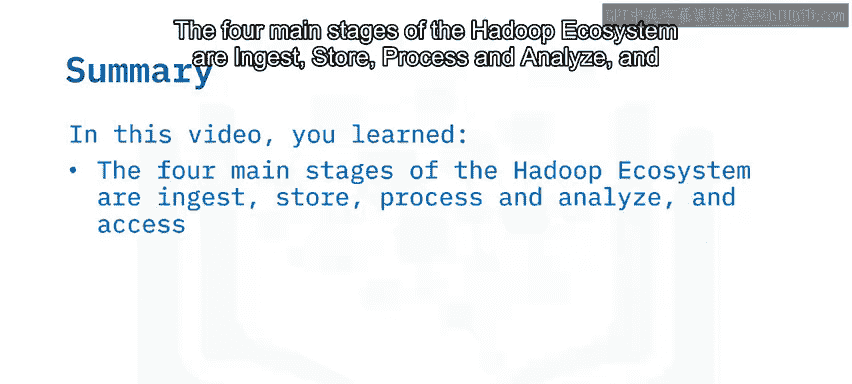

