# IBM数据工程专业证书 课程11：《使用Spark和Hadoop进行大数据介绍》｜big-data-with-spark-hadoop｜ - P12：11_hdfs.zh_en - GPT中英字幕课程资源 - BV12h4y1D7hF

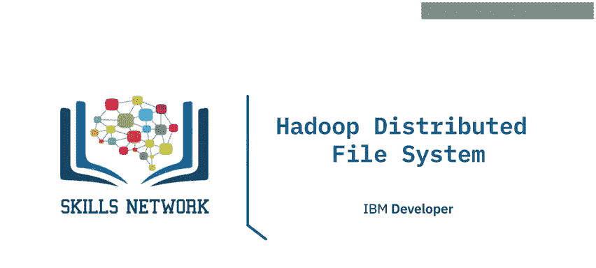

Welcome to Hadoop Dised file system。

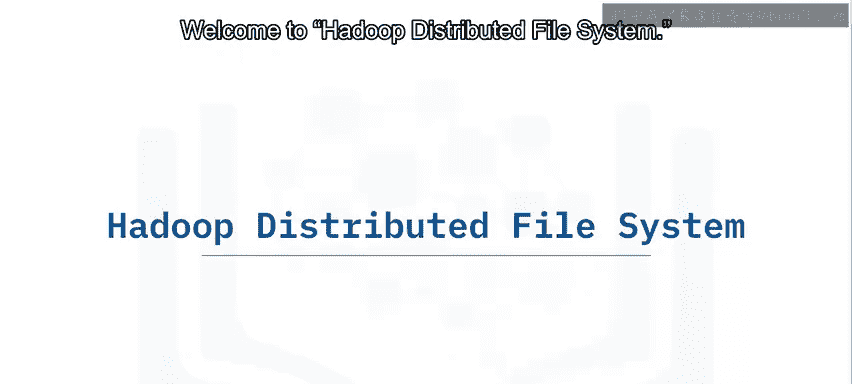

After watching this video， you'll be able to explain Hadoop distributed file system and important concepts。

 identify the key HDFS features， describe the HDFS architecture。

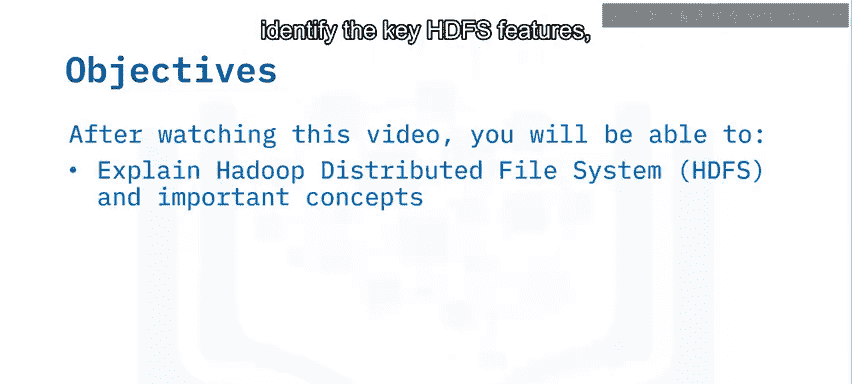

HDFS stands for Hadoop distributed file system。 A distributed file system is a file system that is distributed on multiple file servers and allows programmers to access or store files from any network or computer。

 HDFS is the storage layer of Hadoop。 HDFS works by splitting the files into blocks。

 then creating replicas of the blocks and storing them on different machines。

 HFS is built to access streaming data seamlessly。 Staming means that HDFS provides a constant bit rate when transferring data。

 rather than having the data being transferred in waves。

 HDFS uses a command line interface to interact with Hadoop。

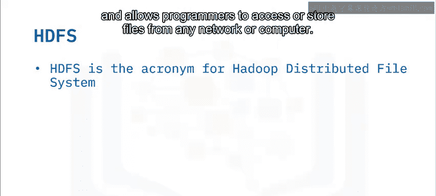

The key features of HDFS are the commodity hardware that stores the data is not expensive and therefore reduces storage costs。

 HFS can store very large amounts of data as large as petabytes In any format， Tular and nontular。

 It splits these large amounts of data into small chunks called blocks。

 One of the great features of HDFs is its ability to replicate and minimize the costs associated with data losses when there is failure with one of the hardware units。

 That capability makes HDFS fault tolerant In the event of a data loss of one of the computers。

 The data can be found on another computer and work continues。 HDFS is also highly scalable。

 A single cluster can scale into hundreds of nodes。

 Portability is also one of the key features as HDFS is designed to easily move from one platform to another。

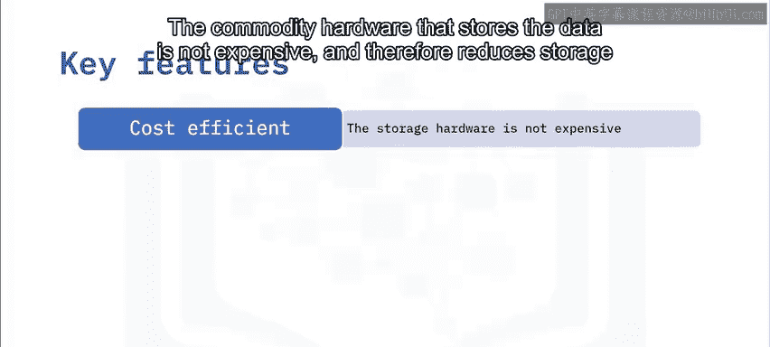

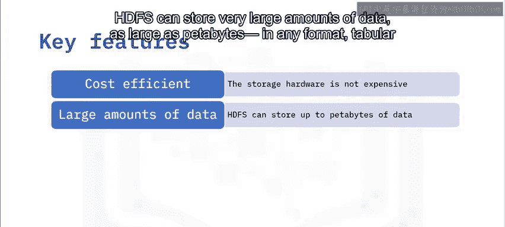

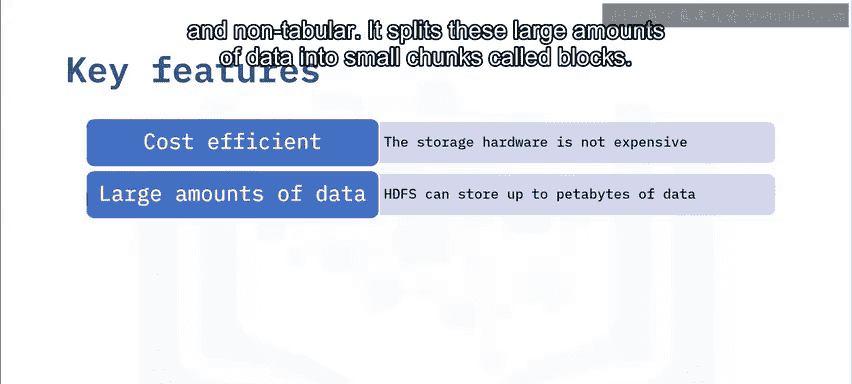

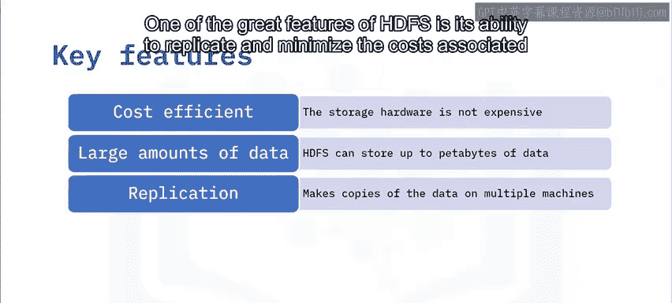

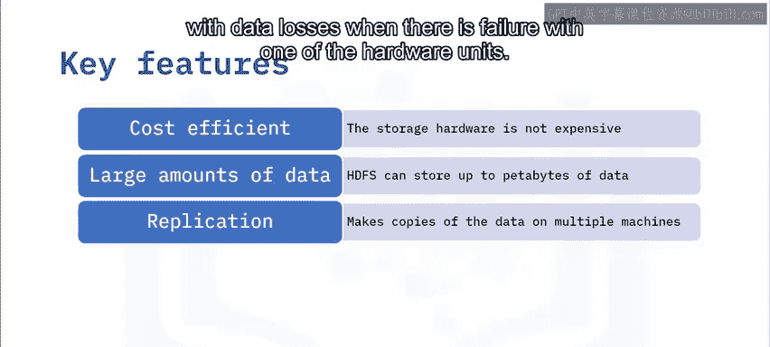

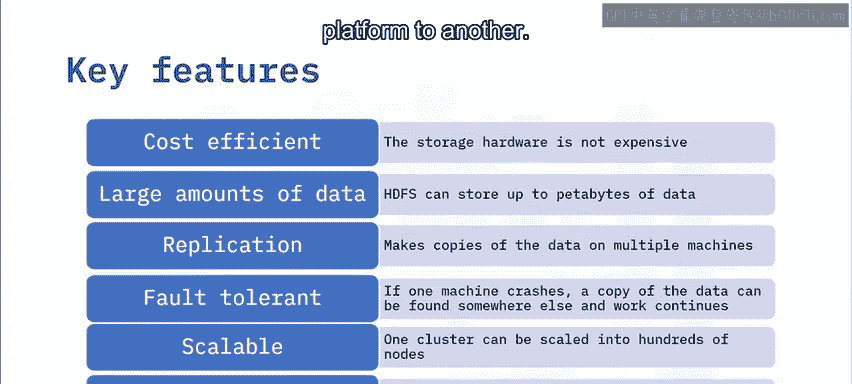

To get familiar with Hadoop， there are a few concepts to know when HFS receives files。

 files are broken into smaller chunks called blocks。

 A block is the minimum amount of data that can be read or written and provides fault tolerance。

 depending on your system configurationgu。 the default block size could be 64 or 128 meby。

 For example， if we had a 500 mebyte file with a default block chunk size of 128 mebys。

 the file will be divided into  three blocks of 128 mebys and one block of 116 meby。

 The only time you will have equal splits is if the file size is a multiple of the default block size。

 Therefore， you can see that each file stored doesn't have to take up the storage of the preconfigured block size。

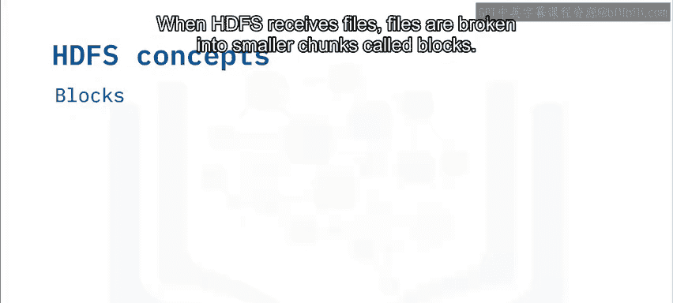

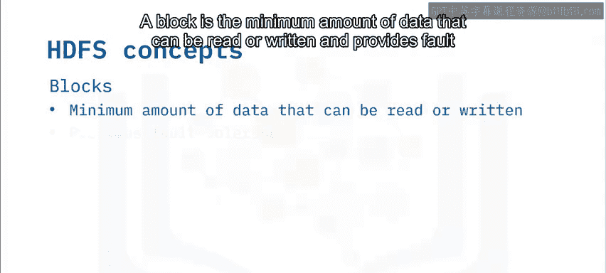

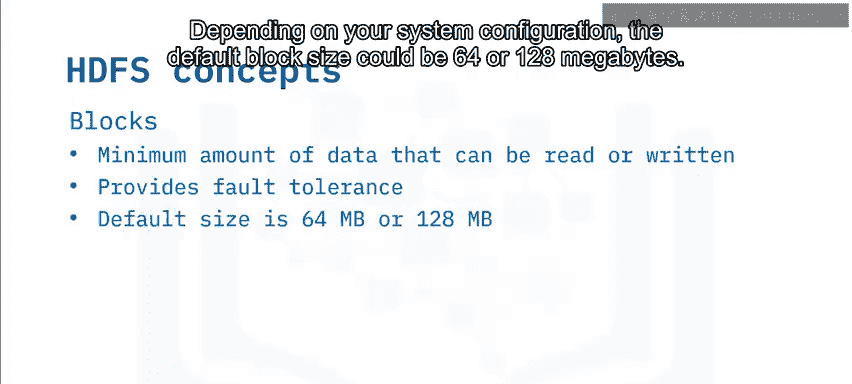

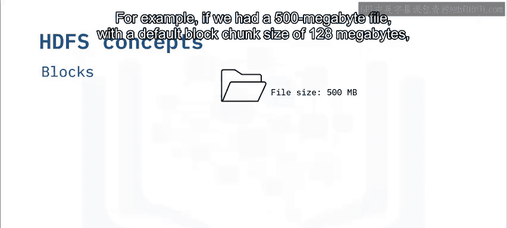

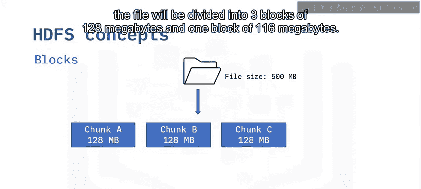

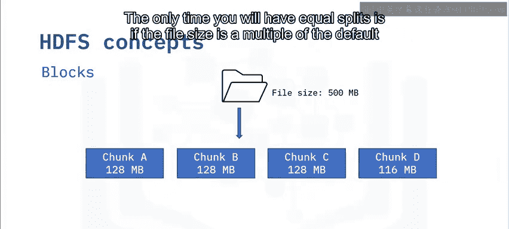

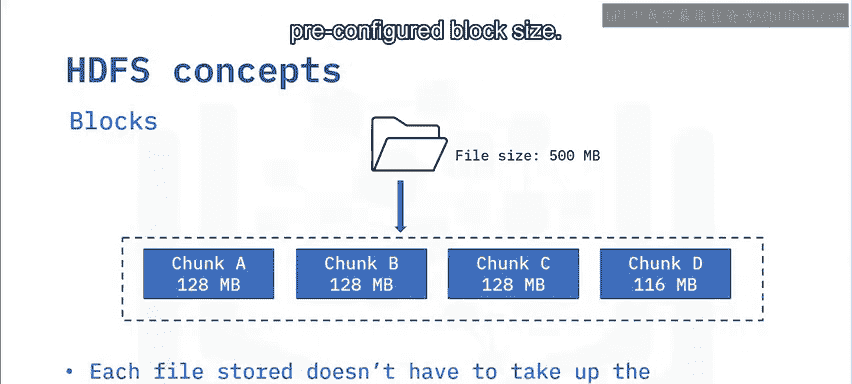

Let's start with nodes。 A node is a single system which is responsible for storing and processing data。

 Think about it as one machine or computer in which data is stored。

 Remember that HDFS follows the primary secondary concept。 HDFS has two types of nodes。

 The primary node known as the name node， regulates file access to the clients and maintains。

 manages and assigns tasks to the secondary node， also known as a data node。

 There can be hundreds of data nodes in the HDFS that manage the storage system。

 They perform read and write requests at the instruction of the name node。

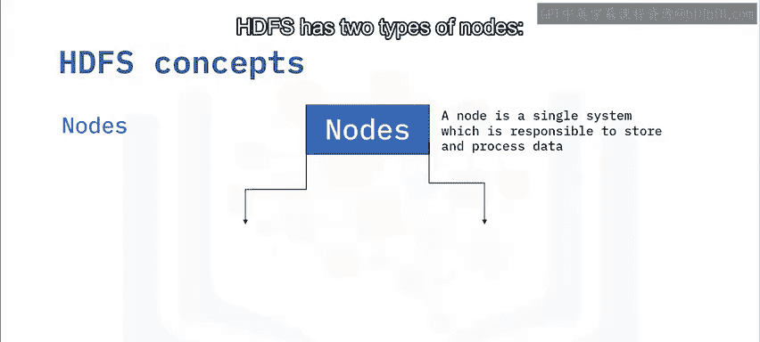

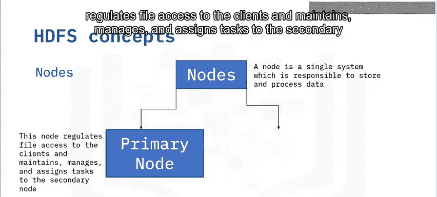

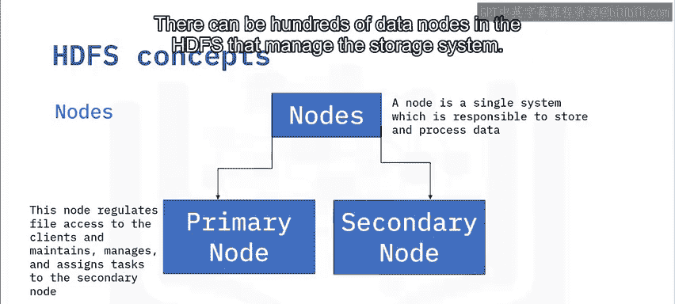

When performing operations like read and write， it is important that the name node maximizes performance by choosing the data nodes closest to themselves。

 This could be by choosing data nodes on the same rack or in nearby racks。

 This is called rack awareness。 a rack is the collection of about 40 to 50 data nodes using the same network switch。

 Ra awareness is used to reduce the network traffic and improve cluster performance。

 to achieve rack awareness。 The name node keeps the rack I D information。

 Replication is done by rack awareness as well。 It is done by making sure replicas of a data node are in differentffer racks。

 So if a rack is down， you can still obtain the data from another rack。😊。

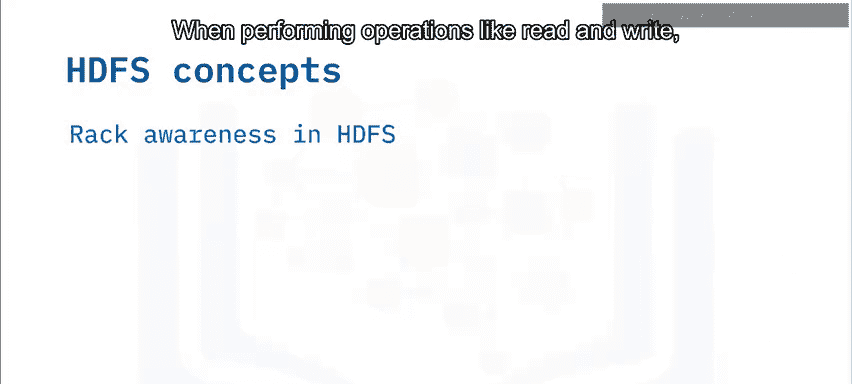

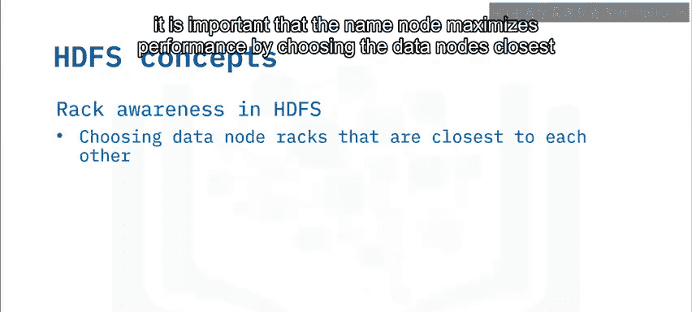

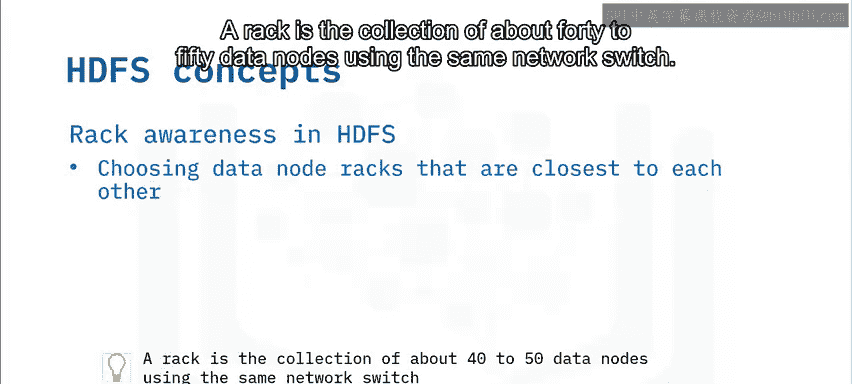

HDFS is known for optimizing replication。 HFS uses the rack awareness concept to create replicas to make sure that the data is reliable and available。

 and that the network bandwidth is properly utilized。

 Replication is creating a copy of the data block When crashes happen。

 Replication provides backup of the data blocks。 Replication factor is defined as the number of times you make a copy of the data block。

 depending on your configuration， you can set the number of copies you want。

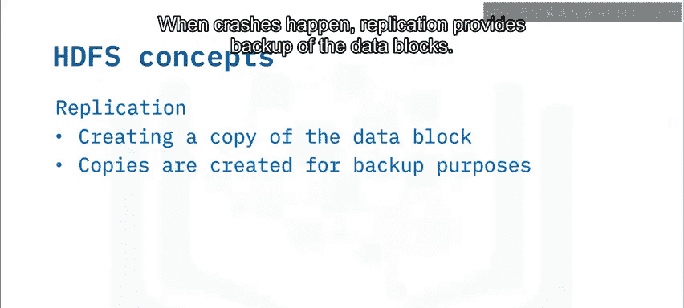

Let's look at our 500 mebyte file example if our replication factor is2。

 it will create two copies of each block。 that means we will have four times two。

 which is eight copies of the file blocks for backup HDFS uses the rack awareness concept and saves the blocks in different racks to make sure that a copy is available in another rack。

 For example， you could have four racks of two copies each。 If one of the racks is down or crashes。

 you will still have a copy of the data blocks in a different rack and you can still work with the data。

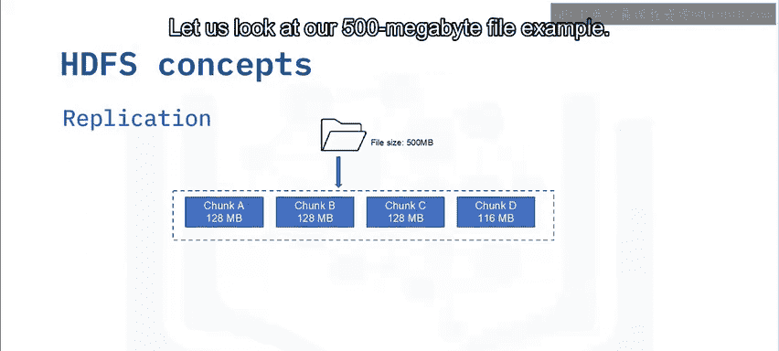

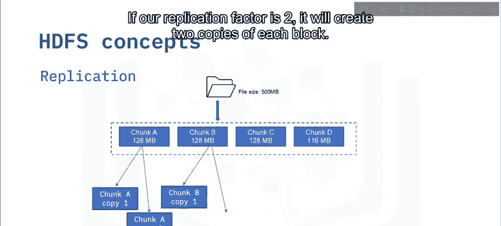

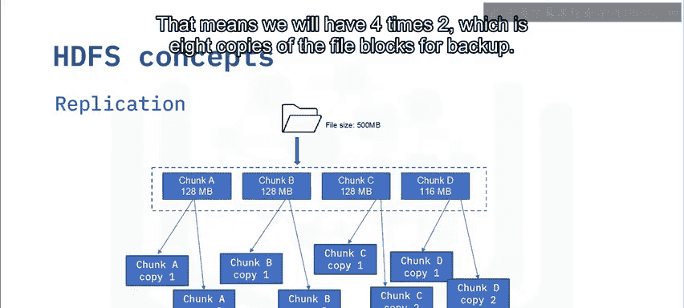

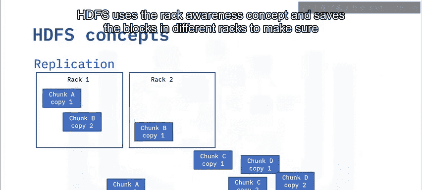

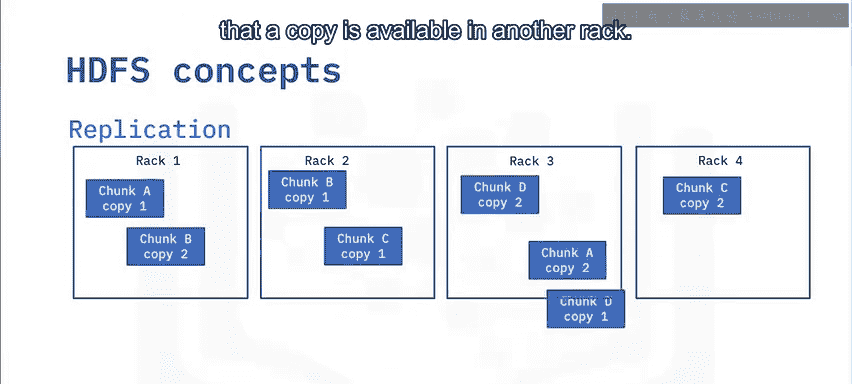

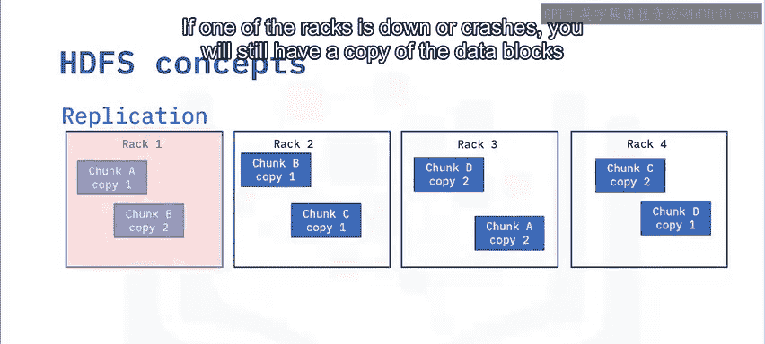

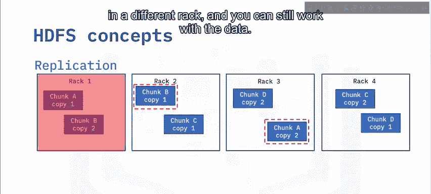

Another important concept is how read and write operations are performed in HDFS。

 HDFS allows write once read many operations。 This means that you cannot edit files that are already stored in HDFS。

 but you can append new data to them。 Let's start with how the read operation works。

 As we have a text file。 The client will send a request to the primary node。

 which is the name node to get the location of the data nodes containing blocks。

 The name node will verify that the client has the correct privileges and provide the client with the locations。

 A client in HDFS interacts with the primary and secondary nodes to fulfill a user's request。

 The client will then send a request to the closest data nodes through an FS data input stream object by calling the read method to read all the files。

 And when the client is done， the client will use the closed method to end the session。 Next。

 we will see how the write operation works。😊。

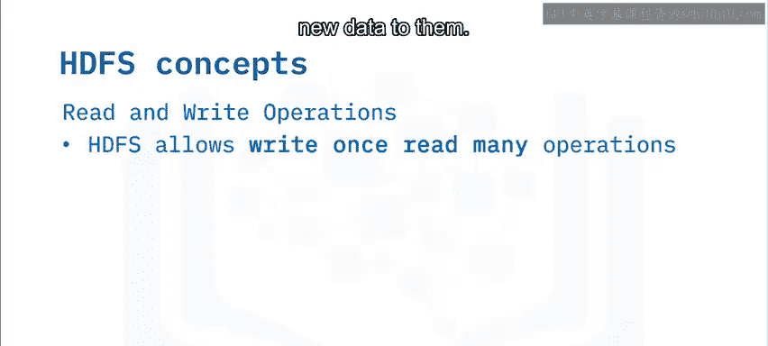

Just like in the read operation， the name node confirms that the client has the right privileges The name node makes sure to check that the file doesn't exist in the system If the file already exists。

 the client will receive an IO exception If the file doesn't exist。

 the client receives a right permission together with the data nodes Once the client is done。

 the data node start creating replicas and sends a confirmation to the client。

Haadoop follows the concept of a primary secondary node architecture。

 The primary node is the name node。 The architecture is such that per cluster there is one name node and multiple data nodes。

 which are the secondary nodes。 internally， a file is split into one or more blocks。

 and these blocks are stored in a set of data nodes。 The name node oversees opening， closing。

 renaming file operations and mapping file blocks to the data node。

 The data nodes are responsible for read and write requests from the client and perform the creation replication and deletion of file blocks based on instructions from the name node。

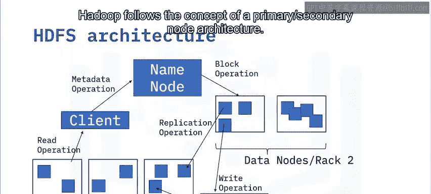

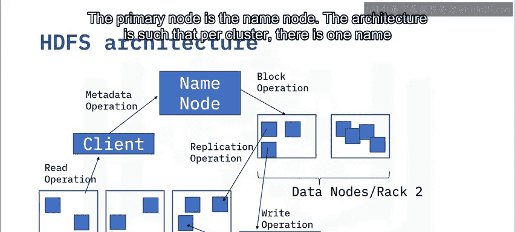

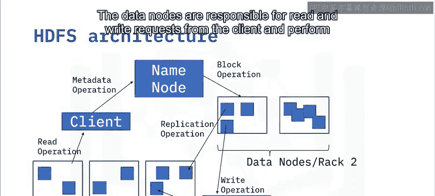

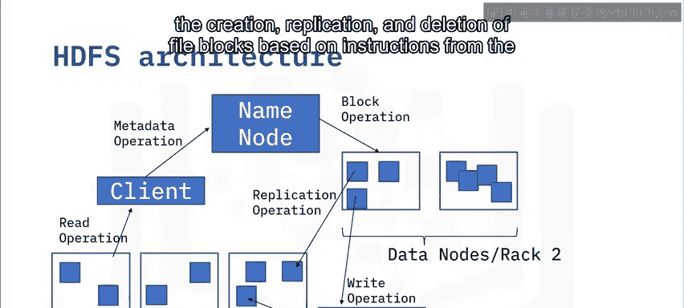

In this video， you learned that key HDFS benefits include its cost efficiency， scalability。

 data storage expansion and data replication capabilities。 A block is the minimum size of a file。

 Replication creates a copy of data blocks for backup purposes。

 RaC awareness helps reduce the network traffic and improve cluster performance。

 HDFS enables right once， read many operations。😊。

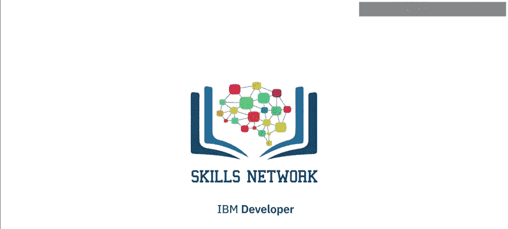