# IBM数据工程专业证书 课程11：《使用Spark和Hadoop进行大数据介绍》｜big-data-with-spark-hadoop｜ - P13：12_蜂巢.zh_en - GPT中英字幕课程资源 - BV12h4y1D7hF

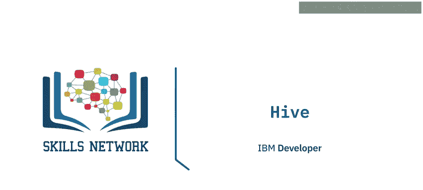

Welcome to Hive。After watching this video， you'll be able to articulate the reasons why Hve is used list hive features。

 differentiate between Hve and traditional RDBMS， identify components of the hive architecture。

 discuss hive concepts。

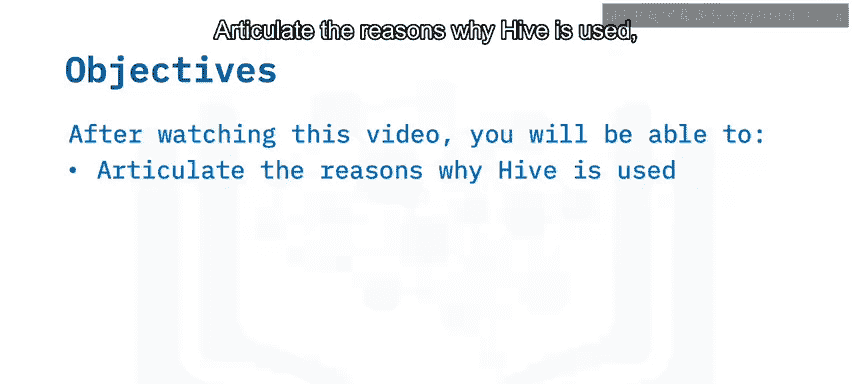

Hive is a data warehouse software within Hadoop that is designed to read。

 write and manage large and tabular type datas and data analysis。

 A data warehouse stores historical data from many different sources so that you can analyze and extract insights from it。

 These insights are used for reporting。 Hve is scalable and fast because it is designed to work on petabytes of data Hve is easy to use if you are familiar with SQL because hive query language or hiveQL is based on SQL This makes learning quicker because users who already deal with relational databases can easily grasp the concepts。

 Hve supports the following file formats。 S files consisting of binary key value pairs record columnar files that store columns of a table in a columnar database and text or flat files。

 Hve allows for data cleaning and filtering tasks according to users' requirements。😊。

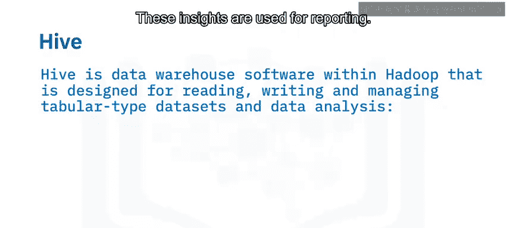

RDBMS is a type of database management system specifically designed for relational databases RDBMS is the acronym for relational database management system A relational database is a database that stores data in a structured format using rows and columns known as a table Let's look at the differences between a traditional RDBMS and Hve Trad RDBMS is used to maintain a database and uses the structured query language known as SQL Hve is used to maintain a data warehouse and uses the hive query language a language inspired by SQL Trad RDBMS is suited for real-time data analysis like data from sensors Hve is suited for static data analysis Tradal RDBMS allows for as many read and write operations。

 a user needs Hve is based on the right one read many methodology Trad RDB。

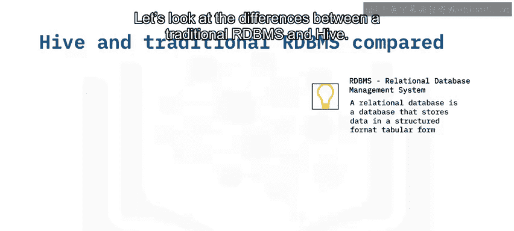

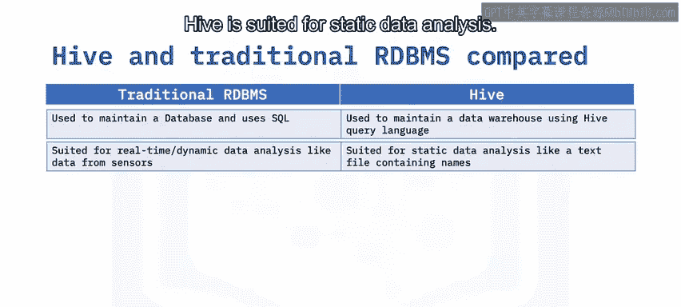

Can handle up to terabytes of data Hve is designed to handle as much as petabytes of data。

 Another difference is that traditional RDBMS enforces that the schema must verify loading data before it can proceed。

 Hve doesn't enforce the schema to verify loading data Lastly。

 traditional RDBMS may not always have built in for support data partitioning Hve supports partitioning Partitioning means dividing the table into parts based on the values of a particular column such as a date or city。

This is what hive architecture looks like。 There are three main parts of the architecture。

 The Hve client Hive provides different drivers for communication depending on the type of application for example for Javabased applications hive uses JDBC drivers and other types of applications will use ODBC drivers these drivers communicate with the servers Hve services clientient interactions are done through the Hve services any query operations are done here。

 the command line interface acts as an interface for the Hve service the driver takes in query statements。

 monitors the progress and lifecycle of each session and stores metadata generated from the query statements the metstore stores the metadata The data and information about each table such as the location and schema the metstore file system and job client in turn communicate with hive storage and computing to perform the following metadata information。

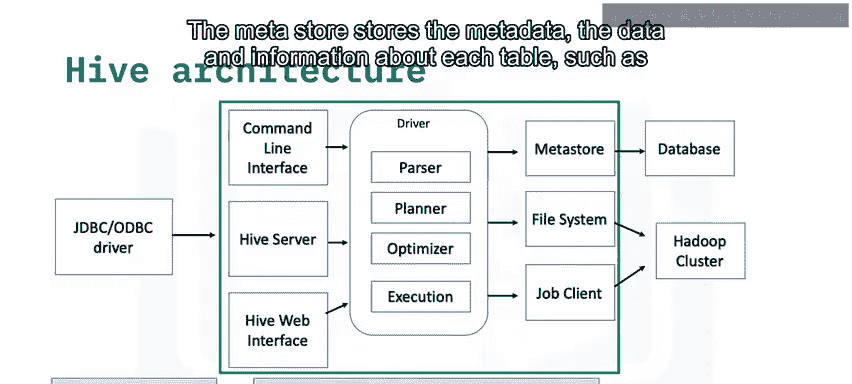

Of tables are stored in some sort of database and query results。

 and data loaded in the tables are stored in Hadoop cluster or HDFS。

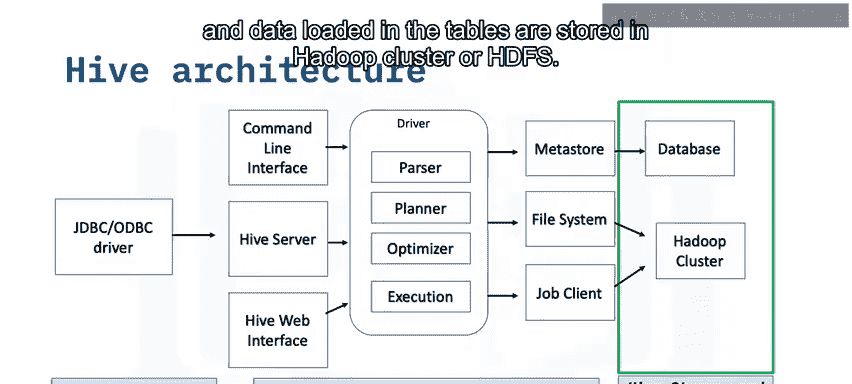

Let's look at the concepts in detail componentson in the Hve clients include the JDBC clientient。

 which allows Java based applications to connect to Hve and the ODBC client。

 which allows applications based on the ODBC protocolcol to connect to Hve。

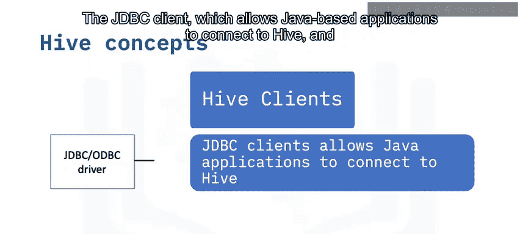

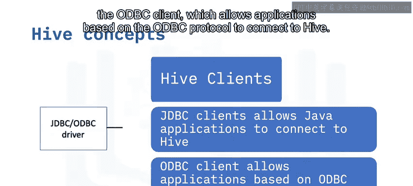

The Hve services section of the architecture is in charge of performing queries。

 The hive server is used to run queries and allows multiple clients to submit requests。

 It is built to support the JDBC and ODBC clients， The driver receives query statement submitted through the command line and sends the query to the compiler after initiating a session。

 The optimizer performs transformations on the execution plan and splits the tasks to help speed up and approve efficiency。

 The Executor execute tasks after the optimizer has split the tasks。

 The metastore is storage for the metadata， which is information about the table。

 The metastore is in charge of keeping this information in a central place。

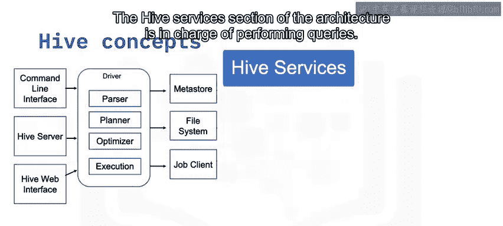

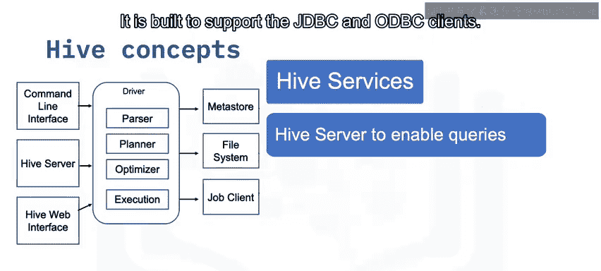

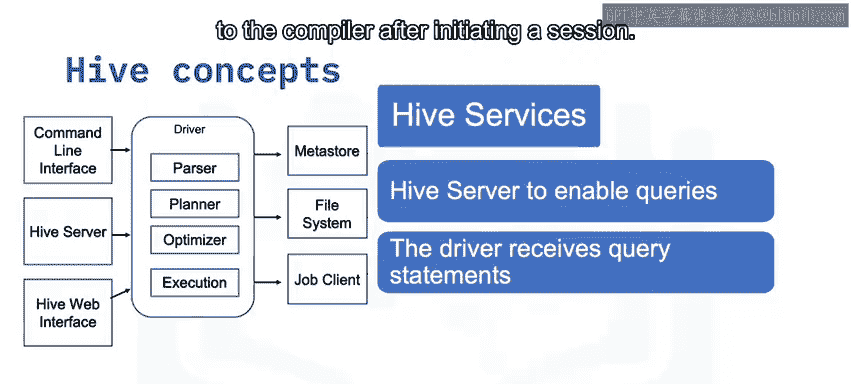

In this video， you learned that Hive is a data warehouse software for reading。

 writing and managing data sets， although Hve works very similarly to traditional RDBMS。

 they are slightly different。 The three main parts of the hive architecture are hive client。

 hive services and hive storage and computing。

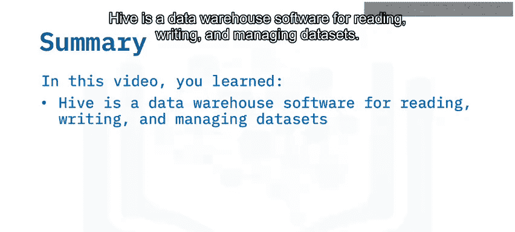

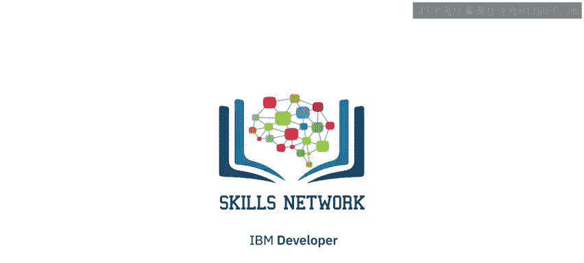