# IBM数据工程专业证书 课程11：《使用Spark和Hadoop进行大数据介绍》｜big-data-with-spark-hadoop｜ - P14：13_hbase.zh_en - GPT中英字幕课程资源 - BV12h4y1D7hF

Welcome to H Base。After watching this video you'll be able to define HBase。

 describe HBase as a columnar database， list the HBase features and usage。

 outline the differences between HBase and HDFS， describe the HBase architecture。

 discuss HBase concepts。HBase is a column oriented non-relational database management system that runs on top of a Doop distributed file system or HDFS。

 it provides a fault tolerant way of storing sparse data sets。

 fault tolerance refers to the working ability of a system or computer to continue working even in unfavorable conditions such as when a server crashes。

 it works well with realtime data and random read and write access to big data。

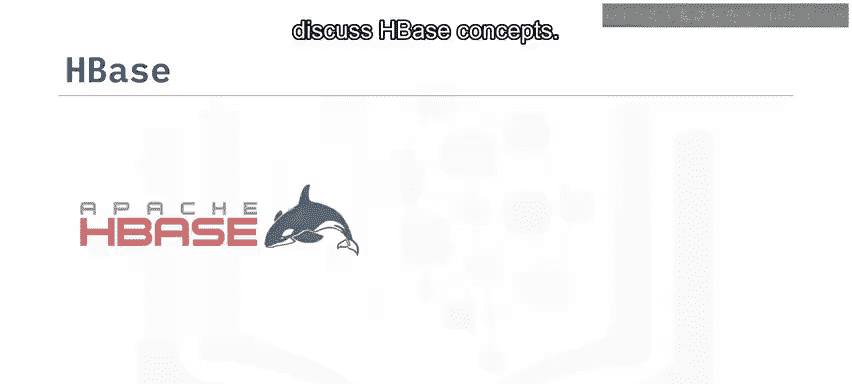

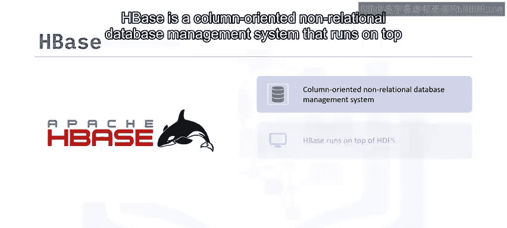

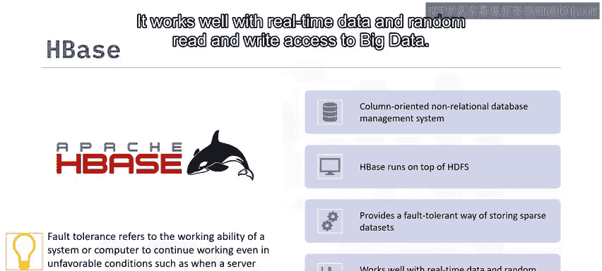

HBase is used for right heavy applications to store large amounts of datas and process and provide analytics in real time it is referred to as linearly scalable because it supports scalability in both linear and modular form HBase is a backup support for mapred jobs HBase can be used for high speed requirements because it offers consistent reads and writes HBase has no fixed columns and is only defined by column families。

 It provides an easy to use Java API for client access。

 HBase supports data replication across clusters。

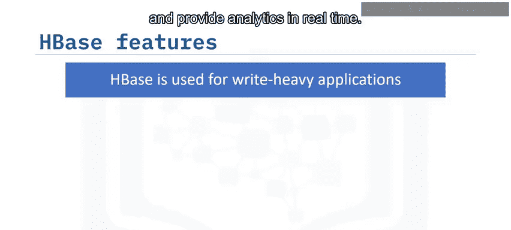

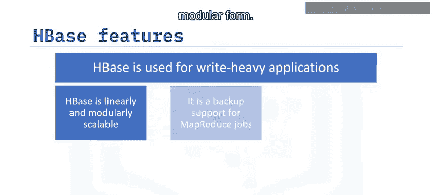

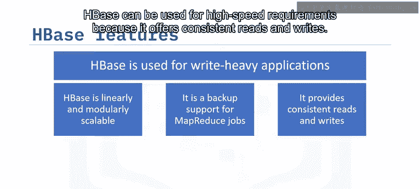

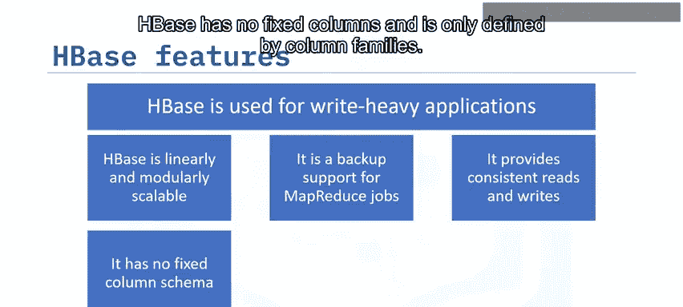

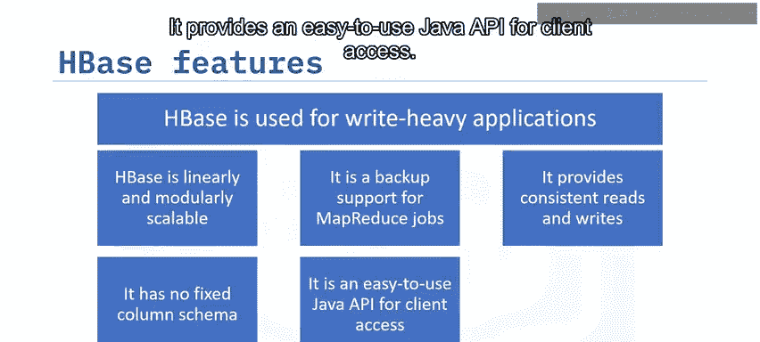

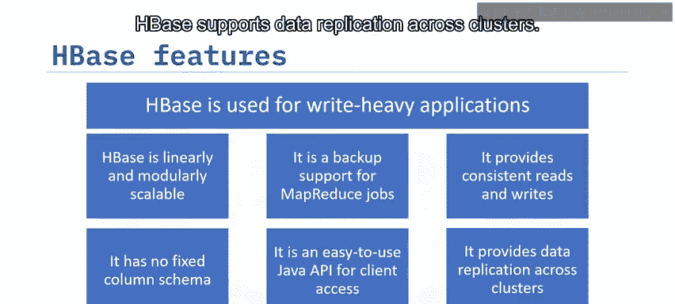

An Hbase column represents an attribute of an object。 Let's look at an example。

 If the table is stor sensors from heart monitors in the hospital， each row might be a log record。

 a typical column could contain information about the patient's details or the time when the log record was taken Hbase allows for many attributes to be grouped together into column families such that the elements of a column family are all stored together。

 For example， patient name and patient age will be stored as patient details。

 the columns in Hbase will look like patient details。

 heart rate and timest when creating schemas in Hbase you must predeine the table schema and specified the column families。

 new columns can be added to families at any time making the schema flexible and adaptable to changing application requirements just as HFS has a name node and secondary nodes。

 Hbase is built on S。

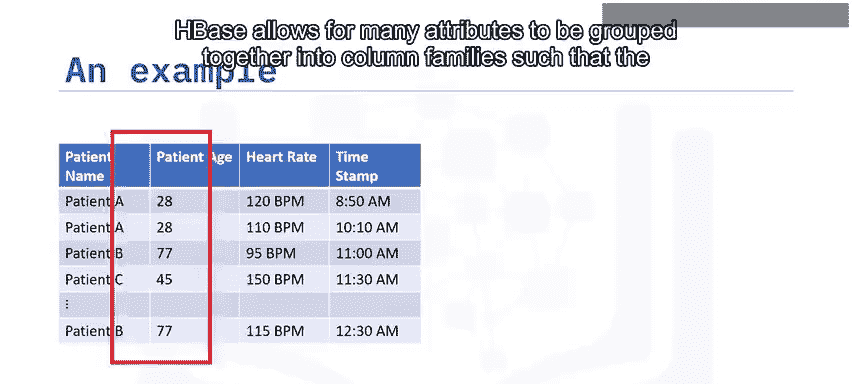

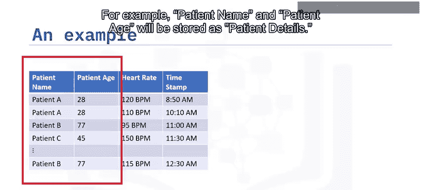

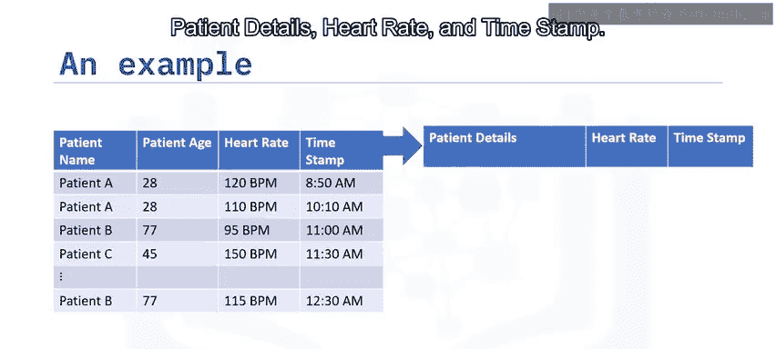

In H base， a primary node manages the cluster and a region server stores portions of the tables and performs the work on the data。

While HBase and HDFS are both used to store massive amounts of data。

 one of the major differences is that HBase stores data in the form of columns and rows in a table。

 while HDFS stores in a distributed manner across different nodes on that network HBase allows dynamic changes while HDFS has a rigid architecture that doesn't allow changes。

 HBase is suitable for read， write， update and delete type workloads on a record level。

 HDFS is just an underlying level resembling properties of a file system。

 so is more suited for write once and read in batch workloads。

 HBase allows for storing and processing of big data， while HDFS is for storing only。

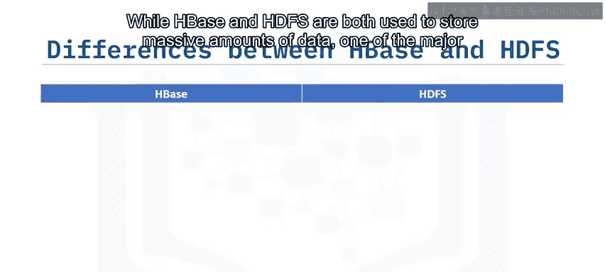

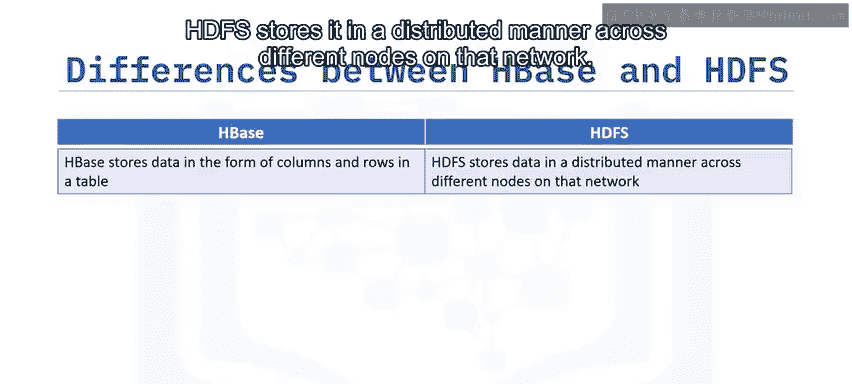

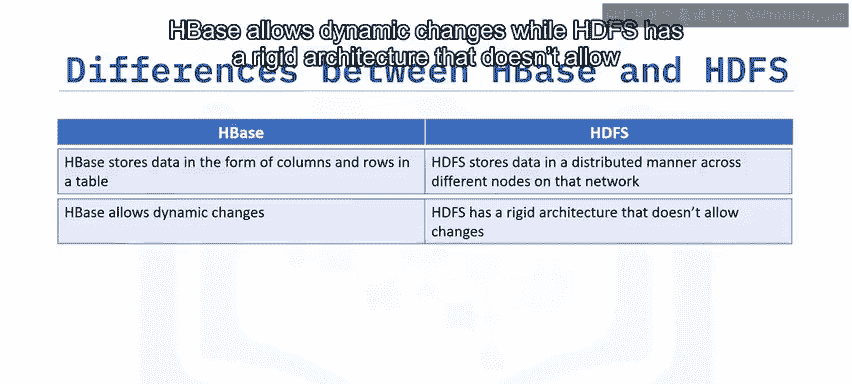

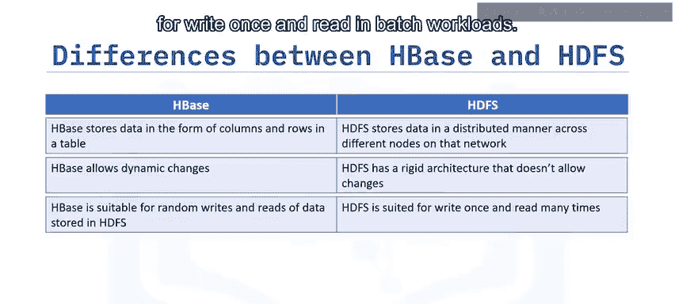

The Hb architecture consists mainly of four components，1 H master，2， H regions server。

3 H regions4 zookeeper from the architecture， we can see that HBase sits and works on top of HDFS HDFS provides a distributed environment for the storage and it is a file system designed to run on commodity hardware It stores each file in multiple blocks and to maintain fault tolerance。

 it replicates the blocks across a Hadoop cluster。

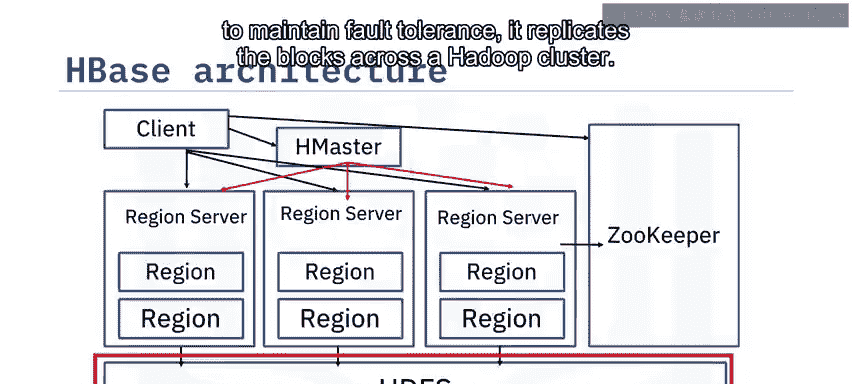

H master is a master server， It monitors the region server instances。

 assigns regions to region servers and distributes services to different region servers and manages any changes that are made to the schema and metadata operations The region servers receive read and write requests from the client and assign the request to a specific region where the column family resides They are responsible for serving and managing regions that are present in a distributed cluster rather than go through H masterster all the time。

 The region servers can communicate directly with the client to facilitate requests。

 The region is the basic building element and smallest unit of the Hbasedase cluster that consists of column families It contains multiple stores。

 one for each column family and has two components H file and Mem store zookeeper is a centralized service for maintaining configuration information to maintain healthy links between no。

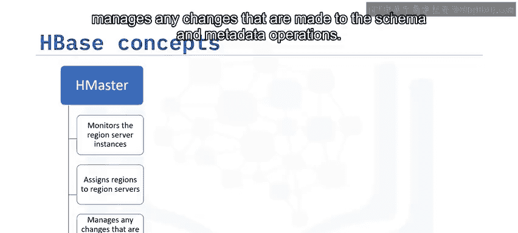

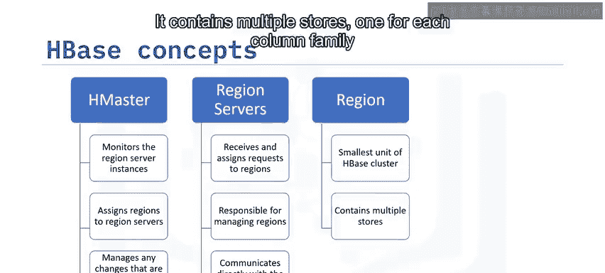

It provides synchronization across distributed applications and is used to track server failure and network partitions by triggering an error message and then starts repairing the failed nodes。

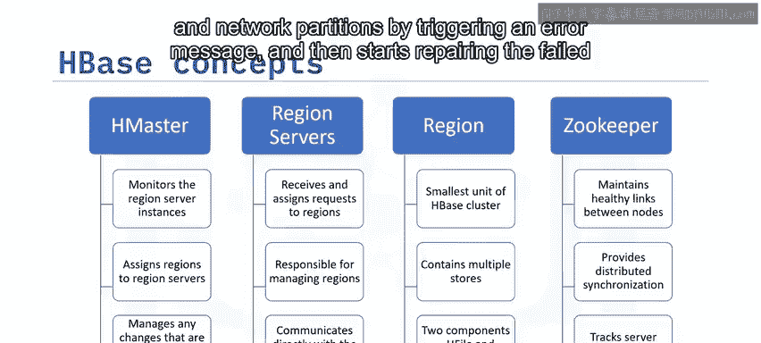

In this video you learned that HBase is a column oriented non-relational database management system that runs on HDFS HBase columns are defined by column families HBase is linearly scalable。

 highly efficient and provides an easy to use Java API for client access。

 a key difference between HDFS and HBase is that HBase allows dynamic changes compared to the rigid architecture of HDFS HBase architecture consists of Hmaster。

 region servers， regionion， zookeeper and HDFS。

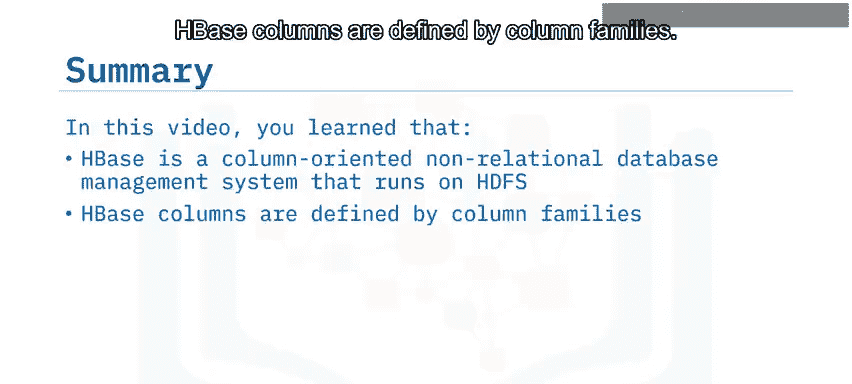