# IBM数据工程专业证书 课程11：《使用Spark和Hadoop进行大数据介绍》｜big-data-with-spark-hadoop｜ - P15：14_为什么使用 apache spark.zh_en - GPT中英字幕课程资源 - BV12h4y1D7hF

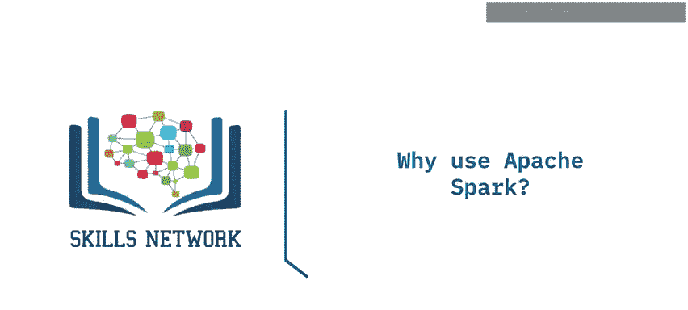

Welcome to why use Apache Spark。 After watching this video。

 you'll be able to describe Apache Spark attributes。😊。

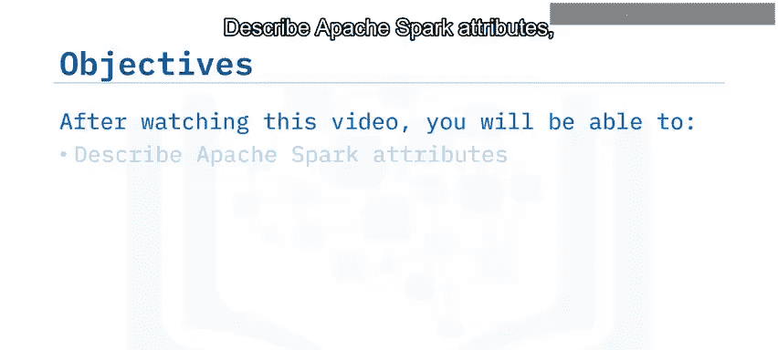

Describe distributed computing。 list the benefits of Apache spark and distributed computing。

 compareare and contrast Apache' spark to map reduceduce。

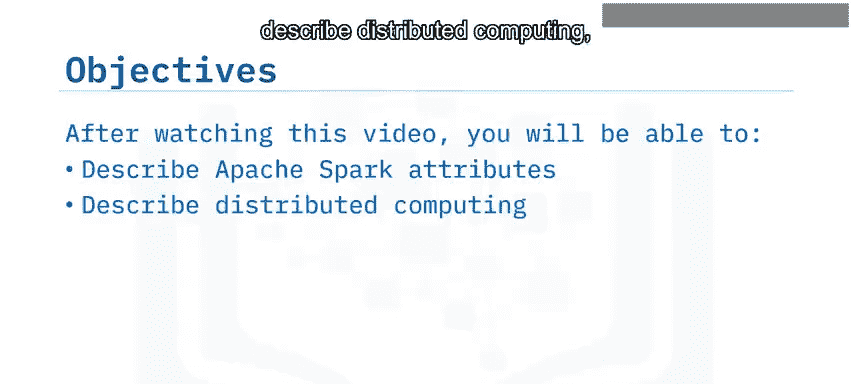

Spark is an open source inmeory application framework for distributed data processing and iterative analysis on massive data volumes。

 Let's review the key words in this sentence。 First， Spark is entirely open source。

 Spark is available under the Apache Foundation。 Hence the name Apache Spark。 Next。

 Spark is in memory。 which means that all operations happen within the memory or RA。

 Dis data processing uses Spark。 Finally， Spark scales very well with data。

 which is ideal for massive data sets。😊，Spark is primarily written in Scala。

 a general purpose programming language that supports both object oriented and functional programming。

 Spark runs on Java virtual machines。

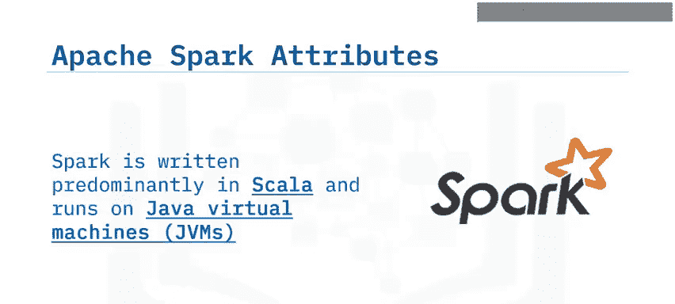

Distributed computing， as the name suggests， is a group of computers or processors working together behind the scenes。

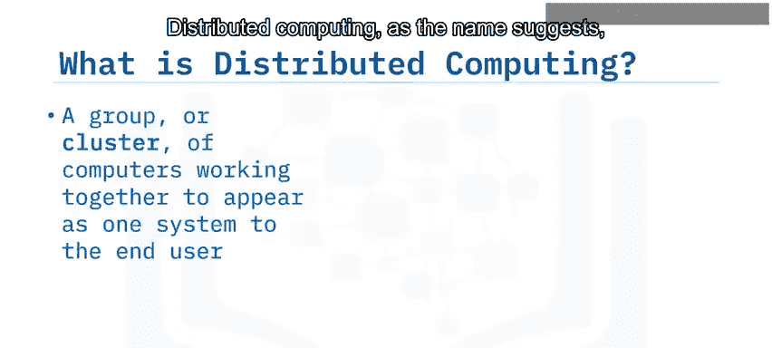

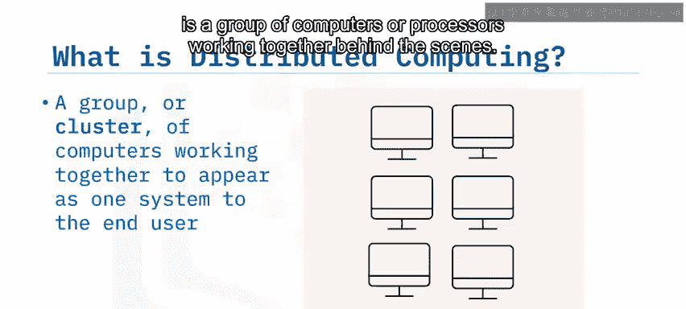

People often use the terms distributed computing and parallel computing interchangeably。

 as the two computing types have many similarities。However。

 distributed computing and parallel computing access memory differently。

 typically parallel computing shares all the memory。

 while in distributed computing each processor accesses its own memory。

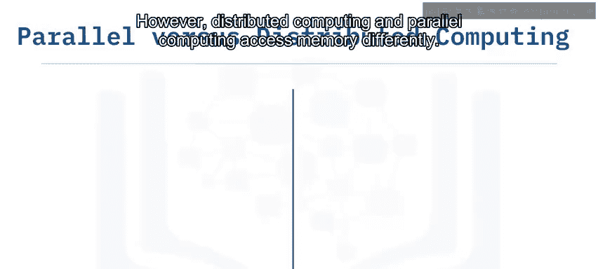

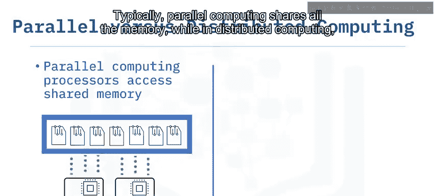

Let's look at two top distributed computing benefits。 First。

 distributed computing offer scalability and modular growth。

 Dis systems are inherently scalable as they work across multiple machines and scale horizontally。

 A user can add additional machines to handle the increasing workload Instead of repeatedly updating a single system with virtually no cap for scalability。

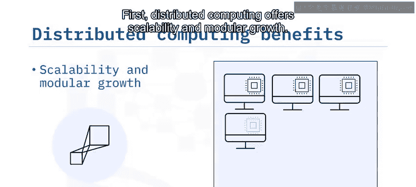

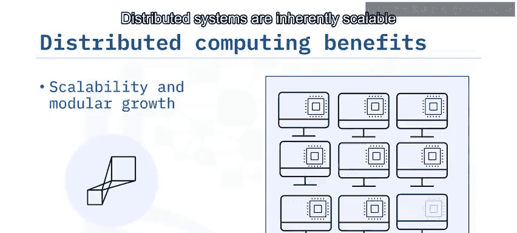

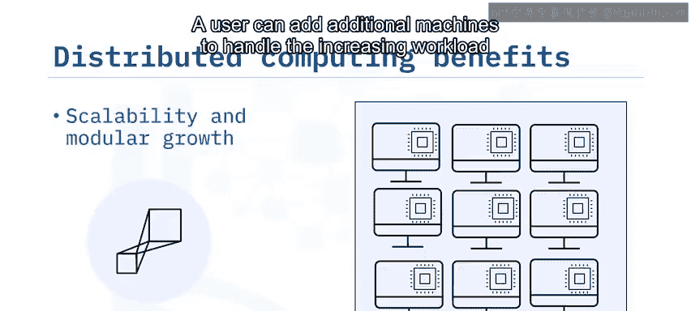

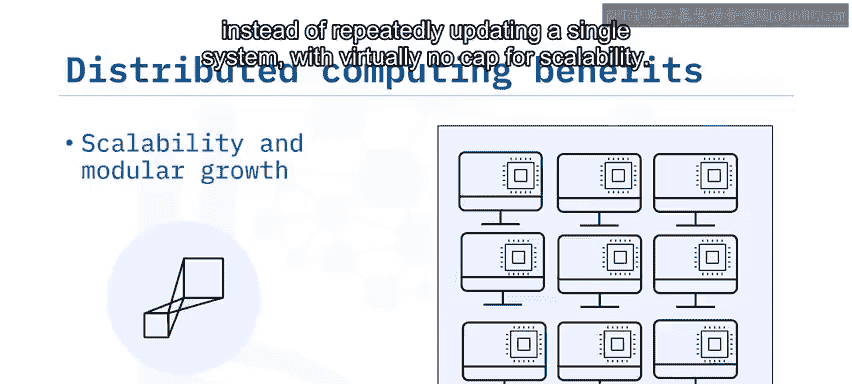

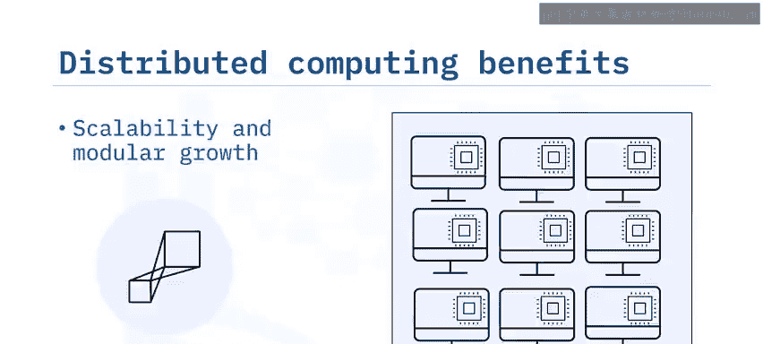

Second， distributed systems require both fault tolerance and redundancy as they use independent nodes that could fail。

 Distributed computing offers more than fault tolerance。

 Disbuted computing provides redundancy that enables business continuity。 For example。

 a business running a cluster of8 machines can continue to function whether a single machine or multiple machines go off line。

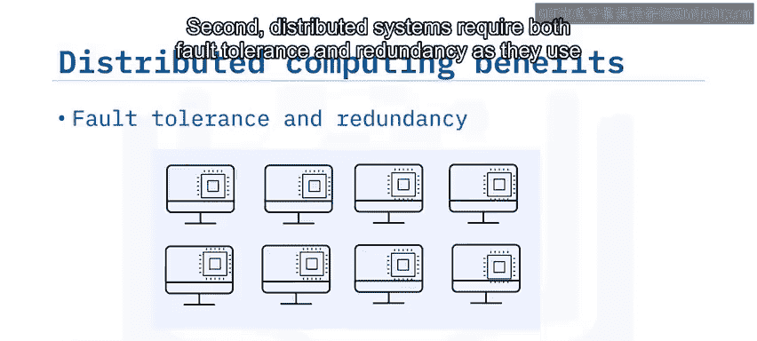

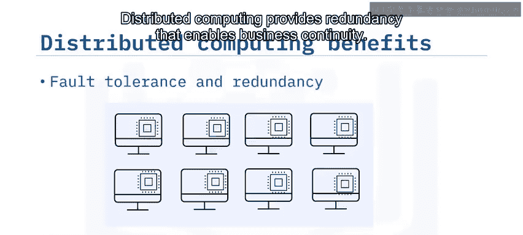

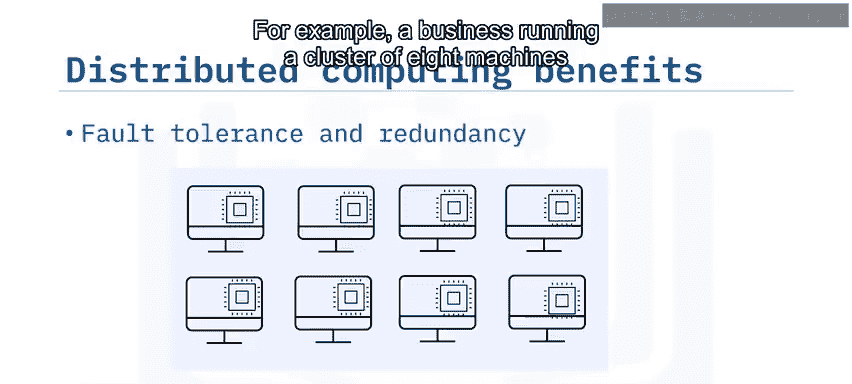

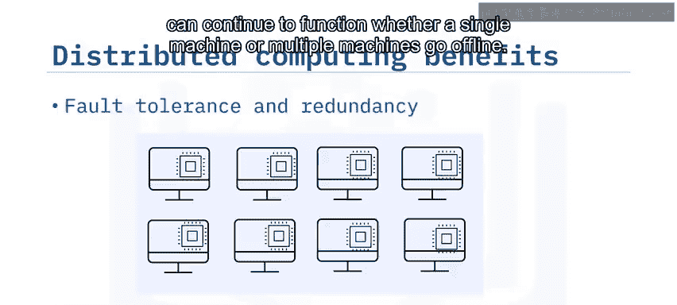

Spark checks the boxes for all the benefits of distributed computing。

 Spark supports a computing framework for large scale data processing and analysis。

 Spark also provides parallel distributed data processing capabilities。

 scalability and fault tolerance on commodity hardware。

Spark provides in memoryory processing and creates a comprehensive unified framework to manage big data processing。

 Spark enables programming flexibility with easy to use Python， Scala and Java APIs。

How does Apache Spark compare to more traditional big data tools like mapp produceuce。

 A traditional map produce job creates iterations that require reads and write to disk or HDFS。

 These reads and writes are usually time consuming and expensive。

Apaache' Sp solves the Read write problems encountered with mappRuce by keeping much of the data required in memory and avoiding expensive disk IO。

 thus reducing the overall time by orders of magnitude。

Spark provides big data solutions for both data engineering problems and data science challenges data engineers use Spar tools。

 including the Cose Spk engine， clusters and executors and their management SparkSQL and data frames Additionally。

 Spark also supports data science and machine learning through libraries such as Spark ML and streaming。

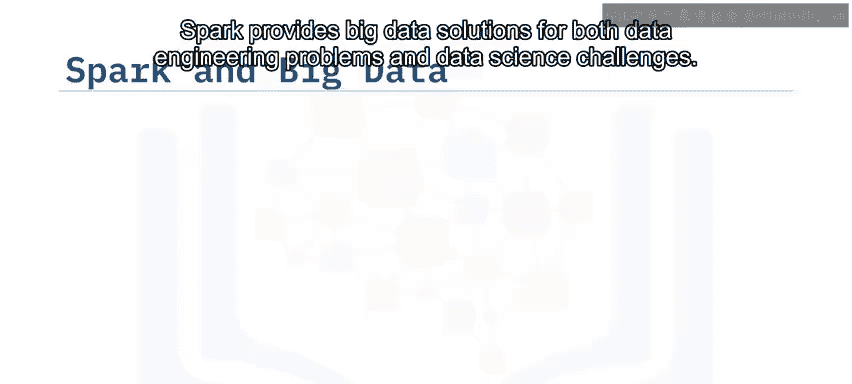

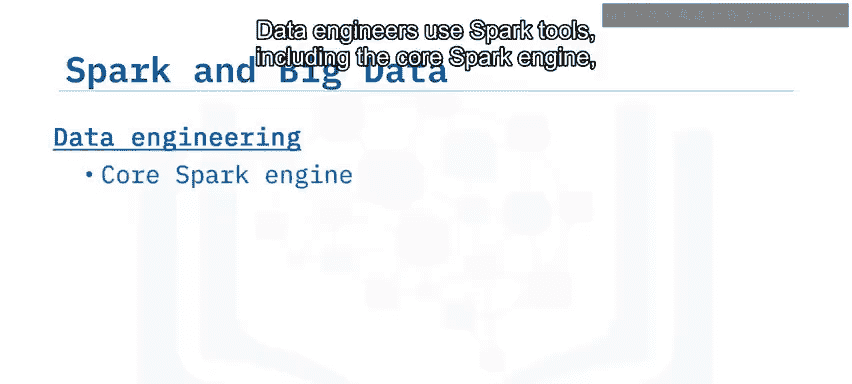

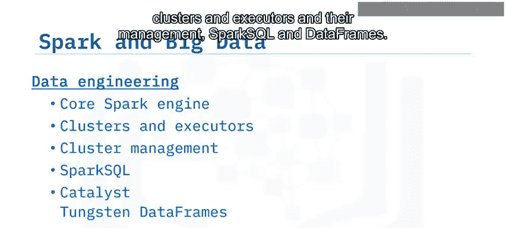

In this video， you learned that。Spark is an open source in memoryory application framework for distributed data processing and iterative analysis on massive data volumes。

 Dis computing is a group of computers or processors working together behind the scenes。

 Both distributed systems and Apache Spark are inherently scalable and fault tolerant。

 Apache Spar keeps a large portion of the data required in memory and avoids expensive and time consuming disko。

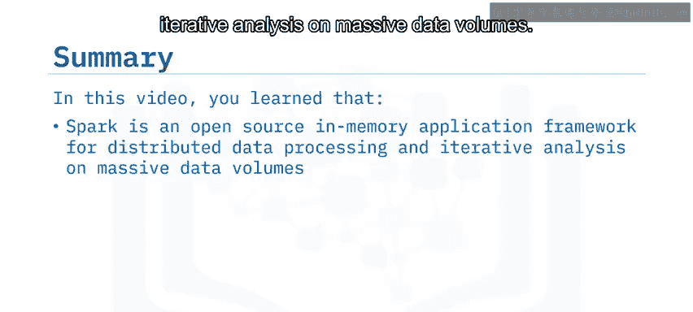

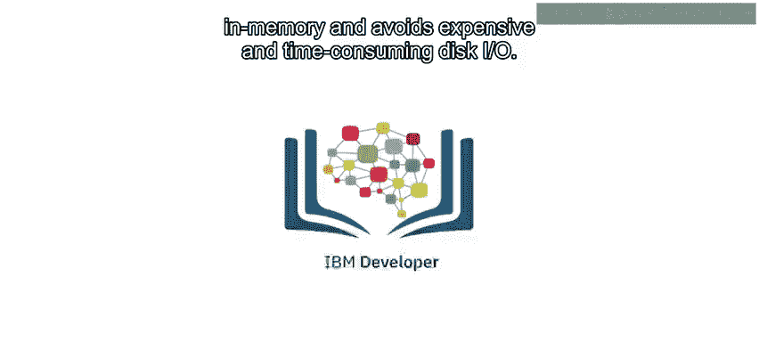