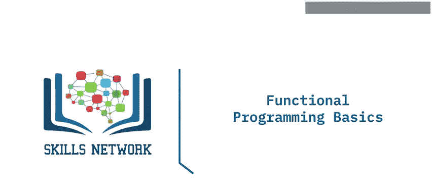
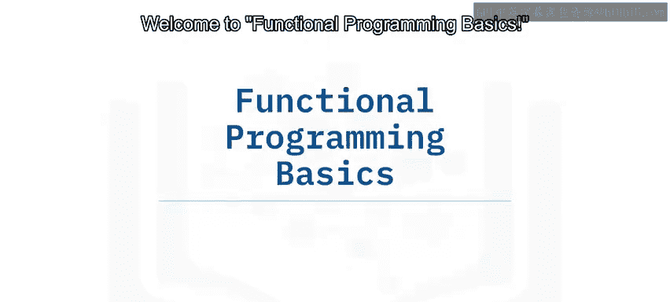
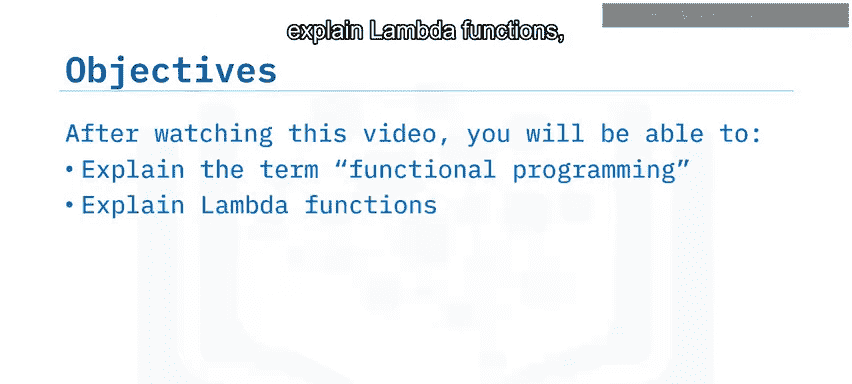
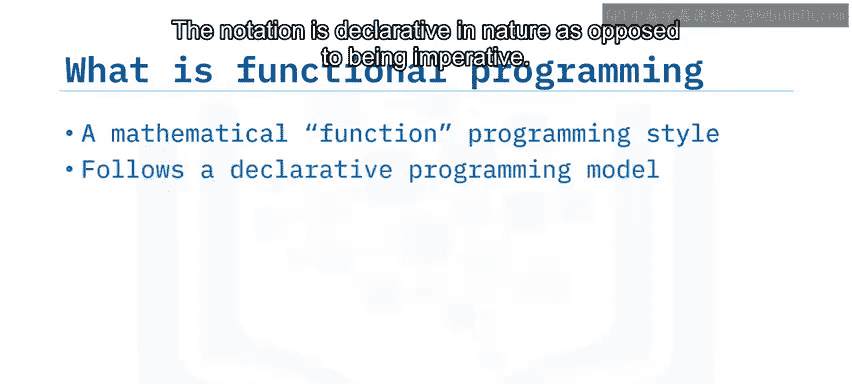
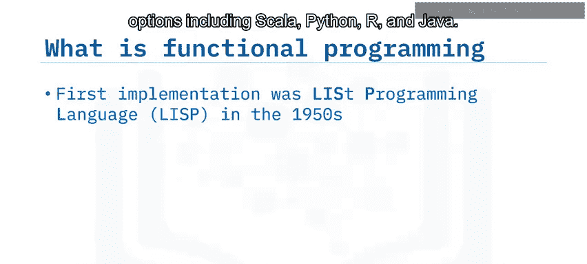
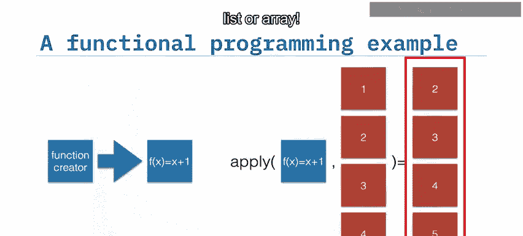
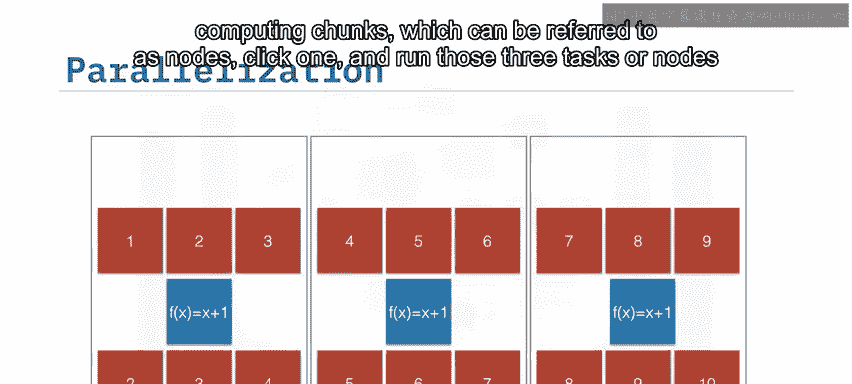
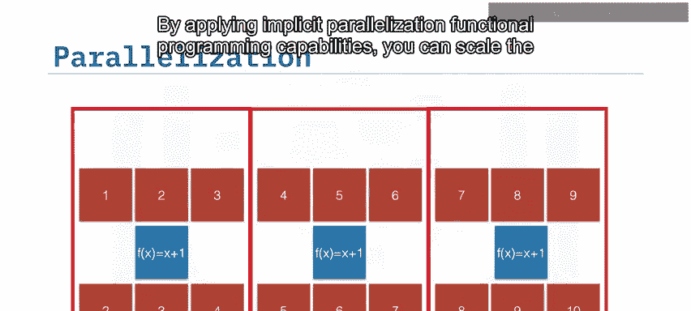
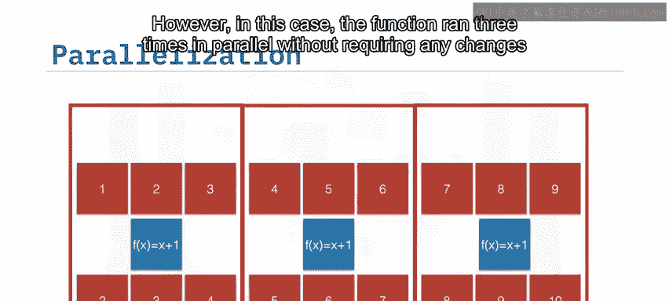
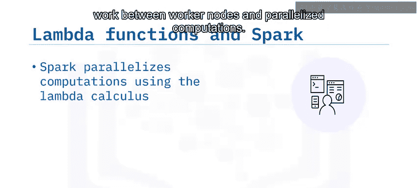

# IBM数据工程专业证书 课程11：《使用Spark和Hadoop进行大数据介绍》｜big-data-with-spark-hadoop｜ - P16：15_函数式编程基础.zh_en - GPT中英字幕课程资源 - BV12h4y1D7hF

Welcome to functionalal programminging Bas。

After watching this video， you'll be able to explain the term functional programming。

 explain Lambda functions， relate functional programming with Apache Spark。

So what is functional programming functional programming or FP is a style of programming that follows the mathematical function format。

 Think of the algebra class with the F of X notation The notation is declarative in nature as opposed to being imperative。

 By declarative， we mean that the emphasis of the code or program is on the what of the solution as opposed to the how to of the solution declarative syntax abstracts out the implementation details and only emphasizes on the final output restd the what we use expressions in functional programming like the expression F of X as mentioned earlier。

😊。

Historically， LISST processing language known as Lisp was the first functional programming language starting in the 1950s。

 but today there are many functional programming language options， including Scala， Python。

 R and Java。 Scala is the most recent representative in this family of programming languages。

 Apaches Sp is written mainly in Scala， which treats functions as first class citizens。

 functionss in Scala can be passed as arguments to other functions returned by other functions and used as variables。

 Here is a simple example of a functional program that increments a number by one。

 We define the function F of x equal X plus1。😊。

We can then apply this function to a list of size4， as shown in the figure。

 and the program increments every element in the list by one。

 That's the advantage of using functional programming。

 You can directly apply functions to an entire list or array If you perform the same task in an imperative paradigm using procedural code。

 you will construct a four loop that iterates over the array and increment each element by one。

 This programming paradigm differs from the preceding example by explicitly listing all the steps to be performed。

 including the go over for each element， Icrementing each element by one。

 This code places emphasis on the how to。 compareare and contrast this traditional programming example to the functional programming example that emphasized on the what part of the solution。

 Paraization is one of the main benefits of functional programming。

 consider the previous example where the program。😊。

Incremented by one up to4 Here is a larger array from one to9。

 You can split the task into three different computing chunks， which can be referred to as nodes。

 click one and run those three tasks or notes in parallel。

 This methods beauty is that you do not need to change any of the function definitions or the code。

 All you need to do is run more than one instance of the task in parallel。

 by applying implicit parallelization functional programming capabilities。

 You can scale the algorithm to any size by adding more compute and resources without modifying the program or code。

 The result is the same as if the function exists on only a single node。 However， in this case。

 the function ran three times in parallel without requiring any changes to the function or code。

 Funal programming applies a mathematical concept called lambmbda calculus。 to keep the explanation。

Simple Lambda calculus basically says that every computation can be expressed as an anonymous function。

 which is applied to a data set。 Lambda functions or operators are anonymous functions used to write functional programming code Here we have the code written in functional programming style using Lambda functions and operators and add two numbers using two popular languages。

 Scala， as seen on the left， and Python， as seen on the right。

 Note how both codes are similar in flow and abstract out the result directly。

 a hallmark of the declarative paradigm of programming。

 Apaches Sp is capable of quickly working through big data by Lambda functions distributing work between worker nodes and parallelized computations。

 All Sp programs implemented this way are inherently parallel。

 So it doesn't matter if you analyze one kilobyte or one petabyte of data。

 Just add additional resources to the spark cluster。

And you're done In this video， you learned that functional programming follows a declarative programming model that emphasizes what。

 instead of how to and uses expressions Lambda functions or operators are anonymous functions that enable functional programming。

Spark parallelizes computations using the lambda calculus。

All functional Sp programs are inherently parallel。

