# IBM数据工程专业证书 课程11：《使用Spark和Hadoop进行大数据介绍》｜big-data-with-spark-hadoop｜ - P17：16_使用弹性分布式数据集进行并行编程.zh_en - GPT中英字幕课程资源 - BV12h4y1D7hF

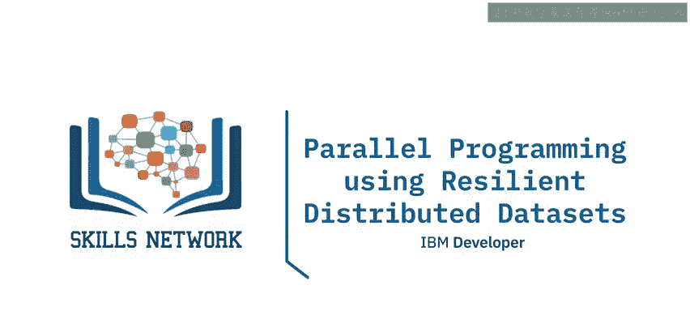

Welcome to parallel programming using resilient， distributed data sets。

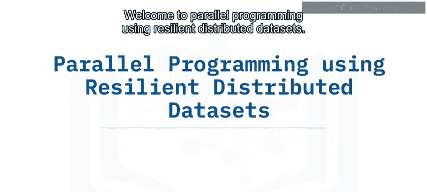

After watching this video， you'll be able to define resilient distributed data sets referred to as RDDs。

 Def parallel programming， Explain resilience in Apache Spark Re RDD and parallel programming with Apache Spk。

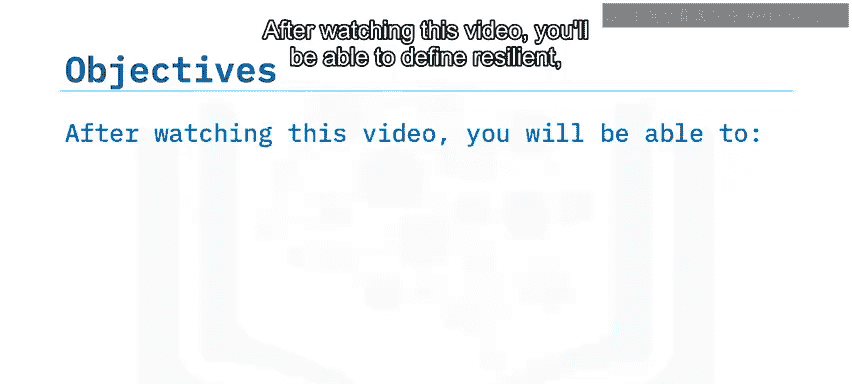

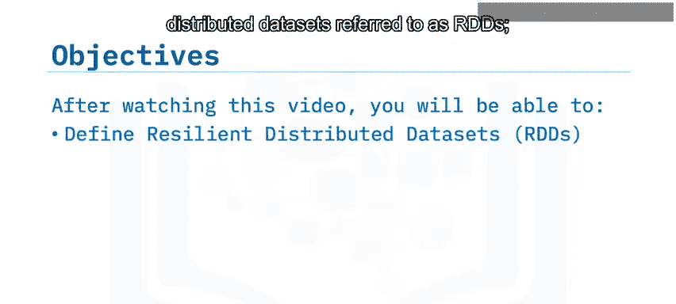

A resilient distributed dataset， also known as an RDD is Spark's primary data abstraction。

 a resilient distributed data is a collection of fault tolerant elements partitioned across the cluster's nodes capable of receiving parallel operations。

 Additionally， resilient distributed databases are immutable。

 meaning that these databases cannot be changed once created。

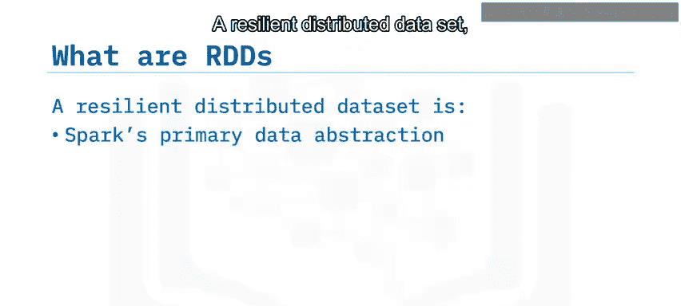

Every Spark application consists of a driver program that runs the user's main functions and runs multiple parallel operations on a cluster。

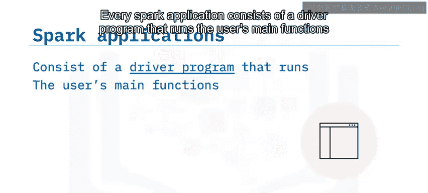

RDDs support text， sequence files， Avro， parquet， and Hadoop input format file types。

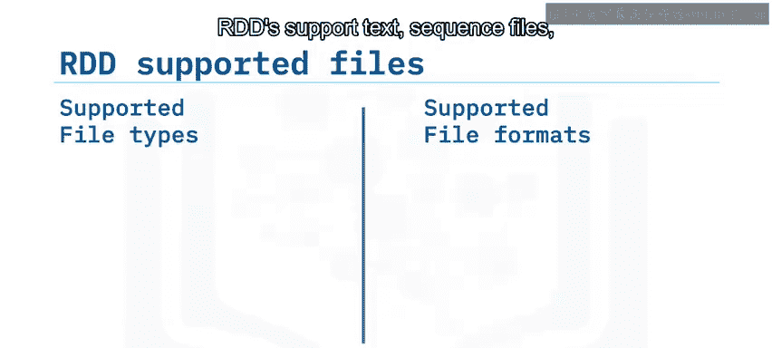

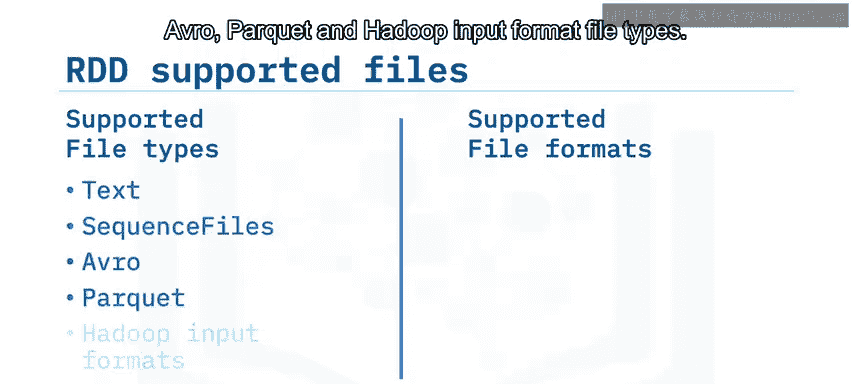

RDDs also support local Cassandra， HBase， HDFS， Amazon S3 and other file formats。

 in addition to an abundance of relational and No SQL databases。

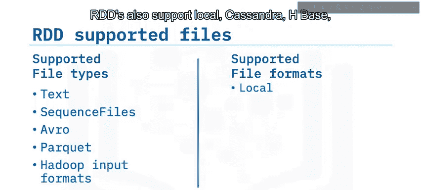

First， you can create an RDD using an external or local file from a Hadoop supported file system such as HDFS。

 Cassandra， HBase， or Amazon S3。

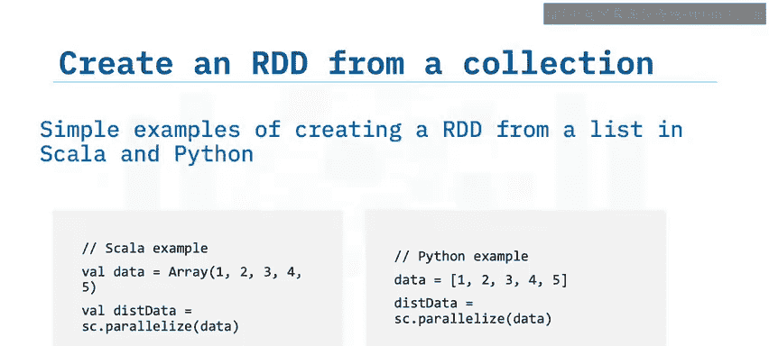

A second method is to apply the parallelI function to an existing collection in the driver program。

 Note that this driver program can be in any of the supported highlevel Apis。

 including Python Java and Scala。 This simple code snippet shown on screen using both Scala and Python creates an RDD from an existing collection。

 In this case， we use a list。 You'll see SC applied to the snippet。

 One important parameter for parallel collections is the number of partitions specified to cut the data set。

 Spark runs one task for each partition of the cluster。 Typically。

 you want two to four partitions for each CPU in your cluster。

 Spark tries to automatically set the number of partitions based on your cluster。 However。

 you can also set partitions manually by passing the number as a second parameter to the parallelI function。

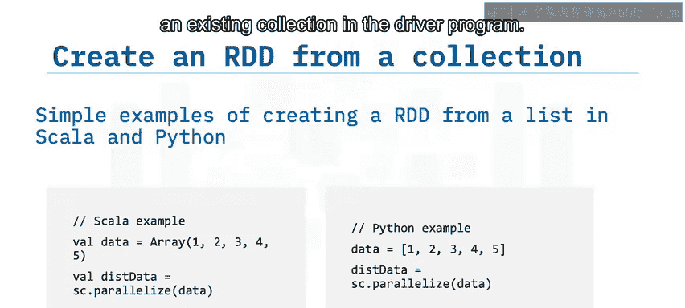

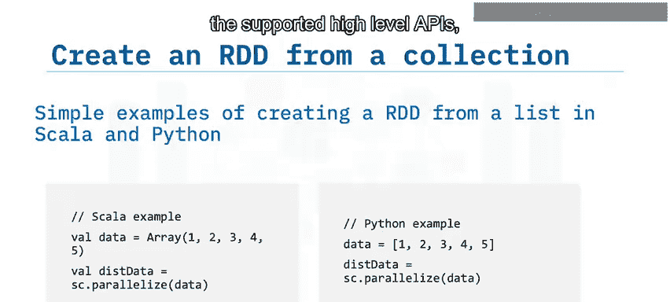

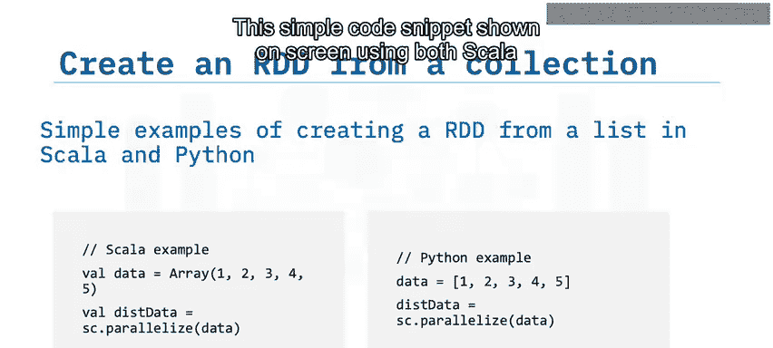

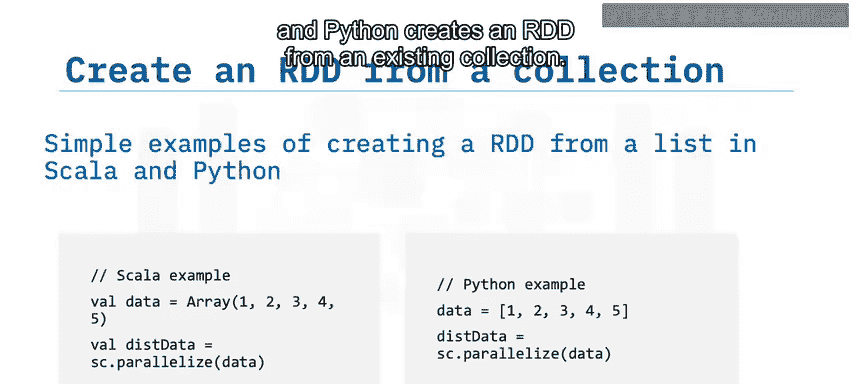

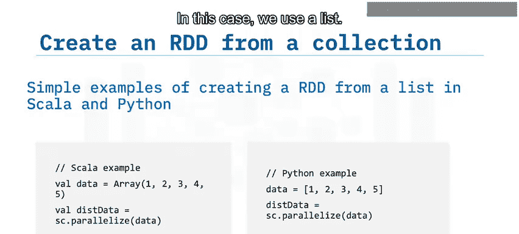

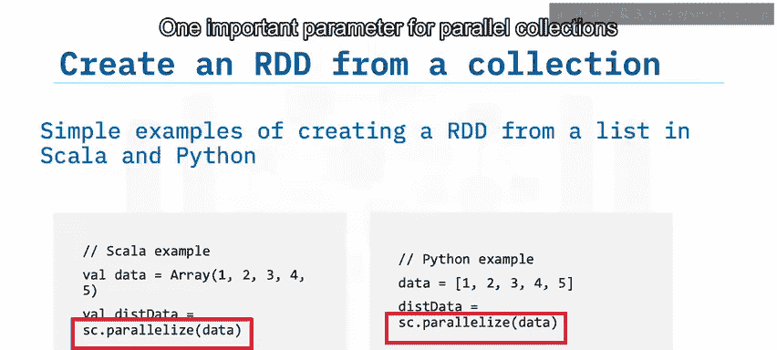

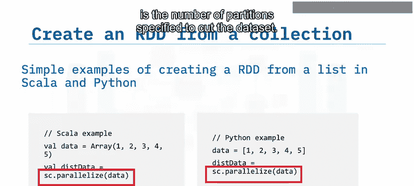

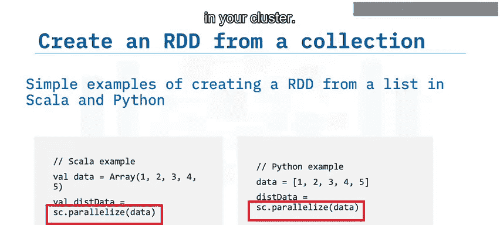

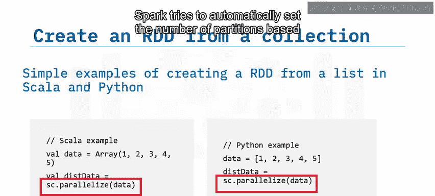

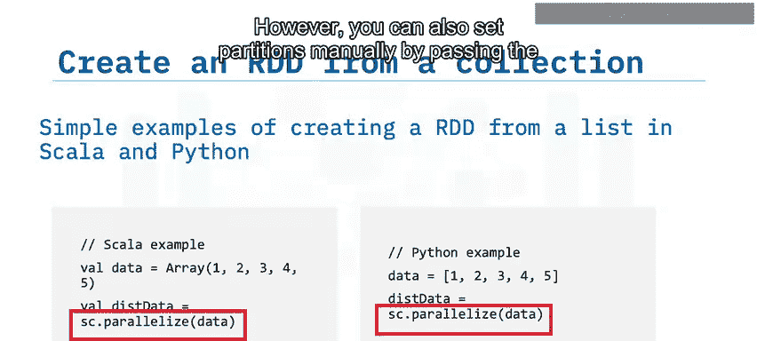

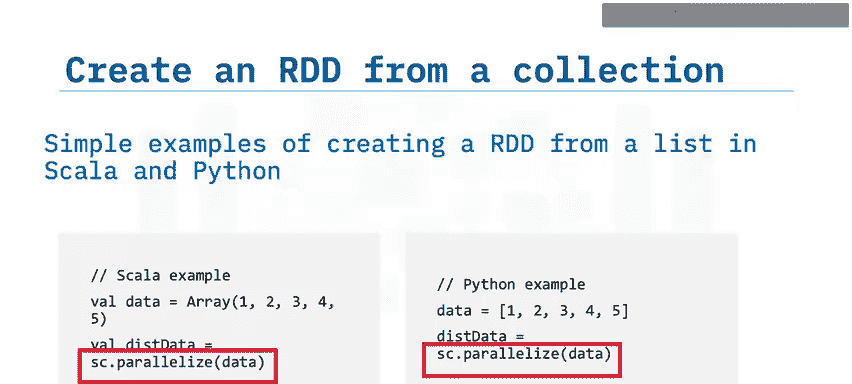

A third method of creating an RDD in Spark is to apply a transformation on an existing RDD to create a new RDD。

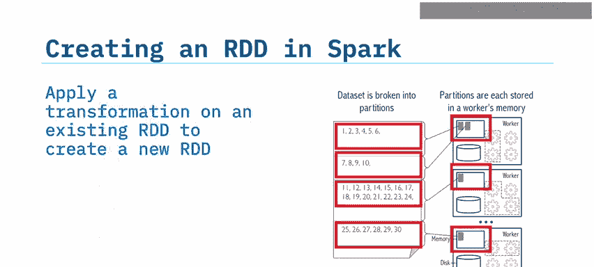

Next， let's define parallel programming Para programming， like distributed programming。

 is the simultaneous use of multiple compute resources to solve a computational task。

 Para programming parsees tasks into discrete parts that are solved concurrently using multiple processors。

 The processors access a shared pool of memory， which has in place control and coordination mechanisms。

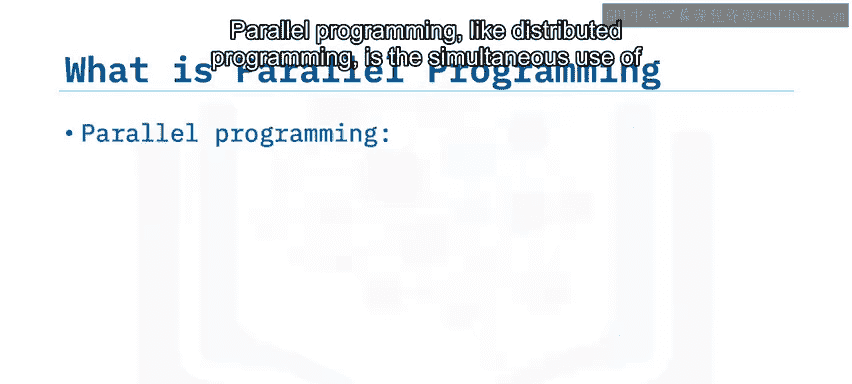

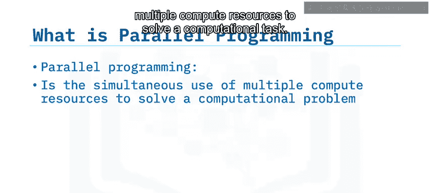

Here is an example of how RDDs enabled parallel programming。

 This example is similar to creating an RDD in Spark。

 You create an RDD by parallelizing an array of objects or by splitting a data set into partitions。

 Notes receive the distributed partitions。 Spark runs one task for each partition of the cluster。

 based on how RDDs are created， RDDs can inherently be operated on in parallel。

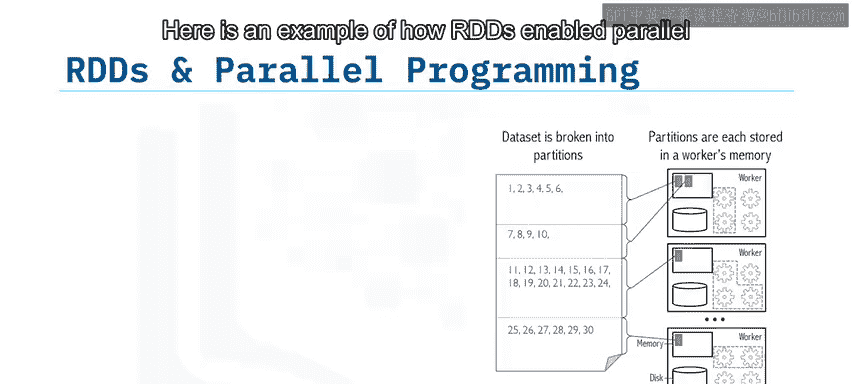

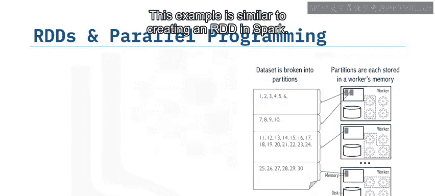

So how do RDDs provide resilience in Sp RDDs provide resilience in Sp through immutability and caching First RDDs are always recoverable as the data is immutable。

 another essential spark capability is the persisting or caching of a dataset in memoryory across operations。

 the cache is fault tolerant and always recoverable as RDDs are immutable and the Hadoop data source is also fault tolerant when you persist in RDD each node stores the partitions that the node computed in memoryory and reuses the same partition in other actions on that data or the subsequent datas derived from the first RDD Perence allows future actions to be much faster often by more than 10 times persisting or caching is used as a key tool for iterative algorithms and fast interactive use。

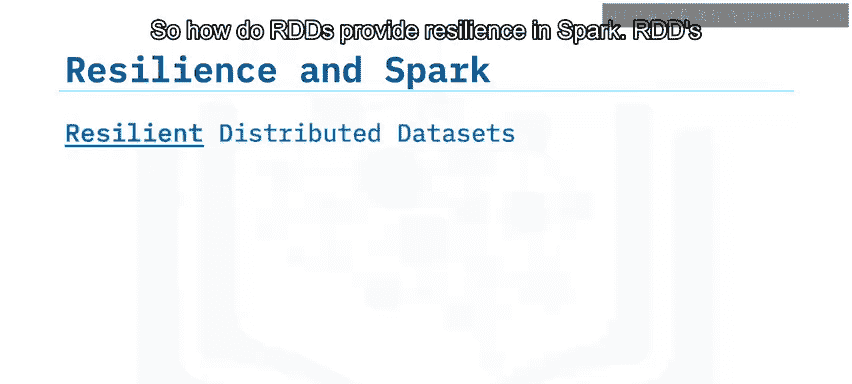

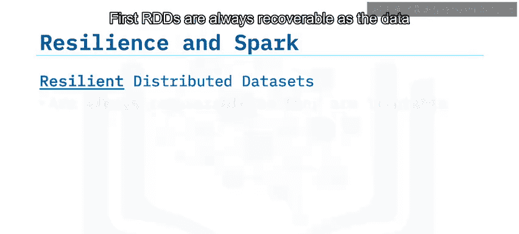

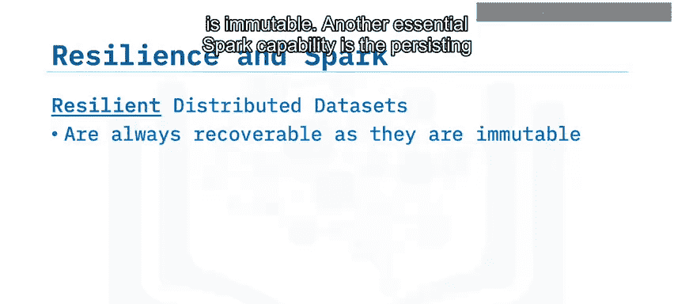

In this video you learned that you can create an RDD using an external or local file from a Hadoop supported file。

 a collection or another RDD RDDs are immutable and always recoverable parallel programming is the simultaneous use of multiple compute resources to solve a computational task RDDs can persist or cache data sets in memory across operations。

 which spades iterative operations。

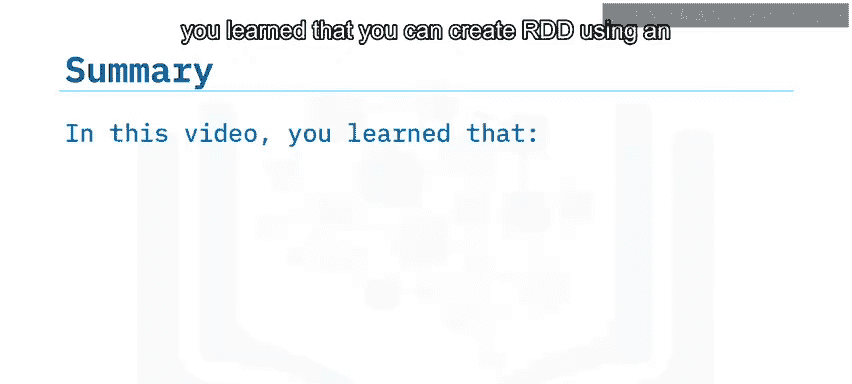

