# IBM数据工程专业证书 课程11：《使用Spark和Hadoop进行大数据介绍》｜big-data-with-spark-hadoop｜ - P18：17_apache spark 中的数据并行扩展.zh_en - GPT中英字幕课程资源 - BV12h4y1D7hF

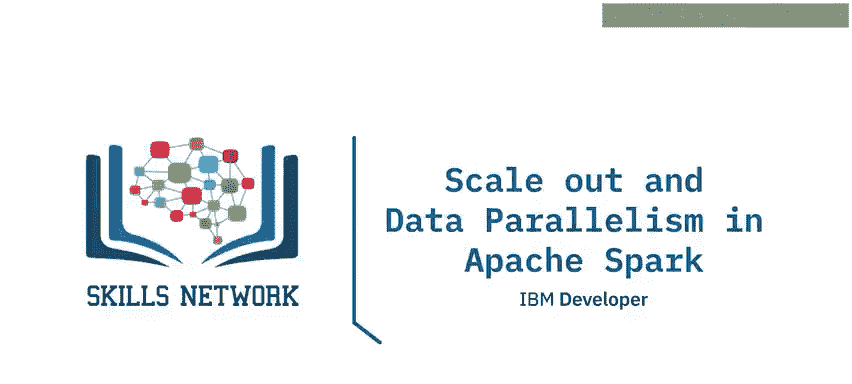

Welcome to scale Out and Data parallelism in Apache Spark。

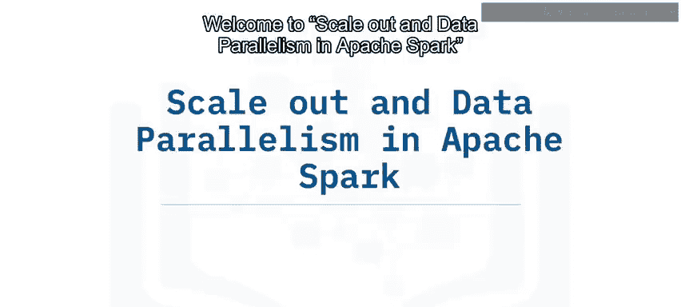

After watching this video， you'll be able to describe Apache Spar components。

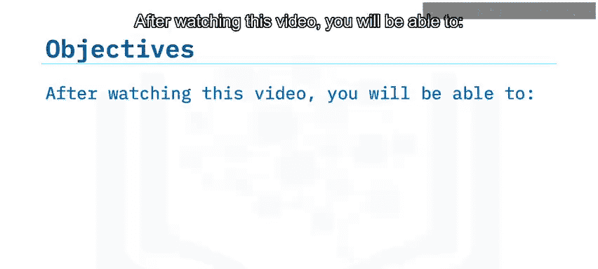

Describe how Apache's Sp scales with big data。 Apache's Sp architecture consists of three main components。

 The first component is data storage。 Data sets load from data storage into memory。

 N a Hadoop compatible data source is acceptable。

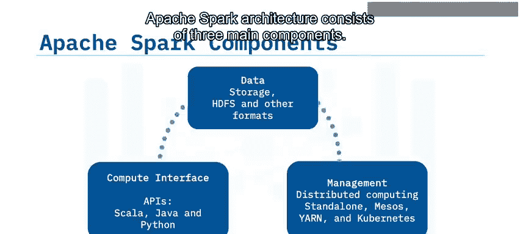

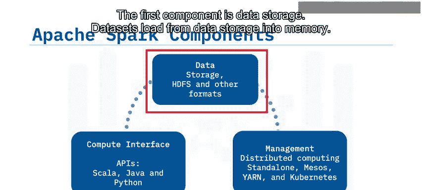

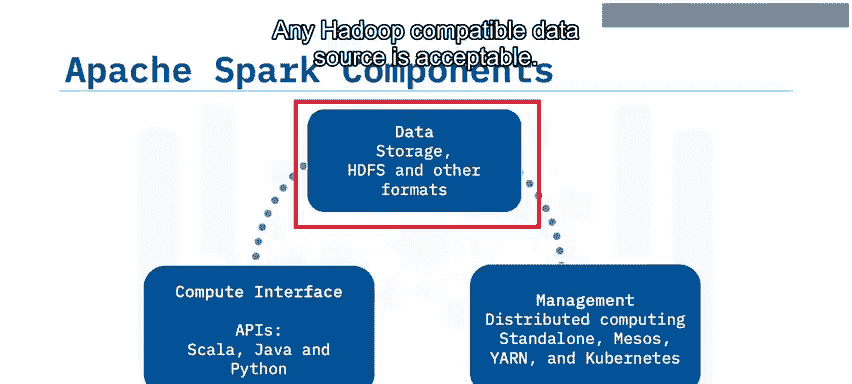

High level programming APIs comprise the second component。 Spark has Apis in Scala， Python and Java。

 The final component is the cluster management framework。

 which handles the distributed computing aspects of Spark。

 Sparks cluster management framework can exist as a standalone server， Mezoos。

 or yet another resource network or yarn。 A cluster management framework is essential for scaling big data Here is a simple visualization of the three pieces。

 The data from a Hadoop file system flows into the compute interface or API。

 which then flows into different nodes to perform distributed parallel tasks。

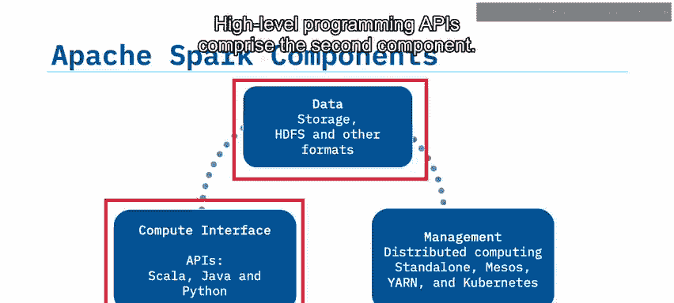

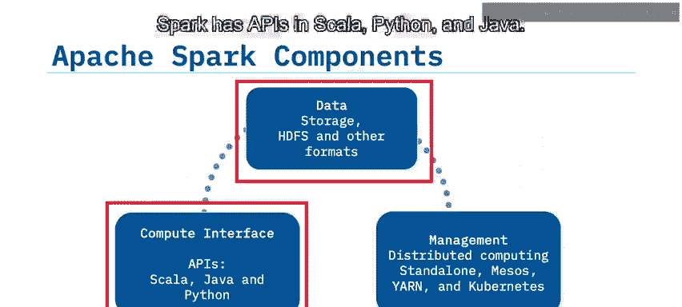

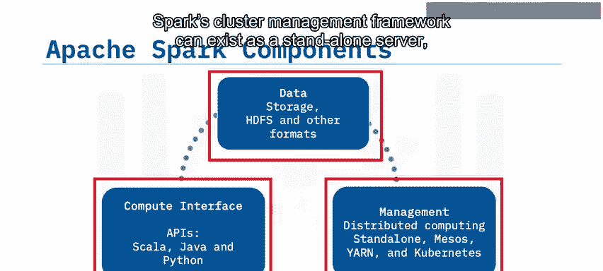

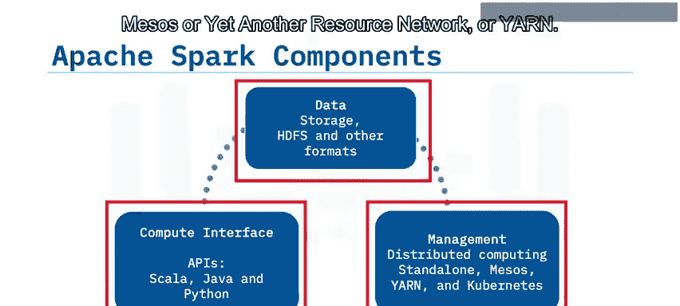

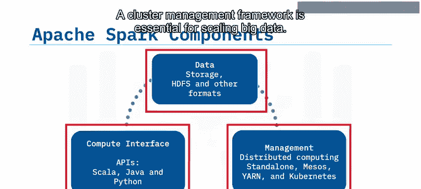

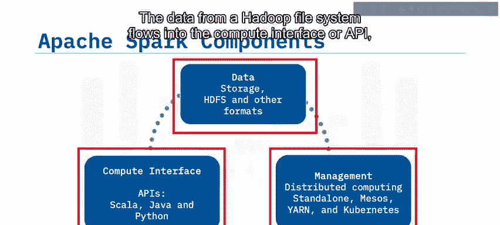

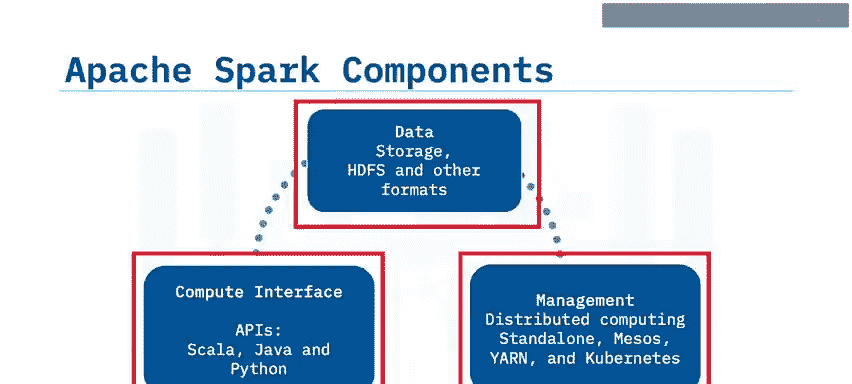

What is often referred to as Spark is the base engine formally called the Spk corere。

 The fault tolerance Spark core is the base engine for large scale parallel and distributed data processing。

 Spark corere manages memory and task scheduling。 Spark corere also contains the As used to define R Dds and other data types。

 Spark core also parallelizes a distributed collection of elements across the cluster。

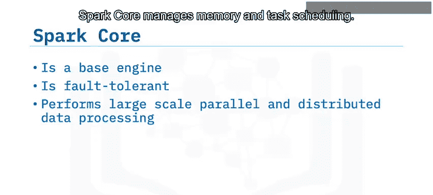

To understand how Spark scales with big data， let's review the Spk application architecture。

 The Spark application consists of the driver program and the executor program。

 Executor programs run on worker nodes。 Spark can start additional executor processes on a worker if there is enough memory and cores available。

 Similarlyly， executors can also take multiple core for multi threadreaded calculations。

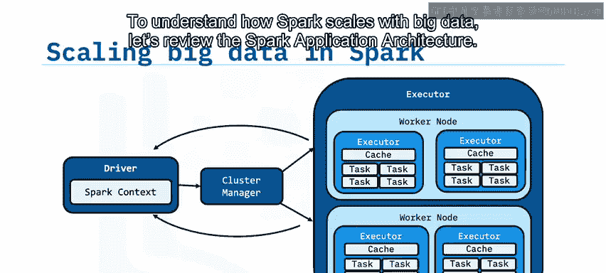

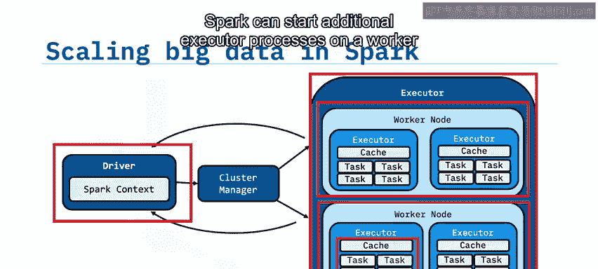

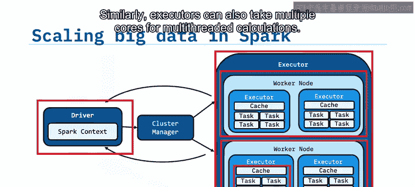

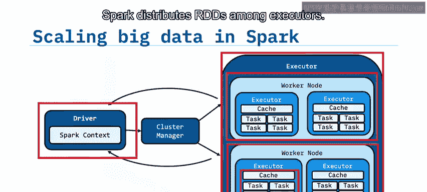

Spark distributes RDDs among executors。 communicationication occurs among the driver and the executors。

 The driver contains the spark jobs that the application needs to run and splits the jobs into tasks submitted to the executors。

 the driver receives the task results when the executors complete the tasks。

 If Apache Spar were a large organization or company。

 The driver code would be the executive management of that company that makes decisions about allocating work obtaining capital and more。

 The junior employees are the executors who do the jobs assigned to them with the resources provided。

 The worker notes correspond to the physical office base that the employees occupy。

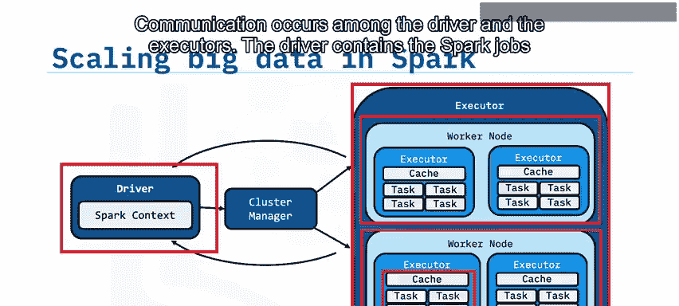

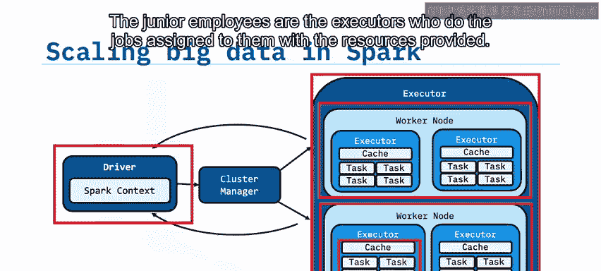

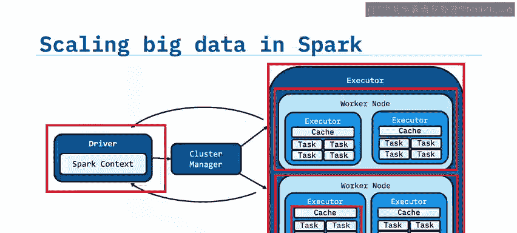

You can add additional worker nodes to scale big data processing incrementally In this video。

 you learned that Apache Spark architecture consists of three main pieces， componentson data。

 compute input and management。 the fall tolerance spark core base engine performs large scale parallel and distributed data processing。

 manages memory， schedules tasks and houses Apis that define RDDs。

 The Spark driver program communicates with the cluster and then distributes RDDs among worker nodes。

😊。

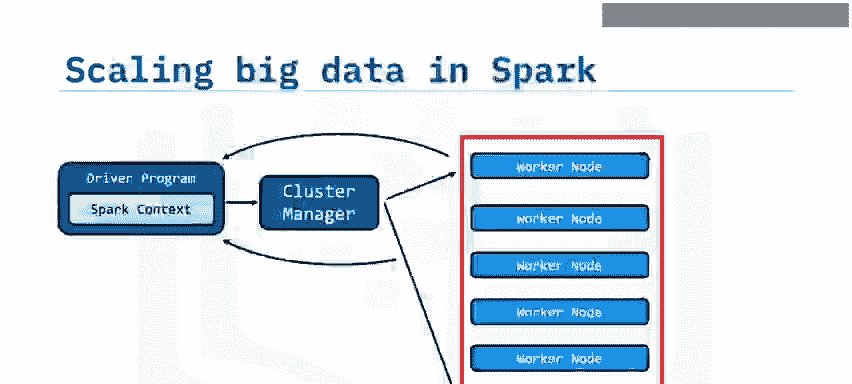

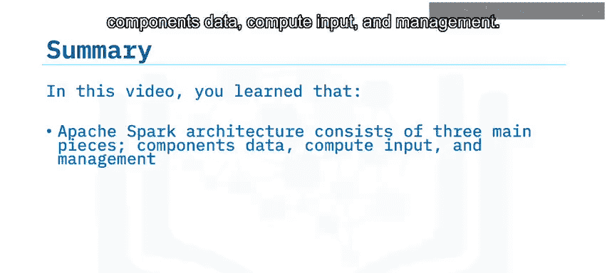

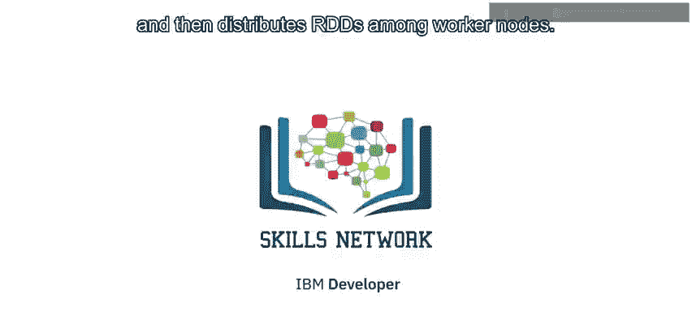