# IBM数据工程专业证书 课程11：《使用Spark和Hadoop进行大数据介绍》｜big-data-with-spark-hadoop｜ - P19：18_dataframe 和 sparksql.zh_en - GPT中英字幕课程资源 - BV12h4y1D7hF

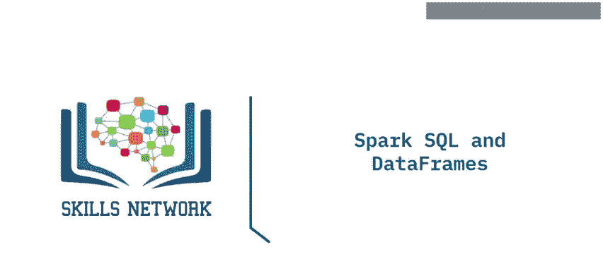

Welcome to SparkSQL and Data frames。

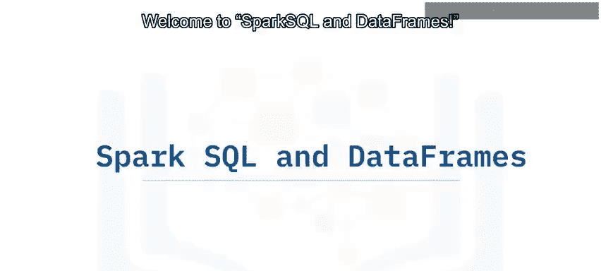

After watching this video， you'll be able to define SparSQL， define the parts of a SparSQL query。

 and explain the benefits of using SparkSQL， De what data frames are。

 Def the parts of a data frame query， and explain the benefits of using a data frame。

 Ex how data frames work with SparSQL。

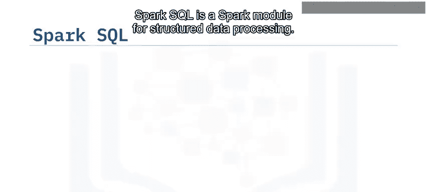

SparkSQL is a Spark module for structured data processing。

 You can interact with SparkSQL using SQL queries and the data frame API。 SparkSQL supports Java。

 Scala， Python and R APIs。 SparkSQL uses the same execution engine to compute the result independently of which API or language you are using for the computation Developers can use the API that provides the most natural way to express a given transformation。

Here is an example of a Spark SQL query using Python。

 The query select star from People statement is the SQL query run using SparkSQL。

 the entity people was registered as a table view before this command。

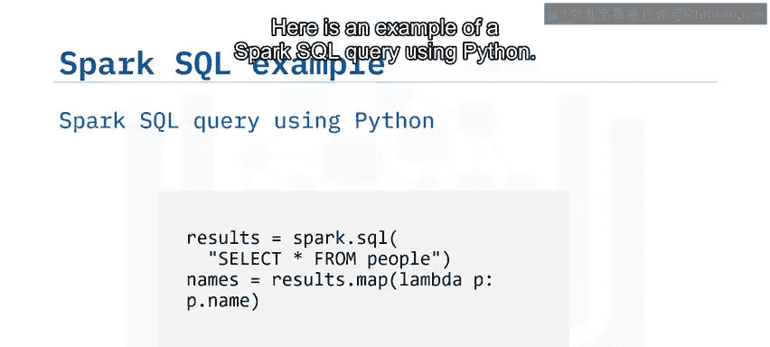

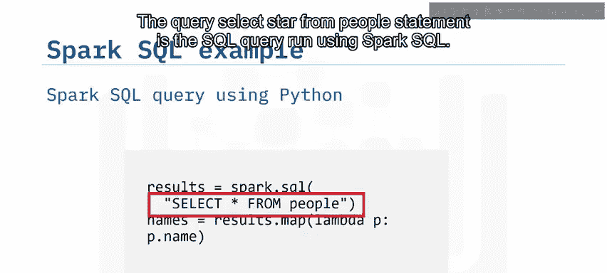

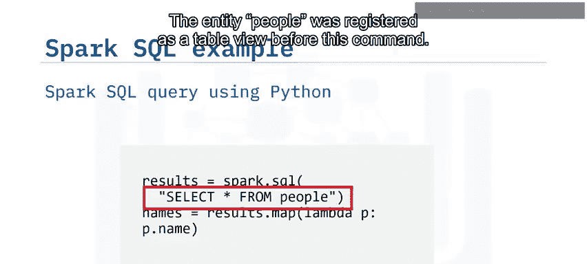

Unlike the basic Spark RDD API， SparkSQL includes a costbased Opr， columnar storage。

 and codegen to perform optimizations that provide Spark with additional information about the structure of both the data and the computation in process。

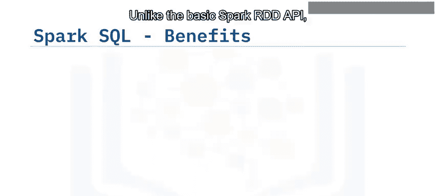

So what is a data frame， A data frame is a collection of data organized into named columns Data frames are conceptually equivalent to a table in a relational database and similar to a data frame in R Python。

 but with richer optimizations， Data frames are built on top of the SparkSQL RDD API Data frames use RDDs to perform relational queries。

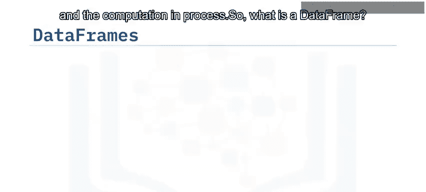

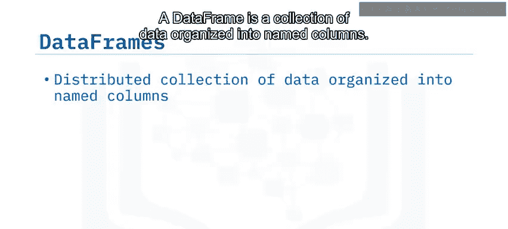

Here is a simple code snippet in Python to read from a JSON file and create a simple data frame。

 the last step of registering the data frames runs SQL queries on this data using SparkSQL。

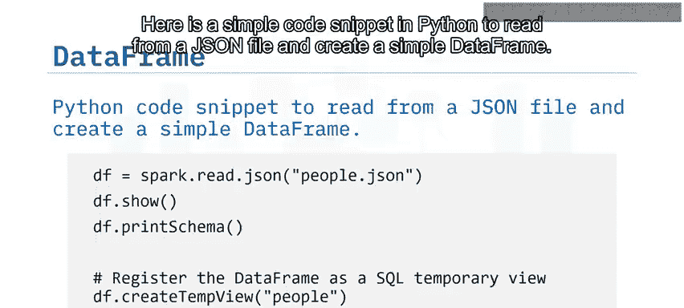

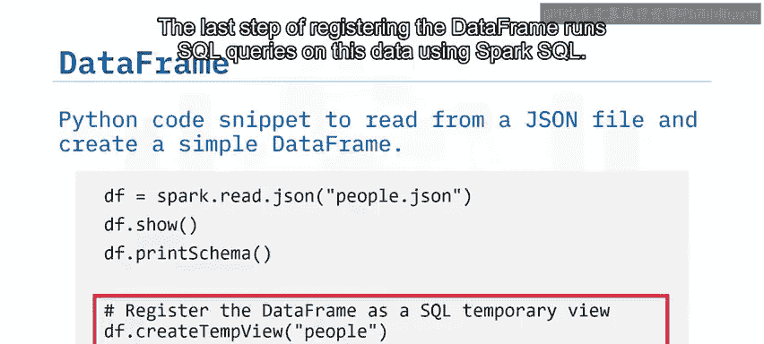

Here you see the input data file in JSON format and the resulting data frame。

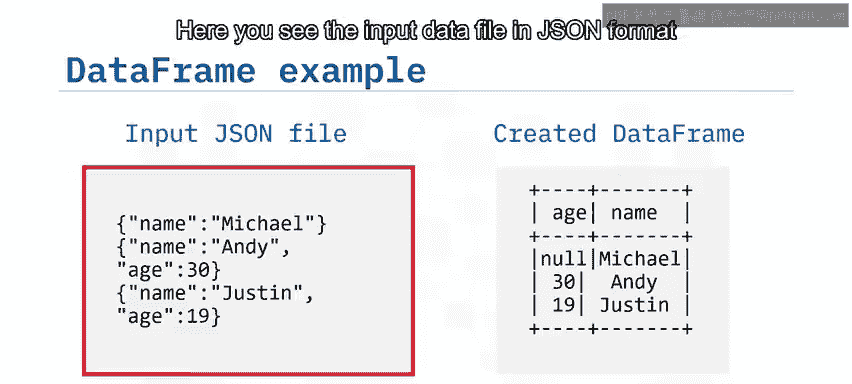

Data frames offer many benefits。 Data frames are highly scalable。

 from a few kilobytes on a single laptop to petabytes on a larger cluster of machines。

 Data frames support a wide array of data formats and storage systems。😊。

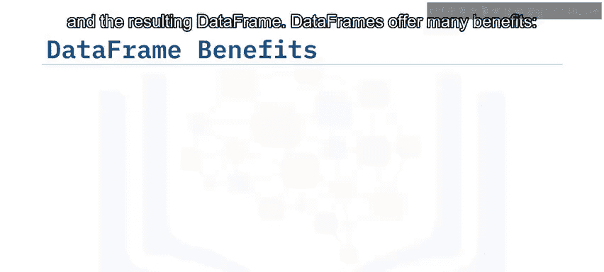

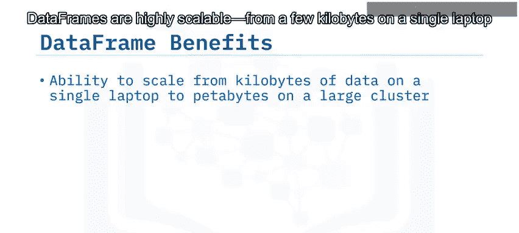

Data frames provide optimization and cogeneration through a catalyst optimizer。 Last。

 data frames are developer friendly， offering integration with most big data tooling via Spark and APIs for Python。

 Java， Scala and R。These code snippets show how to run the same SQL query and the result of those queries using Spark SQL。

 All three queries shown here achieve the same result of showing the names column from our data frame。

 The first query as a more traditional SQL query。 while the other two code examples use the data frame Python API to perform the same task。

😊。

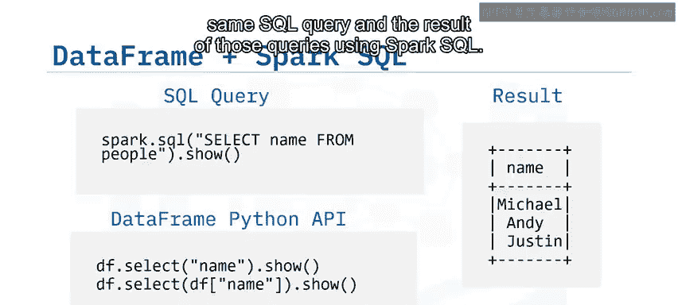

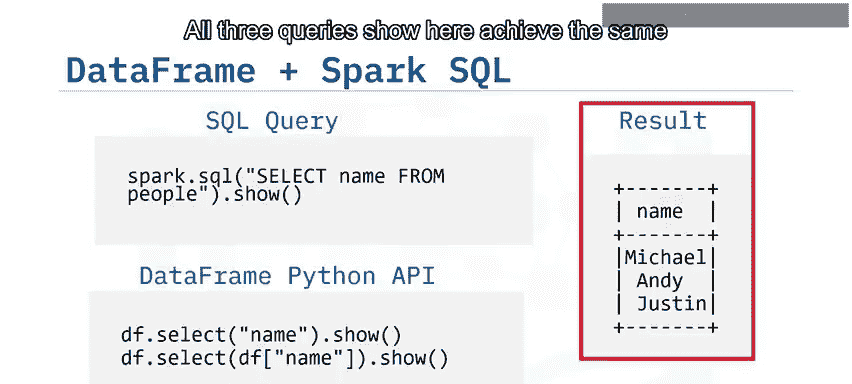

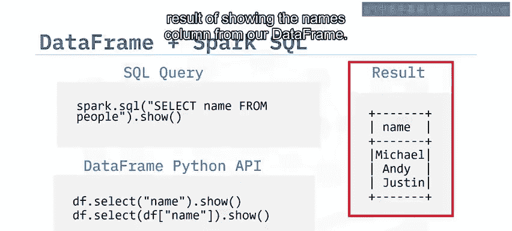

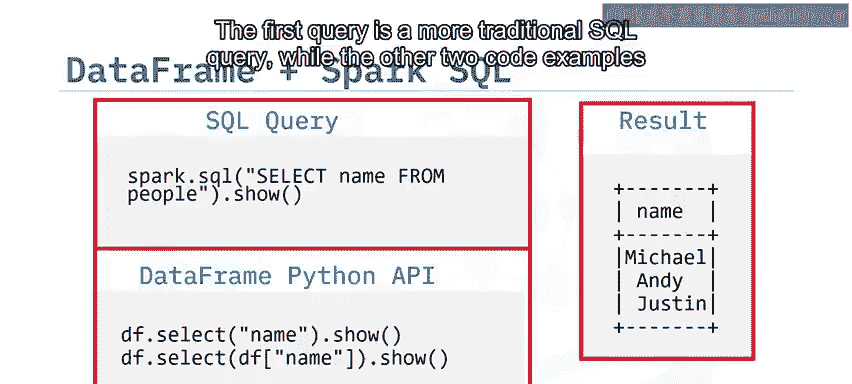

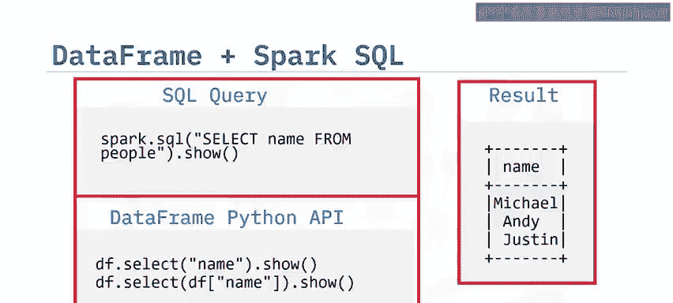

Similarly， here are two different ways to query the entries in the data frame to locate people who are above the age of 21 the first code example is a SQL query。

 while the second code example uses the data frame API。

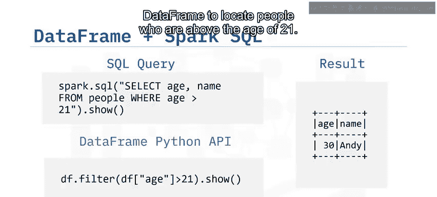

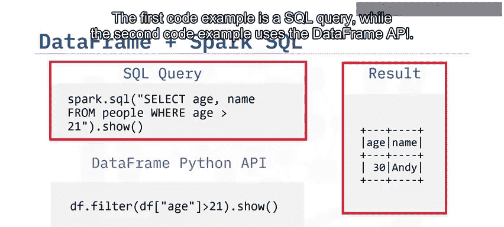

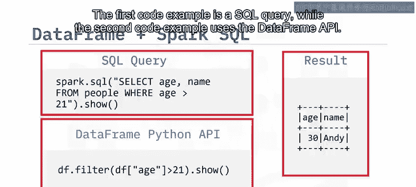

In this video， you learned that Spark SQL is a Spar module for structured data processing。

 SparkSQL provides a programming abstraction called data frames and can also act as a distributed SQL query engine。

 Data frames are conceptually equivalent to a table in a relational database or a data frame in R Python。

 but with richer optimizations。😊。

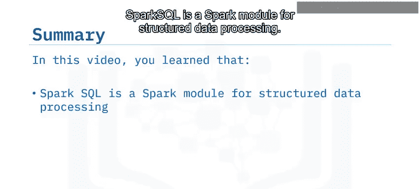

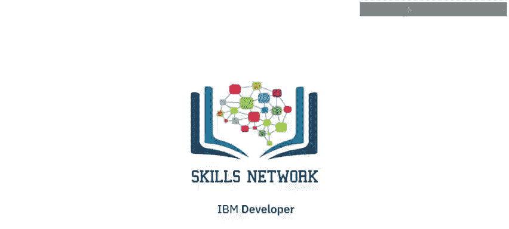