# IBM数据工程专业证书 课程11：《使用Spark和Hadoop进行大数据介绍》｜big-data-with-spark-hadoop｜ - P1：0_课程介绍.zh_en - GPT中英字幕课程资源 - BV12h4y1D7hF

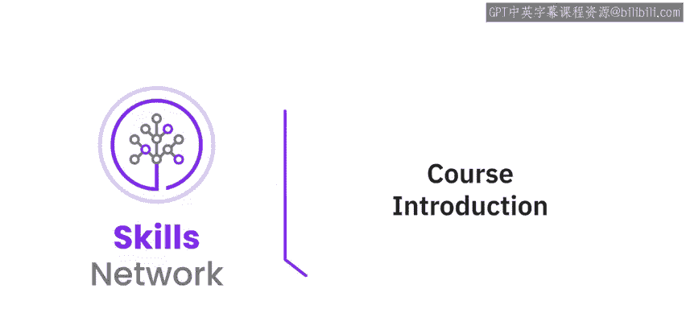

Hello and welcome to this introductory course about big data， Hadoop and Spark。😊。

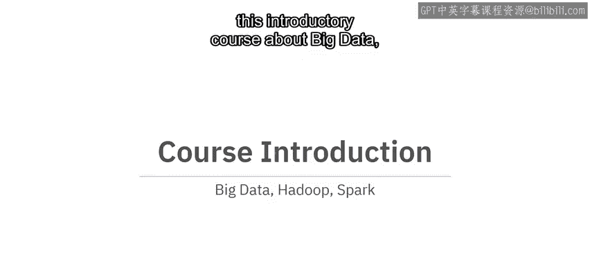

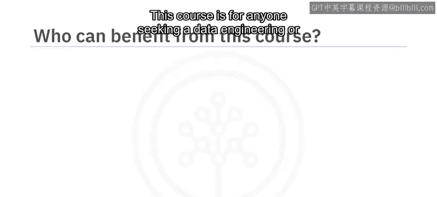

This course is for anyone seeking a data engineering or data architecture role and who wants to develop fundamental knowledge and skills in big data。

 It's also useful for data scientists and machine learning engineers who want to leverage technologies like Hadoop and Spark。

 This course is an excellent choice for technology adoption influencers and those managing technical parts of the business generating or using big data in order to be successful in this course。

 It's recommended that learners have some familiarity with data literacy， SQL and Python。

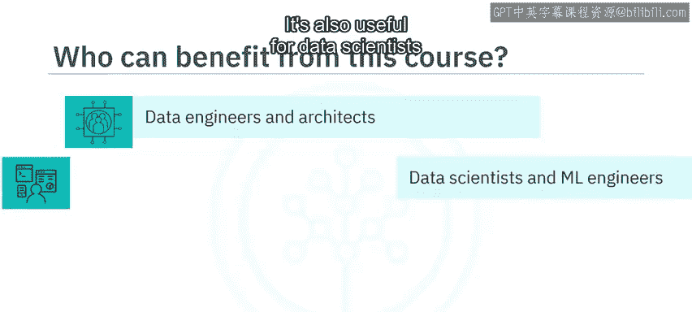

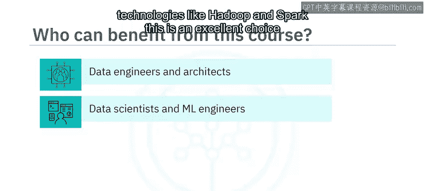

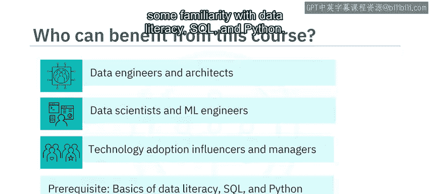

We're excited that you're here。 Your instructors for this course are Romeo Kinsler。

 Ae J Eguhiide and Rav Ahuja Romeo Kinsler， a senior software engineer and product executive at IBM Research is an enthusiastic instructor with over 20 years of software engineering database Administration and information integration experience。

 Aja Iquahiide， a senior data scientist， has experience in creating endtoend machine learning and Sta solutions for optimizing operations。

 Raav Ahuja is a global program director at IBM and leads growth strategy curriculum creation and partner programs for the IBM Skis network。

After this seven module information packed course， youll be able to identify big data and explain its characteristics。

 how the Apache Hado ecosystem fits into the big Data stack。

 and how to use Apache Spark to gain insights from big data。

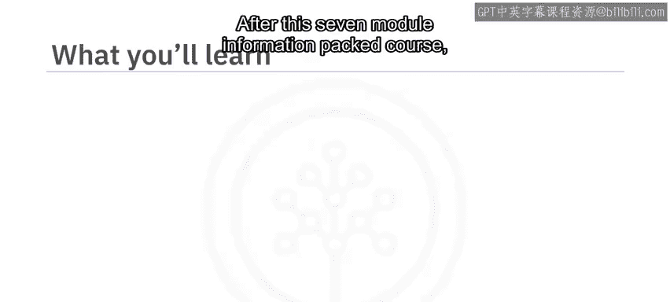

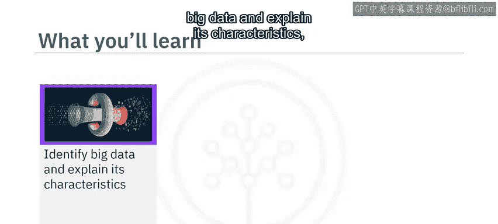

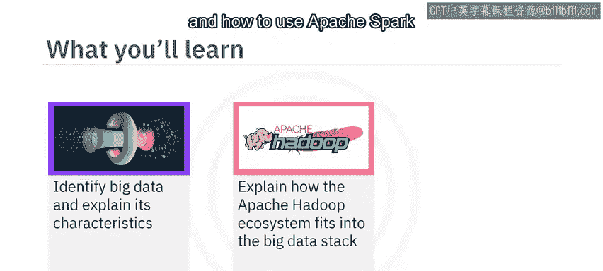

Now let's look at what you'll learn from each of the seven modules The first module talks about the basics of big data here you will learn the most upto- date definition of big data along with its use cases impacting everyday personal tasks and business transactions。

 you'll also learn how big data uses parallel processing， scaling。

 and data parallelism and explore commonly used big data tools。

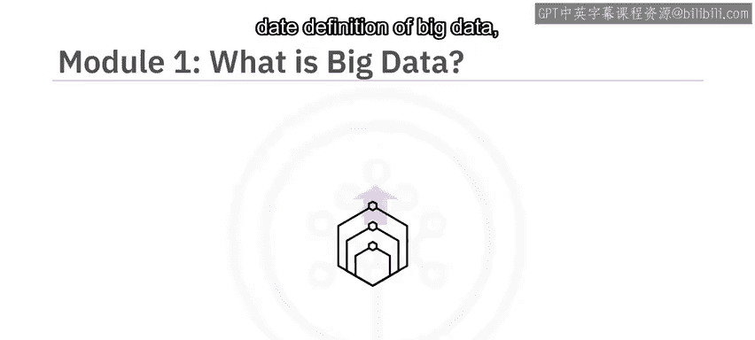

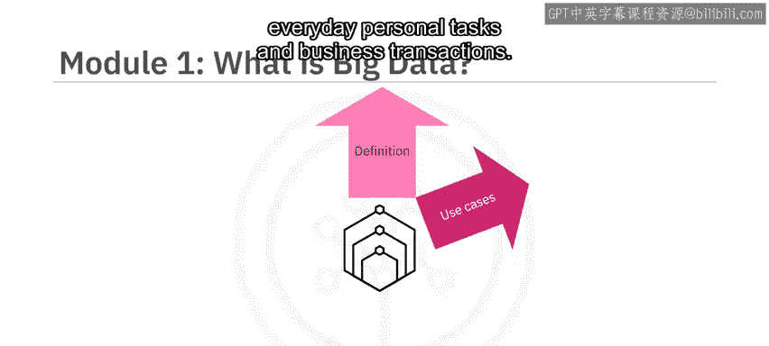

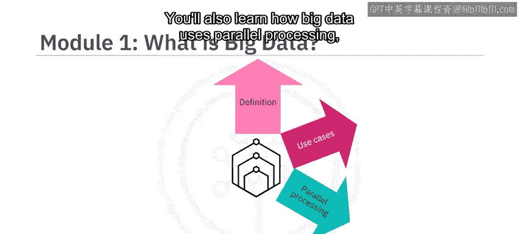

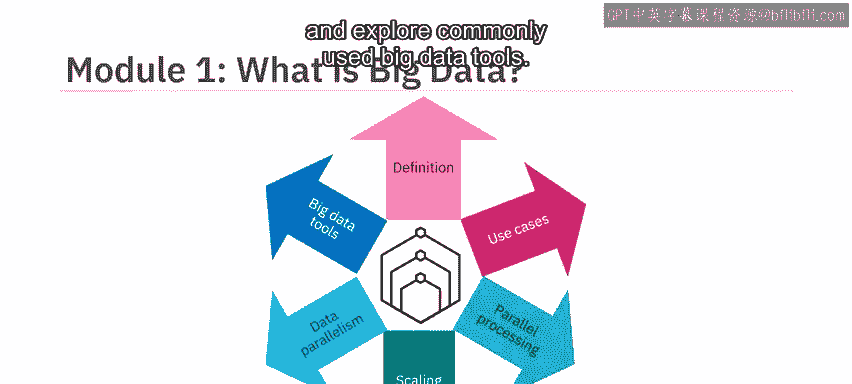

The second module will introduce you to the Apache Hadoop architectureitecture and ecosystem。

 the Hadoop ecosystem comprises of Hadoop Dis file system， or HDFS， MapRduce， Hve and Hbase。

 you'll also get the opportunity to gain practical experience in Hve， Hadoop cluster and map Red。

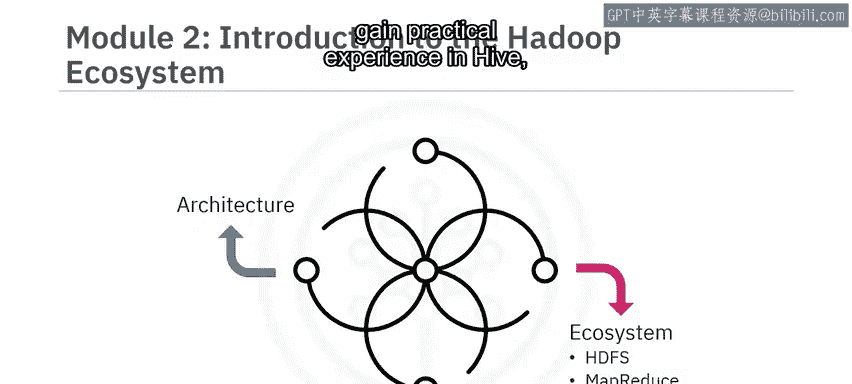

In the third module you'll focus on the popular Apache Spark platform where you'll gain key insights about functional programming and Lambda functions。

 you will also explore resilient distributed datas or RDDs。

 parallel programming and resilience in Apache Spark in this module you'll also work with queries and learn about the functions。

 parts and benefits of Spark SQL and data frame queries。

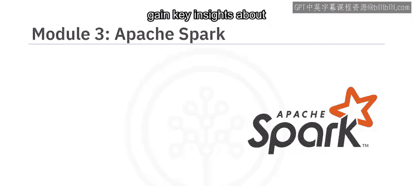

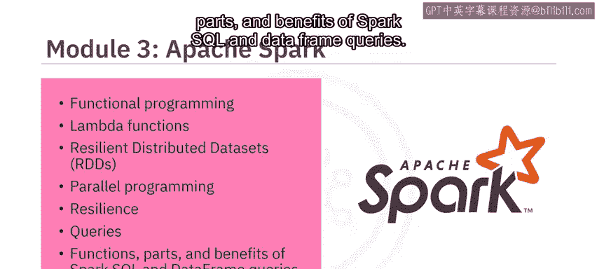

The next module module4 talks about data frames and Spark SQL， where you will learn about RDDs。

 their uses in Apache Spark and RDD transformations and actions。

 you'll compare the use of data sets with Spark's latest data abstraction data frames you'll also explore Apache Spark SQL optimization and learn how Spark SQL and memory optimization benefit from using Cata and tungsten。

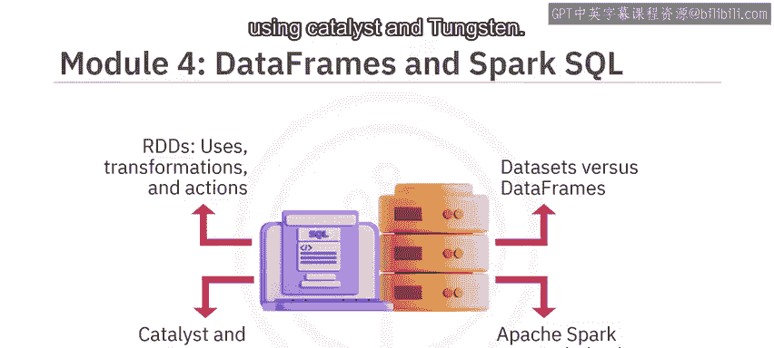

Module 5 will take you through development and runtime environment options here you'll explore how Spark processes the requests that your application submits you'll also be able to identify Apache cluster Manager。

 their components and benefits and know how to connect with each cluster Manager the module will also explain using Spark's Unified interface。

 Spark submit and options and dependencies you'll also learn about setting Apache Spark configurations and perform hands-on labs to use Apache Spark on IBM Cloud and Kubernetes。

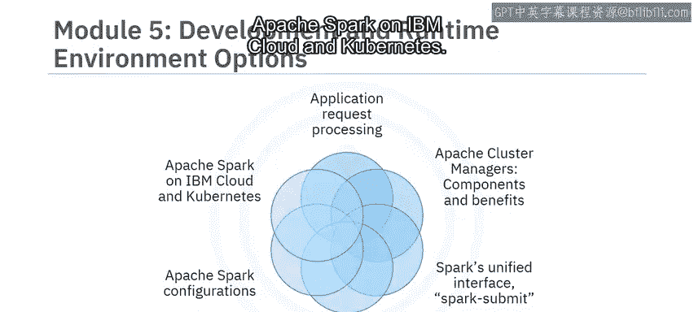

In the6 module， you'll learn about connecting to the Apache Spark user interfaceface or UI web server and using the same UI web server to manage application processes。

 you'll also learn to debug Apache Spark application issues using the application UI and locate related log files。

 the module will also help you discover and gain real-world knowledge about how Spark manages memory and processor resources。

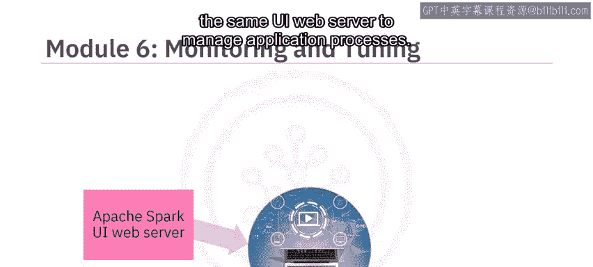

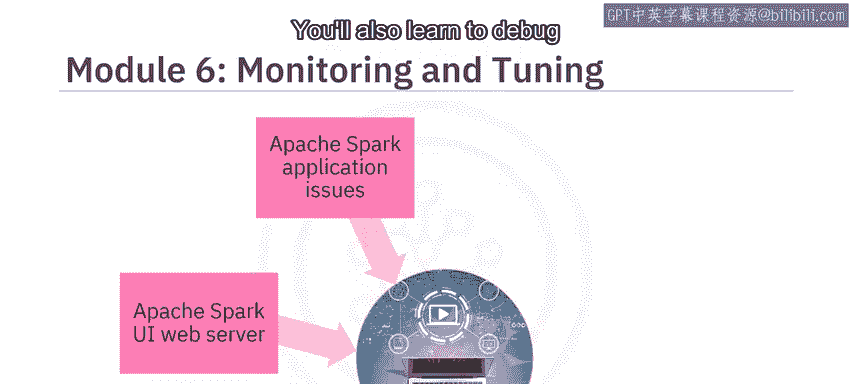

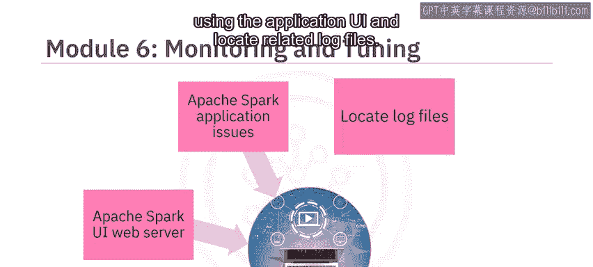

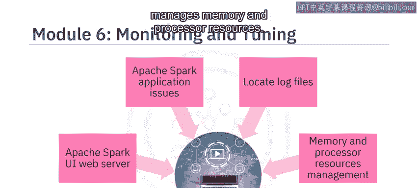

Module7， the final module is where you will cement your learning in this module you'll perform a practice lab to apply various transformations and actions on RDDs and data frames further you'll apply your knowledge to perform a final lab where you will create a data frame and finally you'll be assessed based on your learning from the course。

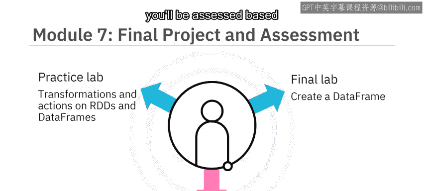

Learn by doing to solidify your course knowledge， you will perform activities and gain practical experience in the hands on labs strategically placed across the learning modules。

Get the most from your course。 Watch all videos and attempt all quizzes。

 completete the hands on laps to practice your new skills and create your shareable portfolio。

 Use the discussion forums to connect and collaborate with your peers or seek assistance from the course staff。

 Congratulations on beginning the next step on this exciting journey。😊。

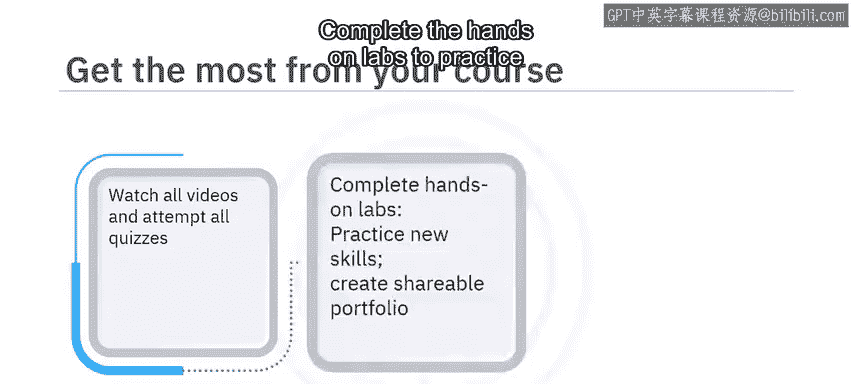

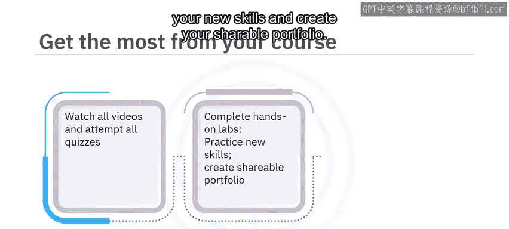

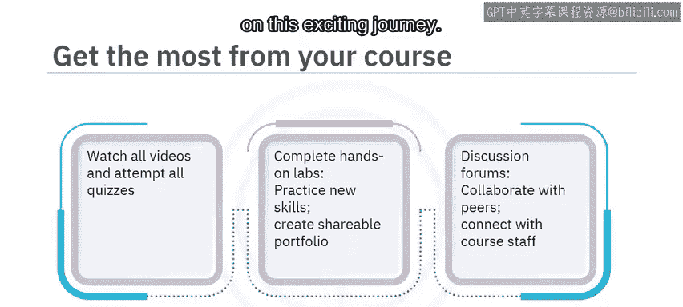

