# IBM数据工程专业证书 课程11：《使用Spark和Hadoop进行大数据介绍》｜big-data-with-spark-hadoop｜ - P20：19_rdd 在并行编程和火花中的作用.zh_en - GPT中英字幕课程资源 - BV12h4y1D7hF

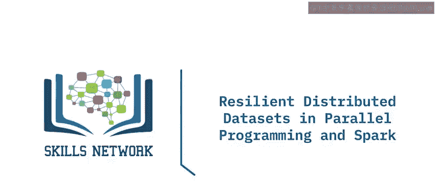

Welcome to Resilient distributed datas in parallel programming and Spark。

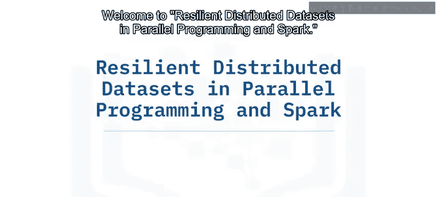

After watching this video， you'll be able to describe resilient distributed data sets。

 explain how to use resilient distributed data sets in Spark。

 explain RDD transformation and actions and list fundamental transformations and actions。

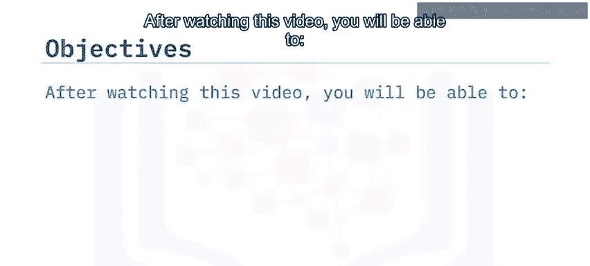

Resilient distributed data sets known as RDDs are Spark's primary data abstraction and are partitioned across a cluster's nodes。

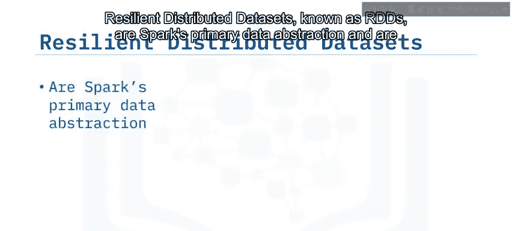

The first RDD operation to explore is a transformation。

 and RDD transformation creates a new RDD from an existing RDD Transs in Spark are considered lazy because Spark does not compute transformation results immediately Instead the results are only computed when evaluated by actions。

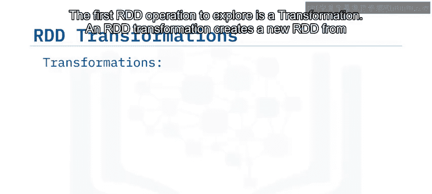

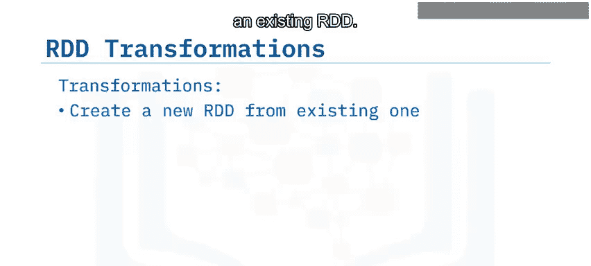

For example， the map transformation passes each element of a data set through a function。

 resulting in a new RDD。

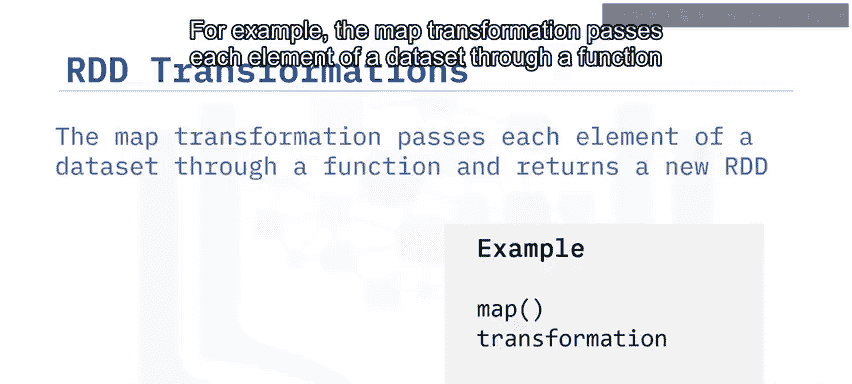

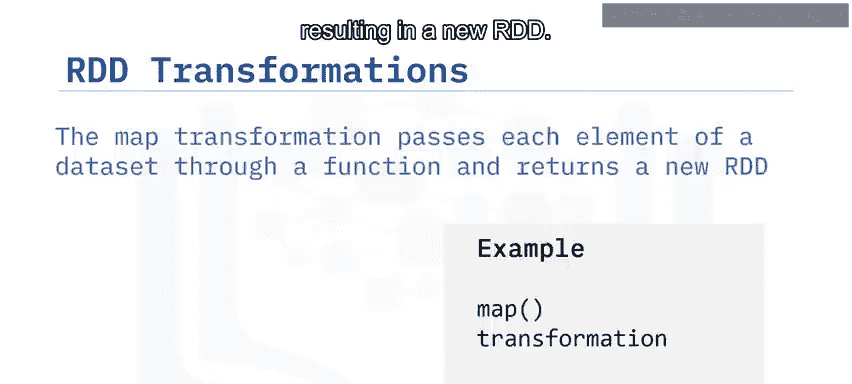

To evaluate a transformation in Sp， you use an action。

 the action returns a value to the driver program after running a computation。

 One example is the reduce action， which aggregates all the elements of an RDD and returns the result to the driver program。

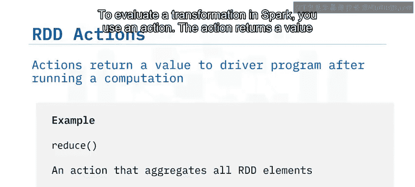

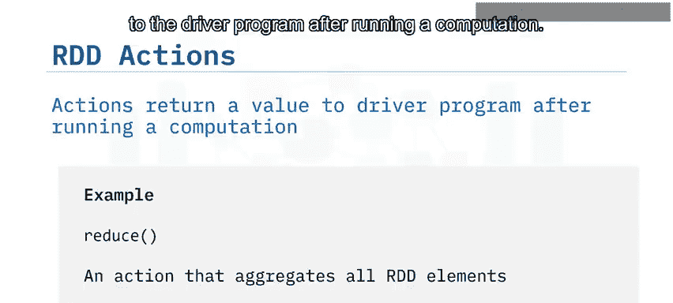

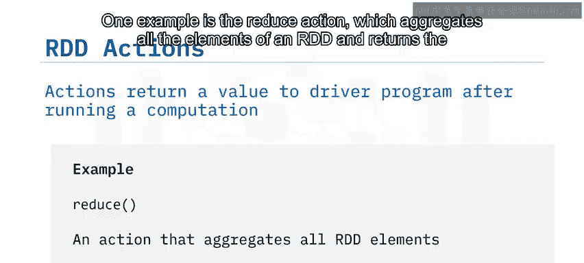

But how do transformations and actions happen， Spark uses a unique data structure called a directed a cyclic graph known as a Dg and an associated Dg scheduler to perform R DD operations。

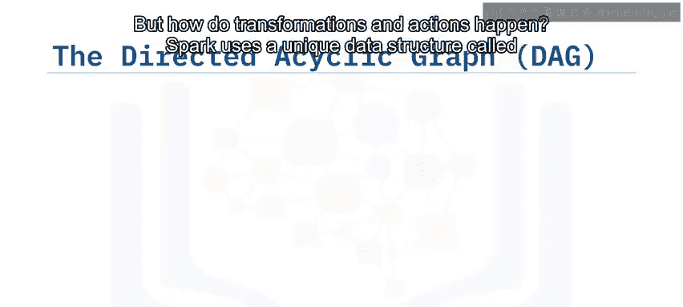

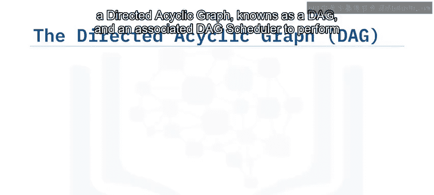

Think of a dag as a graphical structure composed of edges and vertices。

 The term a cyclic means new edges only originate from an existing vertex。 In general。

 the vertices and edges are sequential the vertices represent RDDs and the edges represent the transformations or actions。

 The DAg scheduler applies the graphical structure to run the tasks that use the RDD to perform transformation processes。

 So why does Spk use daAgs DAgs help enable fault tolerance When a node goes down Spk replicates the DAg and restores the node。

😊。

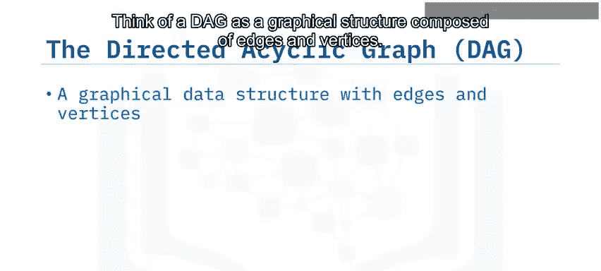

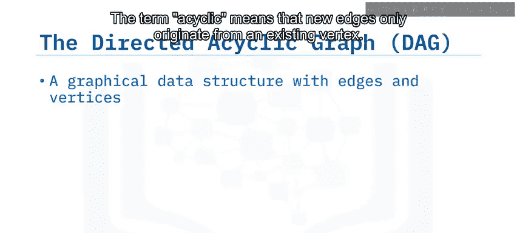

Let's look at the process in more detail。 First， Spark creates DAg when creating an RDD。 Next。

 Spark enables the DAg scheduler to perform a transformation and updates the Dg。

 The Dg now points to the new RDD。 The pointer that transforms RDD is returned to the Spk driver program。

 and if there is an action， the driver program that calls the action。

 evaluates the DAg only after Spark completes the action。😊。

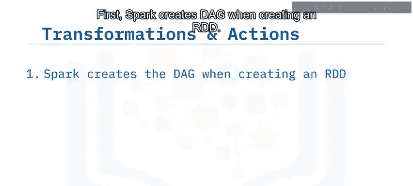

Here are some examples of RDD transformations and actions。 We have already mentioned mapap。

 which is an essential operation and capable of expressing all transformations needed in data science。

 some of the more common high- levell transformations， making use of map and reduce include filter。

 which enables filtering the elements of a data set based on a function and distinct。

 which finds the number of distinct elements in a data。 In addition。

 the flat map transformation which is similar to the map transformation can map each input item to zero or greater output items。

 its function should return a sequence rather than a single item。😊，Next。

 frequently used actions include produce， which aggregates dataset elements using the function Take。

 which returns an array with the first n element。 Collect。

 which returns all the elements of the dataset as an array and take ordered。

 which returns elements ordered in ascending order or as specified by an optional function argument。

 you can find more details about Transs and actions on the Spark。appache。org website。

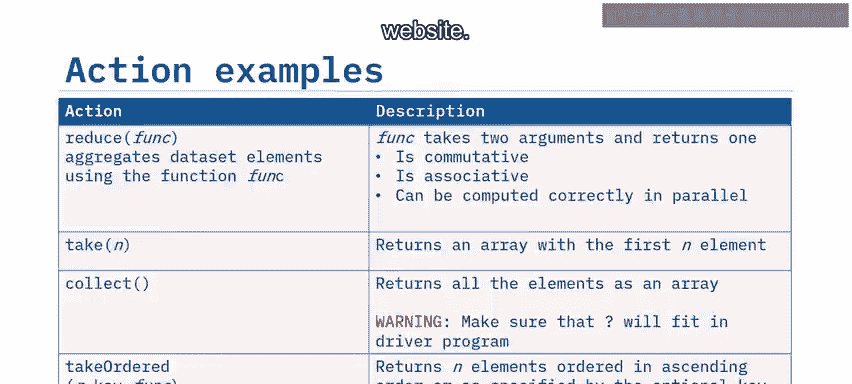

A transformation is only a mapping of operations。 You need actions to get the computed values to the driver program。

 This example considers a function F of X that decreementments x by one。 So F of x equals x minus-1。

 you'll apply this function as a transformation to a data set using the map transformation。

 Each task makes a new partition by calling F of E on each entry E in the original partition。

 Then the collect action gathers the entries from all the partitions into the driver。

 which receives the results。In this video， you learn that RDDs are Spk's primary data abstraction partitioned across the nodes of the cluster。

 Spark uses daAgs to enable fault tolerance when a node goes down。

 Spark replicates the dag and restores the node。 Transforms leave existing RDDs intact and create new RDDs based on the transformation function。

 Transforms undergo lazy evaluation， meaning they are only evaluated when the driver function calls an action。

😊。

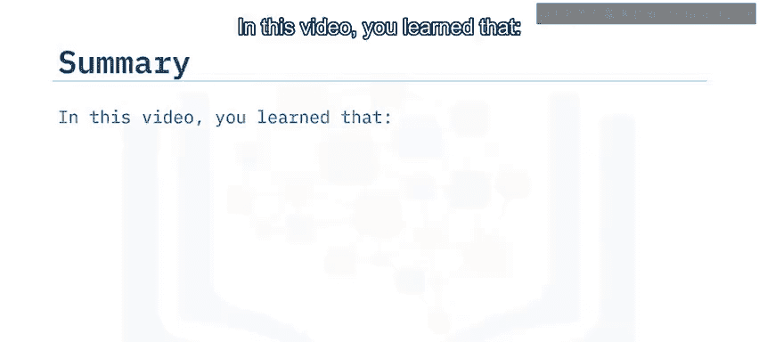

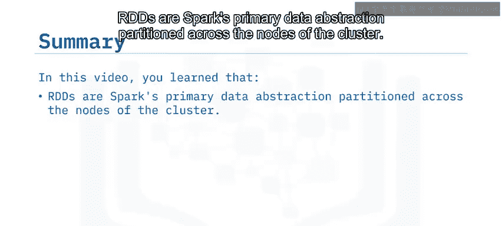

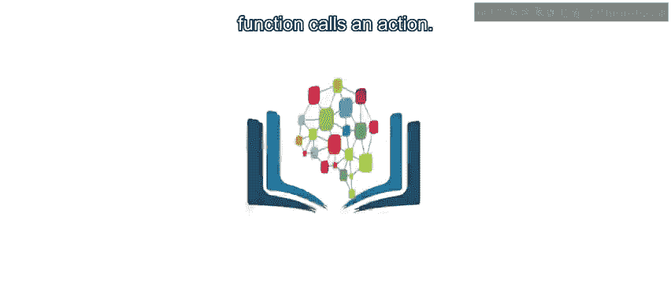