# IBM数据工程专业证书 课程11：《使用Spark和Hadoop进行大数据介绍》｜big-data-with-spark-hadoop｜ - P21：20_数据帧和数据集.zh_en - GPT中英字幕课程资源 - BV12h4y1D7hF

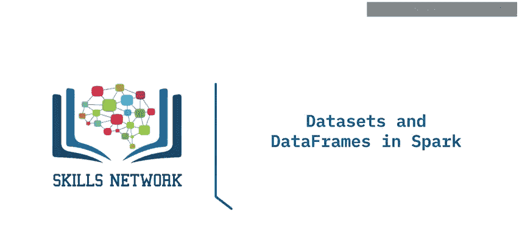

Welcome to datas and Data frames in Spark。

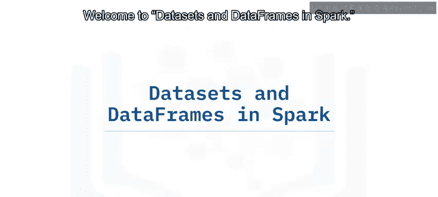

After watching this video， you'll be able to describe data set features and benefits within Apache Spark。

 Ex three ways you can create data sets for use in Spark。

 summarize the differences between data sets and data frames。

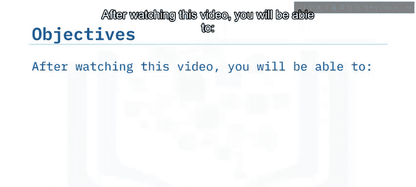

Data sets are the newest spark data abstraction， like RDDs and data frames。

 datas provide an API to access a distributed data collection Data sets are a collection of strongly typed Java virtual machine or JVM objects strongly typed means that dataset sets are Tafe and the data sets data type is made explicit during its creation Data sets provide the benefits of both RDDs such as Lambda functions。

 type safety and SQL optimizations from SparkSQL。

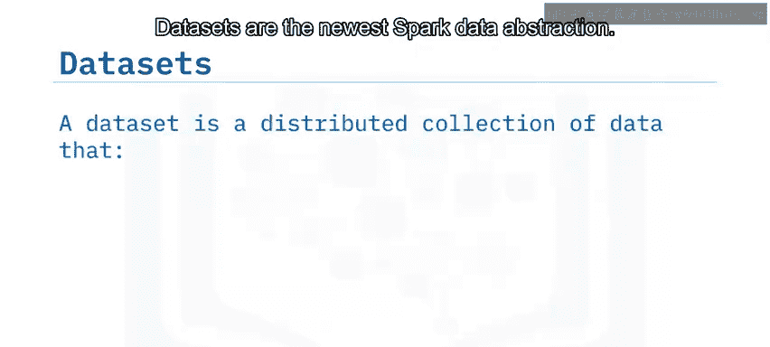

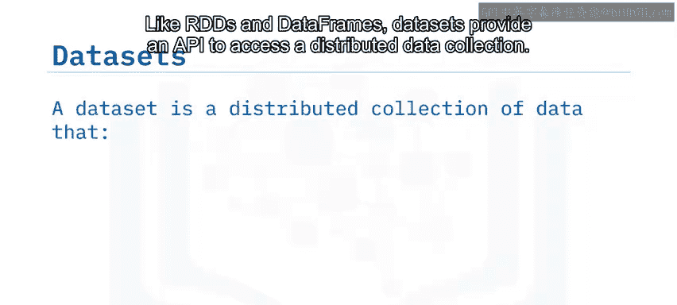

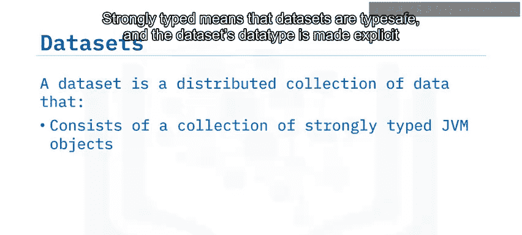

Speaking of benefits， here are four more features of dataset sets Datas are immutable like RDDs。

 they cannot be deleted or lost。 Data sets feature an encoder that converts typespecified JVM objects to a tabular representation Datas extend the data frame API conceptually a data set of a generic untyped row is a JVM object seen as a column of a data frame because datas are strongly typed As are currently only available in Scala and Java。

 which are statically typed languages。 Dyally typed languages such as Python and R do not support data APIs。

Data sets offer some unique advantages and benefits over using data frames and RDDs because datas are statically typed datas provide compile time type safety compile time type safety means that Spark can detect syntax and semantic errors in production applications before deployment。

 saving substantial developer and operational costs and time Datas compute faster than RDDs。

 especially for aggregate queries Datas offer the additional query optimization enabled by catalyst and tungsten Datas enable improved memory usage and caching but how Spark understands the data structure of the datas and optimizes the layout within memory the data API also offers functions for convenient highlevel aggregate operations。

 including some， average， join and group by。

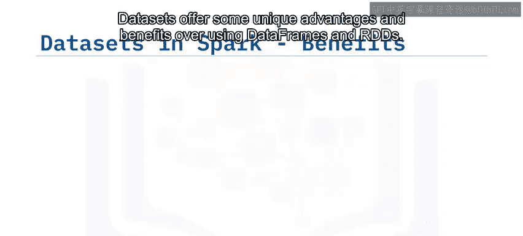

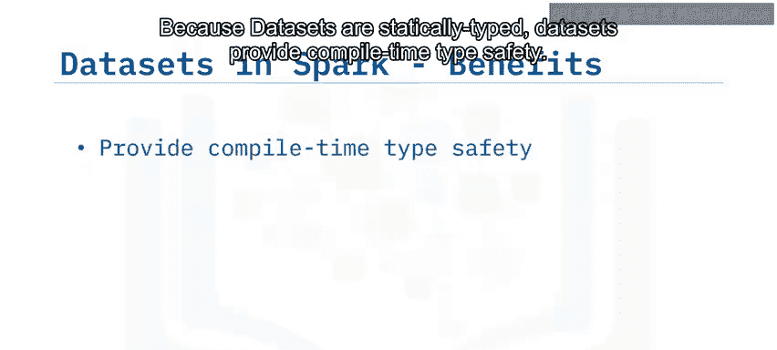

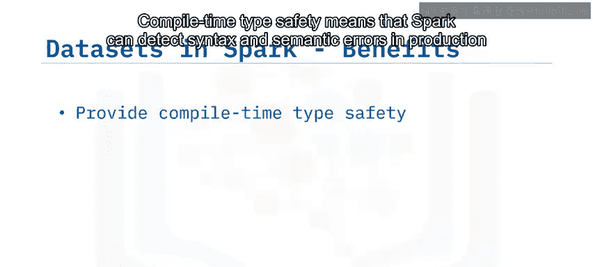

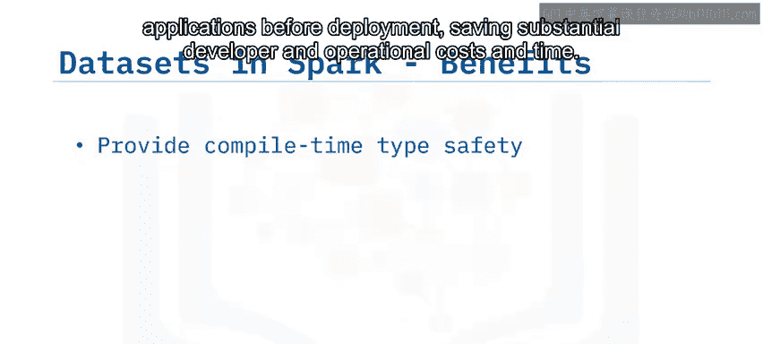

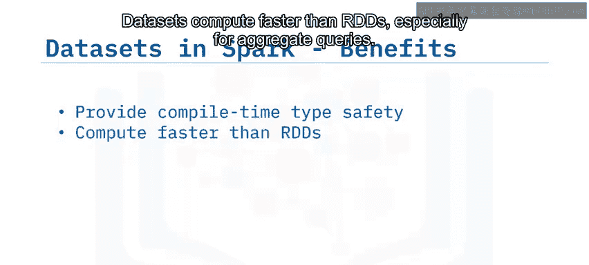

Let's now look at three ways that you can create a data set within Spark。

 This first example written in Scala uses the2 DSs function to create a data set from a sequence。

This second example illustrates how to create a data set from a text file。

 noticeice the explicit schema declaration In this example。

 we apply the primitive string data type to the explicit schema declaration。

This third and final example creates a data set using a JSON file In this last example。

 we use a custom class calledCustomer which contains a name and an ID field。Next。

 let's compare data sets to data frames。 Data sets offer the benefits of both its predecessors。

 Data frames and RDDs Datas are strongly typed Data frames are not Tyafe Datas can use unified Java and Scala APIs。

 Data frames use APIs that are written in Java， Scala。

 Python and R The data frames API may or may not be unified depending on the API version Datas are the latest edition to Spar and are built on top of data frames。

 In contrast， data frames introduced earlier are built on RDDs。

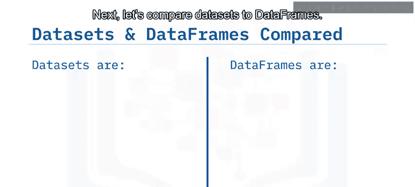

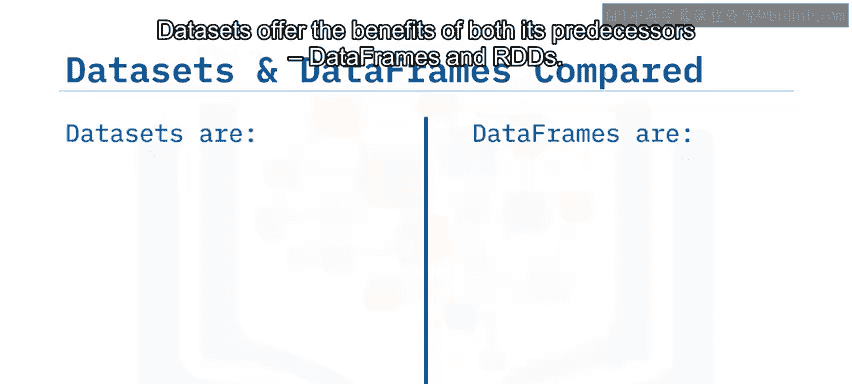

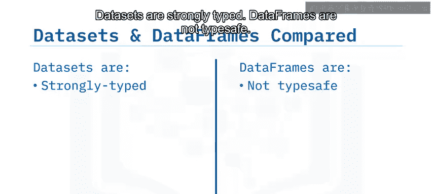

In this video， you learn that a data set is a distributed collection of data that provides the combined benefits of both RDDs and SparSQL Data sets consist of strongly typed JVM objects Datas use data frame typeafe capabilities and extend object oriented API capabilities。

 Datas work with both Scala and Java APIs。

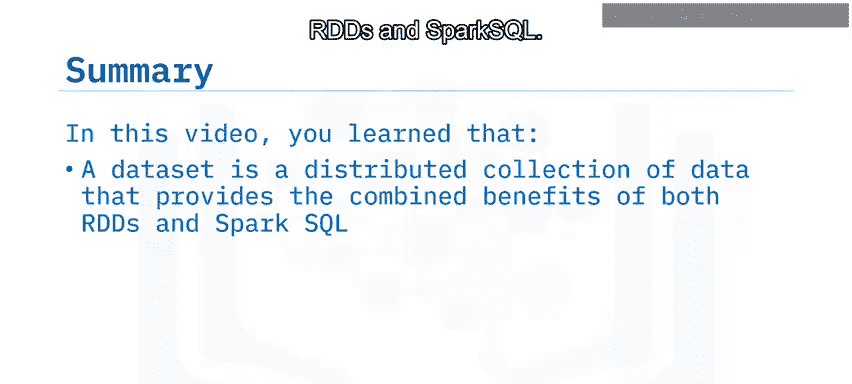

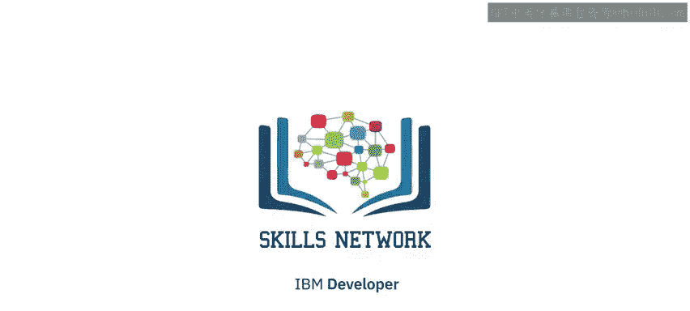