# IBM数据工程专业证书 课程11：《使用Spark和Hadoop进行大数据介绍》｜big-data-with-spark-hadoop｜ - P24：23_sparksql 的实际使用.zh_en - GPT中英字幕课程资源 - BV12h4y1D7hF

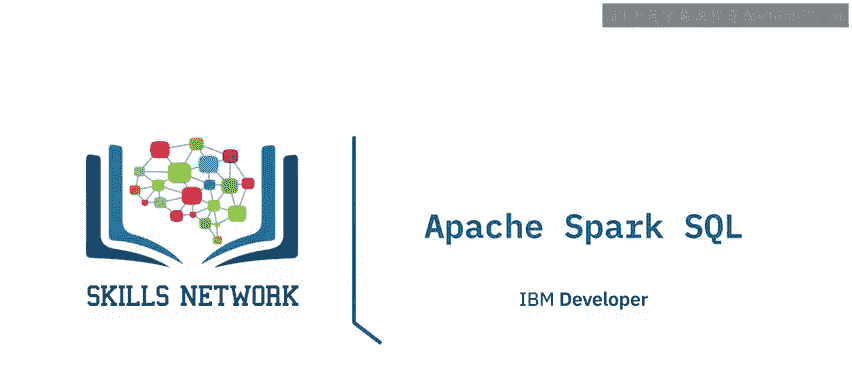

Welcome to Apache Spark Sequel。

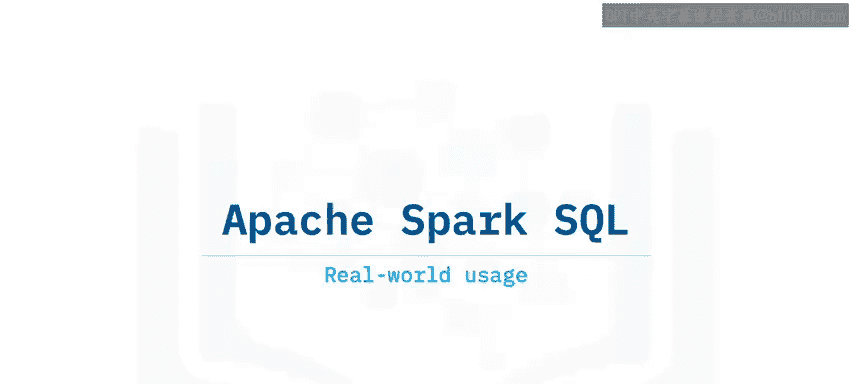

After watching this video， you'll be able to define Spark SQL， create a table view in Spar SQL。

 explain how to aggregate data using SparkSQL， explain the various data sources SparkSQL supports。

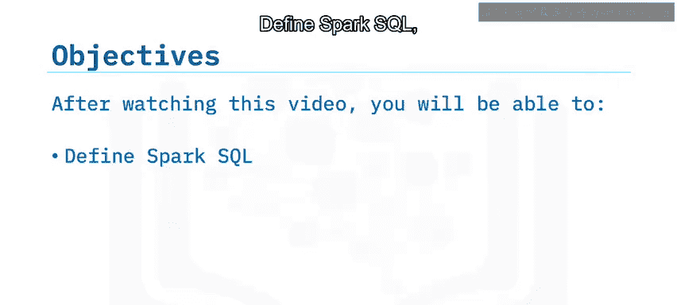

Heres a quick recap of Spark SQL SparkSQL is a Spark module for structured data processing。

 SparkSQL is used to run SQL queries on Spark data frames and has available APIs in Java， Scala。

 Python and R。

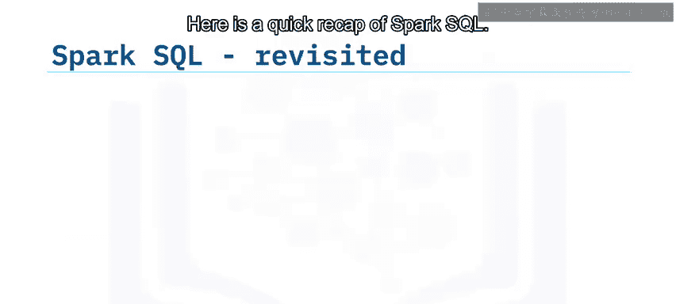

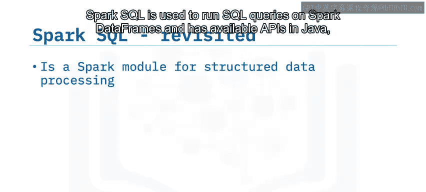

The first step to running SQL queries in Spark SQL is to create a table view。

 A table view is a temporary table used to run SQL queries。

 Spark SQL supports both temporary and global temporary table views。

 A temporary view has local scope。 Local scope means that the view exists only within the current Spar session on the current node。

 A global temporary view， however， exists within the general Spark application。

 A global temporary view is shareable across different Sp sessions。

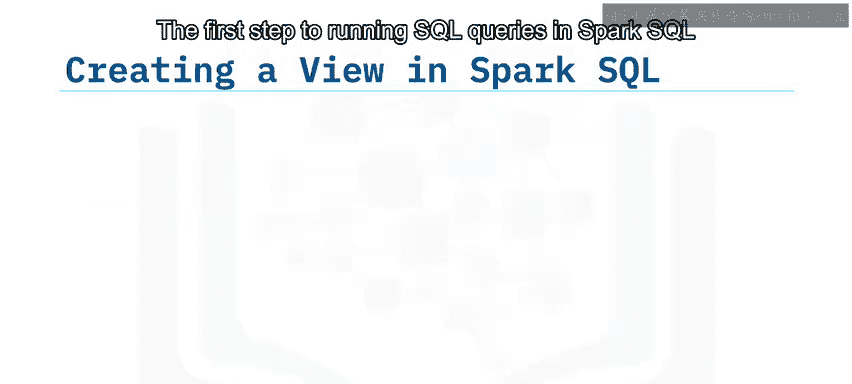

Here is an example that shows how to create a temporary view in Python using Pyparark。

 you first create the data frame from the JSON file。

 then create a temporary view called people you can then run a SQL query using this view。

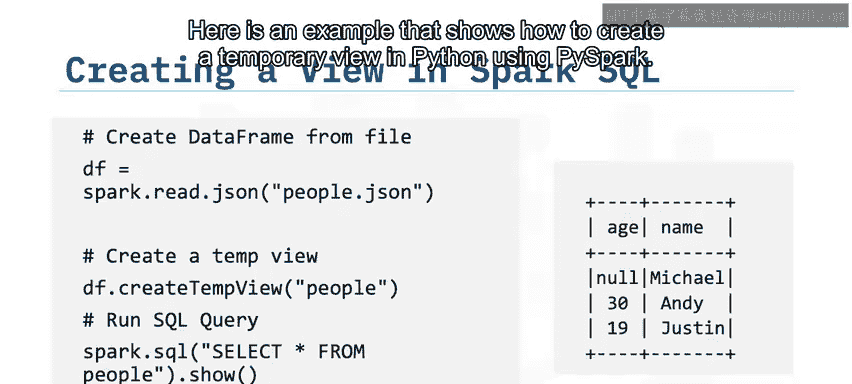

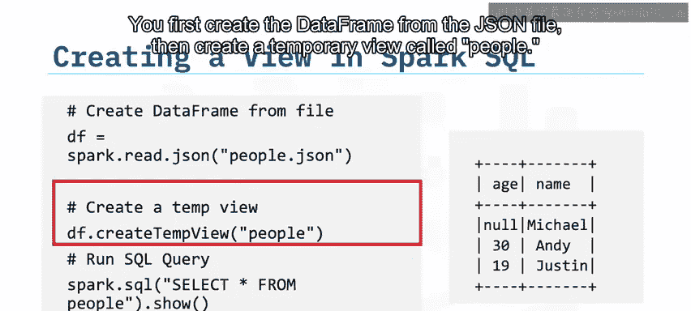

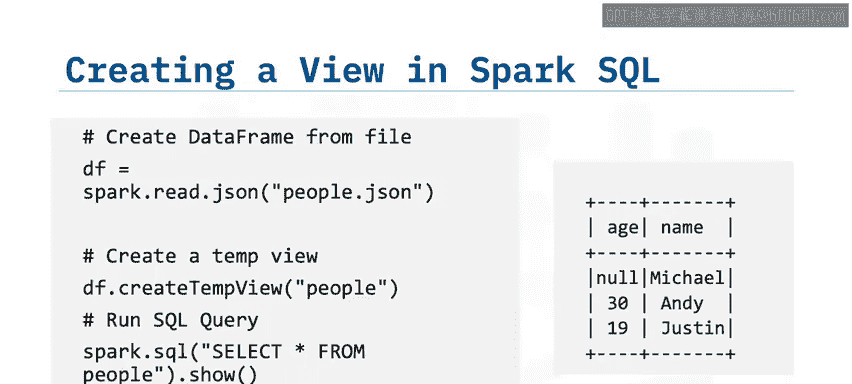

Here is the same example， but this time you are creating a global temporary view。

 Note the minor syntax change， including the global prefix to the function name and the global temp prefix to the view name。

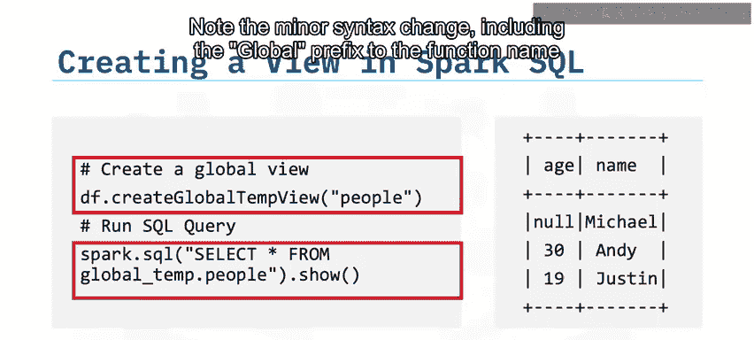

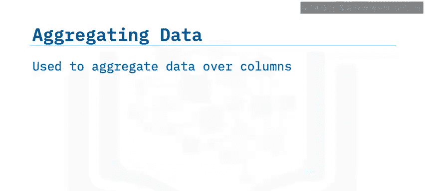

Aggregation， a standard spark SQL process is generally used to present grouped statistics。

 Data frames come in built with commonly used aggregation functions such as count， average。

 Max and others。 You can also perform aggregation programmatically using SQL queries and table views。

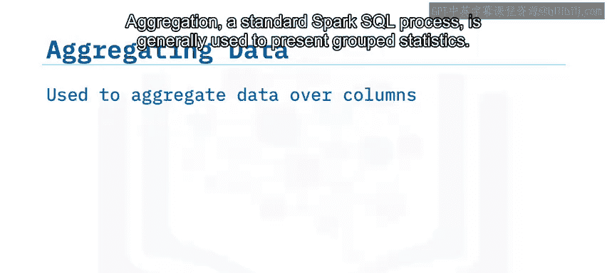

First， import your data into a data frame， then use pandas on Python to read the CSV file and create a data frame。

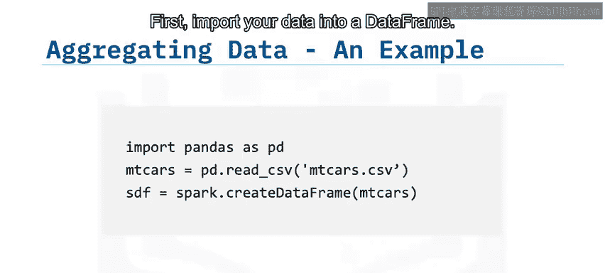

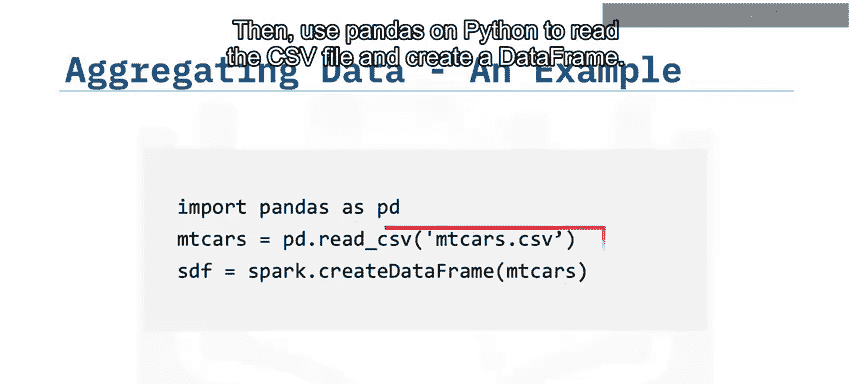

You can apply the select function to examine data from a specific column in detail。

 This example applies the select function to view the first five rows of the MPG column。

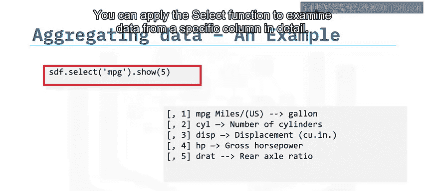

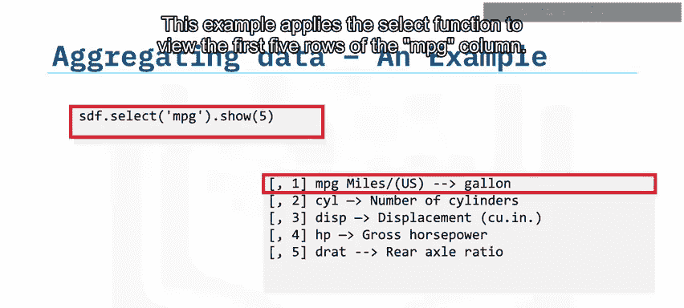

Here you can see the first few rows of the data set。

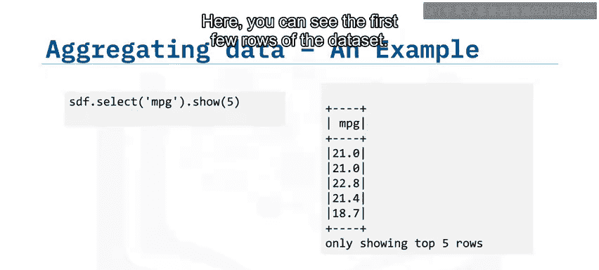

In this example， you aggregate and group cars by the number of cylinders they have。

 You can perform this action using two methods。 The first method is to use the inbuilt functions of the data frame。

 you have already covered this operation in another lesson。

 The second method is to create a temp view for the data frame。 In this example。

 you name the temp view cars。 Then you run a SQL query to group by cylinders and view the data in descending order。

 Although you use different tools and functions， both approaches produce the same results。

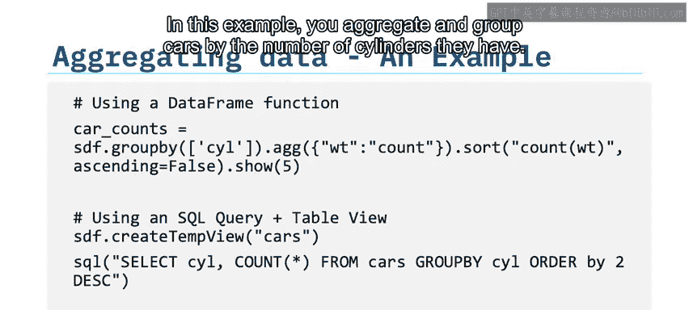

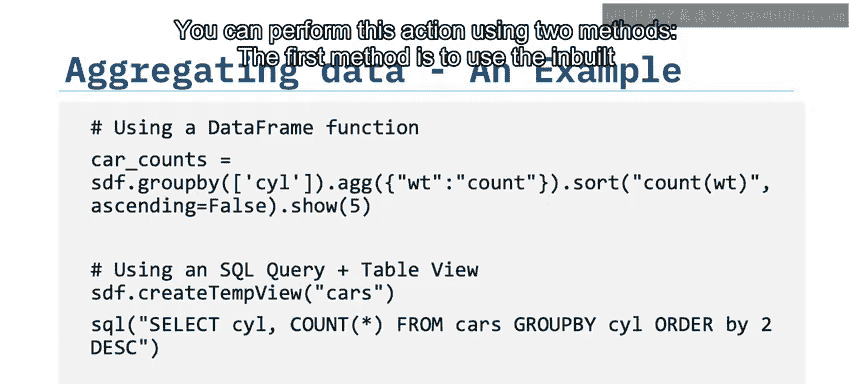

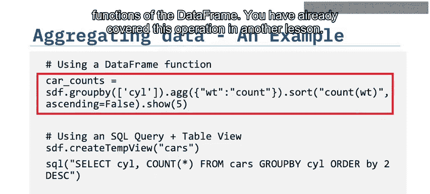

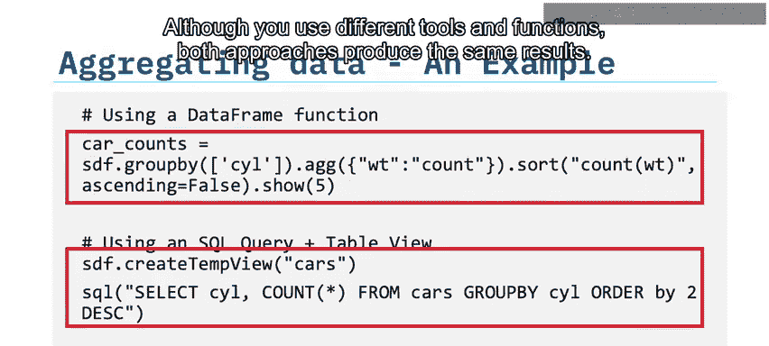

Next， let's look at some of the data sources that SparkSQL supports Parquet is a columnar format supported by many data processing systems。

 SparkSQL supports reading and writing data from Parquet files and SparkSQL preserves the data schema。

 Similarlyly， SparkSQL can load and write to JSON datas by inferring the schema SparSQL also supports reading and writing data stored in Hve。

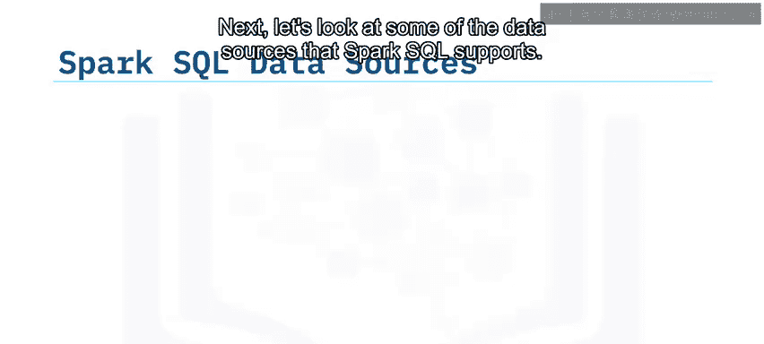

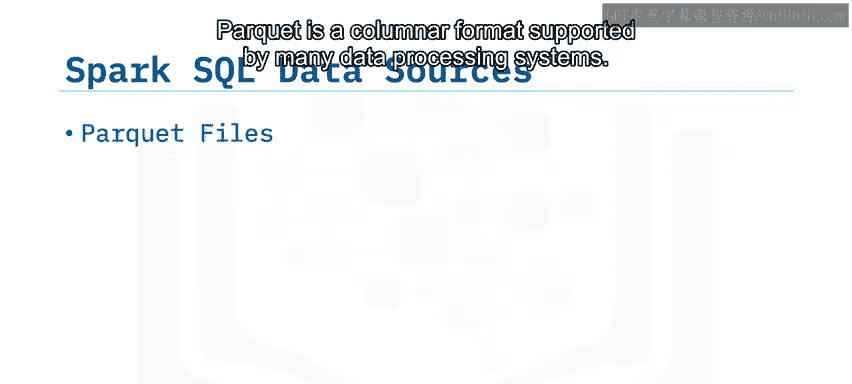

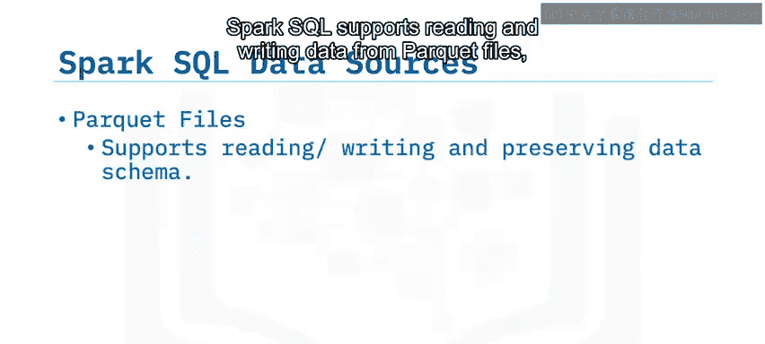

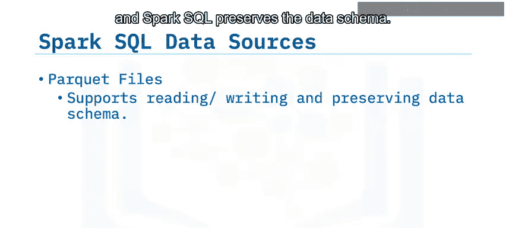

In this video， you learned that Spark modules for structured data processing can run SQL queries on Spark data frames and are usable in Java。

 Scala， Python， and R SparkSQL supports both temporary views and global temporary views you can use a data frame function or a SQL query plus table view for data aggregation。

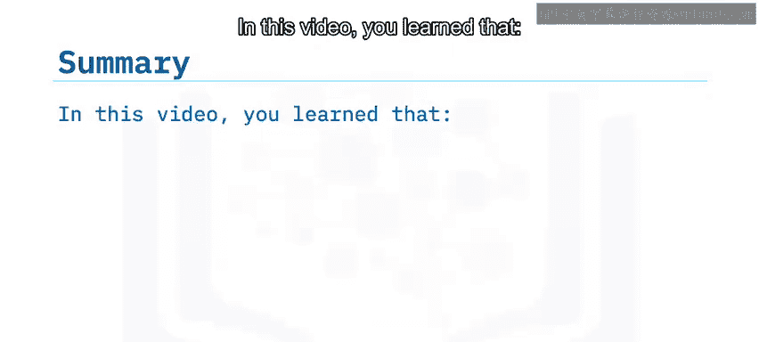

SparkSQL supports PAquet files， JSON datas， and hive tables。

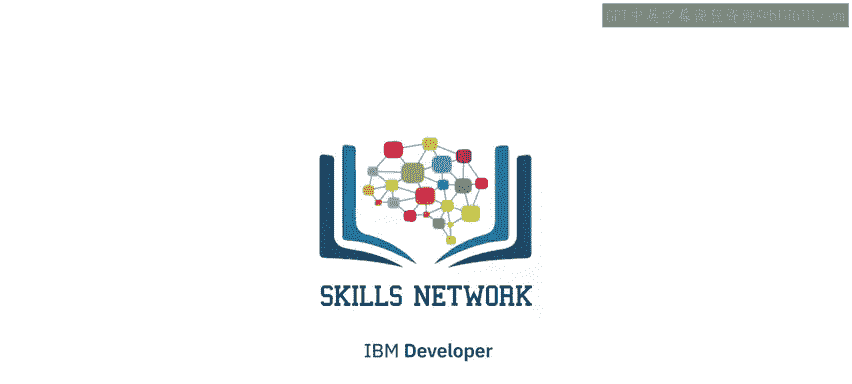