# IBM数据工程专业证书 课程11：《使用Spark和Hadoop进行大数据介绍》｜big-data-with-spark-hadoop｜ - P25：24_apache spark 架构.zh_en - GPT中英字幕课程资源 - BV12h4y1D7hF

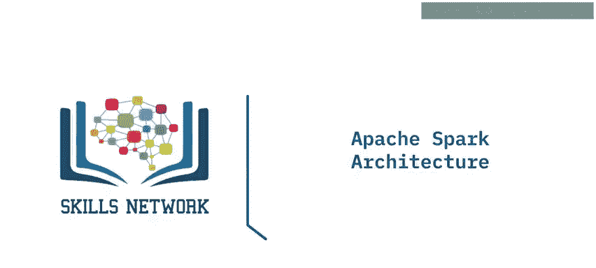

Welcome to Apache Spark Architecture。After watching this video。

 you'll be able to describe the architecture of Apache Spark， identify processes in a Sp application。

 explain how spark jobs and tasks are related， Def stages and describe when a data shuffle occurs。

 describe the cluster deploy modes the driver program can be run in。

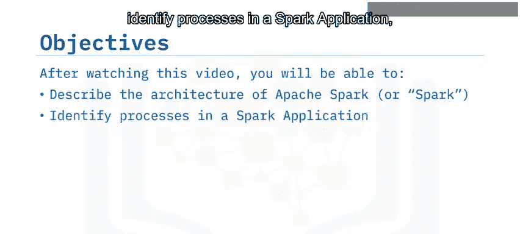

A Spar application has two main processes； The driver program runs as one process per application。

 the driver process can be run on a cluster node or another machine as a client to the cluster。

 the driver runs the application's user code， creates work and sends it to the cluster。

 an executor is a process running multiple threads to perform work concurrently for the cluster。

 Executors work independently， there can be many throughout a cluster and one or more per node depending on configuration。

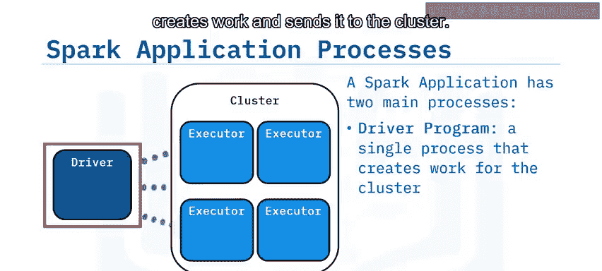

The S context starts when the application launches and must be created in the driver before data frames or RDDs。

 any data frames or RDDs created under the context are tied to it。

 and the context must remain active for the life of them。

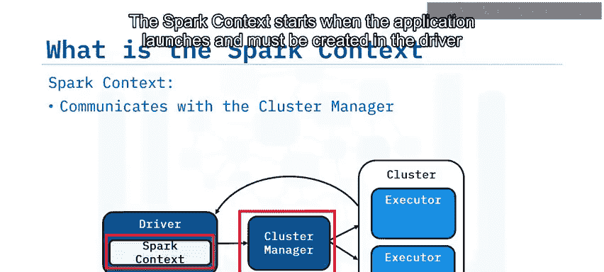

The driver program creates work from the user code called jobsbs or computationuts that can be performed in parallel the Sp context in the driver divides the jobs into tasks to be executed on the cluster。

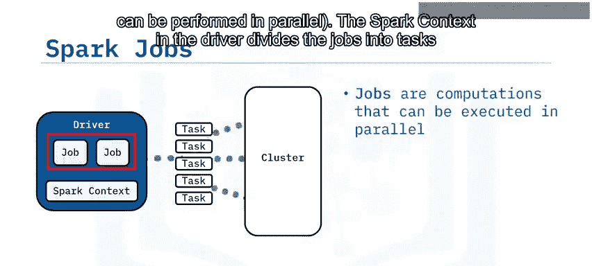

Tasks from a given job operate on different data subsets called partitions。

 This means tasks can run in parallel in the executors。

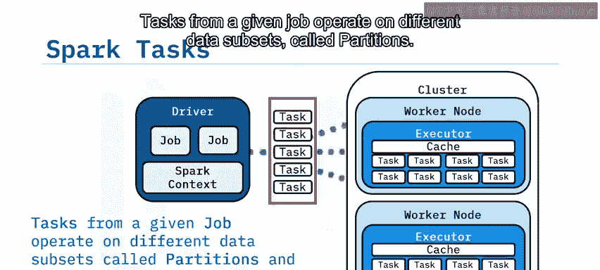

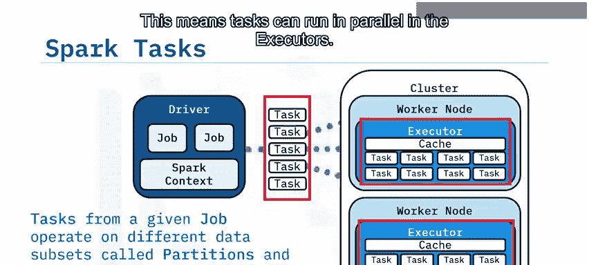

A Sp worker is a cluster node that performs work， A Sp executor utilizes a set portion of local resources as memory and compute cores。

 running one task per available core Each executor manages its data caching as dictated by the driver in general。

 increasing executors and available cores increases the cluster's parallelism tasks run in separate threads until all cores are used When a task finishes。

 the executor puts the results in a new RDD partition or transfers them back to the driver Idely。

 limit utilized cores to total cores available per node， for instance。

 an eight core node could have one executor process using eight cores。

A stage in a spark job represents a set of tasks an executor can complete on the current data partition when a task requires other data partitions。

 Spark must perform a shuffle。 A shuffle marks the boundary between stages。

 subsequentent tasks in later stages must wait for that stage to be completed before beginning execution。

 Cating a dependency from one stage to the next。Shuffles are costly as they require data serialization。

 disk and network IO This is because they enable tasks to pass over other dataset partitions outside the current partition an example would be a group by with a given key that requires scanning each partition to find matching records When Spark performs a shuffle it redistributes the data across the cluster。

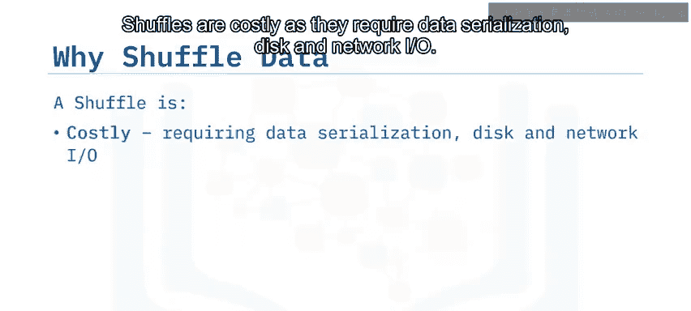

This example shows two stages separated by a shuffle in stage1。

 a transformation such as a map is applied on dataset set A， which has two partitions 1， A and 2 B。

 This creates data set B。 the next operation requires a shuffle。

 such as a group by key values could exist in any other partition。

 So to group keys of equal value together。 tasks must scan each partition to pick out the matching records。

 Transform results are placed in stage 2。 Here， results have the same number of partitions。

 but this depends on the operation。 Fi results are sent to the driver program as an action。

 such as collect Note， it is not advised to perform a collection to the driver on a large data set as it could easily use up the driver process memory。

 If the data set is large， apply a reduction before collection。

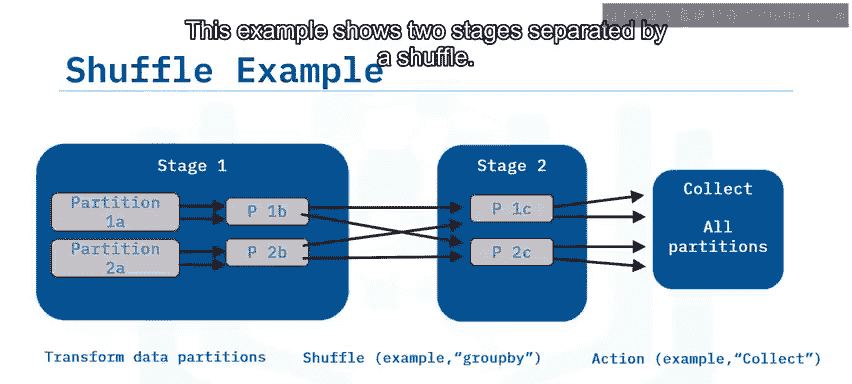

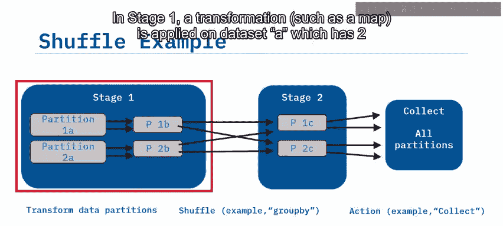

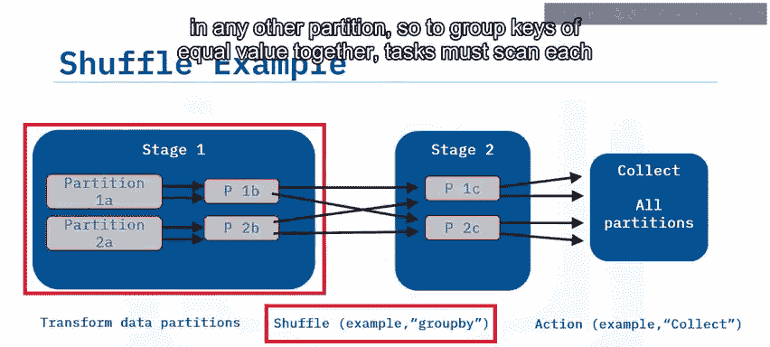

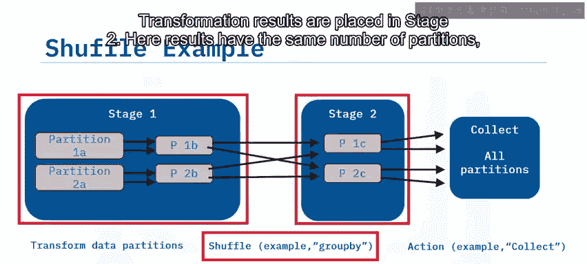

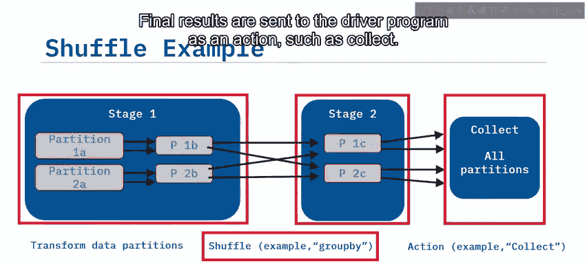

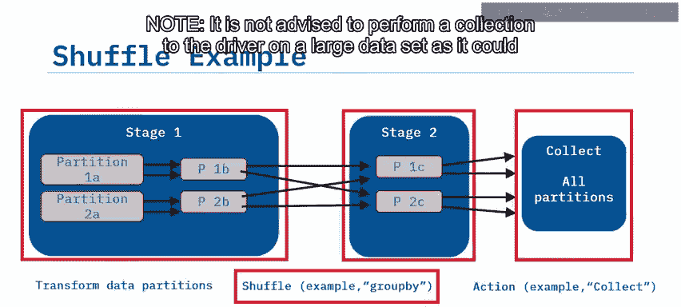

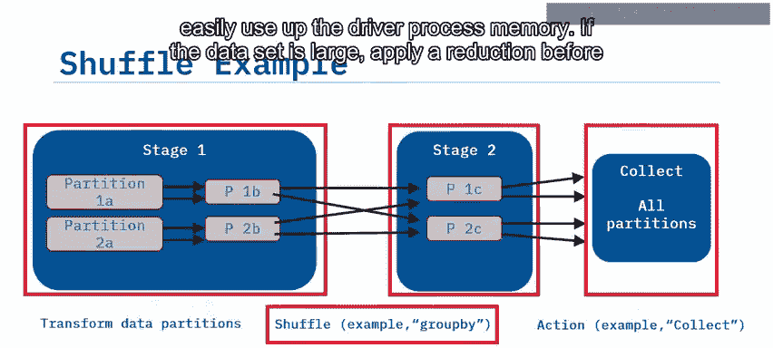

Let's recap what we've learned about Spark architecture。

 It consists of the driver and the executor processes。

 The cluster comprises the cluster manager and worker nodes。

 The Spk context schedules tasks to the cluster and the cluster manager manages the cluster's resources。

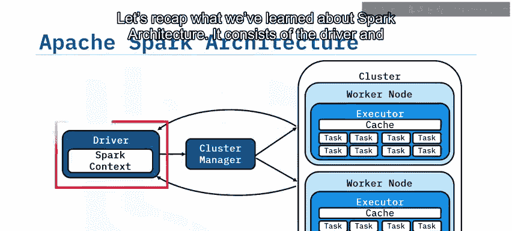

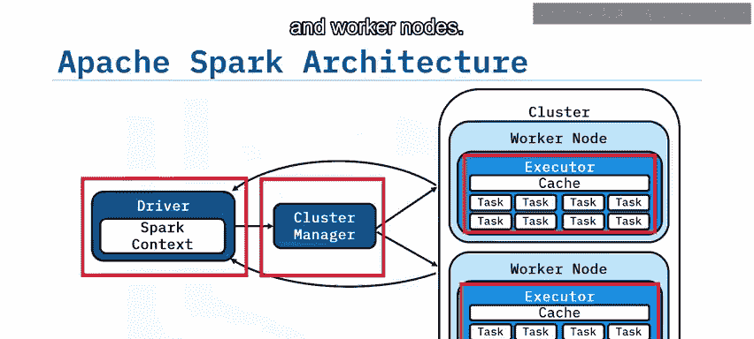

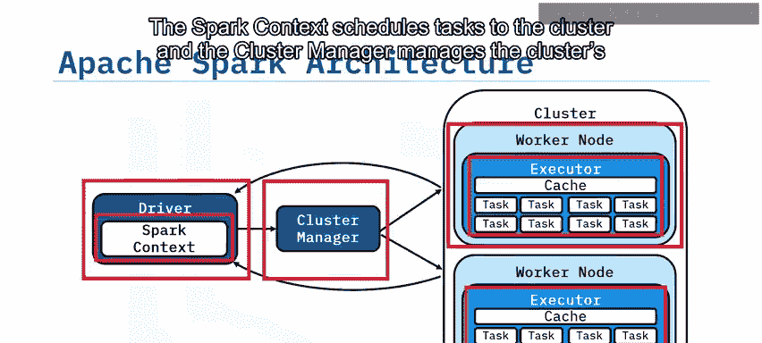

The driver program can be run in either client or cluster mode in client mode。

 the application submitter， such as a user machine terminal launches the driver outside the cluster in cluster mode。

 the driver program is sent to and run on an available worker node inside the cluster。

 the driver must be able to communicate with the cluster while it is running。

 whether it is in client or cluster mode。

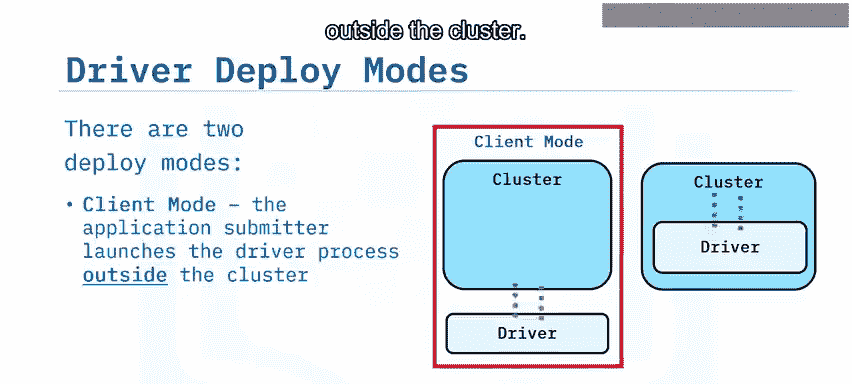

In this video， you learned that Spark architecture has driver and executor processes coordinated by the spark context in the driver。

 The driver creates jobs and splits them into tasks， which can be run in parallel in the executors。

 Sts are set of tasks that are separated by a data shuffle。

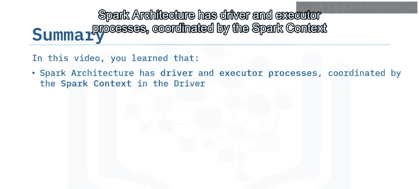

Shuffles are costly as they require data serialization。

 disk and network IO The driver can be run in either client or cluster mode。

 the client mode connects the driver outside the cluster while the cluster mode runs the driver in the cluster。

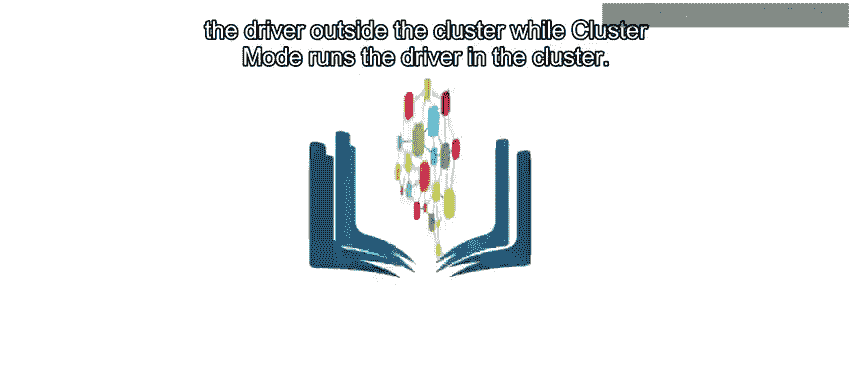