# IBM数据工程专业证书 课程11：《使用Spark和Hadoop进行大数据介绍》｜big-data-with-spark-hadoop｜ - P26：25_概述 apache spark 集群模式.zh_en - GPT中英字幕课程资源 - BV12h4y1D7hF

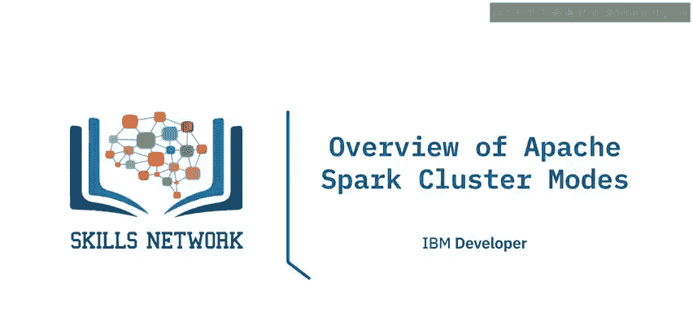

Welcome to overview of Apache Spark cluster modes。😊。

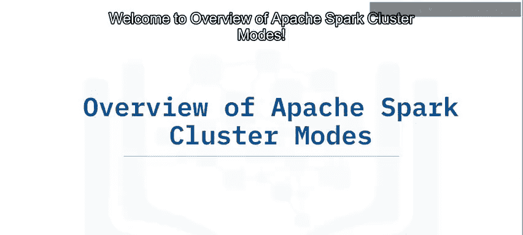

After watching this video， you'll be able to identify different modes of running Apache Spar on a cluster。

 De the components and benefits of each cluster mode。

 De how to run Spark to connect with each cluster mode。

 De how and when to set up a local Sp instance。

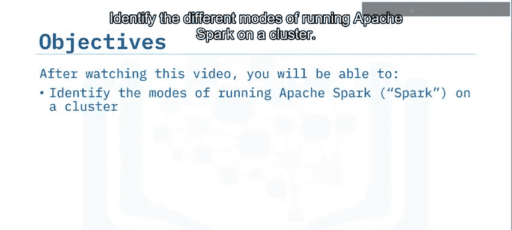

The Spark cluster manager communicates with the cluster to acquire resources for an application to run。

 It runs as a service outside the application and abstracts the cluster type while an application is running。

 the Spark context creates tasks and communicates to the cluster manager what resources are needed。

 then the cluster manager reserves executor course and memory resources once the resources are reserved。

 tasks can be transferred to the executor processes to run。

Spark has built in support for several cluster managers。

 A standalone cluster manager is included with the Spark installation。

 It's best for setting up a simple cluster。 Apache Hadoop yarn， or yet another resource negotiator。

 is a cluster manager from the Hadoop project。 Apache Mezoos is a general purpose cluster manager that Spark can run with additional benefits。

 Finally， Kubernetes is an open source system for running containerized applications。

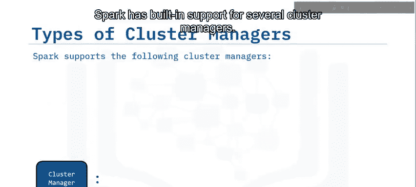

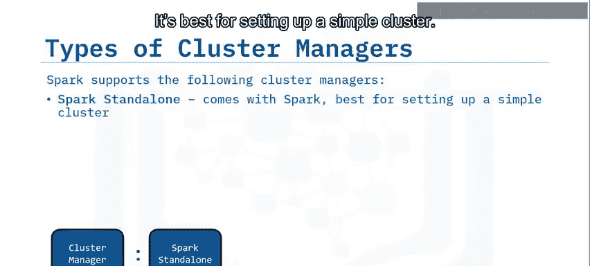

Spark standalone comes packaged with the Spark installation。

 so there are no additional dependencies required to configure and deploy。

 Spark standalone is specifically designed to run Spark and is often the fastest way to get a cluster up and running applications。

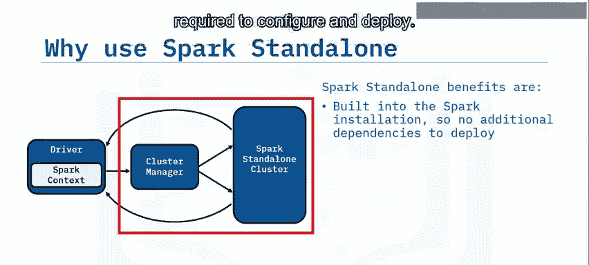

A spark standalone cluster has two main components。 Workers and the master。

 The workers run on cluster nodes。 They start an executor process with one or more reserved cores。

 There must be one master available， which can run on any cluster node。

 It connects workers to the cluster and keeps track of them with heartbeat polling。 However。

 if the master is together with a worker， do not reserve all the node's cores and memory for the worker。

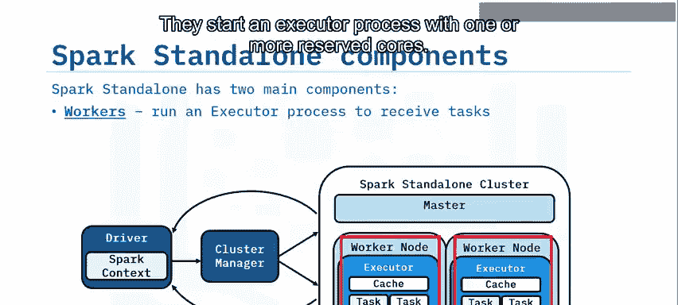

To manually set up a Spk standalone cluster， start the master The master is assigned a URL with a host name and port number After the master is up。

 you can use the master URL to start workers on any node using bidirectional communication with the master once the master and the workers are running you can launch a Spark application on the cluster by specifying the master URL as an argument to connect them to see additional configuration options。

 refer to the Apachepark documentation on the Spk。appache。org website。

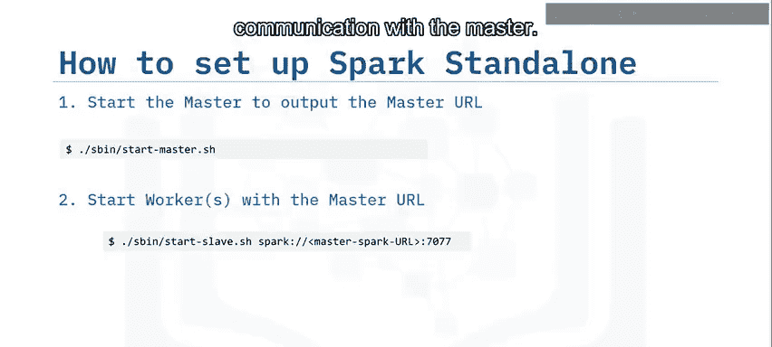

Apache Hadoop yarn is a general purpose cluster manager。

 It's popular in the big data ecosystem and supports many other frameworks。

 beside Spark yarn clusters have their own dependencies set up and configuration requirements。

 So deploying them is more complex than Sp standalone。

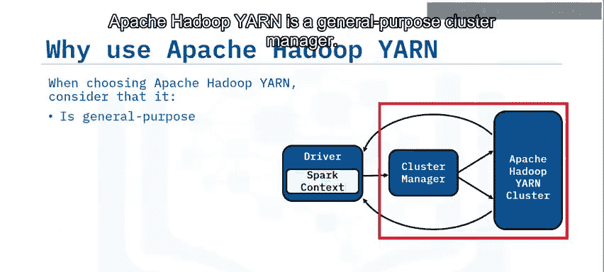

To run Spark on an existing yarn cluster， use the dash dash master option with the keyword yarn。

 When Spark sees that the cluster manager type is yarn。

 it will look for the standard Hadoop configuration files to decide how to connect with the yarn cluster。

 No other configuration from Spark is needed。 Apache mezoos is another general purposepose cluster manager supported by Spark。

 using meszoos has some advantages。 It can provide dynamic partitioning between Spark and other big data frameworks and scalable partitioning between multiple Sp instances。

 However， running Spark on Apache mezoos might require some additional setup depending on your configuration requirements。

 More details are provided on the Spark do Apache do org website at the link shown here。😊。

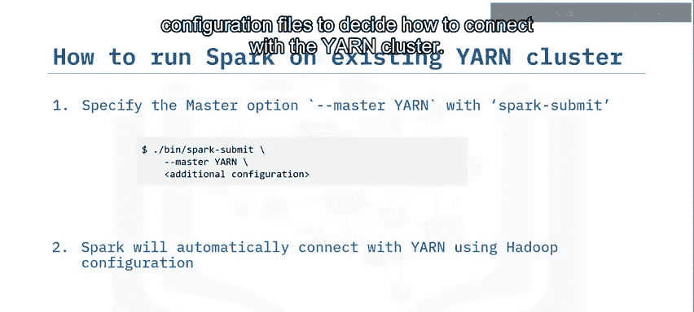

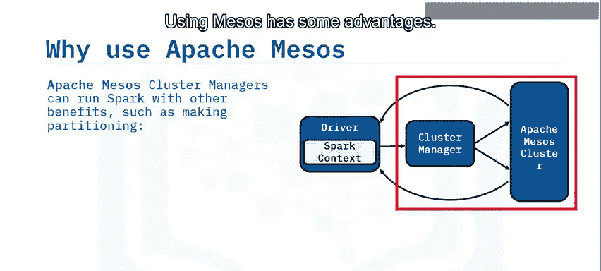

A Kubernetes cluster runs containerized applications。

 This makes Spark applications more portable and helps automate deployment。

 simplifyimpl dependency management and scale the cluster as needed。

 Spark uses a built in native Kubernetes scheduler。

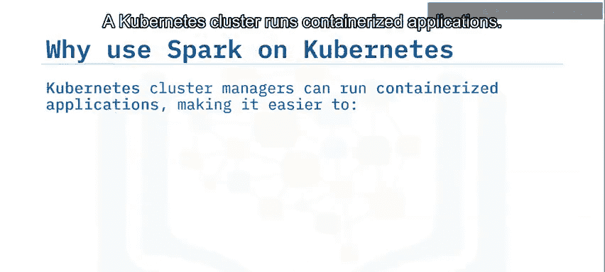

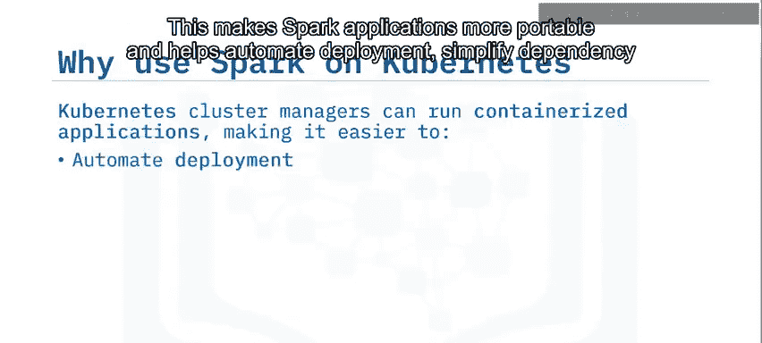

To run Spark on Kubernetes， use the example call shown。

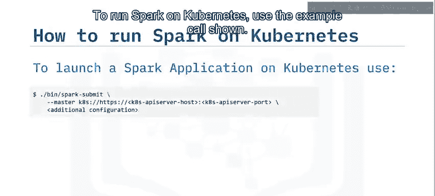

Local mode runs a spark application as a single process locally on the machine。

 Executors are run as separate threads in the main process that cause Spar dash submit。

 Local mode does not connect to any cluster or require configuration outside a basic spark installation。

 Local mode can be run on a laptop。 That's useful for testing or debugging a spark application。

 For example， testing a small data subset to verify correctness before running the application on a cluster。

 However， being constrained by a single process means local mode is not designed for optimal performance。

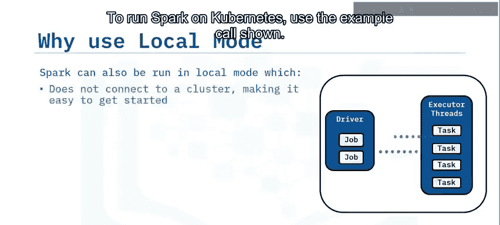

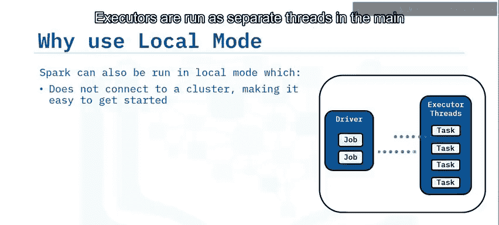

To run in local mode， use the dash dash master option with the keyword Local。

 followed by a number to indicate how many cores the Spark application can use for the executor to use all available core。

 replace the number with an asterisk wild card Keep in mind not all configuration for a cluster will be valid in local mode。

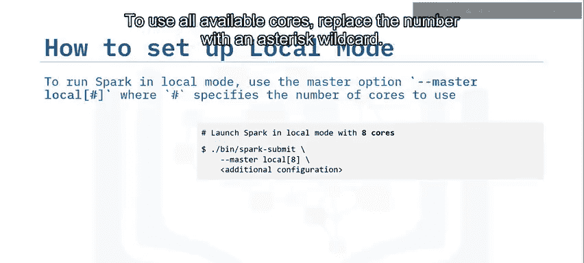

In this video， you learned that cluster managers acquire resources and run as an abstracted service outside the application。

 Spark can run on Spk standalone。 Apache Hadoop yarn。

 Apache mezoos or Kubernetes cluster managers with specific setup requirements。

 choosinging a cluster manager depends on your data ecosystem and factors such as ease of configuration。

 Portability， deployment or data partitioning needs。 Spark can run in local mode。

 useful for testing or debugging an application。😊。

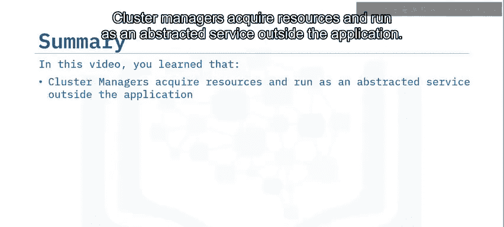

