# IBM数据工程专业证书 课程11：《使用Spark和Hadoop进行大数据介绍》｜big-data-with-spark-hadoop｜ - P27：26_如何运行 apache spark 应用程序.zh_en - GPT中英字幕课程资源 - BV12h4y1D7hF

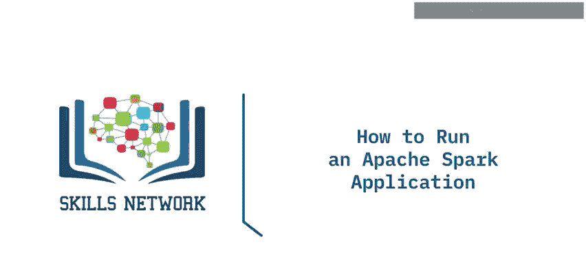

Welcome to how to Run an Apache Spark application。

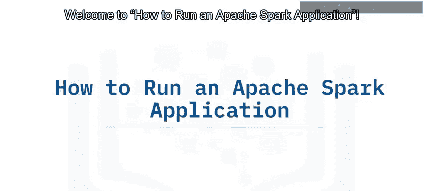

After watching this video， you will be able to describe how to submit an Apache Spark application。

 Ex the characteristics of Spark's unified interface。 Spark dash submitmit。

 Describe and apply the options you can use to submit applications。

 Describe ways of managing external application dependencies。

 Describe the benefits of using Spark shellll to run applications。😊。

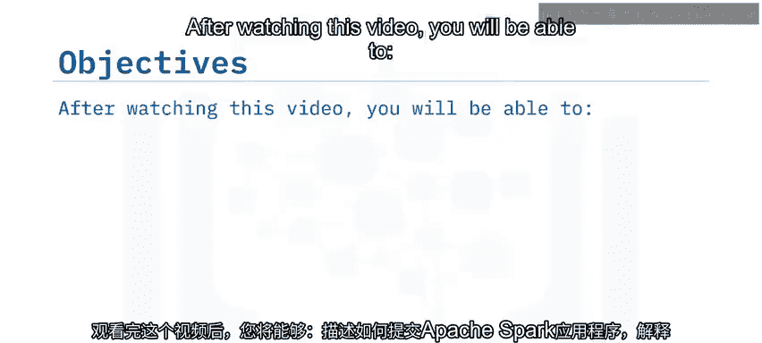

Spark comes with a unified interface for submitting applications。

 It's the Spark dash submit script found in the B directory。

 Spark dash Sub can be used for all supported cluster types and accepts many configuration options for the application or cluster。

 Unified interface means you can switch from running Spark in local mode to cluster by changing a single argument。

 Spark dash Sub works the same way。 No matter the application language。 For example。

 a cluster can run Python and Java applications simultaneously by passing in the required files。😊。

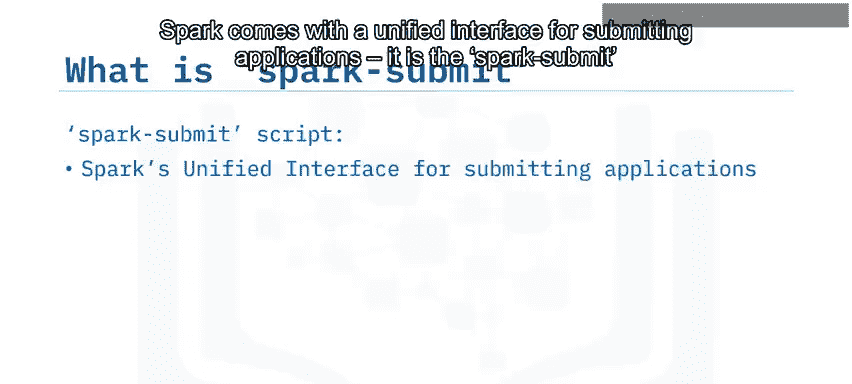

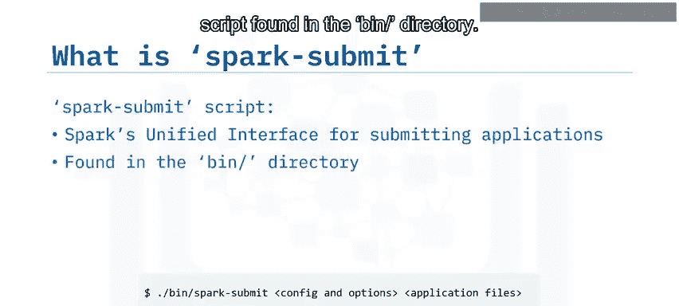

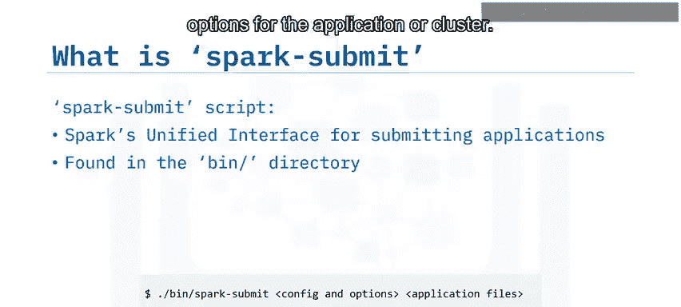

The Spark dash submit script first pares any command line arguments or options。

 Then it reads any additional configuration specified in the Spark dash defaults folder。 Next。

 the dash dash master argument tells the application how to connect to the cluster or run locally。

 Any application files。 including jars or Python files must be specified so they can start the driver program and distribute files to run in the cluster。

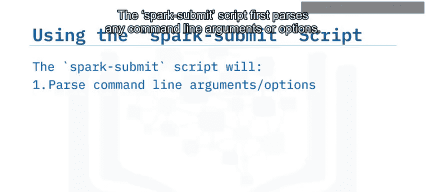

Some Spk dash submit options are mandatory， such as specifying the master option to tell Spark which cluster manager to connect to if the application is written in Java or Scala and packaged in a jar。

 you must specify the full class name of the program entry point。

 Other options include driver deploy mode， run as a client or in the cluster and execute a resource settings such as reserving memory or course。

 driver deploy mode， defaults to client mode， some options relate to specific cluster managers。

Additional spark configuration can be specified on the command line using the dash dash conf argument。

 followed by key equals value for Java or Scala and Python Fi arguments will be the path to the application jar or Python script。

 Next or optional application specific arguments。 These will automatically be passed in。

 You can add Python files with dot pi dot egg or dot zip using the dash dash pi dash files argument。

 These files will be distributed to the cluster and available in the Python environment。

Let's look at two Spar dash submit examples。 The first launches Sp Pi written in Scala and packaged in a jar。

 Yrn is the master。 The application uses an additional argument。

 How many samples to take in the cluster to compute Pi。

 The second example launches a spark Pi Python version， The master is a spark standalone cluster。

 and we simply pass the path to the Python script。

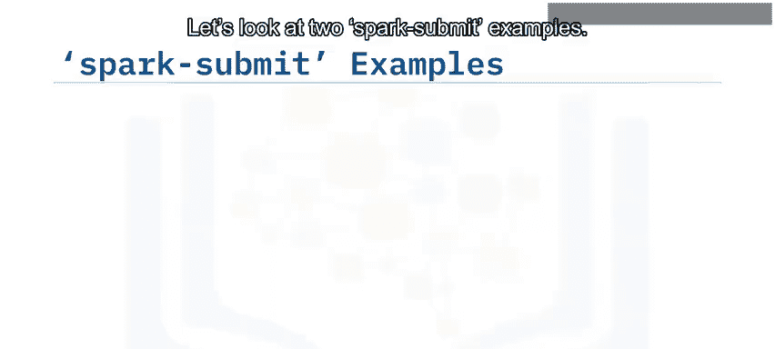

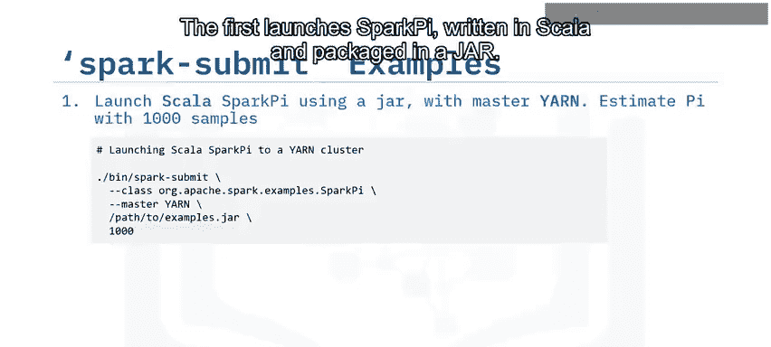

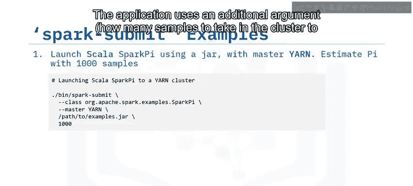

To manage Sp dependencies， the application project or library must be accessible for the driver and cluster executor processes for a Java or a scala based application。

 it's best to create an Uber jar。 This is a single jar file with all dependencies。

 including transitive ones， So the application is portable throughout the cluster。

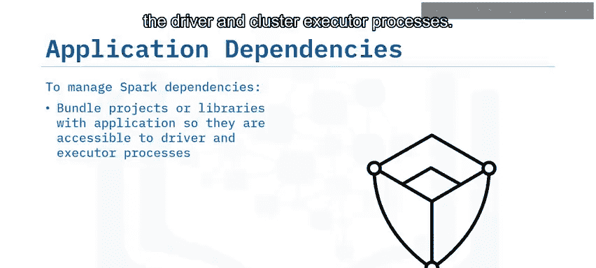

For Python applications， ensure that one， the cluster nodes access required dependencies with the same version and two。

 the same Python version is used。 solutions for Python dependencies may involve creating virtual environments so that applications can run in separate isolated environments。

 Python dependencies can be included in the Spark dash Sub script using the dash dash p dash files argument。

 This will accept dot pi dot zipip or dot egg files。

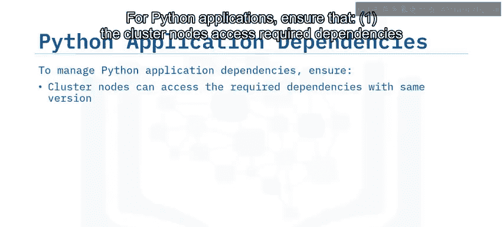

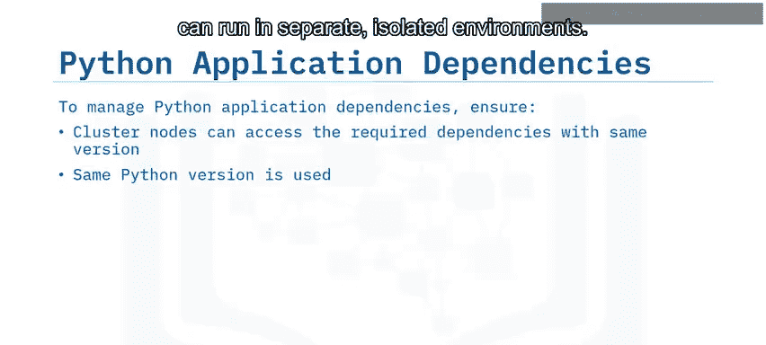

Spark Shell is available for Scala and Python， giving you access to Spark APIs for working with data as Spar jobs。

 Spark Shell can be used in local or cluster mode with all options available。

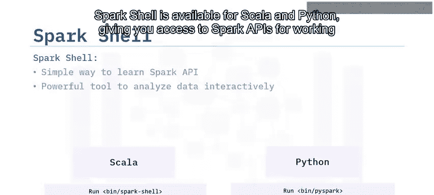

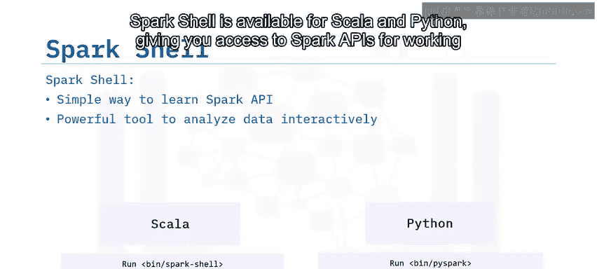

When Spark shellll starts， the environment automatically initializes the Sp context and spark session variables。

 This means you can start working with data immediately。

 Expresss are entered in the shell and evaluated in the driver。

 entering an action on a shell data frame generate spark jobs that are sent to the cluster to be scheduled as tasks。

This example shows the Spark Sch shell starting up in local mode。

The printout includes Sparks load log in the log 4 Jdefaults。 propertiesperties file。

 Sparks web UI address displaying running jobs in the shell。

 variable names for the initialized Spark context and Spark session and version information for important libraries like JDK and Sca。

This example shows running code in the Sch shell In the first line。

 a data frame is created as a distributed range of integers from 0 to 9。

 The second line transforms the data frame， adding a column calculating the modulo of two Next is an action that prints out the first four records of the resulting data frame。

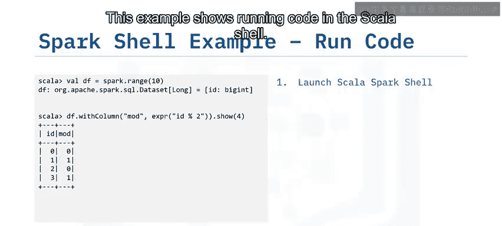

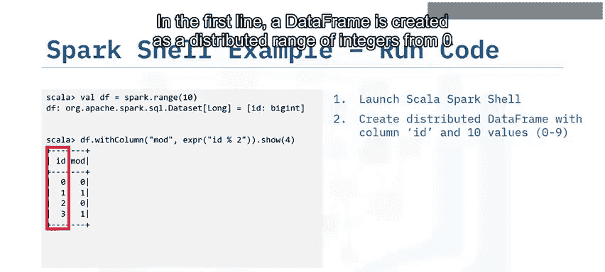

In this video， you learned that Spark Sububmit is a unified interface to submit the Spark application。

 no matter the cluster manager or application language。

 mandatory options include telling Spark which cluster manager to connect to other options set driver deploy mode or Executor resourcing to manage dependencies。

 application projects or libraries must be accessible for driver and executor processes， for example。

 by creating a Java or Scala Uber jar Sparkhell simplifies working with data by automatically initializing the Spk context and Spark session variables and providing Spark API access。

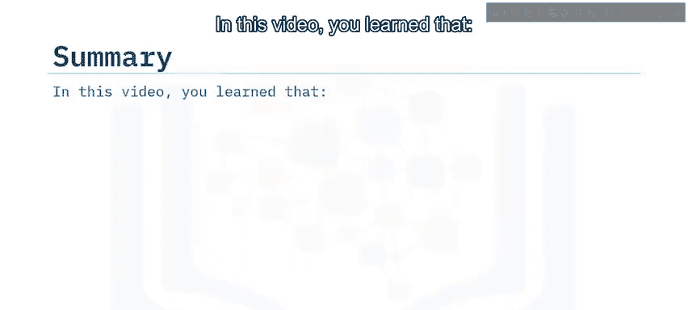

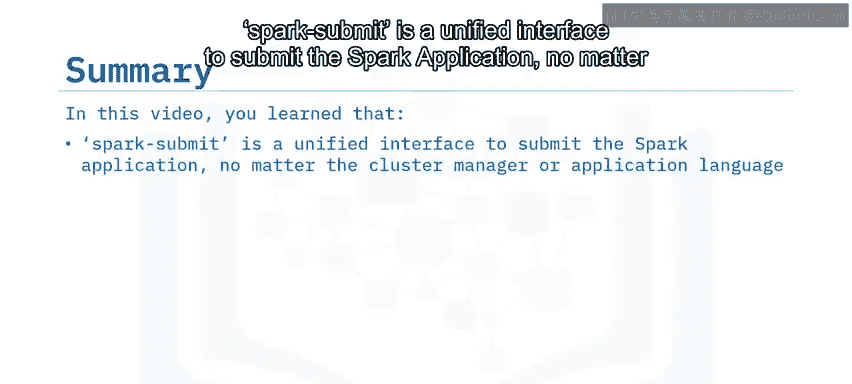

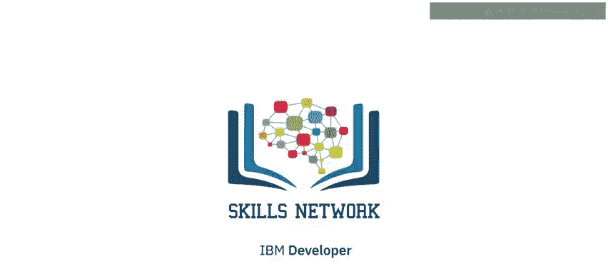