# IBM数据工程专业证书 课程11：《使用Spark和Hadoop进行大数据介绍》｜big-data-with-spark-hadoop｜ - P28：27_在 ibm 云上使用 apache spark.zh_en - GPT中英字幕课程资源 - BV12h4y1D7hF

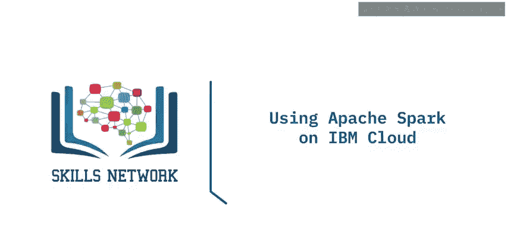

Welcome to U Apache Spark on IBM Cloud。

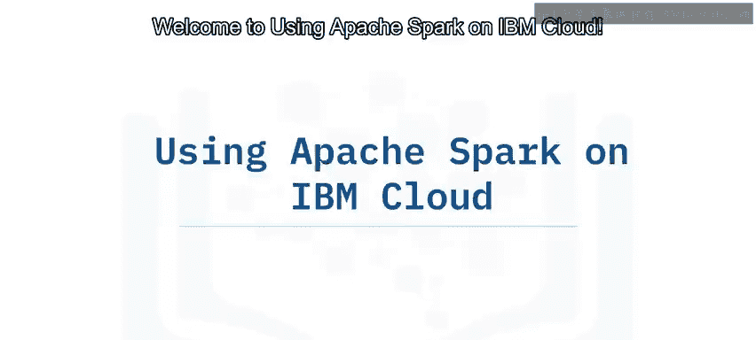

After watching this video， you'll be able to list the benefits of using Apache Spark on IBM Cloud。

 Def AI ops and describe how Spark can be used within AI ops。

 Describe how to use Spark with IBM Spectrum conductor， IBM Watson and the IBM Analytic engine。

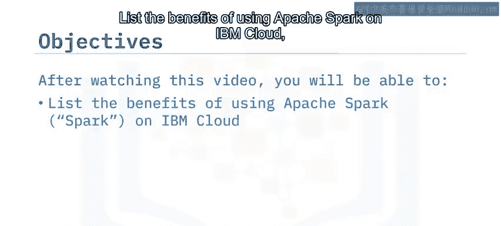

You can run Spark on a local cluster or a cloud。 However。

 it may be difficult to configure nodes in a local cluster so that they are visible and communicate properly。

 Running Spark on a cloud streamlines deployment by using preexisting default configuration。

 This makes it easy to scale up the cluster to add nodes and increase compute power as needed。

 Different cloud providers support runningning Spk on a variety of cluster managers。

 Running Spark on an IBM cloud brings added benefits。 It provides enterprise grade security。

 You can also tie into existing IBM big data solutions for AI ops and applications for IBM Watson and the IBM analytics engine。

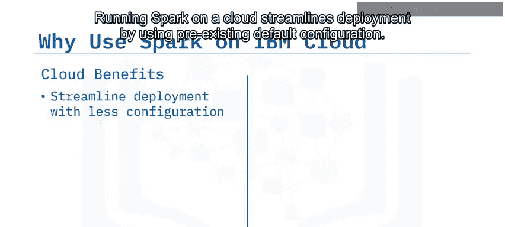

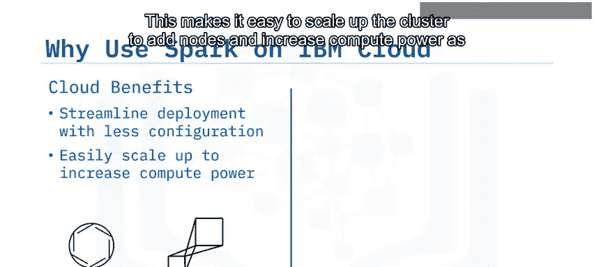

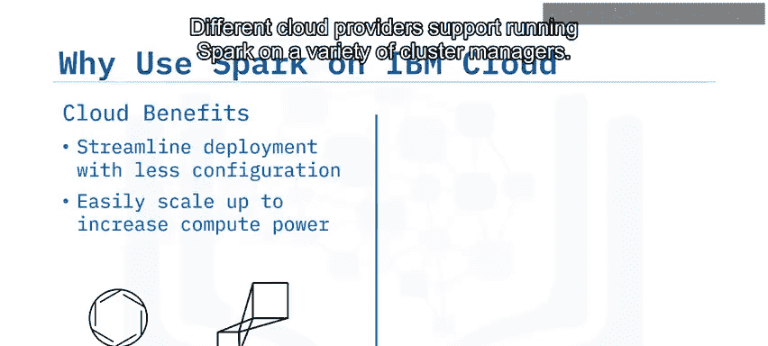

AIOs means applying artificial intelligence to automate or enhance IT operations AIOs helps you collect。

 aggregate and work with large volumes of operations data。

 identify events and patterns in large or complex infrastructure systems。

 quickly diagnose the root causes of issues so you can report or fix them automatically。

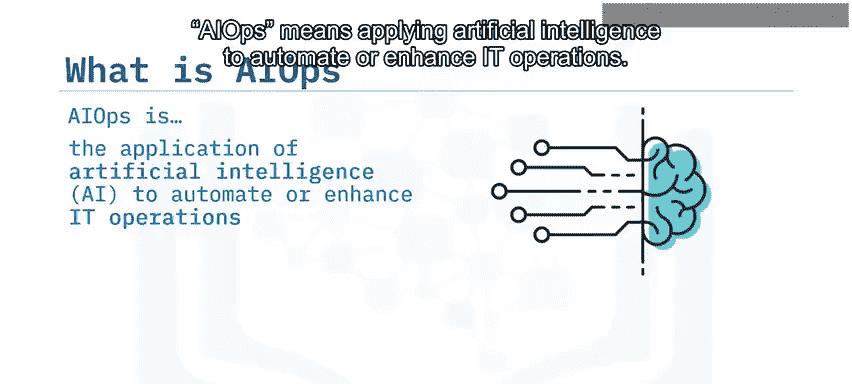

Spark is particularly well suited for big data analytics。

 It is ideal for processing large volumes of infrastructure data and applying machine learning to predict or identify operational issues。

 IBM CloudpackC for Watson AIOs offer solutions with Spark that can correlate data across your operations tool chain to bring insights or identify issues in real time Exles could include data insights about tool availability。

 performance or outages。

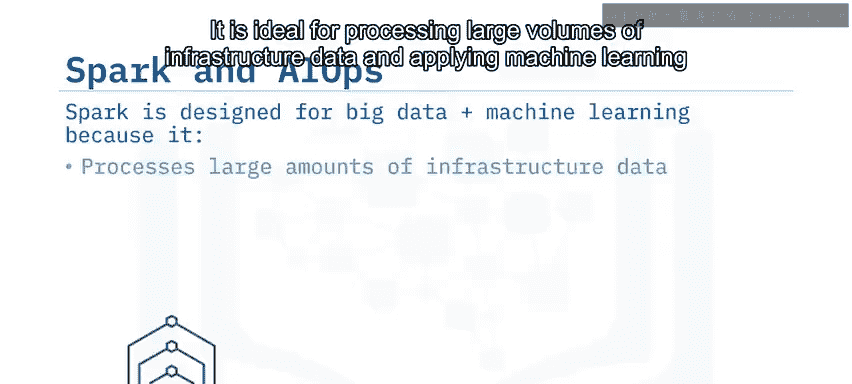

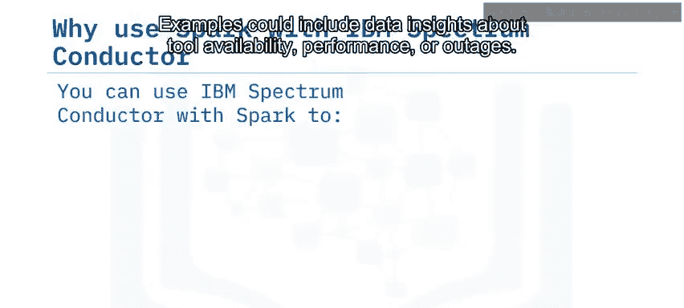

IBM spectrumrum conductor is a multi tenant platform for deploying and managing Spar and other frameworks on a cluster with shared resources。

 This enables multiple spark applications and versions to be run together on a single large cluster。

 cluster resources can be divided up dynamically， avoiding downtime。

 IBM spectrum conductor also provides Sp with enterprise grade security。

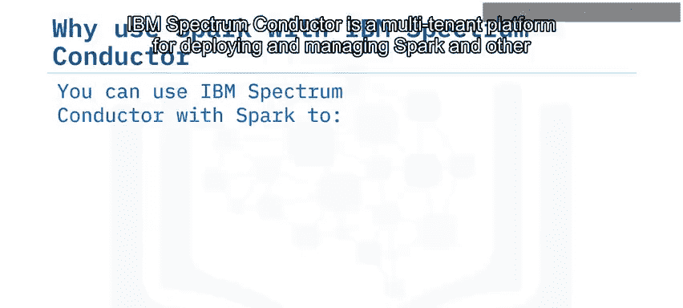

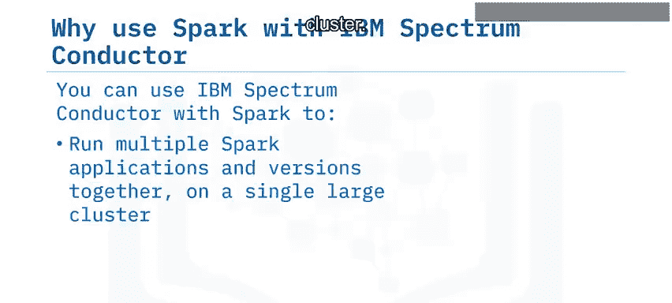

IBM Watson helps create production ready environments for AI and machine learning by providing services。

 support and holistic workflows。 reducinging setup and maintenance saves time so you can concentrate on training Sp to enhance its machine learning capabilities。

 IBM analytics engine works with Spark to provide a flexible scalable analytics solution。

 It uses an Apache Hadoop cluster framework to separate storage and compute by storing data in object storage such as IBM Cloud object storage。

 This means you only need to run compute nodes when needed。

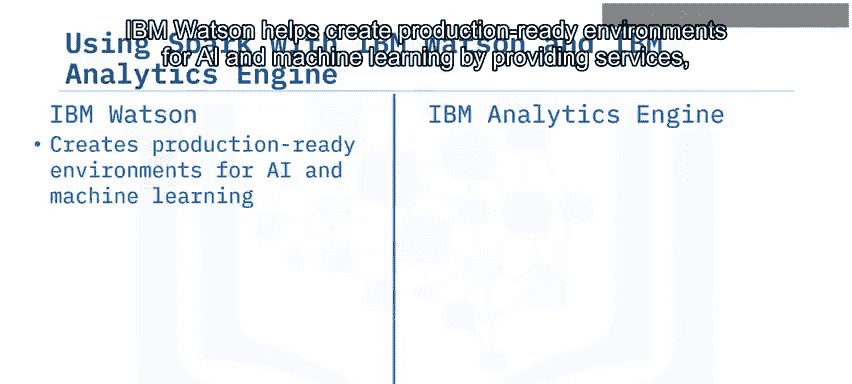

In this video， you learned that runningning Spark on IBM Cloud provides enterprise security and easily ties in IBM big data solutions for AI ops。

 IBM Watson and the IBM analytics engine。 AIOs tools such as IBM Watson use AI to automate or enhance IT operations。

 Spark's big data processing capabilities work well with AIOs tools using machine learning to identify events or patterns and help report or fix issues。

 IBM Spec conductor manages and deploys Spark resources dynamically on a single cluster and provides enterprise security。

 IBM Watson helps you focus on Sparks machine learning capabilities by creating production ready environments for AI IBM analytics engine。

 separate storage and compute to create a scalable analytics solution alongside Sparks data processing capabilities。

😊。

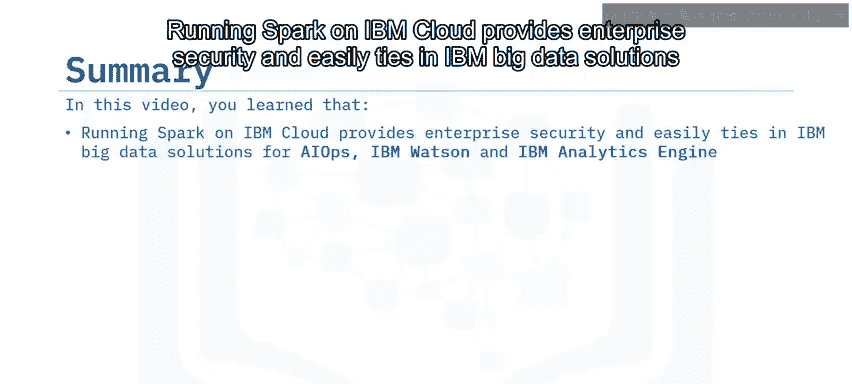

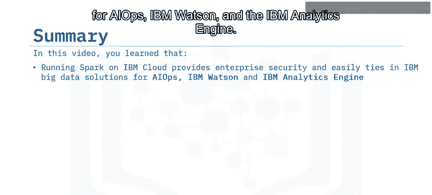

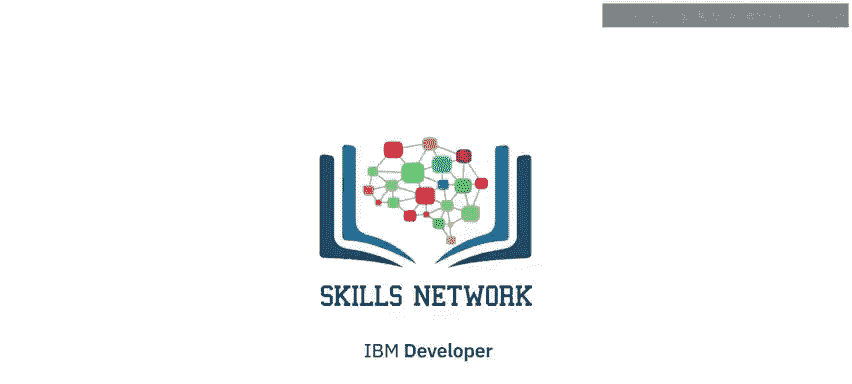