# IBM数据工程专业证书 课程11：《使用Spark和Hadoop进行大数据介绍》｜big-data-with-spark-hadoop｜ - P29：28_设置 apache spark 配置.zh_en - GPT中英字幕课程资源 - BV12h4y1D7hF

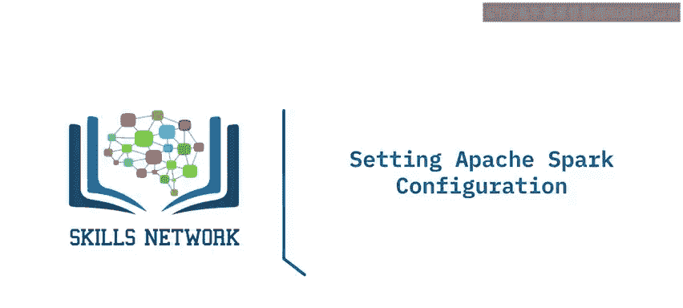

Welcome to Setting Apache Spark Con。

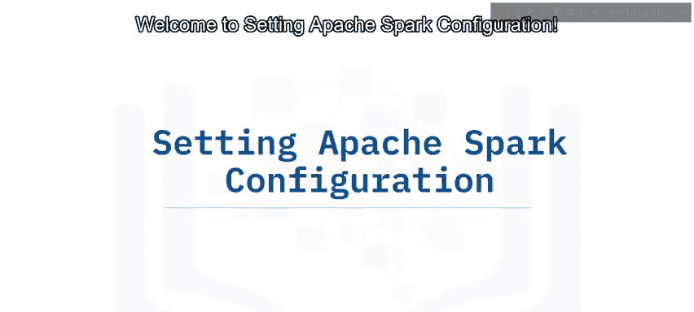

After watching this video， you will be able to describe the configuration types of an Apache Spark application。

 explain the purpose and common options for each configuration type。

 describe when to use static or dynamic configuration。

You can configure a Sp application using three different methods， properties。

 environmentron variables， or logging configuration you can set Spark properties to adjust and control most application behaviors。

 including setting properties with the driver and sharing them with the cluster Enron variables are loaded on each machine。

 so they can be adjusted on a per machine basis if hardware or installed software differs between the cluster nodes。

 Spark logging is controlled by the log4J defaults file which dictates what level of messages such as info or errors are logged to file or output to the driver during application execution。

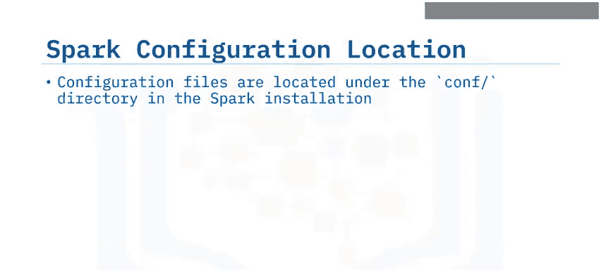

Spark configuration files are located under the Kf directory in the installation by default。

 There are no preexisting files after installation。 However。

 Spark provides a template for each configuration type with the file names shown here。

 You can create the appropriate file by removing the dot template extension inside the template files or sample configurations for common settings。

 You can enable them by uncommenting。You can configure Spk properties in a few different ways in the driver program。

 you can set the configuration programmatically when creating the Spark session or by using a separate Spk conf object that is then passed into the session Conor Pro can be set in a configuration file found at conf/parkdefaults。

com properties can also be set when launching the application with Spkubmit either by using provided options such as dashma or using the option with a key value pair。

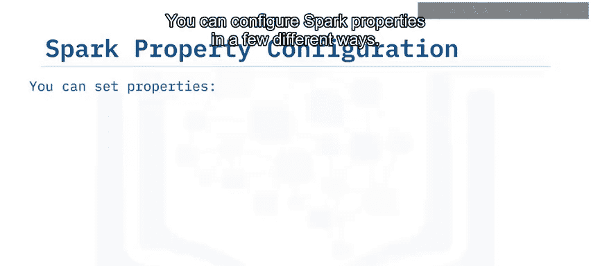

Because spark properties can be set in different ways。

 Let's look at how they are merged to build the final configuration for the application。

 The configuration set programmatically takes the highest precedence。

 This means that if a configuration is already been set elsewhere or programmed into the application。

 it will be overwritten。 Next is the configuration provided with the Spark dash submit script。

 Last is any configuration set in the Spk dash default dot cont file。

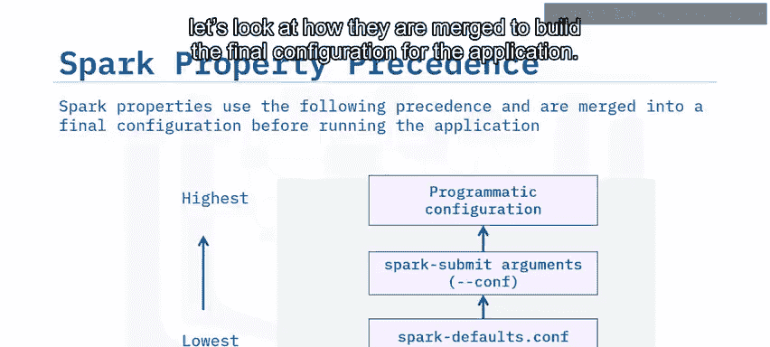

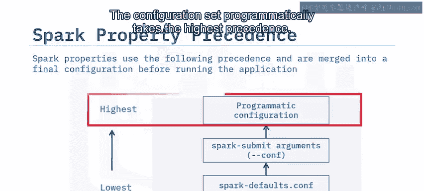

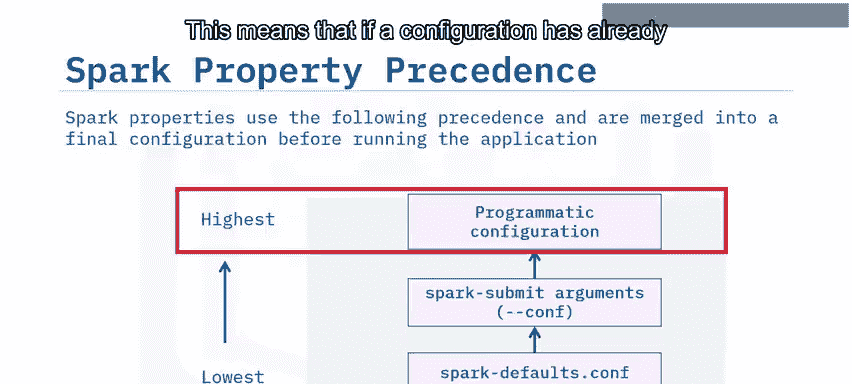

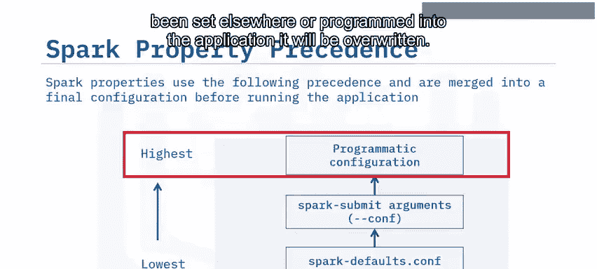

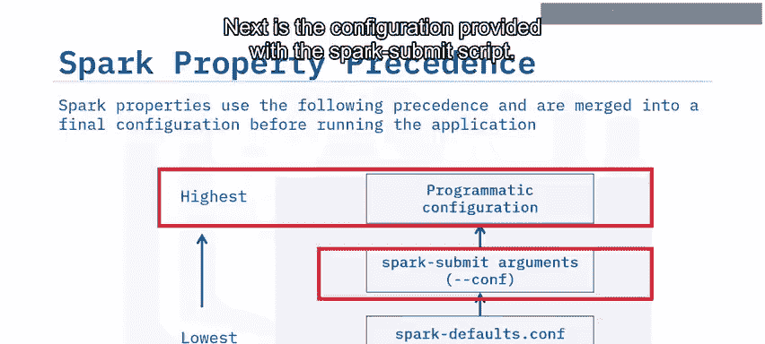

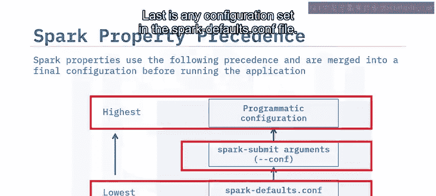

Statatic configuration refers to settings that are written programmatically into the application itself。

 These settings are not usually changed because it requires modifying the application itself。

 Use static configuration for something that is unlikely to be changed or tweaked between application runs。

 such as application name or other properties related to the application only。 For example。

 you would not use static configuration when it depends on what type of cluster or resource requirements are available。

 The example here sets the application name property。

 and there is an additional configuration to set the maximum result size and the driver to two gigaby。

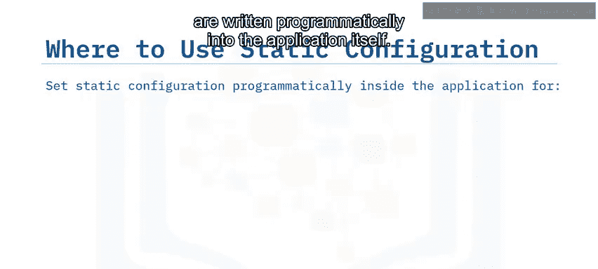

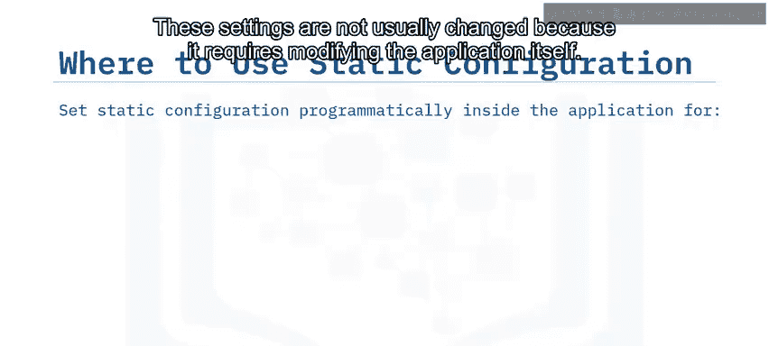

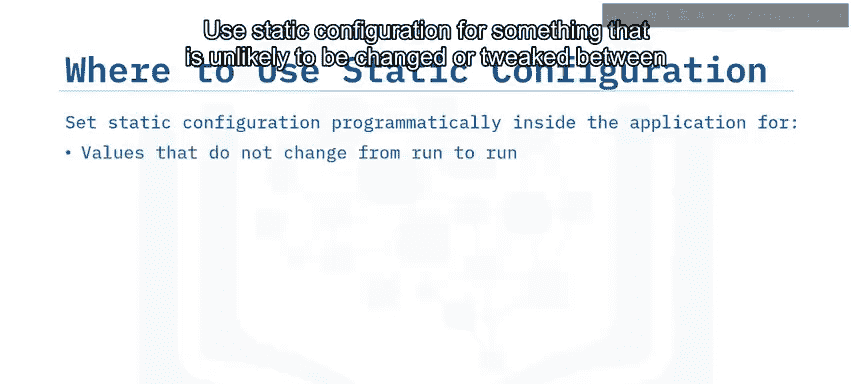

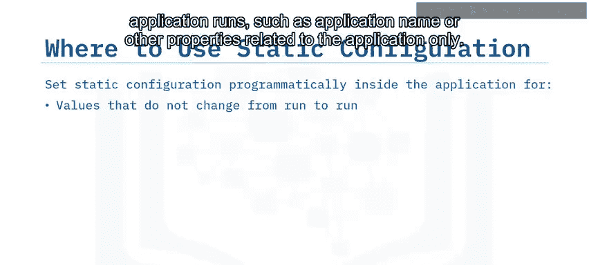

Spark dynamic configuration is useful to avoid hard coding specific values in the application itself This is usually done for configurations such as the master location so that the application can be launched on a cluster by simply changing the master location Other examples include setting dynamically。

 how many cores are used or how much memory is reserved by each executor so that they can be properly tuned for whatever cluster the application is run on。

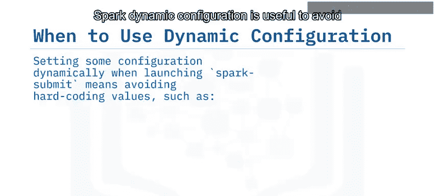

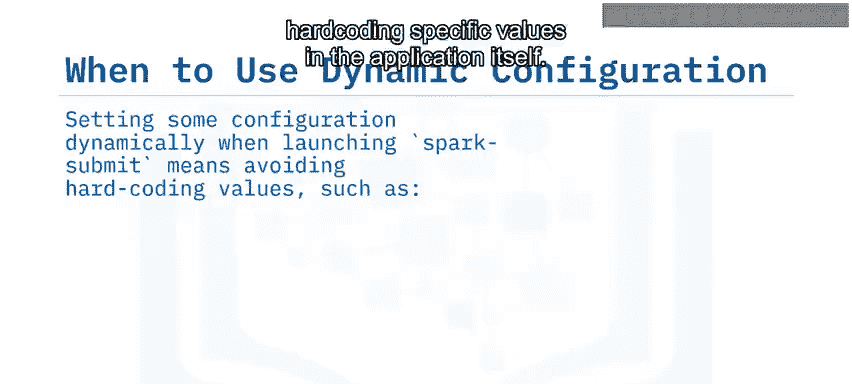

Spark Enron variables are loaded from the filef/parkv。

sH These are loaded from each machine in the cluster when a sparkark process is started since these can be loaded differently for each machine。

 it can help configure specifics on a per machine basis。

 a common usage is to ensure each machine in the cluster uses the same Python executable by setting the P Spk_ Python environmentron variable。

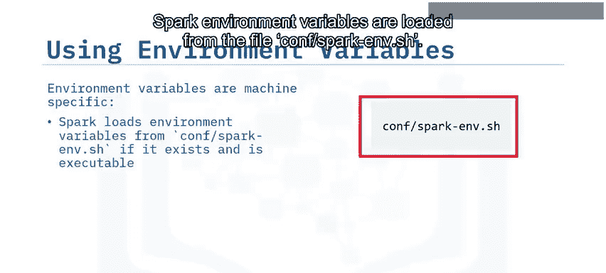

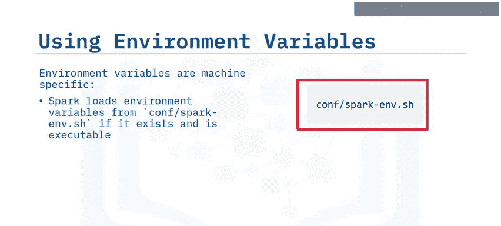

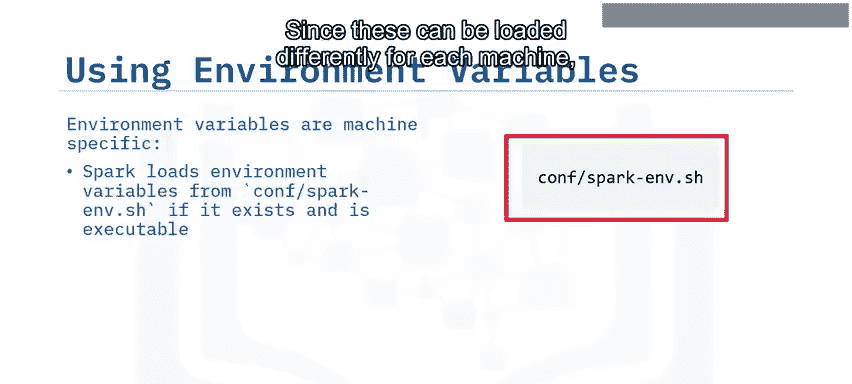

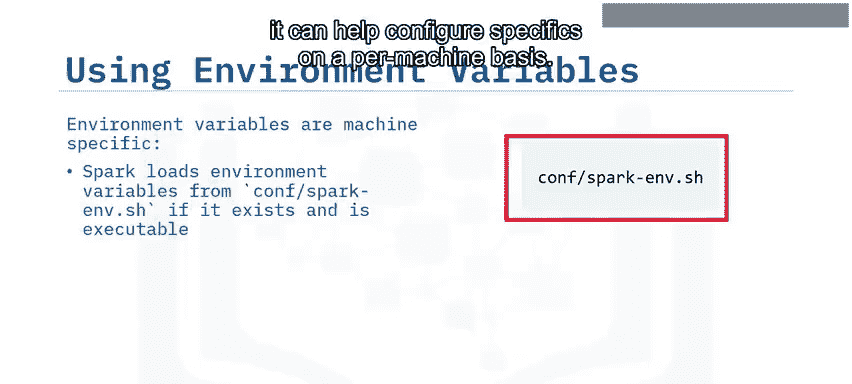

Spark logging is controlled using log 4J and the configuration is read through/ log 4j properties here you can adjust a log level to determine which messages such as debug。

 info or errors are shown in the Spark logs Lo 4j allows the configuration to set where the logs are sent to and adjust specific components of Spark or thirdpart libraries。

In this video， you learned that you can set Sp configuration using properties to control application behavior。

 environment variables to adjust settings on a per machine basis or logging properties to control logging outputs。

Spark propertyper configuration follows a precedence order with the highest being configuration set programmatically。

 then Spar submitm configuration， and lastly， configuration set in the Spark dash defaults file Sta configuration should be used for values that don't change from Run to run。

 or properties related to the application such as application name。

 dynamicy configuration should be used for values that change or need tuning when deployed。

 such as master location， Executor memory or Co settings。

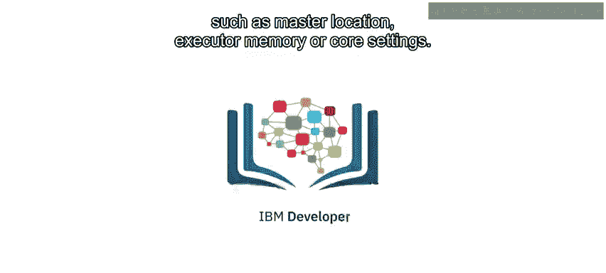