# IBM数据工程专业证书 课程11：《使用Spark和Hadoop进行大数据介绍》｜big-data-with-spark-hadoop｜ - P30：29_在 kubernetes 上运行 spark.zh_en - GPT中英字幕课程资源 - BV12h4y1D7hF

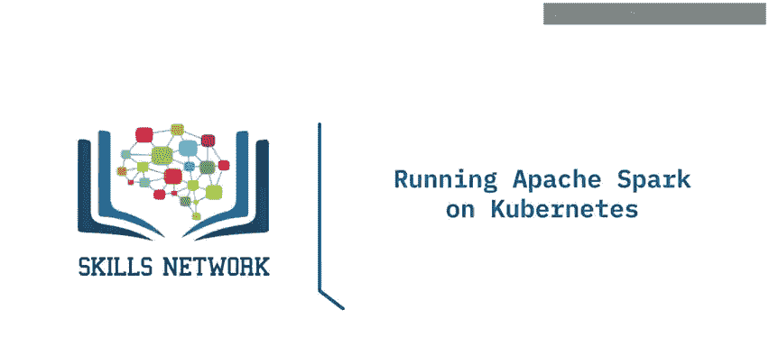

Welcome to Running Apache Spark on Kubernetes。

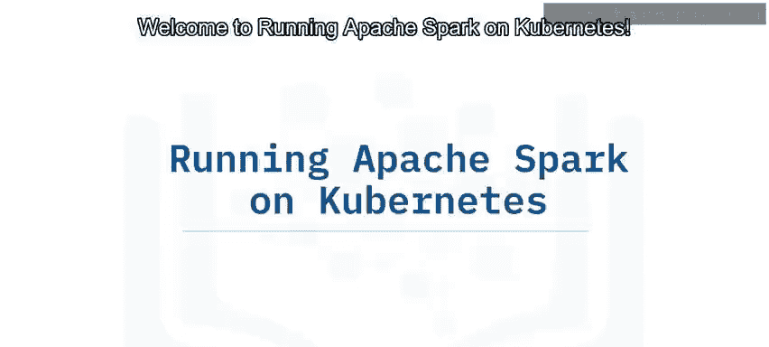

After watching this video， you'll be able to describe when and why Kubernetes is used。

 describe how to run Kubernetes locally versus hosted on the cloud。

 Ex how to run Apache Spark on Kubernetes。

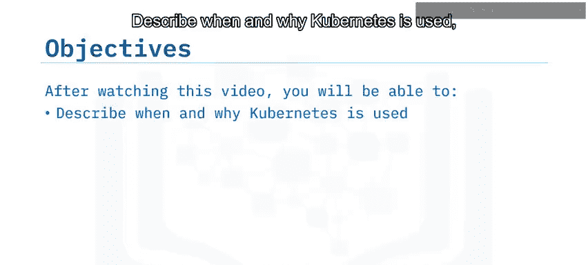

Kubernetes also abbreviated as K8S is a popular framework for running containerized applications on a cluster。

 It's an open source system that is highly scalable and provides flexible deployments to the cluster。

 Kubernetes is portable， so it can be run in the same way。

 whether you are running it in the cloud or on premises。

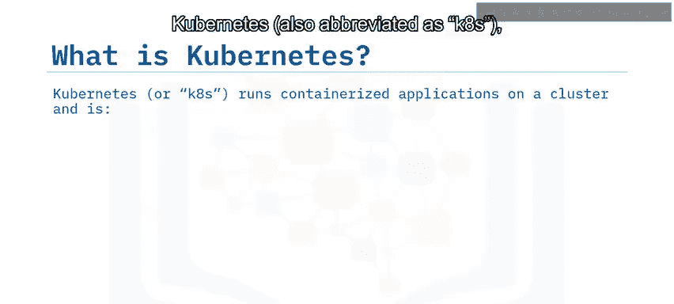

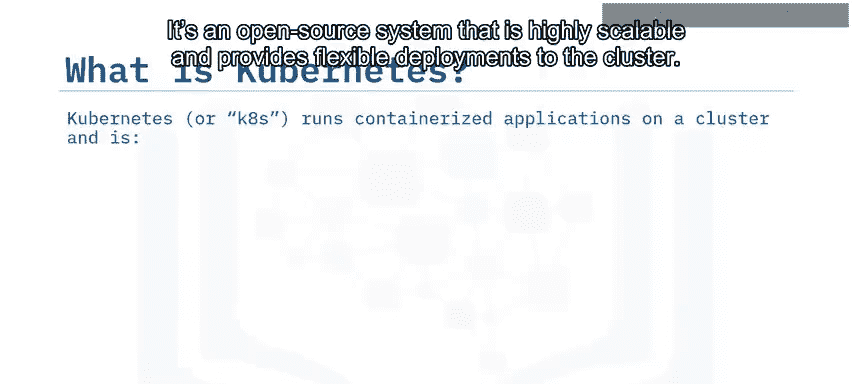

Kubernetes is used to manage containers that run distributed systems such as Spk in a more flexible and resilient way。

 It provides flexibility in the way cluster resources are used and is more resilient if an application errors out or nodes fail。

 Kubernetes has many benefits， including network service discovery and cluster load balancing。

 Automating scale up and down of systems on the cluster。

 making the cluster easier to manage with maximum uptime。

 orchestrating storage to make better use of what is available。

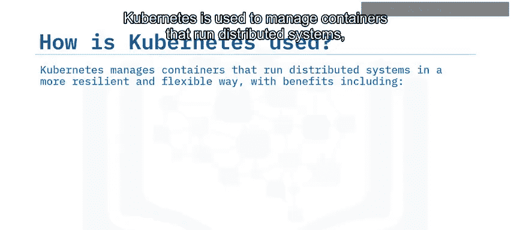

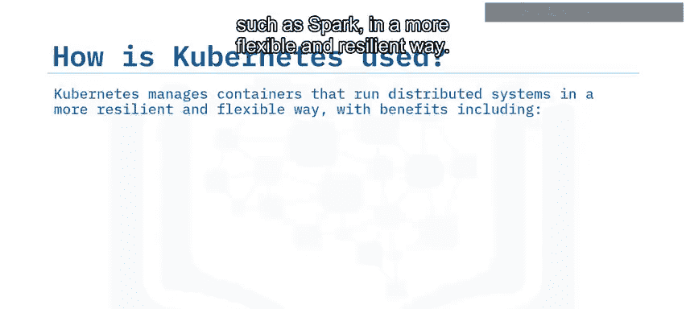

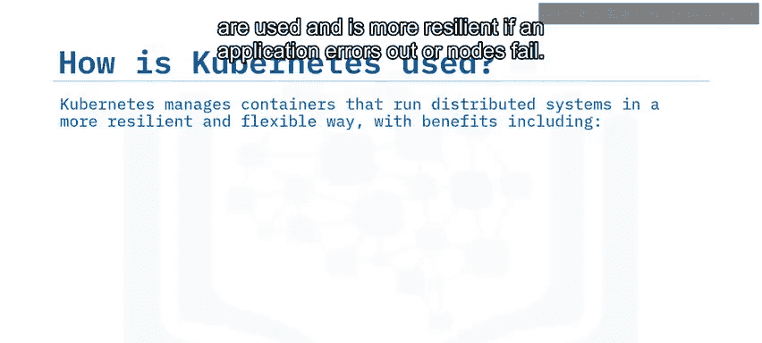

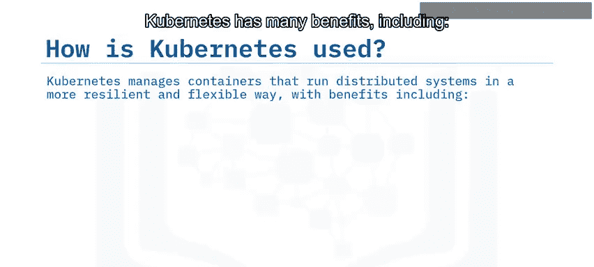

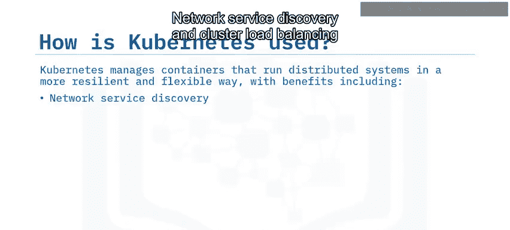

While Kubernetes is designed to work on a cluster， it also supports being hosted locally on a single machine。

 you can try out a locally hosted Kubernetes cluster setting it up using tools such as minicube。

 This is commonly used as a development environment， enabling you to apply changes locally first。

 and test before putting them into production on a cluster in the cloud。

 containerization means that applications run the same way locally as they would on the cluster。

 hence you can identify and resolve any issues more quickly and easily。

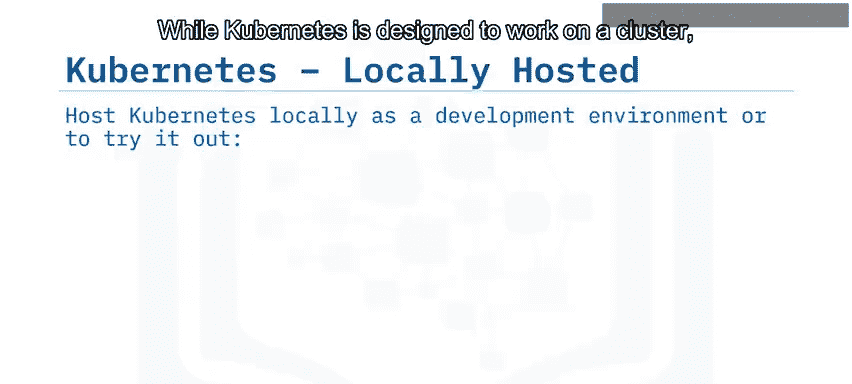

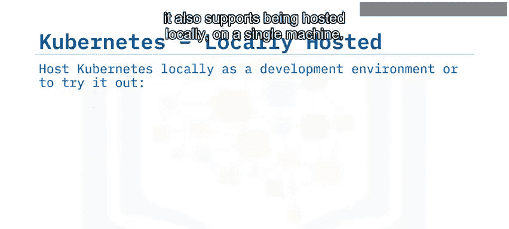

Running a Kubernetes cluster on a cloud is a good choice for production environments because of the ease of deployment and flexibility it provides。

 there are two ways to get started with Kubernetes on the cloud。

 you can use existing tools to bootstrap the cluster and get the necessary components in placeAlternatively。

 use a certified Kubernetes provider with a turnkey option to accelerate getting a Kubernetes cluster up。

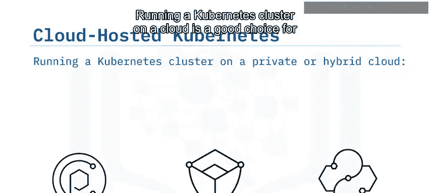

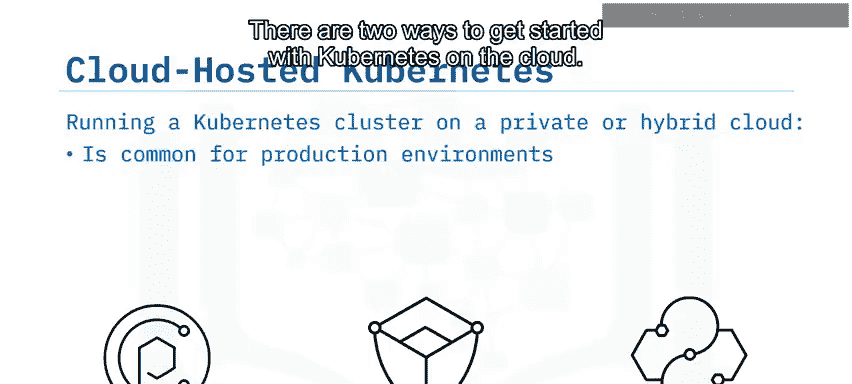

Spark version 2。3 and above can be run on top of Kubernetes as an alternative deployment mode when submitting a Spark application using Spark on Kubernetes comes with some very useful benefits。

 containerization means sparkark applications are more portable。

 It makes it easier to manage dependencies and set up the required environment throughout the cluster。

 Conization supports better resource sharing。 Multi Sp applications running concurrently can easily share the available resources and run in isolation of each other。

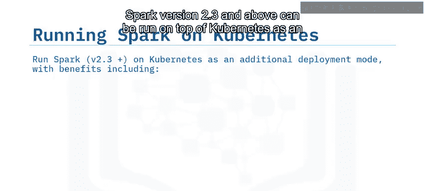

To submit a Sp application to a Kubernetes cluster。

 set the dash dash master option to the URL for the Kubernetes API server and port Spark creates a driver which in turn creates executors with both driver and executors running inside Kubernetes pods。

 A pod is a tightly coupled group of containers with shared resources。

 The application can be deployed as client or cluster mode。 However， for client mode。

 some additional considerations are needed。 The executors must be able to communicate and connect with the driver program。

 Use the driver's pod name to set sparkk Kubernetesdriverpod do name。

 This will ensure the executor pods are cleaned up along with the driver pod when the application finishes。

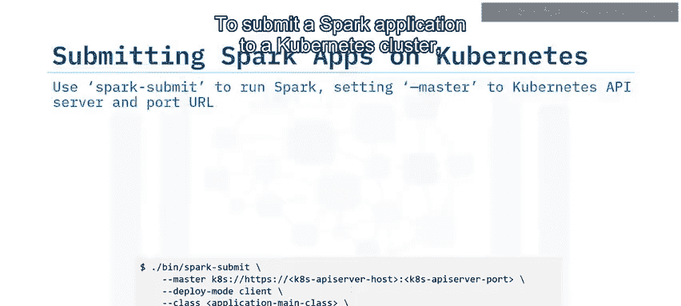

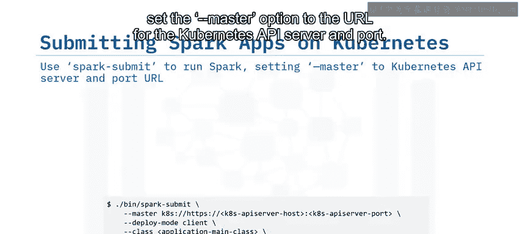

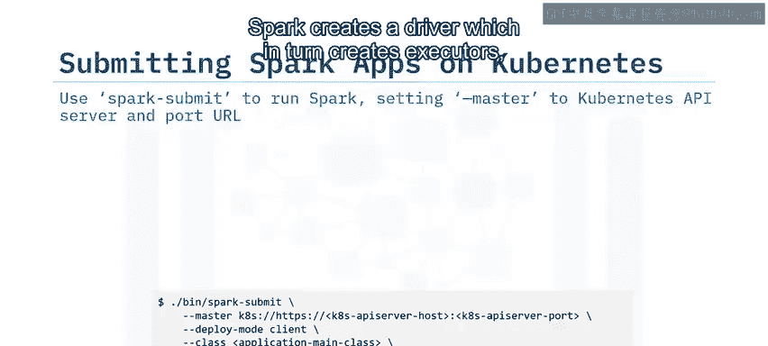

In this video you learned that Kubernetes runs containerized applications on a cluster。

 managing distributed systems such as Spark in a more flexible， resilient way。

 Kubernetes can run locally as a deployment environment useful for trying out changes before deploying to clusters in the cloud Kubernetes can be hosted on private or hybrid clouds set up using existing tools to bootstrap clusters or turnkey options from certified providers while Spark can be launched in client or cluster mode in client mode。

 Executors must be able to connect with the driver and pod cleanup settings are required。

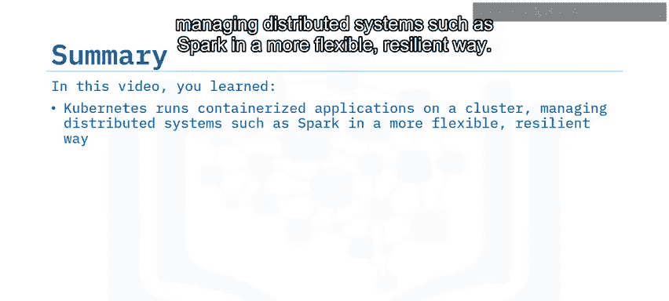

