# IBM数据工程专业证书 课程11：《使用Spark和Hadoop进行大数据介绍》｜big-data-with-spark-hadoop｜ - P33：32_调试 apache spark 应用程序问题.zh_en - GPT中英字幕课程资源 - BV12h4y1D7hF

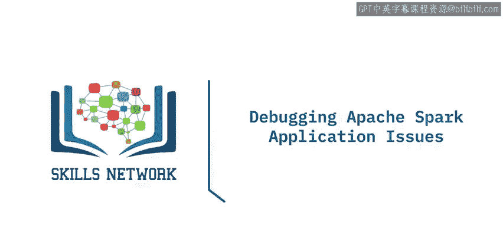

Welcome to debugging Apache Spark A issues。

After watching this video， you'll be able to identify common Apache Spark application issues debug issues through the application UI Describe application log file locations and content runningning a Spar application on a cluster is a complex process with many working parts and many ways in which an application can fail。

 Common reasons for application failure on a cluster include user code。

 system and application configurations， application dependencies that are missing or an incorrect version。

 improper resource allocation and network communication among cluster nodes。

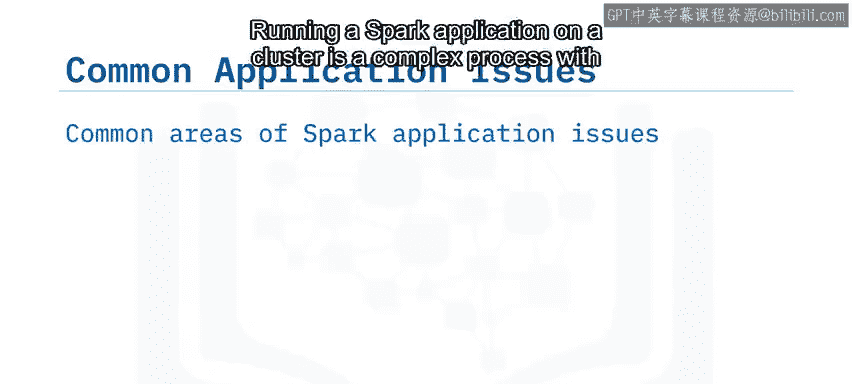

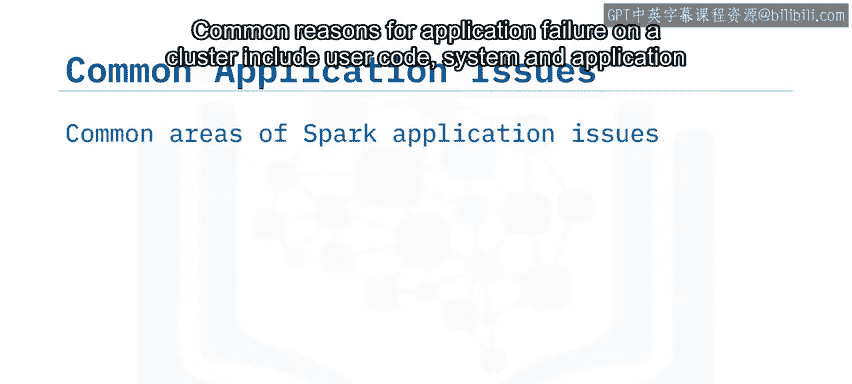

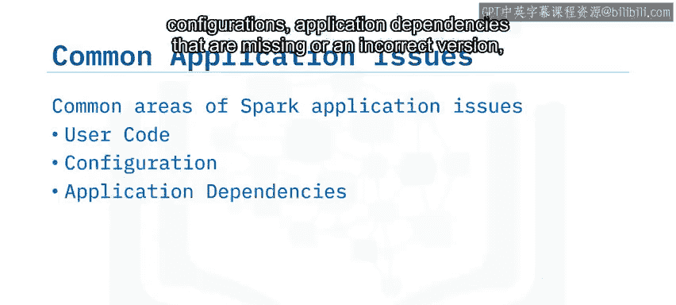

What is user code Use code is made up of the driver program which runs in the driver process and the functions and variables serialize that the executor runs in parallel both the driver and executor processes run the application user code of an application passed to the Spark submit script。

 the user code in the driver creates the spark context and creates jobs based on operations to the data frames。

 these data frame operations become serialized closures sent throughout the cluster and run on Executor processes as tasks。

 the serialized closures contain the necessary functions。

 classes and variables needed to run each task。

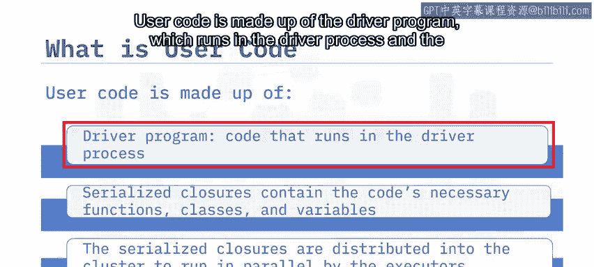

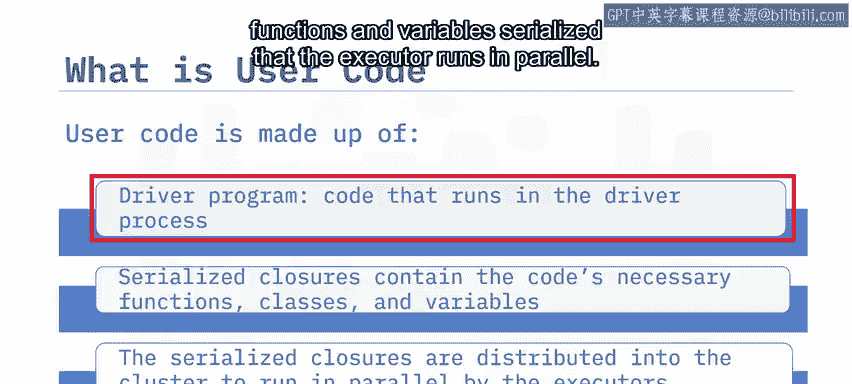

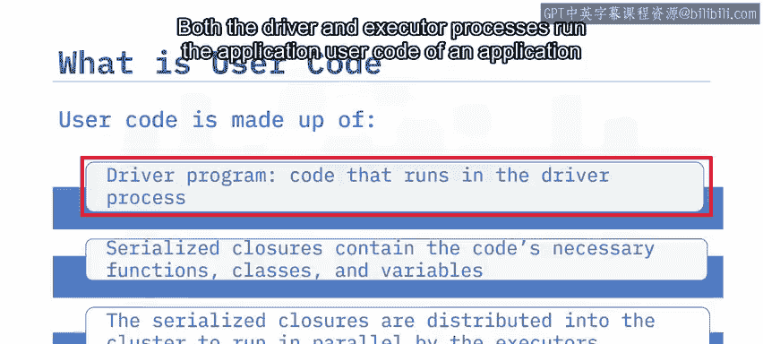

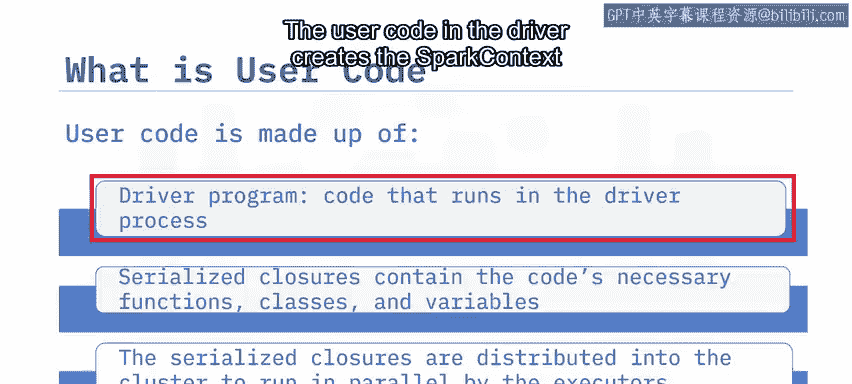

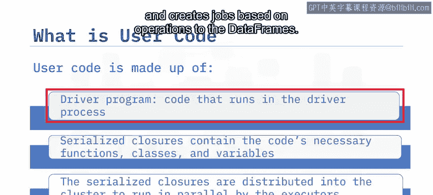

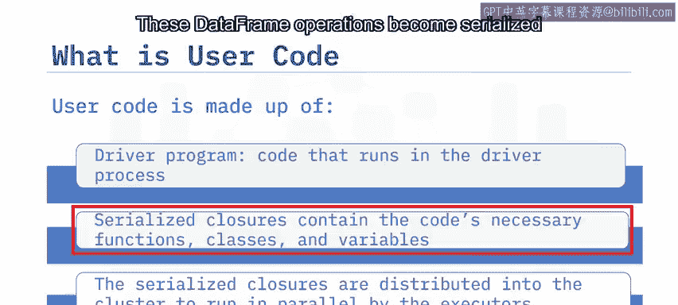

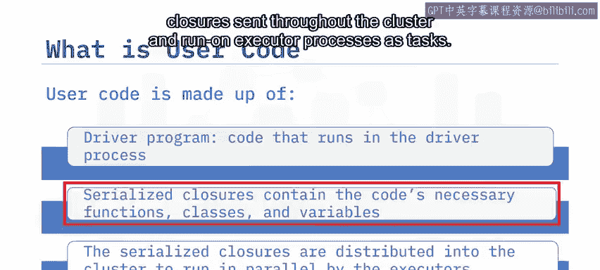

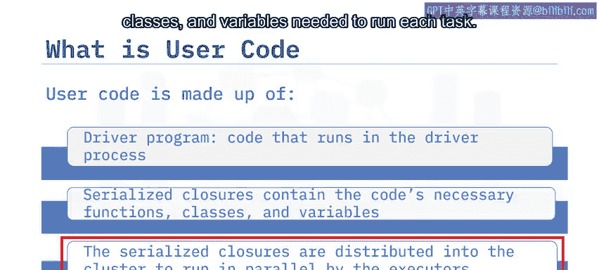

Spark usually immediately terminates when syntax serialization。

 data validation and other use errors occur Spark reports task errors to the driver and immediately cancels the related executor tasks terminating the application for example。

 closures are cleaned before being serialized， flushing out most issues right away and ensuring the closures can be serialized and executed remotely user code serialized as a closure might not error until after the user code runs on another executor process these errors could be due to runtime calculations。

 network communication issues or unexpected data issues If a task fails due to an error Spark can attempt to rerun the task for a set number of retries If all attempts to run the task fail Spark reports an error to the driver and the application is terminated the cause of an application failure can usually be found in the driver event log。

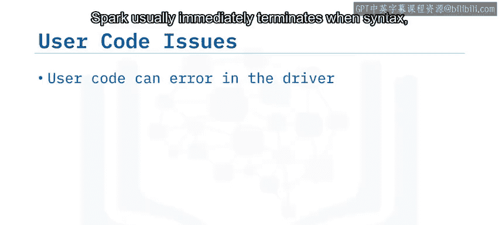

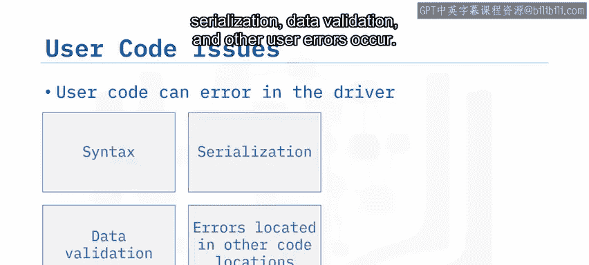

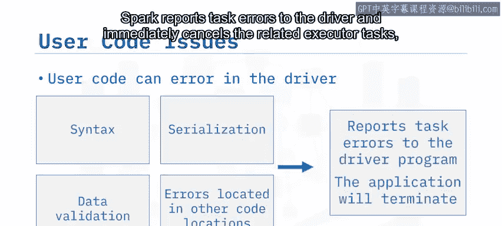

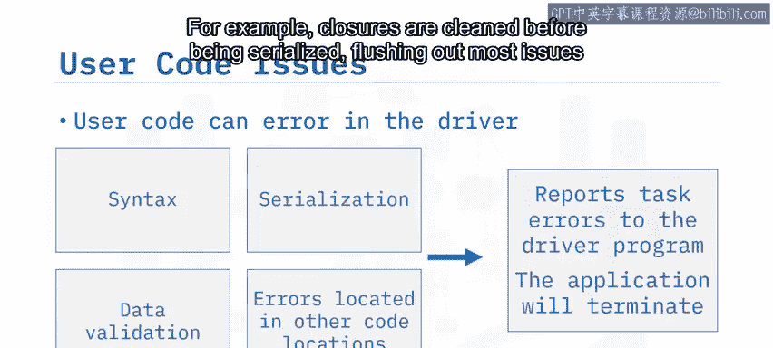

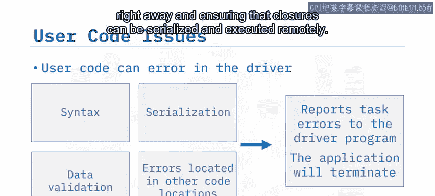

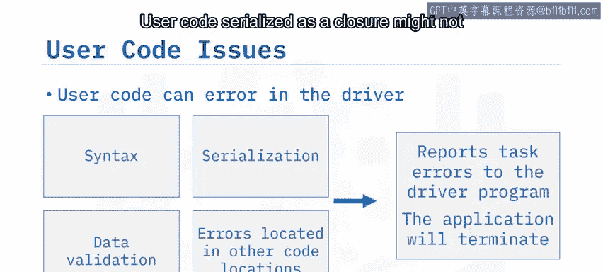

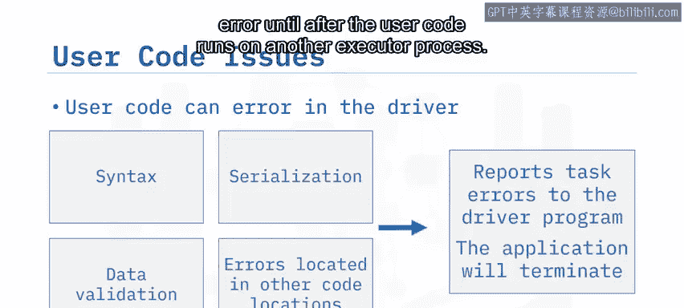

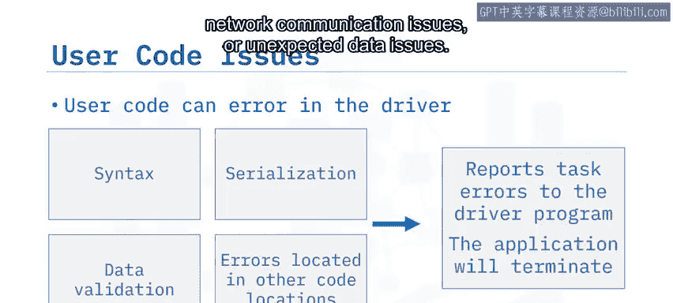

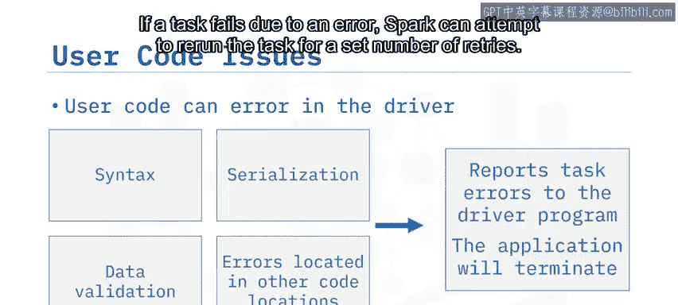

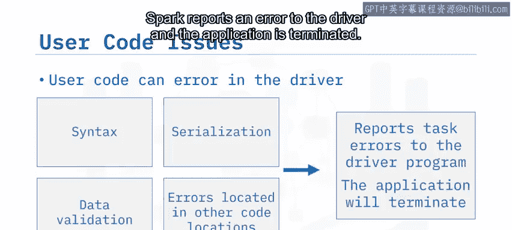

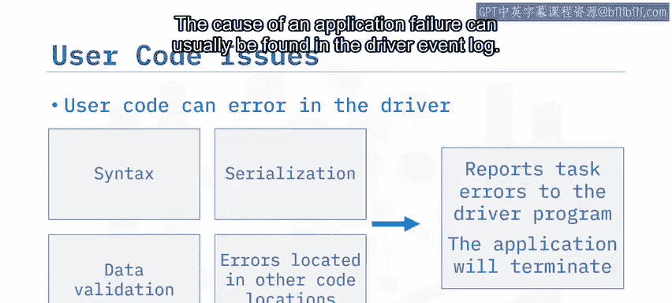

A Spar application can have many dependencies including application files such as Python script files。

 Java J files， and even required data files， applications also depends on the libraries used and their dependencies dependencies must be made available on all nodes of the cluster。

 either by pre-instlation or by including the dependencies in the Spark submit script bundled with the application or as additional arguments For example。

 a task will error if a Python library is not installed in the Python environment of the executor process。

 and even more subtle error can occur if a library is installed with different versions on executors that might have different APIs or produce unexpected results。

 the best way to identify this type of issue is by examining the event log for stack trace errors that identify which libraries the application loaded。

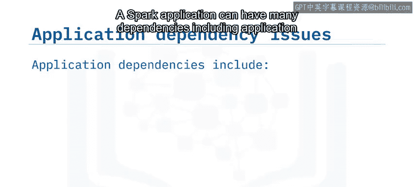

Application resources such as CPU course and memory can become an issue if a task is in the scheduling queue and the available workers do not have enough available resources to run the tasks as a worker finishes a task the CPU and memory and use are freed。

 allowing the scheduling of another task however， if the application asks for more resources that can never become available the tasks might never be run and eventually timeout Similarlyly suppose that the executors are running long tasks that never finish In that case。

 their are resources never become available， which also causes future tasks never to run。

 resulting in a timeout error， you can readily access these errors when you view the UI or event logs。

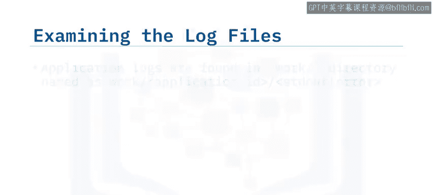

While the application UI provides a great deal of information。

 viewing the log files provides details to give more insights into possible application failure causes you'll find the application log files in the Spark In directory under work/ application ID where you will find one log file for STD out and one log file for STD Air output The application ID is a unique ID that Spark assigns to each application。

 these log files appear for each Executor and driver process that the application runs Additionally。

 if you're running a Spark standalone cluster， the master and workers both output log files to the log/lash directory under the Spark installation directory from where they run。

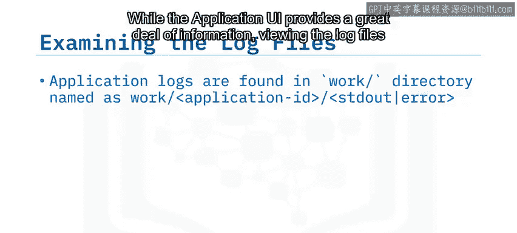

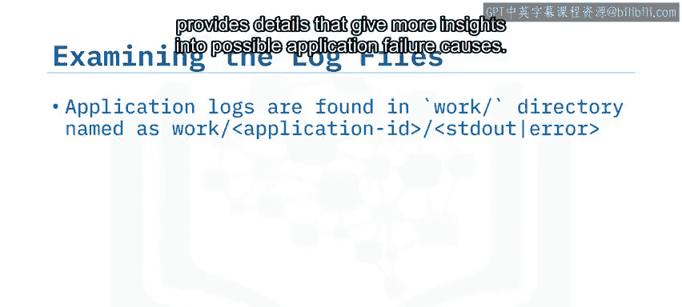

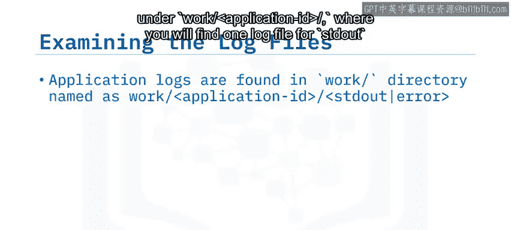

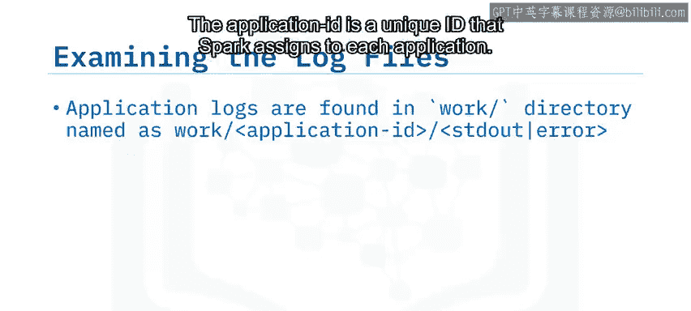

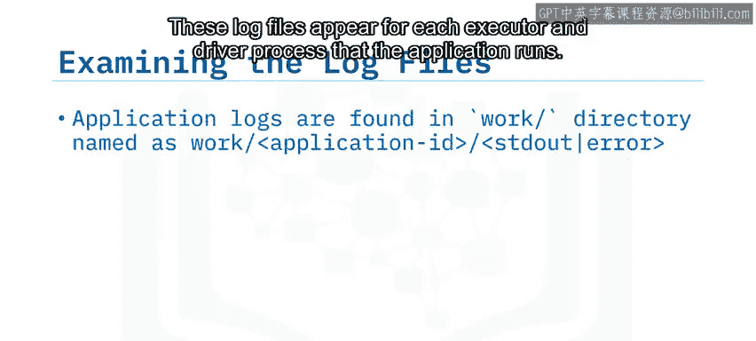

In this video， you learned that common reasons for application failure on a cluster include user code。

 system and application configurations， missing dependencies。

 improper resource allocation and network communications。

 application log files will often show the complete details of a failure。

 which are located in the Spark installation directory。

。

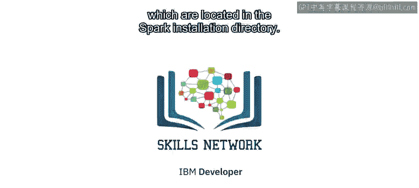