# IBM数据工程专业证书 课程11：《使用Spark和Hadoop进行大数据介绍》｜big-data-with-spark-hadoop｜ - P34：33_了解内存资源.zh_en - GPT中英字幕课程资源 - BV12h4y1D7hF

Welcome to Understanding memory Re for Apache Spark。

After watching this video， you'll be able to describe memory parameters。

 describe Spark memory management， describescribe Spark data persistence。

 Explain how to set executor memory on submit， Explain how to set memory for Spark standalone memory and core。

😊。

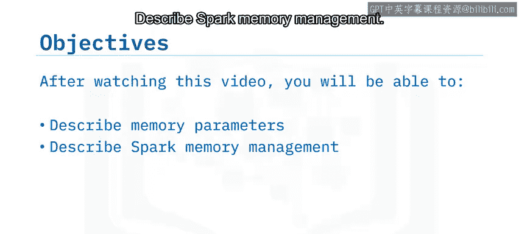

When running a Sp application， the driver and executor processes launch with an upper memory limit。

 the upper memory limit enables a Spar application to run without using all the available cluster memory。

 but this limit also requires that the memory limits are set high enough to perform necessary tasks an application runs best when processes complete within the requested memory。

 if the driver and executor processes exceed the memory requirements。

 this situation can result in poor performance with data spilling to disk or even out of memory errors。

Let's examine some memory setting considerations for both executors and drivers Executors use memory for processing and additional memory if caching is enabled。

 however， excessive caching can lead to out ofme errors Collecting data as a result of operations will be done in the driver driver memory loads the data broadcasts variables and handles results such as collections because large data sets can easily exceed the driver's memory capacity if collecting to the driver filter the data and use a subset of the data。

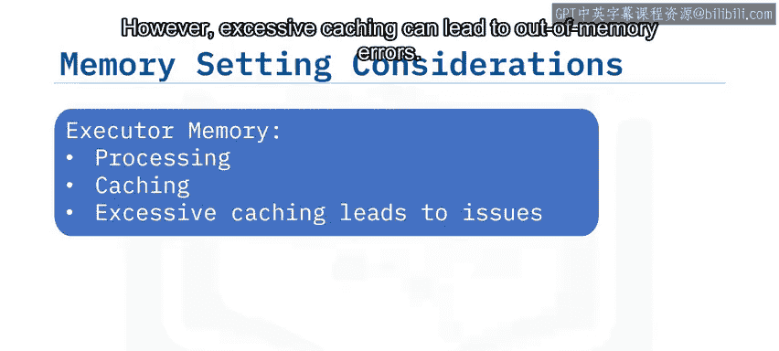

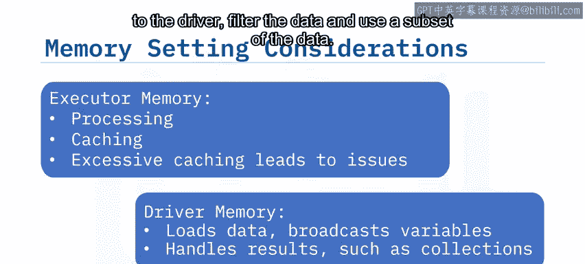

In Spk， executor memory and storage memory share a unified region shown in this Java heap space in the space labeled M。

 When no executor memory is used， storage can acquire all the available memory and vice versa。

 Executor memory can evict storage memory if necessary。

 but only until storage memory usage falls under a certain threshold。 In other words。

 R describes a subregion within M， where cached blocks are never evicted storage is not allowed to evict executor memory due to complexities in implementation。

 This design ensures several preferable properties。 First。

 applications that do not use caching can use the entire space for executor memory obviating unnecessary disk bills。

 Second， applications that do use caching can reserve a minimum storage space， the area labeled R。

 where there data blocks are immune to being evicted。 Lastly。

 this approach provides reasonable outof the box performance for a variety of workloads without。😊。

Requiring user expertise of how memory is divided internally。

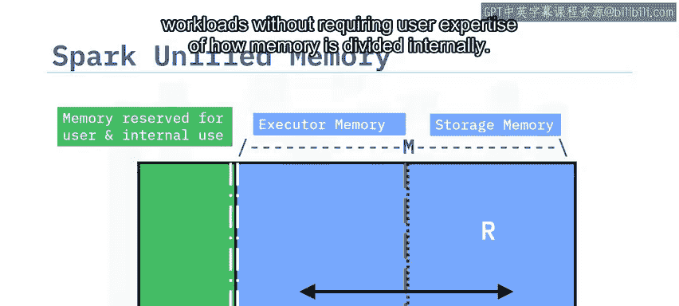

Next， let's explore data persistence in Spark data persistence or caching data in Spark means being able to store intermediate calculations for reuse by setting persistence in either or both memory and disk after the intermediate data is calculated to produce a new data frame and if memory is cached than any other operations on that data frame can reuse the same data。

 rather than reloading data from the source and recalculating all prior operations。

 this capability is essential to speed machine learning workloads that often require many iterations over the same data set when training a model。

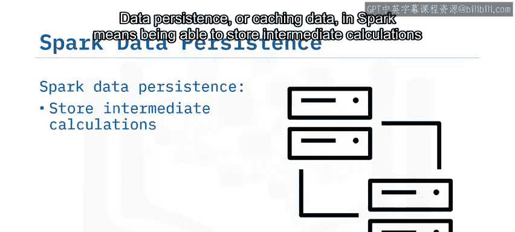

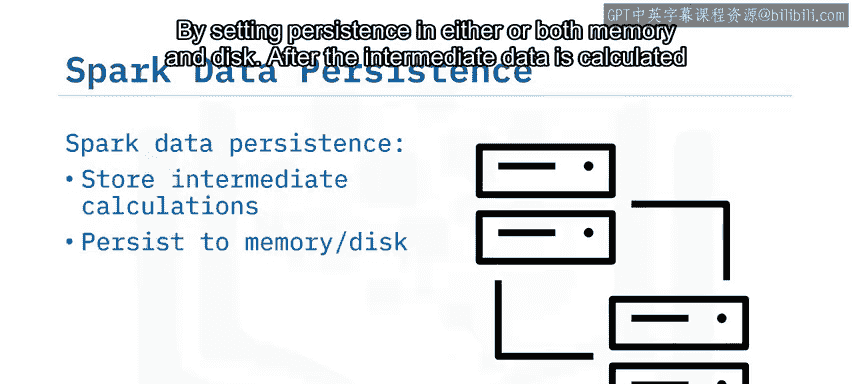

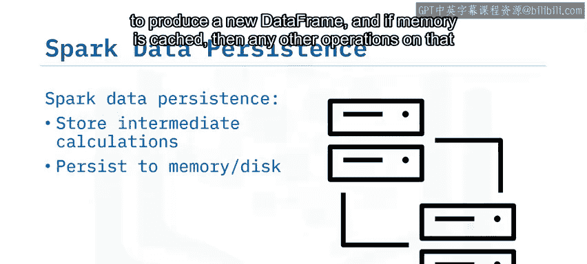

This sample Pibar code creates a data frame with column features consisting of random values After creating the data frame。

 the cache method is called to mark the random values to cache in memory Caching the data frame here means that the application only needs to generate random features once At this point。

 the random values are not yet generated Caching is done lazily after computing the values。

 In this example， the count action is invoked on the data frame which generates the values that are then stored in memory subsequent data frame calls can use the cached values which can save a great deal of computational time if the cost to recreate a data frame is high。

 If this data frame is not cached， then different random features would be generated with each action on the data frame because the function RA is called each time。

There are several ways to set the memory for executors in a cluster。

 such as setting a value in the properties file。 however。

 the more common practice is to specify a memory configuration when submitting the application to the cluster。

 you can tailor memory so that each application has enough memory to run effectively but does not use all available memory in the executor。

 This example configure the application to run on a spark standalone cluster and reserves 10 gigab per executor when running tasks。

 If using the Spar standalone cluster to manage and start a worker manually。

 you can specify the total memory and CPU course that the application can use。

 This specifications determine the resources available when worker start the executors。

 avoid assigning more resources than are available on the physical machine。 For instance。

 if the machine has a CPU with8 core and the worker starts with 16 core。

 too many threads might run simultaneously。

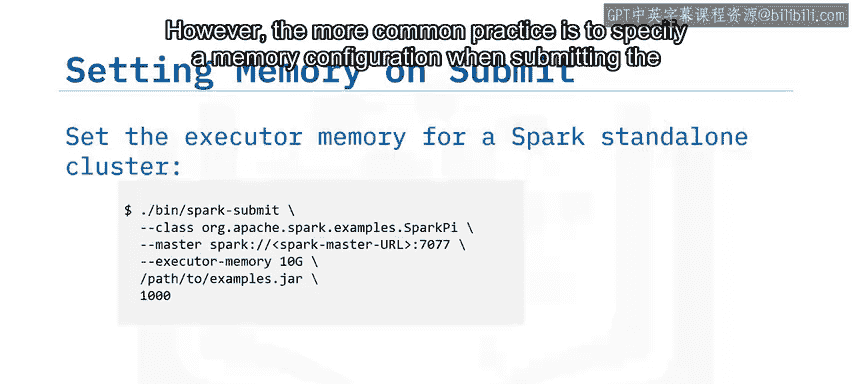

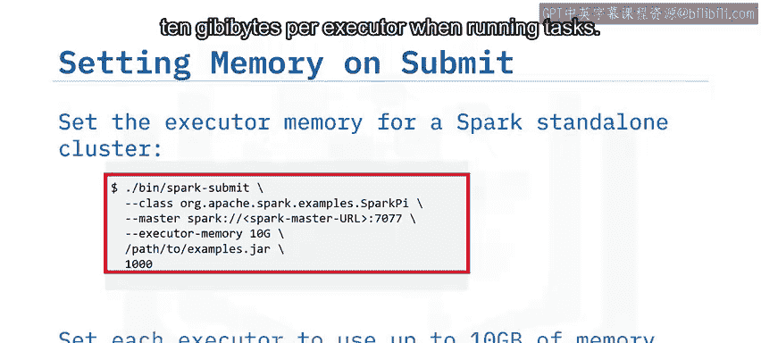

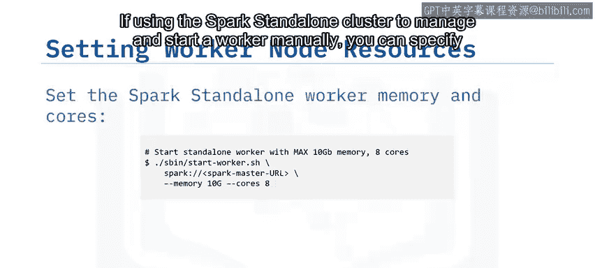

And cause performance degradation You can tailor memories so that each application has enough memory to run effectively。

 but does not use all available memory in the executor The default configuration is to use all available memory minus1 gigabyte for all available cores。

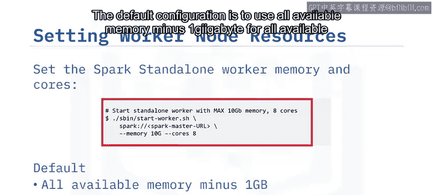

In this video， you learned that Spark has configurable memory for executor and driver processes。

 Executor memory and storage memory share a region that can be tuned as needed。

 Caching data can help improve application performance。😊。

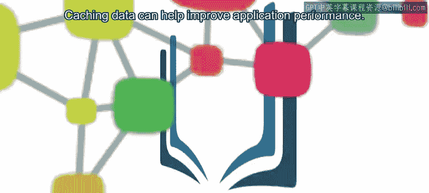