# IBM数据工程专业证书 课程11：《使用Spark和Hadoop进行大数据介绍》｜big-data-with-spark-hadoop｜ - P35：34_了解处理器资源.zh_en - GPT中英字幕课程资源 - BV12h4y1D7hF

Welcome to Understanding Proor Res for Apache Spark。

After watching this video， you'll be able to explain how Apache Spark uses processor Cos。

 describe how to use Spark to configure your cores for an application。

Just as with memory， CPUU cores are a resource assigned to both the driver and executor processes。

An executor can process tasks in parallel only up to the number of cores assigned to the application。

Once the application tasks finish processing， the cores no longer in use return to the available pool。

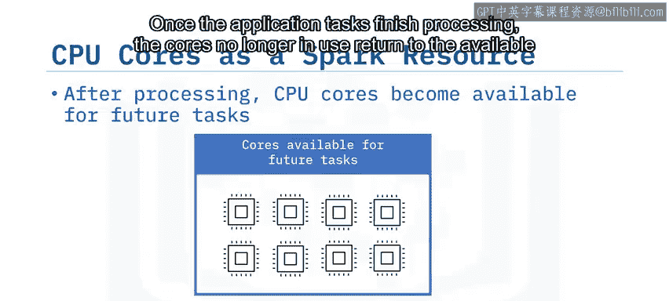

The workers in the cluster contain a limited number of cores if no cores are available to an application。

 the application must wait for currently running tasks to finish。

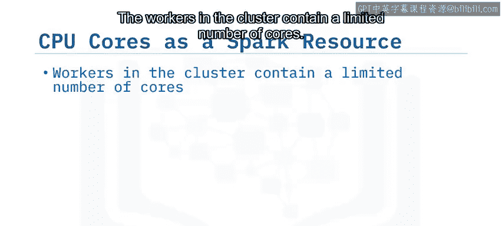

When Spark launches an application and creates tasks。

 Spark places those tasks in a scheduling queue Spark assigns tasks to any available executor。

 the default behavior is for each task that is ready to be scheduled to an executor with available course to maximize parallelism any remaining tasks will have to wait in the queue until more core become available if you provided specific settings for the number of cores such as configuring how many cores the executor uses。

 the application overrides the default behavior。

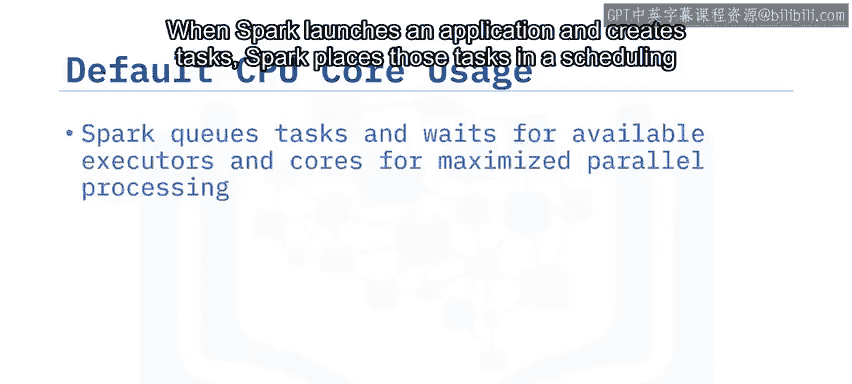

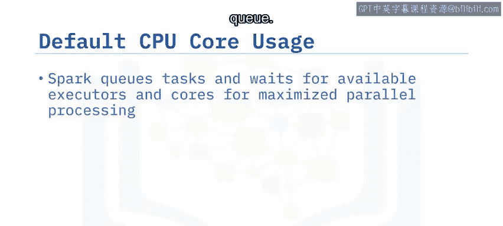

To configure executor course on application submission。

 use the argument Executor dash Cos followed by the specific number of cores required for the application tasks to run on an executor。

 as always， if the executor does not have the required number of cores available。

 tasks do not start until the specified number of cores are free or another executor becomes available。

Alternatively， the argument dash dash To dash Executor dash Co。

 followed by a number is the total amount of course throughout the cluster to use for the application。

 not per executor process tasks will be scheduled to executors whenever they have a free core until the total number of core reaches the specified value。

When starting a worker manually in a Sp standalone cluster。

 you can specify the number of cores the application uses by using the argument dash Cos。

 followed by the number of core Sparks default behavior is to use all available cores。

 a common practice is to start one worker per node。

 which under default behavior allows the worker to create one executor process with exactly the same number of threads as cores available to run tasks If another process is running on the same machine as the worker such as the master。

 then a good practice is to apply these settings to reduce the number of cores available to the worker specifying the total number of CPU core can reserve processing time available for the master process so essential operations are not blocked and timed out。

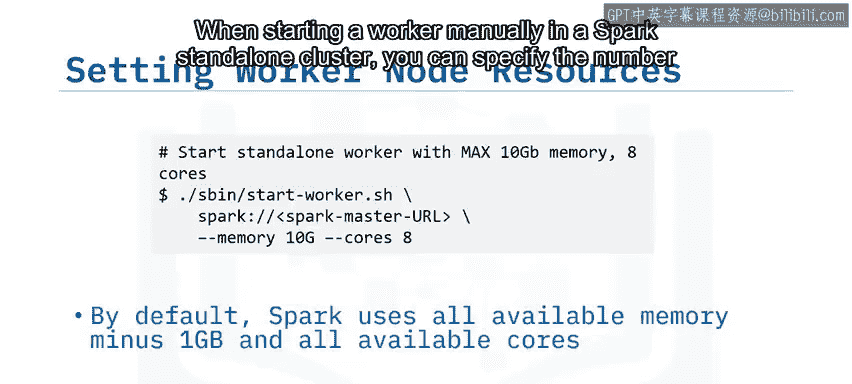

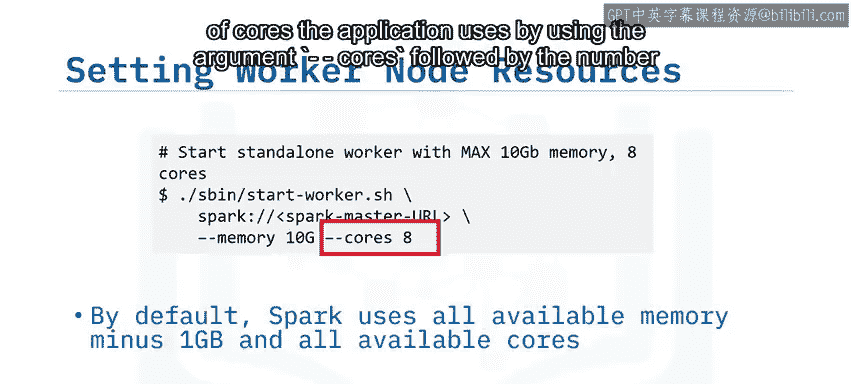

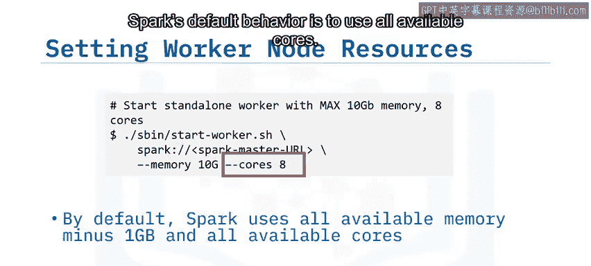

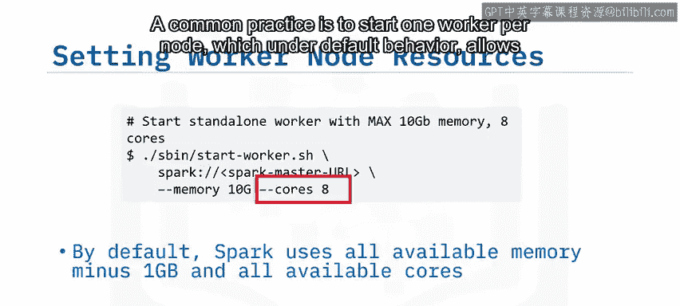

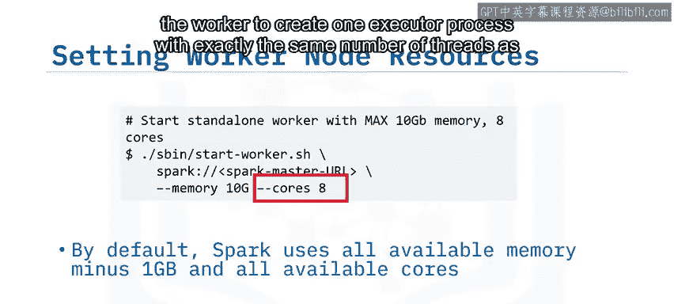

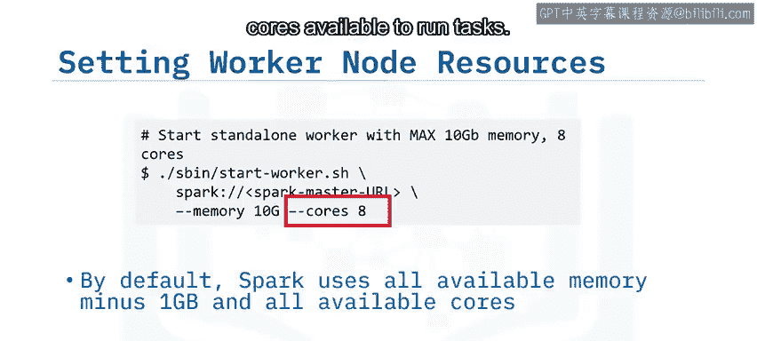

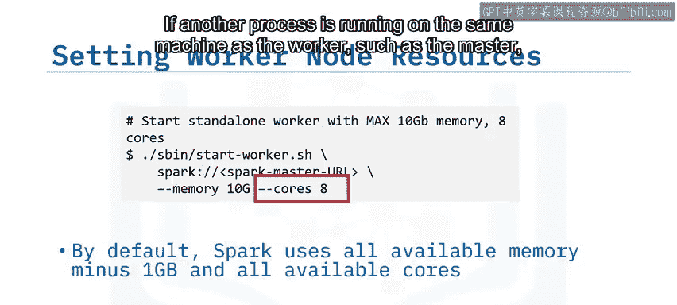

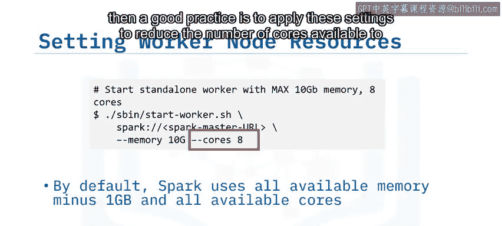

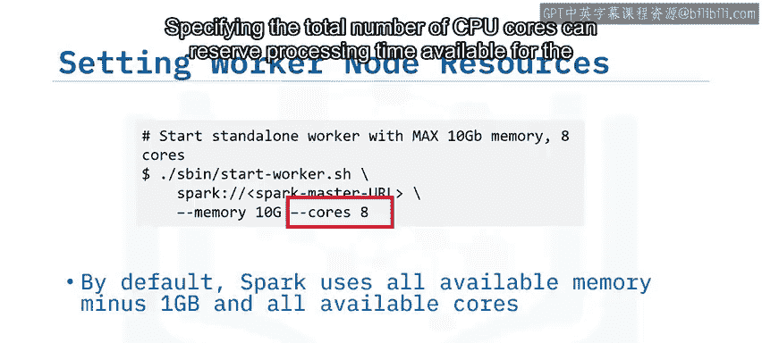

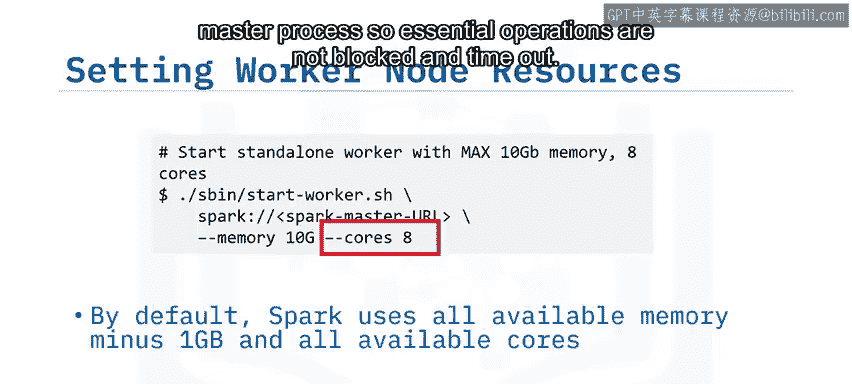

Let's look at another example that uses a small standalone cluster with one worker node and six cores This example uses two identical applications submitted to the same cluster in overlapping time one right after the other the first application is submitted to the cluster and requests four cores per executor the executor is currently idle with six cores available the first four tasks of the application are then scheduled to the executor and begin to run two cores of the executor remain available。

While the first application is running， the second application is submitted。

 the second application also requests four cores from the executor because tasks that belong to the first application are still running and are using four cores。

 only two cores are available， therefore， the second application must wait until the executor has at least four cores available as soon as any two tasks from the first application complete and four cores become available。

 the second application can begin。What if you start the second application and request only two course to run two tasks using this scenario you can submit a second application and two tasks immediately start however。

 the second application might take longer to finish because of running only two tasks at a time maximizing Spark application performance can be a tricky balance between configuration of application workloads and cluster resources and requires careful tuning of both the application and the clusters In this video you learned that Spark assigned CPUU course to driver and executor processes during application processing Executor' process tasks in parallel according to the number of course available or assigned by the application if using the Spark standalone cluster manager you can specify the total memory and CPUU course workers can use。

